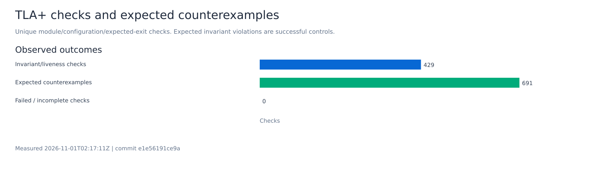
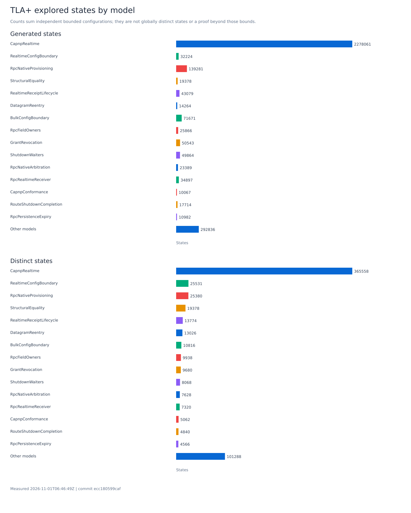

# Capntproto verification reports

[Project and supported APIs](https://github.com/DericHuynh/capntproto) · [Reporting contract](https://github.com/DericHuynh/capntproto/blob/main/docs/wiki/README-Reports.md)

This branch contains generated evidence only. See each result's measured commit
and workflow link before comparing it with a source checkout.

## Tests, coverage and benchmarks

Generated automatically from CI evidence. Each lane keeps its own measured commit and date; measurements from different commits are not combined into a single qualification claim.

### Cargo tests

Latest Cargo run: [2026-11-01T06:46:49Z · run 41282184234 / attempt 1](https://github.com/DericHuynh/capntproto/actions/runs/41282184234) · commit `ecc180599caf` · **success**

| Total | Passed | Failed | Errors | Skipped |
| ---: | ---: | ---: | ---: | ---: |
| 2749 | 2732 | [0](docs/reports/failed-tests.md) | 0 | 17 |

[Show all failed tests and diagnostics](docs/reports/failed-tests.md). Cargo tests and doctests exclude the dedicated TLA+, fuzz, Miri and mutation campaigns. Filtered tests are not counted as passes or skips. [Reporting contract](https://github.com/DericHuynh/capntproto/blob/main/docs/wiki/README-Reports.md).

### TLA+ models and Rust trace replays

[2026-11-01T06:46:49Z · run 41282184234 / attempt 1](https://github.com/DericHuynh/capntproto/actions/runs/41282184234) · commit `ecc180599caf` · **success**

Unique module&#47;configuration&#47;expected&#45;exit checks&#46; Expected invariant violations are successful controls&#46;

Counts sum independent bounded configurations&#59; they are not globally distinct states or a proof beyond those bounds&#46;

[Failed model replay tests](docs/reports/failed-models.md). Expected mutation counterexamples are successful checks, not unexpected failures.

### Fuzzing: libFuzzer and AFL++

[2026-11-01T06:46:49Z · run 41282184234 / attempt 1](https://github.com/DericHuynh/capntproto/actions/runs/41282184234) · commit `ecc180599caf` · **success**

Bounded campaigns including seed calibration&#59; execution counts are not comparable performance benchmarks&#46;

Engine&#45;local counters&#44; not LLVM source coverage&#46; Do not compare counts across engines or builds&#46;

Saved crashes&#47;hangs are findings requiring triage&#44; not confirmed unique bugs&#46; Missing results remain unknown&#46;

AFL++ guides the RPC lifecycle oracle with IJON state and progress annotations. Corpus inputs, crashes, hangs, logs and engine statistics are retained in the linked run. Fuzzer counters are not source coverage percentages.

### LLVM coverage

Latest coverage run: [2026-11-01T16:41:43Z · run 41327633446 / attempt 1](https://github.com/DericHuynh/capntproto/actions/runs/41327633446) · commit `af2eeeb4818f` · **failure**

No validated coverage/baseline comparison is available for the latest run. Missing or unmapped counters are never presented as 100% coverage.

### Linux loopback benchmark comparisons

Latest benchmark run: [2026-11-01T06:46:49Z · run 41282184234 / attempt 1](https://github.com/DericHuynh/capntproto/actions/runs/41282184234) · commit `ecc180599caf` · **success**

Measurement evidence: **passed**. Independently validated encrypted benchmark values&#46; Workflow status and diagnostic completion are separate&#59; unavailable values remain blank&#46; Operations include whole concurrent batches and every service hop&#46;

Separate client/server processes, one outstanding request, several payload sizes and five repetitions. Current TCP fixtures use TLS 1.3, including upstream Rust Cap’n Proto, C++, gRPC over HTTP/2 and WebSockets over WSS; native encrypted transports and standard QUIC are identified separately. Historical data retains its recorded fixture contract. The dedicated campaign also reports recursive data, concurrent calls and independent service chains for gRPC and binary Protobuf WebSockets in its encrypted comparison artifact. Bars compare the recorded workload, rather than universal protocol performance.

[Machine-readable history and exact plotted values](docs/reports/history.json). Full logs, raw samples and LLVM exports are retained in the linked workflow artifacts.

## Exhaustive benchmark tables

Measured run: [2026-11-01T06:46:49Z · run 41282184234 / attempt 1](https://github.com/DericHuynh/capntproto/actions/runs/41282184234) · commit `ecc180599caf` · **success**

All measured cases and implementations are listed. Minimum latency is the primary estimate; means and spread retain all repetitions. Run mean SD is not a confidence interval. Latency is per complete operation or concurrent batch. Profiler counters sum the client and every service hop. Dashes indicate unavailable values.

### All encrypted latency comparisons

| Transport | Case | Implementation | Samples | Minimum µs | Mean µs | Sample SD µs | Run mean SD µs | Run mean min µs | Run mean max µs | p50 µs | p95 µs | p99 µs |
| --- | --- | --- | --- | --- | --- | --- | --- | --- | --- | --- | --- | --- |
| tls | loopback&#45;0 | cpp | 5000 | 54.607 | 60.515 | 5.953 | 1.000 | 59.727 | 62.080 | 58.667 | 71.698 | 83.852 |
| tls | loopback&#45;0 | grpc | 5000 | 62.004 | 69.058 | 5.974 | 1.667 | 67.371 | 71.681 | 67.294 | 80.483 | 92.537 |
| tls | loopback&#45;0 | legacy | 5000 | 36.732 | 40.897 | 4.333 | 0.662 | 40.167 | 41.850 | 39.677 | 49.077 | 58.414 |
| tls | loopback&#45;0 | portable | 5000 | 37.421 | 43.028 | 6.041 | 2.702 | 41.153 | 47.810 | 40.676 | 55.814 | 64.645 |
| tls | loopback&#45;0 | websocket | 5000 | 29.711 | 36.790 | 4.030 | 0.176 | 36.552 | 36.994 | 35.961 | 43.562 | 51.838 |
| tls | loopback&#45;64 | cpp | 5000 | 54.753 | 90.385 | 24.040 | 25.954 | 61.761 | 109.437 | 106.440 | 119.653 | 125.459 |
| tls | loopback&#45;64 | grpc | 5000 | 64.841 | 106.433 | 18.484 | 19.425 | 71.692 | 115.514 | 112.364 | 127.446 | 133.169 |
| tls | loopback&#45;64 | legacy | 5000 | 36.974 | 59.066 | 10.528 | 10.308 | 40.630 | 63.964 | 62.164 | 72.492 | 80.303 |
| tls | loopback&#45;64 | portable | 5000 | 38.431 | 56.998 | 13.869 | 12.793 | 43.375 | 69.200 | 66.736 | 76.277 | 85.192 |
| tls | loopback&#45;64 | websocket | 5000 | 31.225 | 47.642 | 7.376 | 6.493 | 36.044 | 51.127 | 48.343 | 57.742 | 65.199 |
| tls | loopback&#45;1024 | cpp | 5000 | 56.715 | 83.315 | 25.380 | 27.455 | 61.709 | 113.456 | 69.589 | 120.051 | 129.601 |
| tls | loopback&#45;1024 | grpc | 5000 | 67.878 | 86.465 | 22.162 | 23.588 | 74.826 | 128.627 | 75.035 | 128.555 | 142.507 |
| tls | loopback&#45;1024 | legacy | 5000 | 38.868 | 47.898 | 10.615 | 10.806 | 42.431 | 67.207 | 42.410 | 66.803 | 77.551 |
| tls | loopback&#45;1024 | portable | 5000 | 40.191 | 55.894 | 14.675 | 15.437 | 44.403 | 73.018 | 46.777 | 75.370 | 87.449 |
| tls | loopback&#45;1024 | websocket | 5000 | 30.260 | 35.650 | 4.336 | 0.291 | 35.371 | 36.012 | 34.637 | 43.524 | 51.783 |
| tls | loopback&#45;65536 | cpp | 5000 | 236.514 | 306.972 | 73.622 | 72.452 | 253.205 | 414.288 | 261.222 | 425.801 | 442.576 |
| tls | loopback&#45;65536 | grpc | 5000 | 236.146 | 289.091 | 56.573 | 41.581 | 261.486 | 360.106 | 263.737 | 414.962 | 448.864 |
| tls | loopback&#45;65536 | legacy | 5000 | 160.990 | 190.672 | 40.015 | 43.478 | 168.891 | 268.388 | 170.838 | 275.551 | 287.913 |
| tls | loopback&#45;65536 | portable | 5000 | 168.861 | 200.674 | 42.206 | 45.531 | 178.472 | 282.057 | 179.498 | 288.357 | 302.498 |
| tls | loopback&#45;65536 | websocket | 5000 | 179.285 | 213.028 | 44.514 | 47.985 | 188.863 | 298.785 | 191.457 | 305.450 | 323.492 |
| tls | unary&#45;empty | cpp | 5000 | 54.322 | 60.628 | 6.165 | 0.780 | 59.451 | 61.493 | 58.618 | 72.334 | 84.167 |
| tls | unary&#45;empty | grpc | 5000 | 62.694 | 68.824 | 6.483 | 1.222 | 67.785 | 70.810 | 66.615 | 80.370 | 94.494 |
| tls | unary&#45;empty | legacy | 5000 | 36.284 | 40.441 | 4.343 | 0.721 | 39.813 | 41.531 | 39.036 | 48.956 | 57.842 |
| tls | unary&#45;empty | portable | 5000 | 38.174 | 42.158 | 4.397 | 0.408 | 41.723 | 42.682 | 40.807 | 50.934 | 59.908 |
| tls | unary&#45;empty | websocket | 5000 | 31.836 | 37.502 | 4.395 | 0.260 | 37.232 | 37.887 | 36.319 | 44.847 | 55.170 |
| tls | unary&#45;small | cpp | 5000 | 55.104 | 71.111 | 20.104 | 21.441 | 60.863 | 109.448 | 60.704 | 108.440 | 122.850 |
| tls | unary&#45;small | grpc | 5000 | 64.535 | 75.755 | 15.488 | 8.964 | 70.530 | 91.648 | 69.465 | 114.870 | 129.564 |
| tls | unary&#45;small | legacy | 5000 | 36.820 | 41.872 | 5.677 | 1.062 | 40.543 | 42.927 | 39.904 | 52.937 | 64.977 |
| tls | unary&#45;small | portable | 5000 | 37.800 | 42.308 | 4.654 | 0.610 | 41.372 | 42.944 | 40.828 | 51.294 | 60.619 |
| tls | unary&#45;small | websocket | 5000 | 31.034 | 36.586 | 4.415 | 0.556 | 35.989 | 37.460 | 35.604 | 44.600 | 53.072 |
| tls | unary&#45;1k | cpp | 5000 | 56.920 | 73.233 | 21.314 | 22.954 | 62.653 | 114.292 | 62.271 | 113.765 | 127.881 |
| tls | unary&#45;1k | grpc | 5000 | 68.982 | 91.664 | 24.187 | 22.726 | 76.826 | 130.928 | 78.577 | 133.849 | 145.957 |
| tls | unary&#45;1k | legacy | 5000 | 38.724 | 48.063 | 10.719 | 10.732 | 42.777 | 67.243 | 42.470 | 66.701 | 77.506 |
| tls | unary&#45;1k | portable | 5000 | 40.343 | 50.267 | 12.398 | 12.880 | 43.860 | 73.286 | 43.792 | 72.941 | 86.232 |
| tls | unary&#45;1k | websocket | 5000 | 30.460 | 39.556 | 8.638 | 8.243 | 35.288 | 54.278 | 35.822 | 58.383 | 64.282 |
| tls | fanout&#45;32 | cpp | 5000 | 438.089 | 492.009 | 53.485 | 19.795 | 473.729 | 525.015 | 478.389 | 604.581 | 760.740 |
| tls | fanout&#45;32 | grpc | 5000 | 815.267 | 857.583 | 19.970 | 3.184 | 852.628 | 860.836 | 854.616 | 887.120 | 926.151 |
| tls | fanout&#45;32 | legacy | 5000 | 177.040 | 189.551 | 10.689 | 0.977 | 188.769 | 191.079 | 186.156 | 208.832 | 227.400 |
| tls | fanout&#45;32 | portable | 5000 | 212.221 | 228.835 | 12.191 | 3.633 | 224.282 | 234.197 | 225.786 | 250.740 | 271.701 |
| tls | fanout&#45;32 | websocket | 5000 | 241.348 | 271.761 | 14.486 | 4.037 | 265.978 | 277.357 | 269.659 | 297.966 | 308.877 |
| tls | fanout&#45;128 | cpp | 5000 | 1601.964 | 1920.523 | 485.828 | 198.163 | 1758.200 | 2161.509 | 1723.473 | 3235.151 | 3478.868 |
| tls | fanout&#45;128 | grpc | 5000 | 3252.487 | 3862.688 | 724.794 | 694.110 | 3397.963 | 5002.782 | 3417.211 | 5149.289 | 5256.171 |
| tls | fanout&#45;128 | legacy | 5000 | 655.362 | 744.775 | 119.214 | 119.482 | 686.360 | 958.447 | 690.173 | 1010.727 | 1031.508 |
| tls | fanout&#45;128 | portable | 5000 | 812.235 | 864.585 | 48.876 | 11.609 | 855.761 | 884.792 | 849.034 | 953.276 | 1059.370 |
| tls | fanout&#45;128 | websocket | 5000 | 949.713 | 1018.559 | 31.207 | 16.056 | 1006.399 | 1046.655 | 1014.006 | 1065.011 | 1123.283 |
| tls | dependent&#45;read | cpp | 5000 | 126.917 | 166.335 | 50.174 | 53.895 | 137.176 | 262.182 | 140.061 | 269.479 | 277.879 |
| tls | dependent&#45;read | grpc | 5000 | 135.455 | 148.797 | 10.048 | 1.365 | 147.190 | 149.915 | 145.718 | 168.198 | 183.738 |
| tls | dependent&#45;read | legacy | 5000 | 81.479 | 99.288 | 21.794 | 23.254 | 87.562 | 140.853 | 88.392 | 142.443 | 155.134 |
| tls | dependent&#45;read | portable | 5000 | 101.161 | 125.673 | 32.966 | 35.703 | 109.174 | 189.531 | 108.915 | 194.755 | 206.774 |
| tls | dependent&#45;read | websocket | 5000 | 59.789 | 70.170 | 6.352 | 1.629 | 69.012 | 72.967 | 69.029 | 82.050 | 89.868 |
| tls | pipelined&#45;read | cpp | 5000 | 88.857 | 98.393 | 8.645 | 1.125 | 97.330 | 99.804 | 95.839 | 114.596 | 132.390 |
| tls | pipelined&#45;read | legacy | 5000 | 48.697 | 54.436 | 5.130 | 0.890 | 53.142 | 55.539 | 52.984 | 63.636 | 76.181 |
| tls | pipelined&#45;read | portable | 5000 | 74.320 | 81.366 | 7.526 | 1.109 | 80.075 | 82.718 | 78.885 | 94.854 | 112.546 |
| tls | write&#45;read | cpp | 5000 | 111.287 | 123.720 | 10.686 | 1.951 | 121.453 | 126.466 | 120.420 | 144.463 | 161.788 |
| tls | write&#45;read | grpc | 5000 | 136.274 | 149.243 | 9.398 | 0.774 | 148.364 | 150.325 | 146.378 | 168.502 | 183.465 |
| tls | write&#45;read | legacy | 5000 | 74.808 | 82.898 | 6.276 | 0.470 | 82.244 | 83.383 | 80.895 | 95.269 | 106.948 |
| tls | write&#45;read | portable | 5000 | 78.092 | 86.941 | 9.265 | 1.669 | 85.605 | 89.118 | 83.824 | 104.345 | 121.457 |
| tls | write&#45;read | websocket | 5000 | 60.144 | 70.394 | 6.579 | 0.765 | 69.320 | 71.267 | 69.319 | 81.791 | 92.043 |
| tls | callback | cpp | 5000 | 118.027 | 152.106 | 43.810 | 47.801 | 128.042 | 237.541 | 130.791 | 242.405 | 253.675 |
| tls | callback | grpc | 5000 | 70.612 | 89.067 | 19.397 | 17.625 | 77.117 | 118.864 | 78.205 | 123.035 | 133.422 |
| tls | callback | legacy | 5000 | 79.694 | 89.360 | 7.231 | 1.305 | 88.015 | 90.750 | 87.045 | 104.356 | 115.212 |
| tls | callback | portable | 5000 | 96.102 | 122.093 | 30.071 | 31.987 | 105.287 | 179.231 | 107.028 | 183.713 | 195.621 |
| tls | callback | websocket | 5000 | 58.601 | 75.121 | 13.595 | 13.280 | 68.214 | 98.813 | 69.604 | 103.143 | 111.137 |
| tls | bulk&#45;64k | cpp | 5000 | 234.699 | 259.266 | 16.381 | 6.341 | 253.118 | 269.254 | 255.447 | 288.378 | 317.615 |
| tls | bulk&#45;64k | grpc | 5000 | 237.323 | 274.927 | 21.970 | 10.468 | 265.391 | 291.453 | 270.977 | 314.854 | 337.306 |
| tls | bulk&#45;64k | legacy | 5000 | 161.959 | 172.928 | 10.914 | 1.983 | 171.159 | 176.211 | 169.582 | 188.739 | 207.955 |
| tls | bulk&#45;64k | portable | 5000 | 168.554 | 186.410 | 24.936 | 14.971 | 178.690 | 213.143 | 178.170 | 272.509 | 290.107 |
| tls | bulk&#45;64k | websocket | 5000 | 182.553 | 215.352 | 42.784 | 46.257 | 193.000 | 298.066 | 194.619 | 304.620 | 316.148 |
| tls | bulk&#45;256k | cpp | 5000 | 971.800 | 1037.888 | 35.483 | 8.167 | 1026.352 | 1048.470 | 1028.291 | 1103.185 | 1167.818 |
| tls | bulk&#45;256k | grpc | 5000 | 589.511 | 1121.992 | 331.936 | 288.427 | 725.016 | 1378.836 | 1176.916 | 1502.984 | 1556.543 |
| tls | bulk&#45;256k | legacy | 5000 | 475.352 | 515.530 | 40.260 | 15.003 | 507.084 | 542.286 | 506.032 | 585.514 | 704.025 |
| tls | bulk&#45;256k | portable | 5000 | 485.183 | 514.155 | 14.546 | 0.555 | 513.714 | 515.040 | 512.510 | 536.772 | 565.446 |
| tls | bulk&#45;256k | websocket | 5000 | 1142.904 | 1194.240 | 33.579 | 17.445 | 1177.353 | 1222.435 | 1186.287 | 1273.339 | 1324.033 |
| tls | bulk&#45;1m | cpp | 5000 | 3784.945 | 4518.164 | 832.873 | 829.970 | 4023.280 | 5977.270 | 4073.695 | 6041.966 | 6652.300 |
| tls | bulk&#45;1m | grpc | 5000 | 2422.597 | 4843.020 | 886.051 | 866.730 | 3811.183 | 6172.156 | 4858.062 | 6389.087 | 6684.286 |
| tls | bulk&#45;1m | legacy | 5000 | 1662.489 | 2068.477 | 200.656 | 200.179 | 1720.114 | 2186.276 | 2158.922 | 2242.310 | 2281.219 |
| tls | bulk&#45;1m | portable | 5000 | 1655.450 | 2045.341 | 246.476 | 253.054 | 1725.020 | 2232.854 | 2195.852 | 2282.055 | 2326.903 |
| tls | bulk&#45;1m | websocket | 5000 | 4631.238 | 5562.715 | 516.178 | 299.675 | 5217.835 | 5922.205 | 5457.923 | 6370.822 | 6614.427 |
| tls | bulk&#45;4m | cpp | 5000 | 16942.693 | 19261.091 | 2453.261 | 1152.055 | 18043.809 | 20586.811 | 18387.098 | 25513.470 | 25759.793 |
| tls | bulk&#45;4m | grpc | 5000 | 22382.143 | 29617.374 | 3444.912 | 3137.763 | 24082.214 | 31849.107 | 29250.129 | 33697.064 | 34220.782 |
| tls | bulk&#45;4m | legacy | 5000 | 8447.556 | 10405.511 | 873.764 | 849.865 | 8906.979 | 10976.472 | 10797.821 | 11115.968 | 11260.473 |
| tls | bulk&#45;4m | portable | 5000 | 8476.317 | 10584.064 | 782.268 | 611.216 | 9510.451 | 10947.494 | 10902.681 | 11153.544 | 11244.946 |
| tls | bulk&#45;4m | websocket | 5000 | 29677.110 | 33772.356 | 2862.406 | 1246.063 | 31892.808 | 35237.879 | 35651.931 | 37092.643 | 37397.580 |
| tls | deep&#45;8 | cpp | 5000 | 57.294 | 62.212 | 5.065 | 0.539 | 61.787 | 63.113 | 60.574 | 72.109 | 84.427 |
| tls | deep&#45;8 | grpc | 5000 | 75.661 | 82.570 | 6.464 | 0.760 | 81.777 | 83.602 | 80.742 | 93.929 | 107.047 |
| tls | deep&#45;8 | legacy | 5000 | 39.249 | 42.899 | 3.899 | 0.277 | 42.620 | 43.253 | 41.497 | 50.559 | 58.940 |
| tls | deep&#45;8 | portable | 5000 | 40.719 | 44.924 | 4.667 | 0.768 | 44.338 | 46.271 | 43.333 | 53.662 | 64.279 |
| tls | deep&#45;8 | websocket | 5000 | 34.926 | 43.725 | 5.671 | 0.511 | 43.143 | 44.251 | 42.812 | 53.735 | 61.413 |
| tls | deep&#45;32 | cpp | 5000 | 63.886 | 91.051 | 29.546 | 29.131 | 69.896 | 130.945 | 71.624 | 138.573 | 146.556 |
| tls | deep&#45;32 | grpc | 5000 | 93.081 | 122.884 | 38.665 | 41.914 | 101.033 | 197.426 | 102.564 | 202.699 | 213.806 |
| tls | deep&#45;32 | legacy | 5000 | 46.007 | 50.864 | 5.213 | 0.447 | 50.491 | 51.614 | 49.019 | 61.597 | 72.199 |
| tls | deep&#45;32 | portable | 5000 | 47.283 | 64.250 | 19.237 | 17.667 | 52.256 | 93.307 | 52.741 | 94.968 | 107.814 |
| tls | deep&#45;32 | websocket | 5000 | 53.282 | 73.365 | 19.952 | 20.549 | 62.849 | 110.034 | 64.631 | 115.811 | 125.160 |
| tls | concurrent&#45;32 | cpp | 5000 | 480.314 | 557.401 | 142.407 | 66.752 | 511.321 | 674.987 | 512.500 | 983.685 | 1118.149 |
| tls | concurrent&#45;32 | grpc | 5000 | 598.373 | 635.701 | 48.725 | 11.784 | 628.959 | 656.619 | 625.622 | 677.173 | 943.405 |
| tls | concurrent&#45;32 | legacy | 5000 | 122.610 | 134.855 | 10.346 | 1.672 | 132.168 | 136.536 | 132.135 | 154.048 | 174.028 |
| tls | concurrent&#45;32 | portable | 5000 | 152.636 | 167.378 | 10.381 | 3.801 | 162.792 | 171.664 | 165.705 | 182.976 | 202.222 |
| tls | concurrent&#45;32 | websocket | 5000 | 111.579 | 172.039 | 19.937 | 2.317 | 168.280 | 173.999 | 170.477 | 205.684 | 225.748 |
| tls | deep&#45;32&#45;concurrent&#45;32 | cpp | 5000 | 639.682 | 983.644 | 314.976 | 312.264 | 681.100 | 1326.328 | 737.354 | 1370.537 | 1398.657 |
| tls | deep&#45;32&#45;concurrent&#45;32 | grpc | 5000 | 1484.854 | 1917.673 | 496.947 | 479.116 | 1570.184 | 2620.162 | 1587.510 | 2806.379 | 2854.303 |
| tls | deep&#45;32&#45;concurrent&#45;32 | legacy | 5000 | 400.652 | 593.653 | 202.254 | 216.698 | 425.458 | 844.251 | 441.021 | 870.505 | 896.288 |
| tls | deep&#45;32&#45;concurrent&#45;32 | portable | 5000 | 432.582 | 686.463 | 173.164 | 169.726 | 461.045 | 818.707 | 808.255 | 851.672 | 867.223 |
| tls | deep&#45;32&#45;concurrent&#45;32 | websocket | 5000 | 681.232 | 952.530 | 235.265 | 245.519 | 743.566 | 1229.294 | 772.980 | 1263.590 | 1299.308 |
| tls | services&#45;4&#45;deep&#45;16 | cpp | 5000 | 474.870 | 522.231 | 22.419 | 5.095 | 514.612 | 526.983 | 520.829 | 556.545 | 591.606 |
| tls | services&#45;4&#45;deep&#45;16 | grpc | 5000 | 600.186 | 650.525 | 21.192 | 4.364 | 644.889 | 656.418 | 649.783 | 683.131 | 707.506 |
| tls | services&#45;4&#45;deep&#45;16 | legacy | 5000 | 342.471 | 379.243 | 18.101 | 5.702 | 371.044 | 386.226 | 377.180 | 410.781 | 427.761 |
| tls | services&#45;4&#45;deep&#45;16 | portable | 5000 | 387.387 | 425.512 | 57.175 | 7.968 | 417.639 | 438.007 | 421.662 | 456.074 | 478.415 |
| tls | services&#45;4&#45;deep&#45;16 | websocket | 5000 | 275.224 | 355.225 | 38.465 | 4.846 | 349.073 | 362.234 | 352.353 | 420.176 | 442.712 |
| tls | services&#45;4&#45;deep&#45;16&#45;concurrent&#45;32 | cpp | 5000 | 3252.410 | 3991.130 | 252.317 | 70.635 | 3867.670 | 4038.709 | 3970.287 | 4442.671 | 4697.951 |
| tls | services&#45;4&#45;deep&#45;16&#45;concurrent&#45;32 | grpc | 5000 | 4939.052 | 5973.898 | 339.011 | 165.922 | 5705.612 | 6137.528 | 5986.707 | 6549.604 | 6782.135 |
| tls | services&#45;4&#45;deep&#45;16&#45;concurrent&#45;32 | legacy | 5000 | 1795.581 | 2084.018 | 124.385 | 37.406 | 2042.849 | 2144.957 | 2050.094 | 2324.653 | 2460.700 |
| tls | services&#45;4&#45;deep&#45;16&#45;concurrent&#45;32 | portable | 5000 | 1949.233 | 2227.669 | 151.108 | 42.534 | 2186.878 | 2286.088 | 2217.155 | 2483.682 | 2602.149 |
| tls | services&#45;4&#45;deep&#45;16&#45;concurrent&#45;32 | websocket | 5000 | 1640.396 | 1993.123 | 79.690 | 7.083 | 1986.834 | 2002.836 | 1990.951 | 2126.005 | 2192.749 |
| tls | services&#45;4&#45;deep&#45;16&#45;clients&#45;8 | cpp | 5000 | 2696.115 | 3620.383 | 427.563 | 59.511 | 3553.179 | 3708.298 | 3628.733 | 4242.363 | 4447.014 |
| tls | services&#45;4&#45;deep&#45;16&#45;clients&#45;8 | grpc | 5000 | 4562.250 | 5778.413 | 503.221 | 114.492 | 5605.523 | 5927.848 | 5769.533 | 6640.507 | 6961.472 |
| tls | services&#45;4&#45;deep&#45;16&#45;clients&#45;8 | legacy | 5000 | 1484.837 | 2136.373 | 134.359 | 38.773 | 2094.101 | 2190.618 | 2129.090 | 2356.308 | 2487.223 |
| tls | services&#45;4&#45;deep&#45;16&#45;clients&#45;8 | portable | 5000 | 1854.830 | 2363.540 | 143.575 | 76.897 | 2286.383 | 2484.668 | 2354.733 | 2609.185 | 2718.776 |
| tls | services&#45;4&#45;deep&#45;16&#45;clients&#45;8 | websocket | 5000 | 1501.440 | 1817.276 | 132.142 | 46.402 | 1778.675 | 1897.678 | 1807.343 | 2047.934 | 2146.881 |
| tls | services&#45;8&#45;deep&#45;16&#45;clients&#45;8 | cpp | 5000 | 5192.379 | 7722.011 | 711.777 | 233.261 | 7440.733 | 7941.701 | 7873.492 | 8618.093 | 8996.624 |
| tls | services&#45;8&#45;deep&#45;16&#45;clients&#45;8 | grpc | 5000 | 8658.226 | 10978.097 | 1454.087 | 496.124 | 10533.634 | 11803.885 | 10796.278 | 13280.893 | 13788.004 |
| tls | services&#45;8&#45;deep&#45;16&#45;clients&#45;8 | legacy | 5000 | 3354.843 | 4604.140 | 249.076 | 72.699 | 4497.862 | 4671.670 | 4595.967 | 5017.888 | 5207.411 |
| tls | services&#45;8&#45;deep&#45;16&#45;clients&#45;8 | portable | 5000 | 4101.094 | 5010.494 | 195.800 | 69.833 | 4963.693 | 5132.802 | 4995.589 | 5355.452 | 5544.007 |
| tls | services&#45;8&#45;deep&#45;16&#45;clients&#45;8 | websocket | 5000 | 2713.956 | 3397.679 | 264.579 | 24.229 | 3357.783 | 3418.423 | 3348.501 | 3895.683 | 4176.873 |
| quic | loopback&#45;0 | legacy | 5000 | 49.869 | 56.265 | 7.709 | 1.324 | 54.703 | 58.283 | 54.670 | 66.354 | 74.911 |
| quic | loopback&#45;0 | portable | 5000 | 54.151 | 60.988 | 5.969 | 0.415 | 60.333 | 61.369 | 59.329 | 71.696 | 81.268 |
| quic | loopback&#45;64 | legacy | 5000 | 49.670 | 55.867 | 5.864 | 0.789 | 54.740 | 56.885 | 54.340 | 65.990 | 74.236 |
| quic | loopback&#45;64 | portable | 5000 | 53.983 | 59.818 | 5.765 | 0.702 | 58.785 | 60.596 | 58.211 | 69.850 | 78.188 |
| quic | loopback&#45;1024 | legacy | 5000 | 51.643 | 56.980 | 6.042 | 0.527 | 56.291 | 57.686 | 55.440 | 66.427 | 75.908 |
| quic | loopback&#45;1024 | portable | 5000 | 56.381 | 62.119 | 5.292 | 0.544 | 61.437 | 62.846 | 60.542 | 71.910 | 80.250 |
| quic | loopback&#45;65536 | legacy | 5000 | 210.264 | 226.526 | 17.710 | 4.161 | 224.428 | 233.956 | 222.115 | 249.147 | 294.610 |
| quic | loopback&#45;65536 | portable | 5000 | 220.370 | 247.254 | 40.291 | 28.246 | 233.329 | 297.729 | 233.391 | 362.067 | 374.455 |
| quic | unary&#45;empty | legacy | 5000 | 49.520 | 55.184 | 5.909 | 0.622 | 54.550 | 56.203 | 53.662 | 64.985 | 75.008 |
| quic | unary&#45;empty | portable | 5000 | 54.298 | 60.293 | 6.168 | 0.722 | 59.312 | 60.992 | 58.507 | 70.947 | 81.051 |
| quic | unary&#45;small | legacy | 5000 | 48.898 | 55.546 | 5.794 | 1.259 | 53.824 | 56.738 | 54.030 | 65.428 | 74.809 |
| quic | unary&#45;small | portable | 5000 | 54.382 | 60.345 | 5.812 | 0.999 | 59.335 | 61.410 | 58.651 | 71.081 | 81.890 |
| quic | unary&#45;1k | legacy | 5000 | 51.613 | 62.335 | 13.753 | 10.631 | 56.989 | 81.341 | 56.297 | 91.358 | 104.621 |
| quic | unary&#45;1k | portable | 5000 | 56.265 | 70.909 | 18.712 | 19.977 | 61.387 | 106.628 | 61.240 | 106.590 | 120.465 |
| quic | fanout&#45;32 | legacy | 5000 | 213.666 | 299.683 | 88.430 | 96.871 | 226.449 | 406.973 | 238.194 | 432.173 | 447.573 |
| quic | fanout&#45;32 | portable | 5000 | 250.469 | 336.179 | 87.379 | 96.252 | 263.506 | 442.578 | 273.550 | 458.798 | 478.596 |
| quic | fanout&#45;128 | legacy | 5000 | 682.557 | 1027.869 | 124.207 | 90.557 | 873.769 | 1113.569 | 1071.414 | 1168.215 | 1229.215 |
| quic | fanout&#45;128 | portable | 5000 | 878.512 | 1266.410 | 191.865 | 190.757 | 929.604 | 1399.726 | 1340.328 | 1484.601 | 1572.376 |
| quic | dependent&#45;read | legacy | 5000 | 108.295 | 119.921 | 11.713 | 1.658 | 117.693 | 122.344 | 117.389 | 135.466 | 148.267 |
| quic | dependent&#45;read | portable | 5000 | 140.541 | 153.973 | 13.655 | 3.293 | 151.515 | 159.575 | 150.766 | 172.632 | 188.985 |
| quic | pipelined&#45;read | legacy | 5000 | 62.558 | 68.781 | 5.217 | 0.757 | 67.660 | 69.509 | 67.225 | 78.839 | 90.102 |
| quic | pipelined&#45;read | portable | 5000 | 98.090 | 105.268 | 8.823 | 0.698 | 104.300 | 105.982 | 102.308 | 119.409 | 133.227 |
| quic | write&#45;read | legacy | 5000 | 102.039 | 121.270 | 23.736 | 17.197 | 111.589 | 151.921 | 112.290 | 179.666 | 194.611 |
| quic | write&#45;read | portable | 5000 | 110.730 | 121.573 | 9.241 | 0.699 | 121.075 | 122.795 | 119.353 | 136.993 | 149.761 |
| quic | callback | legacy | 5000 | 107.153 | 117.694 | 8.074 | 1.037 | 116.411 | 118.953 | 115.573 | 131.973 | 145.004 |
| quic | callback | portable | 5000 | 134.762 | 147.206 | 9.789 | 2.017 | 145.207 | 150.410 | 144.130 | 165.883 | 181.020 |
| quic | bulk&#45;64k | legacy | 5000 | 211.049 | 225.514 | 12.547 | 0.776 | 224.776 | 226.644 | 221.965 | 246.840 | 267.609 |
| quic | bulk&#45;64k | portable | 5000 | 214.333 | 230.115 | 11.348 | 1.822 | 228.150 | 232.373 | 226.744 | 252.199 | 264.065 |
| quic | bulk&#45;256k | legacy | 5000 | 533.047 | 569.822 | 387.287 | 13.700 | 561.421 | 593.984 | 561.254 | 590.958 | 627.194 |
| quic | bulk&#45;256k | portable | 5000 | 554.077 | 585.249 | 18.436 | 2.329 | 582.385 | 587.695 | 582.233 | 614.897 | 644.043 |
| quic | bulk&#45;1m | legacy | 5000 | 1941.756 | 2285.565 | 378.932 | 312.691 | 2049.747 | 2788.892 | 2087.961 | 2995.790 | 3104.417 |
| quic | bulk&#45;1m | portable | 5000 | 1946.990 | 2314.053 | 559.469 | 410.200 | 2109.181 | 3047.286 | 2113.443 | 3118.208 | 3236.260 |
| quic | bulk&#45;4m | legacy | 5000 | 9733.649 | 10864.364 | 1421.249 | 947.248 | 10136.674 | 12477.893 | 10374.355 | 14307.640 | 14467.568 |
| quic | bulk&#45;4m | portable | 5000 | 10139.940 | 11935.151 | 1934.343 | 1181.133 | 10625.129 | 13192.671 | 10778.925 | 14806.554 | 15015.012 |
| quic | deep&#45;8 | legacy | 5000 | 51.981 | 58.999 | 5.839 | 1.706 | 56.821 | 60.903 | 57.506 | 69.462 | 81.238 |
| quic | deep&#45;8 | portable | 5000 | 56.788 | 63.847 | 5.635 | 1.101 | 62.705 | 65.439 | 62.099 | 74.664 | 86.176 |
| quic | deep&#45;32 | legacy | 5000 | 60.097 | 66.820 | 6.094 | 1.129 | 66.006 | 68.739 | 64.980 | 77.690 | 91.675 |
| quic | deep&#45;32 | portable | 5000 | 64.411 | 71.621 | 6.312 | 0.551 | 70.870 | 72.249 | 69.725 | 82.802 | 95.657 |
| quic | concurrent&#45;32 | legacy | 5000 | 139.683 | 153.766 | 10.006 | 0.939 | 152.709 | 155.259 | 150.774 | 172.332 | 194.329 |
| quic | concurrent&#45;32 | portable | 5000 | 172.325 | 190.069 | 17.317 | 7.902 | 183.724 | 200.199 | 185.325 | 224.588 | 255.735 |
| quic | deep&#45;32&#45;concurrent&#45;32 | legacy | 5000 | 457.040 | 633.718 | 204.935 | 178.385 | 475.570 | 892.732 | 481.104 | 917.473 | 930.875 |
| quic | deep&#45;32&#45;concurrent&#45;32 | portable | 5000 | 488.539 | 590.993 | 157.957 | 161.686 | 503.915 | 877.291 | 507.782 | 898.673 | 914.813 |
| quic | services&#45;4&#45;deep&#45;16 | legacy | 5000 | 516.200 | 548.655 | 15.458 | 2.703 | 546.917 | 553.411 | 548.003 | 573.906 | 590.130 |
| quic | services&#45;4&#45;deep&#45;16 | portable | 5000 | 497.440 | 534.688 | 20.211 | 11.094 | 526.014 | 548.538 | 532.871 | 563.956 | 587.463 |
| quic | services&#45;4&#45;deep&#45;16&#45;concurrent&#45;32 | legacy | 5000 | 2173.008 | 2521.168 | 148.080 | 81.496 | 2456.680 | 2663.058 | 2505.235 | 2805.243 | 2918.896 |
| quic | services&#45;4&#45;deep&#45;16&#45;concurrent&#45;32 | portable | 5000 | 2168.949 | 2548.301 | 143.607 | 77.070 | 2414.704 | 2600.756 | 2547.951 | 2789.735 | 2916.851 |
| quic | services&#45;4&#45;deep&#45;16&#45;clients&#45;8 | legacy | 5000 | 2197.858 | 2599.835 | 154.517 | 36.732 | 2544.542 | 2640.288 | 2560.737 | 2889.241 | 3013.863 |
| quic | services&#45;4&#45;deep&#45;16&#45;clients&#45;8 | portable | 5000 | 1995.747 | 2554.344 | 253.376 | 125.283 | 2408.996 | 2740.977 | 2615.403 | 2948.159 | 3054.321 |
| quic | services&#45;8&#45;deep&#45;16&#45;clients&#45;8 | legacy | 5000 | 4082.159 | 5667.613 | 491.085 | 166.846 | 5489.701 | 5894.478 | 5745.894 | 6383.742 | 6945.085 |
| quic | services&#45;8&#45;deep&#45;16&#45;clients&#45;8 | portable | 5000 | 3844.945 | 5209.984 | 637.110 | 374.044 | 4572.388 | 5559.816 | 5253.084 | 6120.927 | 6438.362 |

### Unsupported comparison cells

| Transport | Case | Implementation | Status |
| --- | --- | --- | --- |
| tls | pipelined&#45;read | grpc | Unsupported by this fixture&#47;protocol |
| tls | pipelined&#45;read | websocket | Unsupported by this fixture&#47;protocol |
| quic | loopback&#45;0 | cpp | Unsupported by this fixture&#47;protocol |
| quic | loopback&#45;64 | cpp | Unsupported by this fixture&#47;protocol |
| quic | loopback&#45;1024 | cpp | Unsupported by this fixture&#47;protocol |
| quic | loopback&#45;65536 | cpp | Unsupported by this fixture&#47;protocol |
| quic | unary&#45;empty | cpp | Unsupported by this fixture&#47;protocol |
| quic | unary&#45;small | cpp | Unsupported by this fixture&#47;protocol |
| quic | unary&#45;1k | cpp | Unsupported by this fixture&#47;protocol |
| quic | fanout&#45;32 | cpp | Unsupported by this fixture&#47;protocol |
| quic | fanout&#45;128 | cpp | Unsupported by this fixture&#47;protocol |
| quic | dependent&#45;read | cpp | Unsupported by this fixture&#47;protocol |
| quic | pipelined&#45;read | cpp | Unsupported by this fixture&#47;protocol |
| quic | write&#45;read | cpp | Unsupported by this fixture&#47;protocol |
| quic | callback | cpp | Unsupported by this fixture&#47;protocol |
| quic | bulk&#45;64k | cpp | Unsupported by this fixture&#47;protocol |
| quic | bulk&#45;256k | cpp | Unsupported by this fixture&#47;protocol |
| quic | bulk&#45;1m | cpp | Unsupported by this fixture&#47;protocol |
| quic | bulk&#45;4m | cpp | Unsupported by this fixture&#47;protocol |
| quic | deep&#45;8 | cpp | Unsupported by this fixture&#47;protocol |
| quic | deep&#45;32 | cpp | Unsupported by this fixture&#47;protocol |
| quic | concurrent&#45;32 | cpp | Unsupported by this fixture&#47;protocol |
| quic | deep&#45;32&#45;concurrent&#45;32 | cpp | Unsupported by this fixture&#47;protocol |
| quic | services&#45;4&#45;deep&#45;16 | cpp | Unsupported by this fixture&#47;protocol |
| quic | services&#45;4&#45;deep&#45;16&#45;concurrent&#45;32 | cpp | Unsupported by this fixture&#47;protocol |
| quic | services&#45;4&#45;deep&#45;16&#45;clients&#45;8 | cpp | Unsupported by this fixture&#47;protocol |
| quic | services&#45;8&#45;deep&#45;16&#45;clients&#45;8 | cpp | Unsupported by this fixture&#47;protocol |
| quic | loopback&#45;0 | grpc | Unsupported by this fixture&#47;protocol |
| quic | loopback&#45;64 | grpc | Unsupported by this fixture&#47;protocol |
| quic | loopback&#45;1024 | grpc | Unsupported by this fixture&#47;protocol |
| quic | loopback&#45;65536 | grpc | Unsupported by this fixture&#47;protocol |
| quic | unary&#45;empty | grpc | Unsupported by this fixture&#47;protocol |
| quic | unary&#45;small | grpc | Unsupported by this fixture&#47;protocol |
| quic | unary&#45;1k | grpc | Unsupported by this fixture&#47;protocol |
| quic | fanout&#45;32 | grpc | Unsupported by this fixture&#47;protocol |
| quic | fanout&#45;128 | grpc | Unsupported by this fixture&#47;protocol |
| quic | dependent&#45;read | grpc | Unsupported by this fixture&#47;protocol |
| quic | pipelined&#45;read | grpc | Unsupported by this fixture&#47;protocol |
| quic | write&#45;read | grpc | Unsupported by this fixture&#47;protocol |
| quic | callback | grpc | Unsupported by this fixture&#47;protocol |
| quic | bulk&#45;64k | grpc | Unsupported by this fixture&#47;protocol |
| quic | bulk&#45;256k | grpc | Unsupported by this fixture&#47;protocol |
| quic | bulk&#45;1m | grpc | Unsupported by this fixture&#47;protocol |
| quic | bulk&#45;4m | grpc | Unsupported by this fixture&#47;protocol |
| quic | deep&#45;8 | grpc | Unsupported by this fixture&#47;protocol |
| quic | deep&#45;32 | grpc | Unsupported by this fixture&#47;protocol |
| quic | concurrent&#45;32 | grpc | Unsupported by this fixture&#47;protocol |
| quic | deep&#45;32&#45;concurrent&#45;32 | grpc | Unsupported by this fixture&#47;protocol |
| quic | services&#45;4&#45;deep&#45;16 | grpc | Unsupported by this fixture&#47;protocol |
| quic | services&#45;4&#45;deep&#45;16&#45;concurrent&#45;32 | grpc | Unsupported by this fixture&#47;protocol |
| quic | services&#45;4&#45;deep&#45;16&#45;clients&#45;8 | grpc | Unsupported by this fixture&#47;protocol |
| quic | services&#45;8&#45;deep&#45;16&#45;clients&#45;8 | grpc | Unsupported by this fixture&#47;protocol |
| quic | loopback&#45;0 | websocket | Unsupported by this fixture&#47;protocol |
| quic | loopback&#45;64 | websocket | Unsupported by this fixture&#47;protocol |
| quic | loopback&#45;1024 | websocket | Unsupported by this fixture&#47;protocol |
| quic | loopback&#45;65536 | websocket | Unsupported by this fixture&#47;protocol |
| quic | unary&#45;empty | websocket | Unsupported by this fixture&#47;protocol |
| quic | unary&#45;small | websocket | Unsupported by this fixture&#47;protocol |
| quic | unary&#45;1k | websocket | Unsupported by this fixture&#47;protocol |
| quic | fanout&#45;32 | websocket | Unsupported by this fixture&#47;protocol |
| quic | fanout&#45;128 | websocket | Unsupported by this fixture&#47;protocol |
| quic | dependent&#45;read | websocket | Unsupported by this fixture&#47;protocol |
| quic | pipelined&#45;read | websocket | Unsupported by this fixture&#47;protocol |
| quic | write&#45;read | websocket | Unsupported by this fixture&#47;protocol |
| quic | callback | websocket | Unsupported by this fixture&#47;protocol |
| quic | bulk&#45;64k | websocket | Unsupported by this fixture&#47;protocol |
| quic | bulk&#45;256k | websocket | Unsupported by this fixture&#47;protocol |
| quic | bulk&#45;1m | websocket | Unsupported by this fixture&#47;protocol |
| quic | bulk&#45;4m | websocket | Unsupported by this fixture&#47;protocol |
| quic | deep&#45;8 | websocket | Unsupported by this fixture&#47;protocol |
| quic | deep&#45;32 | websocket | Unsupported by this fixture&#47;protocol |
| quic | concurrent&#45;32 | websocket | Unsupported by this fixture&#47;protocol |
| quic | deep&#45;32&#45;concurrent&#45;32 | websocket | Unsupported by this fixture&#47;protocol |
| quic | services&#45;4&#45;deep&#45;16 | websocket | Unsupported by this fixture&#47;protocol |
| quic | services&#45;4&#45;deep&#45;16&#45;concurrent&#45;32 | websocket | Unsupported by this fixture&#47;protocol |
| quic | services&#45;4&#45;deep&#45;16&#45;clients&#45;8 | websocket | Unsupported by this fixture&#47;protocol |
| quic | services&#45;8&#45;deep&#45;16&#45;clients&#45;8 | websocket | Unsupported by this fixture&#47;protocol |

### All TLS&#47;WebTransport runtime combinations &#40;32&#45;hop reads&#59; both peers&#59; whole operations&#47;batches&#41;

| Runtime | Transport | RPC driver | Case &#40;operation or batch&#41; | Runs | Wall ns&#58; min &#47; mean ± SD | CPU ns&#58; min &#47; mean ± SD | User cycles&#58; min &#47; mean ± SD | Allocations&#58; min &#47; mean ± SD | Bytes allocated&#58; min &#47; mean ± SD | Reads&#58; min &#47; mean ± SD | Writes&#58; min &#47; mean ± SD | Received bytes&#58; min &#47; mean ± SD | Transmitted bytes&#58; min &#47; mean ± SD | IO counter level |
| --- | --- | --- | --- | --- | --- | --- | --- | --- | --- | --- | --- | --- | --- | --- |
| monoio&#45;epoll | tls | legacy | callback | 5 | 69702&#46;938 &#47; 75382&#46;656 ± 10585&#46;903 | 69725&#46;219 &#47; 75346&#46;427 ± 10455&#46;978 | 117433&#46;453 &#47; 134066&#46;920 ± 32641&#46;177 | 39&#46;000 &#47; 39&#46;000 ± 0&#46;000 | 3644&#46;000 &#47; 3644&#46;000 ± 0&#46;000 | 4&#46;000 &#47; 4&#46;000 ± 0&#46;000 | 4&#46;000 &#47; 4&#46;000 ± 0&#46;000 | 568&#46;000 &#47; 568&#46;000 ± 0&#46;000 | 568&#46;000 &#47; 568&#46;000 ± 0&#46;000 | ciphertext&#45;completions |
| monoio&#45;epoll | tls | legacy | concurrent&#45;32 | 5 | 111837&#46;301 &#47; 112909&#46;759 ± 726&#46;769 | 111650&#46;840 &#47; 112724&#46;939 ± 722&#46;621 | 309346&#46;566 &#47; 312764&#46;202 ± 2460&#46;048 | 206&#46;000 &#47; 206&#46;000 ± 0&#46;000 | 36864&#46;000 &#47; 36864&#46;000 ± 0&#46;000 | 2&#46;000 &#47; 2&#46;000 ± 0&#46;000 | 2&#46;000 &#47; 2&#46;000 ± 0&#46;000 | 6956&#46;000 &#47; 6956&#46;000 ± 0&#46;000 | 6956&#46;000 &#47; 6956&#46;000 ± 0&#46;000 | ciphertext&#45;completions |
| monoio&#45;epoll | tls | legacy | deep&#45;32&#45;concurrent&#45;32 | 5 | 10315912&#46;250 &#47; 10503226&#46;950 ± 182018&#46;550 | 10293443&#46;250 &#47; 10477893&#46;650 ± 178669&#46;915 | 33099982&#46;250 &#47; 33640594&#46;350 ± 563812&#46;809 | 52208&#46;750 &#47; 52208&#46;750 ± 0&#46;000 | 9099728&#46;000 &#47; 9099728&#46;000 ± 0&#46;000 | 5&#46;000 &#47; 5&#46;000 ± 0&#46;000 | 11&#46;000 &#47; 11&#46;000 ± 0&#46;000 | 343510&#46;000 &#47; 343510&#46;000 ± 0&#46;000 | 343510&#46;000 &#47; 343510&#46;000 ± 0&#46;000 | ciphertext&#45;completions |
| monoio&#45;epoll | tls | legacy | dependent | 5 | 1167062&#46;453 &#47; 1179007&#46;827 ± 11614&#46;076 | 1163523&#46;016 &#47; 1176146&#46;545 ± 11632&#46;079 | 1970557&#46;859 &#47; 2008709&#46;736 ± 36067&#46;808 | 1189&#46;000 &#47; 1189&#46;000 ± 0&#46;000 | 93840&#46;000 &#47; 93840&#46;000 ± 0&#46;000 | 66&#46;000 &#47; 66&#46;000 ± 0&#46;000 | 66&#46;000 &#47; 66&#46;000 ± 0&#46;000 | 11140&#46;000 &#47; 11140&#46;000 ± 0&#46;000 | 11140&#46;000 &#47; 11140&#46;000 ± 0&#46;000 | ciphertext&#45;completions |
| monoio&#45;epoll | tls | legacy | fanout&#45;128 | 5 | 400564&#46;250 &#47; 417445&#46;053 ± 24397&#46;855 | 399800&#46;906 &#47; 416679&#46;334 ± 24393&#46;241 | 1248938&#46;922 &#47; 1303408&#46;453 ± 81550&#46;997 | 1042&#46;000 &#47; 1042&#46;000 ± 0&#46;000 | 436480&#46;000 &#47; 436480&#46;000 ± 0&#46;000 | 2&#46;000 &#47; 2&#46;000 ± 0&#46;000 | 2&#46;000 &#47; 2&#46;000 ± 0&#46;000 | 27692&#46;000 &#47; 27692&#46;000 ± 0&#46;000 | 27692&#46;000 &#47; 27692&#46;000 ± 0&#46;000 | ciphertext&#45;completions |
| monoio&#45;epoll | tls | legacy | large | 5 | 194966&#46;219 &#47; 196858&#46;487 ± 2042&#46;572 | 195072&#46;656 &#47; 196953&#46;938 ± 2054&#46;920 | 520543&#46;625 &#47; 523854&#46;675 ± 3912&#46;426 | 18&#46;000 &#47; 18&#46;000 ± 0&#46;000 | 201048&#46;000 &#47; 201048&#46;000 ± 0&#46;000 | 3&#46;000 &#47; 3&#46;000 ± 0&#46;000 | 2&#46;000 &#47; 2&#46;000 ± 0&#46;000 | 100408&#46;000 &#47; 100408&#46;000 ± 0&#46;000 | 100408&#46;000 &#47; 100408&#46;000 ± 0&#46;000 | ciphertext&#45;completions |
| monoio&#45;epoll | tls | legacy | pipelined | 5 | 247746&#46;930 &#47; 256551&#46;258 ± 12535&#46;198 | 247378&#46;750 &#47; 256168&#46;184 ± 12535&#46;459 | 747676&#46;445 &#47; 775467&#46;266 ± 41173&#46;188 | 1466&#46;008 &#47; 1466&#46;014 ± 0&#46;003 | 183145&#46;125 &#47; 183190&#46;825 ± 25&#46;547 | 2&#46;000 &#47; 2&#46;000 ± 0&#46;000 | 2&#46;000 &#47; 2&#46;000 ± 0&#46;000 | 10756&#46;000 &#47; 10756&#46;000 ± 0&#46;000 | 10756&#46;000 &#47; 10756&#46;000 ± 0&#46;000 | ciphertext&#45;completions |
| monoio&#45;epoll | tls | legacy | unary | 5 | 30714&#46;702 &#47; 31214&#46;010 ± 635&#46;098 | 30666&#46;424 &#47; 31149&#46;265 ± 639&#46;108 | 46183&#46;574 &#47; 47605&#46;551 ± 1977&#46;660 | 7&#46;000 &#47; 7&#46;000 ± 0&#46;000 | 744&#46;000 &#47; 744&#46;000 ± 0&#46;000 | 2&#46;000 &#47; 2&#46;000 ± 0&#46;000 | 2&#46;000 &#47; 2&#46;000 ± 0&#46;000 | 260&#46;000 &#47; 260&#46;000 ± 0&#46;000 | 260&#46;000 &#47; 260&#46;000 ± 0&#46;000 | ciphertext&#45;completions |
| monoio&#45;epoll | tls | portable | callback | 5 | 90541&#46;484 &#47; 92376&#46;986 ± 3204&#46;193 | 90570&#46;031 &#47; 92403&#46;511 ± 3200&#46;767 | 177004&#46;945 &#47; 183000&#46;845 ± 8731&#46;375 | 35&#46;000 &#47; 35&#46;000 ± 0&#46;000 | 3012&#46;000 &#47; 3012&#46;000 ± 0&#46;000 | 4&#46;000 &#47; 4&#46;000 ± 0&#46;000 | 4&#46;000 &#47; 4&#46;000 ± 0&#46;000 | 568&#46;000 &#47; 568&#46;000 ± 0&#46;000 | 568&#46;000 &#47; 568&#46;000 ± 0&#46;000 | ciphertext&#45;completions |
| monoio&#45;epoll | tls | portable | concurrent&#45;32 | 5 | 143146&#46;805 &#47; 144620&#46;777 ± 2143&#46;914 | 142956&#46;246 &#47; 144332&#46;269 ± 2075&#46;695 | 410874&#46;801 &#47; 414836&#46;559 ± 6207&#46;112 | 170&#46;000 &#47; 170&#46;000 ± 0&#46;000 | 23552&#46;000 &#47; 23552&#46;000 ± 0&#46;000 | 2&#46;000 &#47; 2&#46;000 ± 0&#46;000 | 2&#46;000 &#47; 2&#46;000 ± 0&#46;000 | 6956&#46;000 &#47; 6956&#46;000 ± 0&#46;000 | 6956&#46;000 &#47; 6956&#46;000 ± 0&#46;000 | ciphertext&#45;completions |
| monoio&#45;epoll | tls | portable | deep&#45;32&#45;concurrent&#45;32 | 5 | 42448308&#46;750 &#47; 43311120&#46;450 ± 637313&#46;069 | 42363830&#46;750 &#47; 43212318&#46;950 ± 622586&#46;235 | 139053816&#46;750 &#47; 141662657&#46;200 ± 1889457&#46;151 | 40472&#46;000 &#47; 40472&#46;000 ± 0&#46;000 | 6631975&#46;250 &#47; 6631975&#46;250 ± 0&#46;000 | 6&#46;000 &#47; 6&#46;000 ± 0&#46;000 | 21&#46;000 &#47; 21&#46;000 ± 0&#46;000 | 343444&#46;000 &#47; 343444&#46;000 ± 0&#46;000 | 343444&#46;000 &#47; 343444&#46;000 ± 0&#46;000 | ciphertext&#45;completions |
| monoio&#45;epoll | tls | portable | dependent | 5 | 2140079&#46;945 &#47; 2146674&#46;659 ± 6487&#46;932 | 2133702&#46;195 &#47; 2141077&#46;608 ± 6313&#46;525 | 4207363&#46;766 &#47; 4250840&#46;005 ± 29488&#46;242 | 1063&#46;000 &#47; 1063&#46;000 ± 0&#46;000 | 105808&#46;000 &#47; 105808&#46;000 ± 0&#46;000 | 66&#46;000 &#47; 66&#46;000 ± 0&#46;000 | 98&#46;000 &#47; 98&#46;000 ± 0&#46;000 | 11844&#46;000 &#47; 11844&#46;000 ± 0&#46;000 | 11844&#46;000 &#47; 11844&#46;000 ± 0&#46;000 | ciphertext&#45;completions |
| monoio&#45;epoll | tls | portable | fanout&#45;128 | 5 | 599237&#46;531 &#47; 608951&#46;859 ± 8859&#46;700 | 598531&#46;594 &#47; 608085&#46;328 ± 8915&#46;619 | 1893371&#46;875 &#47; 1918211&#46;106 ± 27962&#46;601 | 716&#46;000 &#47; 716&#46;000 ± 0&#46;000 | 224512&#46;000 &#47; 224512&#46;000 ± 0&#46;000 | 2&#46;000 &#47; 2&#46;000 ± 0&#46;000 | 2&#46;000 &#47; 2&#46;000 ± 0&#46;000 | 27692&#46;000 &#47; 27692&#46;000 ± 0&#46;000 | 27692&#46;000 &#47; 27692&#46;000 ± 0&#46;000 | ciphertext&#45;completions |
| monoio&#45;epoll | tls | portable | large | 5 | 211275&#46;500 &#47; 216528&#46;000 ± 8323&#46;373 | 211394&#46;875 &#47; 216361&#46;156 ± 8489&#46;650 | 555658&#46;094 &#47; 570360&#46;838 ± 24604&#46;617 | 19&#46;000 &#47; 19&#46;000 ± 0&#46;000 | 301255&#46;000 &#47; 301255&#46;000 ± 0&#46;000 | 3&#46;000 &#47; 3&#46;000 ± 0&#46;000 | 2&#46;000 &#47; 2&#46;000 ± 0&#46;000 | 100408&#46;000 &#47; 100408&#46;000 ± 0&#46;000 | 100408&#46;000 &#47; 100408&#46;000 ± 0&#46;000 | ciphertext&#45;completions |
| monoio&#45;epoll | tls | portable | pipelined | 5 | 555170&#46;719 &#47; 563976&#46;478 ± 7381&#46;326 | 553894&#46;758 &#47; 562673&#46;894 ± 7335&#46;388 | 1711055&#46;742 &#47; 1738135&#46;387 ± 22368&#46;104 | 1234&#46;148 &#47; 1234&#46;155 ± 0&#46;003 | 141942&#46;930 &#47; 141988&#46;630 ± 25&#46;547 | 2&#46;000 &#47; 2&#46;000 ± 0&#46;000 | 3&#46;000 &#47; 3&#46;000 ± 0&#46;000 | 10778&#46;000 &#47; 10778&#46;000 ± 0&#46;000 | 10778&#46;000 &#47; 10778&#46;000 ± 0&#46;000 | ciphertext&#45;completions |
| monoio&#45;epoll | tls | portable | unary | 5 | 33589&#46;592 &#47; 33911&#46;883 ± 439&#46;890 | 33542&#46;360 &#47; 33866&#46;163 ± 441&#46;048 | 54152&#46;678 &#47; 54760&#46;463 ± 1044&#46;227 | 6&#46;000 &#47; 6&#46;000 ± 0&#46;000 | 456&#46;000 &#47; 456&#46;000 ± 0&#46;000 | 2&#46;000 &#47; 2&#46;000 ± 0&#46;000 | 2&#46;000 &#47; 2&#46;000 ± 0&#46;000 | 260&#46;000 &#47; 260&#46;000 ± 0&#46;000 | 260&#46;000 &#47; 260&#46;000 ± 0&#46;000 | ciphertext&#45;completions |
| monoio&#45;epoll | webtransport | legacy | callback | 5 | 85222&#46;555 &#47; 86699&#46;431 ± 1239&#46;920 | 84930&#46;391 &#47; 86659&#46;747 ± 1337&#46;663 | 162127&#46;938 &#47; 166553&#46;122 ± 3532&#46;109 | 57&#46;125 &#47; 57&#46;125 ± 0&#46;000 | 5146&#46;000 &#47; 5146&#46;000 ± 0&#46;000 | 4&#46;000 &#47; 4&#46;000 ± 0&#46;000 | 10&#46;000 &#47; 10&#46;000 ± 0&#46;000 | 480&#46;000 &#47; 480&#46;000 ± 0&#46;000 | 480&#46;000 &#47; 480&#46;000 ± 0&#46;000 | rpc&#45;stream&#45;completions |
| monoio&#45;epoll | webtransport | legacy | concurrent&#45;32 | 5 | 206908&#46;926 &#47; 210865&#46;727 ± 3150&#46;940 | 206513&#46;797 &#47; 210419&#46;217 ± 3147&#46;107 | 499113&#46;477 &#47; 510059&#46;065 ± 9375&#46;143 | 350&#46;328 &#47; 350&#46;334 ± 0&#46;003 | 57726&#46;703 &#47; 58136&#46;428 ± 229&#46;043 | 2&#46;043 &#47; 2&#46;048 ± 0&#46;003 | 128&#46;000 &#47; 128&#46;000 ± 0&#46;000 | 6912&#46;000 &#47; 6912&#46;000 ± 0&#46;000 | 6912&#46;000 &#47; 6912&#46;000 ± 0&#46;000 | rpc&#45;stream&#45;completions |
| monoio&#45;epoll | webtransport | legacy | deep&#45;32&#45;concurrent&#45;32 | 5 | 36034894&#46;000 &#47; 36540842&#46;350 ± 418275&#46;495 | 35904678&#46;250 &#47; 36451244&#46;700 ± 436045&#46;506 | 113807335&#46;250 &#47; 115596244&#46;600 ± 1411670&#46;194 | 60649&#46;750 &#47; 60794&#46;500 ± 94&#46;021 | 9960335&#46;000 &#47; 10063481&#46;200 ± 84990&#46;281 | 8&#46;000 &#47; 9&#46;350 ± 0&#46;978 | 8608&#46;000 &#47; 8665&#46;600 ± 52&#46;581 | 348544&#46;000 &#47; 349696&#46;000 ± 1051&#46;627 | 348544&#46;000 &#47; 349696&#46;000 ± 1051&#46;627 | rpc&#45;stream&#45;completions |
| monoio&#45;epoll | webtransport | legacy | dependent | 5 | 1456615&#46;023 &#47; 1468076&#46;391 ± 10169&#46;446 | 1453484&#46;672 &#47; 1464769&#46;733 ± 9907&#46;287 | 2846179&#46;617 &#47; 2878305&#46;119 ± 32596&#46;166 | 1643&#46;500 &#47; 1643&#46;572 ± 0&#46;066 | 150661&#46;094 &#47; 151468&#46;544 ± 451&#46;627 | 66&#46;000 &#47; 66&#46;000 ± 0&#46;000 | 260&#46;000 &#47; 260&#46;000 ± 0&#46;000 | 9688&#46;000 &#47; 9688&#46;000 ± 0&#46;000 | 9688&#46;000 &#47; 9688&#46;000 ± 0&#46;000 | rpc&#45;stream&#45;completions |
| monoio&#45;epoll | webtransport | legacy | fanout&#45;128 | 5 | 830577&#46;438 &#47; 842474&#46;409 ± 14553&#46;178 | 829058&#46;875 &#47; 840644&#46;322 ± 14300&#46;068 | 2248329&#46;531 &#47; 2273523&#46;250 ± 32822&#46;033 | 1581&#46;188 &#47; 1581&#46;391 ± 0&#46;114 | 534845&#46;625 &#47; 534893&#46;825 ± 26&#46;948 | 2&#46;172 &#47; 2&#46;197 ± 0&#46;014 | 512&#46;000 &#47; 512&#46;000 ± 0&#46;000 | 27648&#46;000 &#47; 27648&#46;000 ± 0&#46;000 | 27648&#46;000 &#47; 27648&#46;000 ± 0&#46;000 | rpc&#45;stream&#45;completions |
| monoio&#45;epoll | webtransport | legacy | large | 5 | 816749&#46;688 &#47; 833228&#46;100 ± 11815&#46;401 | 815240&#46;656 &#47; 831476&#46;887 ± 11897&#46;515 | 1279504&#46;531 &#47; 1311235&#46;206 ± 30310&#46;261 | 37&#46;125 &#47; 37&#46;425 ± 0&#46;274 | 420800&#46;500 &#47; 420872&#46;500 ± 65&#46;727 | 3&#46;250 &#47; 3&#46;275 ± 0&#46;014 | 5&#46;000 &#47; 5&#46;000 ± 0&#46;000 | 100232&#46;000 &#47; 100232&#46;000 ± 0&#46;000 | 100232&#46;000 &#47; 100232&#46;000 ± 0&#46;000 | rpc&#45;stream&#45;completions |
| monoio&#45;epoll | webtransport | legacy | pipelined | 5 | 435247&#46;453 &#47; 439566&#46;600 ± 3652&#46;564 | 434193&#46;750 &#47; 438654&#46;133 ± 3783&#46;848 | 1191661&#46;125 &#47; 1204930&#46;006 ± 12498&#46;284 | 1747&#46;500 &#47; 1747&#46;591 ± 0&#46;051 | 233400&#46;875 &#47; 233804&#46;600 ± 552&#46;925 | 2&#46;078 &#47; 2&#46;087 ± 0&#46;007 | 260&#46;000 &#47; 260&#46;000 ± 0&#46;000 | 10712&#46;000 &#47; 10712&#46;000 ± 0&#46;000 | 10712&#46;000 &#47; 10712&#46;000 ± 0&#46;000 | rpc&#45;stream&#45;completions |
| monoio&#45;epoll | webtransport | legacy | unary | 5 | 38341&#46;450 &#47; 38872&#46;320 ± 630&#46;664 | 38292&#46;652 &#47; 38814&#46;734 ± 615&#46;417 | 67311&#46;617 &#47; 69016&#46;490 ± 1797&#46;262 | 15&#46;008 &#47; 15&#46;020 ± 0&#46;007 | 1992&#46;156 &#47; 1995&#46;156 ± 1&#46;677 | 2&#46;000 &#47; 2&#46;000 ± 0&#46;000 | 4&#46;000 &#47; 4&#46;000 ± 0&#46;000 | 216&#46;000 &#47; 216&#46;000 ± 0&#46;000 | 216&#46;000 &#47; 216&#46;000 ± 0&#46;000 | rpc&#45;stream&#45;completions |
| monoio&#45;epoll | webtransport | portable | callback | 5 | 113081&#46;523 &#47; 114031&#46;342 ± 1136&#46;414 | 113109&#46;820 &#47; 114002&#46;300 ± 1161&#46;915 | 247035&#46;430 &#47; 249319&#46;791 ± 2690&#46;493 | 48&#46;000 &#47; 48&#46;100 ± 0&#46;056 | 4484&#46;000 &#47; 4508&#46;000 ± 13&#46;416 | 4&#46;000 &#47; 4&#46;000 ± 0&#46;000 | 5&#46;000 &#47; 5&#46;000 ± 0&#46;000 | 480&#46;000 &#47; 480&#46;000 ± 0&#46;000 | 480&#46;000 &#47; 480&#46;000 ± 0&#46;000 | rpc&#45;stream&#45;completions |
| monoio&#45;epoll | webtransport | portable | concurrent&#45;32 | 5 | 227305&#46;684 &#47; 229012&#46;761 ± 1843&#46;576 | 226892&#46;441 &#47; 228613&#46;913 ± 1835&#46;084 | 565589&#46;422 &#47; 569195&#46;170 ± 3614&#46;450 | 248&#46;242 &#47; 248&#46;273 ± 0&#46;019 | 40738&#46;016 &#47; 41046&#46;622 ± 455&#46;822 | 2&#46;043 &#47; 2&#46;049 ± 0&#46;007 | 64&#46;000 &#47; 64&#46;000 ± 0&#46;000 | 6912&#46;000 &#47; 6912&#46;000 ± 0&#46;000 | 6912&#46;000 &#47; 6912&#46;000 ± 0&#46;000 | rpc&#45;stream&#45;completions |
| monoio&#45;epoll | webtransport | portable | deep&#45;32&#45;concurrent&#45;32 | 5 | 48665990&#46;750 &#47; 49895353&#46;450 ± 1146677&#46;801 | 48553753&#46;750 &#47; 49778796&#46;050 ± 1136463&#46;250 | 155121797&#46;250 &#47; 158784085&#46;650 ± 3619400&#46;562 | 44394&#46;750 &#47; 44607&#46;800 ± 202&#46;229 | 7759165&#46;250 &#47; 7825601&#46;250 ± 49881&#46;088 | 9&#46;250 &#47; 9&#46;900 ± 0&#46;518 | 4112&#46;000 &#47; 4161&#46;600 ± 35&#46;508 | 328672&#46;750 &#47; 335135&#46;800 ± 7469&#46;179 | 340864&#46;000 &#47; 342848&#46;000 ± 1420&#46;310 | rpc&#45;stream&#45;completions |
| monoio&#45;epoll | webtransport | portable | dependent | 5 | 2699339&#46;180 &#47; 2750132&#46;306 ± 31094&#46;328 | 2692515&#46;438 &#47; 2743290&#46;309 ± 30991&#46;030 | 5799175&#46;016 &#47; 5945103&#46;083 ± 84877&#46;256 | 1293&#46;500 &#47; 1293&#46;522 ± 0&#46;032 | 152674&#46;906 &#47; 154905&#46;519 ± 1508&#46;317 | 66&#46;148 &#47; 66&#46;162 ± 0&#46;012 | 130&#46;000 &#47; 130&#46;000 ± 0&#46;000 | 9688&#46;000 &#47; 9688&#46;000 ± 0&#46;000 | 9688&#46;000 &#47; 9688&#46;000 ± 0&#46;000 | rpc&#45;stream&#45;completions |
| monoio&#45;epoll | webtransport | portable | fanout&#45;128 | 5 | 874439&#46;188 &#47; 888564&#46;241 ± 11480&#46;429 | 872147&#46;000 &#47; 886730&#46;988 ± 11751&#46;661 | 2402842&#46;797 &#47; 2447723&#46;350 ± 34687&#46;577 | 997&#46;125 &#47; 997&#46;341 ± 0&#46;125 | 303651&#46;875 &#47; 303700&#46;875 ± 27&#46;477 | 2&#46;203 &#47; 2&#46;206 ± 0&#46;007 | 256&#46;000 &#47; 256&#46;000 ± 0&#46;000 | 27648&#46;000 &#47; 27648&#46;000 ± 0&#46;000 | 27648&#46;000 &#47; 27648&#46;000 ± 0&#46;000 | rpc&#45;stream&#45;completions |
| monoio&#45;epoll | webtransport | portable | large | 5 | 859994&#46;188 &#47; 891871&#46;756 ± 28168&#46;074 | 858593&#46;188 &#47; 890372&#46;144 ± 28258&#46;971 | 1334710&#46;375 &#47; 1388693&#46;863 ± 43801&#46;664 | 37&#46;125 &#47; 37&#46;525 ± 0&#46;224 | 521007&#46;500 &#47; 521103&#46;500 ± 53&#46;666 | 2&#46;688 &#47; 2&#46;688 ± 0&#46;000 | 4&#46;000 &#47; 4&#46;000 ± 0&#46;000 | 100232&#46;000 &#47; 100232&#46;000 ± 0&#46;000 | 100232&#46;000 &#47; 100232&#46;000 ± 0&#46;000 | rpc&#45;stream&#45;completions |
| monoio&#45;epoll | webtransport | portable | pipelined | 5 | 694824&#46;688 &#47; 699660&#46;637 ± 4837&#46;089 | 693526&#46;492 &#47; 697887&#46;600 ± 4218&#46;948 | 2005168&#46;055 &#47; 2015358&#46;839 ± 11979&#46;422 | 1381&#46;688 &#47; 1381&#46;784 ± 0&#46;054 | 178864&#46;469 &#47; 178892&#46;544 ± 27&#46;951 | 2&#46;062 &#47; 2&#46;062 ± 0&#46;000 | 130&#46;000 &#47; 130&#46;000 ± 0&#46;000 | 10712&#46;000 &#47; 10712&#46;000 ± 0&#46;000 | 10712&#46;000 &#47; 10712&#46;000 ± 0&#46;000 | rpc&#45;stream&#45;completions |
| monoio&#45;epoll | webtransport | portable | unary | 5 | 42224&#46;001 &#47; 43117&#46;105 ± 896&#46;295 | 42177&#46;416 &#47; 43058&#46;953 ± 877&#46;575 | 79550&#46;564 &#47; 81738&#46;498 ± 2222&#46;499 | 12&#46;008 &#47; 12&#46;020 ± 0&#46;007 | 1704&#46;156 &#47; 1707&#46;156 ± 1&#46;677 | 2&#46;000 &#47; 2&#46;000 ± 0&#46;000 | 2&#46;000 &#47; 2&#46;000 ± 0&#46;000 | 216&#46;000 &#47; 216&#46;000 ± 0&#46;000 | 216&#46;000 &#47; 216&#46;000 ± 0&#46;000 | rpc&#45;stream&#45;completions |
| monoio&#45;uring | tls | legacy | callback | 5 | 64065&#46;164 &#47; 65948&#46;328 ± 1681&#46;578 | 64094&#46;391 &#47; 65908&#46;852 ± 1694&#46;428 | 114948&#46;812 &#47; 119642&#46;719 ± 5057&#46;724 | 39&#46;000 &#47; 39&#46;000 ± 0&#46;000 | 3644&#46;000 &#47; 3644&#46;000 ± 0&#46;000 | 4&#46;000 &#47; 4&#46;000 ± 0&#46;000 | 4&#46;000 &#47; 4&#46;000 ± 0&#46;000 | 568&#46;000 &#47; 568&#46;000 ± 0&#46;000 | 568&#46;000 &#47; 568&#46;000 ± 0&#46;000 | ciphertext&#45;completions |
| monoio&#45;uring | tls | legacy | concurrent&#45;32 | 5 | 110189&#46;289 &#47; 112001&#46;633 ± 1742&#46;913 | 110001&#46;785 &#47; 111794&#46;699 ± 1700&#46;100 | 312524&#46;191 &#47; 316907&#46;973 ± 4771&#46;334 | 206&#46;000 &#47; 206&#46;000 ± 0&#46;000 | 36864&#46;000 &#47; 36864&#46;000 ± 0&#46;000 | 2&#46;000 &#47; 2&#46;000 ± 0&#46;000 | 2&#46;000 &#47; 2&#46;000 ± 0&#46;000 | 6956&#46;000 &#47; 6956&#46;000 ± 0&#46;000 | 6956&#46;000 &#47; 6956&#46;000 ± 0&#46;000 | ciphertext&#45;completions |
| monoio&#45;uring | tls | legacy | deep&#45;32&#45;concurrent&#45;32 | 5 | 11287546&#46;000 &#47; 12068626&#46;050 ± 578811&#46;680 | 11271051&#46;250 &#47; 12047876&#46;100 ± 577111&#46;654 | 34782121&#46;000 &#47; 36976841&#46;800 ± 1744986&#46;158 | 52384&#46;000 &#47; 52384&#46;000 ± 0&#46;000 | 8662848&#46;000 &#47; 8662848&#46;000 ± 0&#46;000 | 7&#46;000 &#47; 7&#46;000 ± 0&#46;000 | 7&#46;000 &#47; 7&#46;000 ± 0&#46;000 | 343422&#46;000 &#47; 343422&#46;000 ± 0&#46;000 | 343422&#46;000 &#47; 343422&#46;000 ± 0&#46;000 | ciphertext&#45;completions |
| monoio&#45;uring | tls | legacy | dependent | 5 | 1065360&#46;055 &#47; 1090262&#46;034 ± 34854&#46;721 | 1062977&#46;852 &#47; 1088038&#46;872 ± 34701&#46;575 | 1941747&#46;922 &#47; 1995600&#46;477 ± 94349&#46;196 | 1189&#46;000 &#47; 1189&#46;000 ± 0&#46;000 | 93840&#46;000 &#47; 93840&#46;000 ± 0&#46;000 | 66&#46;000 &#47; 66&#46;000 ± 0&#46;000 | 66&#46;000 &#47; 66&#46;000 ± 0&#46;000 | 11140&#46;000 &#47; 11140&#46;000 ± 0&#46;000 | 11140&#46;000 &#47; 11140&#46;000 ± 0&#46;000 | ciphertext&#45;completions |
| monoio&#45;uring | tls | legacy | fanout&#45;128 | 5 | 406441&#46;781 &#47; 411637&#46;444 ± 4418&#46;861 | 404978&#46;203 &#47; 410604&#46;453 ± 4569&#46;483 | 1267097&#46;781 &#47; 1285195&#46;094 ± 15303&#46;150 | 1042&#46;000 &#47; 1042&#46;000 ± 0&#46;000 | 436480&#46;000 &#47; 436480&#46;000 ± 0&#46;000 | 2&#46;000 &#47; 2&#46;000 ± 0&#46;000 | 2&#46;000 &#47; 2&#46;000 ± 0&#46;000 | 27692&#46;000 &#47; 27692&#46;000 ± 0&#46;000 | 27692&#46;000 &#47; 27692&#46;000 ± 0&#46;000 | ciphertext&#45;completions |
| monoio&#45;uring | tls | legacy | large | 5 | 194396&#46;406 &#47; 197836&#46;819 ± 3460&#46;839 | 194488&#46;812 &#47; 197939&#46;231 ± 3473&#46;055 | 522740&#46;812 &#47; 530694&#46;475 ± 10708&#46;171 | 18&#46;000 &#47; 18&#46;000 ± 0&#46;000 | 201048&#46;000 &#47; 201048&#46;000 ± 0&#46;000 | 3&#46;000 &#47; 3&#46;000 ± 0&#46;000 | 2&#46;000 &#47; 2&#46;000 ± 0&#46;000 | 100408&#46;000 &#47; 100408&#46;000 ± 0&#46;000 | 100408&#46;000 &#47; 100408&#46;000 ± 0&#46;000 | ciphertext&#45;completions |
| monoio&#45;uring | tls | legacy | pipelined | 5 | 265835&#46;641 &#47; 267764&#46;136 ± 1948&#46;357 | 265381&#46;047 &#47; 267126&#46;514 ± 1879&#46;319 | 811224&#46;242 &#47; 816512&#46;306 ± 5429&#46;495 | 1466&#46;008 &#47; 1466&#46;019 ± 0&#46;007 | 183145&#46;125 &#47; 183193&#46;100 ± 36&#46;484 | 2&#46;000 &#47; 2&#46;000 ± 0&#46;000 | 2&#46;000 &#47; 2&#46;000 ± 0&#46;000 | 10756&#46;000 &#47; 10756&#46;000 ± 0&#46;000 | 10756&#46;000 &#47; 10756&#46;000 ± 0&#46;000 | ciphertext&#45;completions |
| monoio&#45;uring | tls | legacy | unary | 5 | 27082&#46;880 &#47; 27778&#46;405 ± 606&#46;651 | 27037&#46;787 &#47; 27724&#46;517 ± 598&#46;219 | 43677&#46;257 &#47; 45297&#46;212 ± 1382&#46;416 | 7&#46;000 &#47; 7&#46;000 ± 0&#46;000 | 744&#46;000 &#47; 744&#46;000 ± 0&#46;000 | 2&#46;000 &#47; 2&#46;000 ± 0&#46;000 | 2&#46;000 &#47; 2&#46;000 ± 0&#46;000 | 260&#46;000 &#47; 260&#46;000 ± 0&#46;000 | 260&#46;000 &#47; 260&#46;000 ± 0&#46;000 | ciphertext&#45;completions |
| monoio&#45;uring | tls | portable | callback | 5 | 86245&#46;977 &#47; 88504&#46;291 ± 1987&#46;458 | 86273&#46;633 &#47; 88468&#46;495 ± 2002&#46;302 | 180436&#46;812 &#47; 186534&#46;417 ± 6176&#46;777 | 35&#46;000 &#47; 35&#46;000 ± 0&#46;000 | 3012&#46;000 &#47; 3012&#46;000 ± 0&#46;000 | 4&#46;000 &#47; 4&#46;000 ± 0&#46;000 | 4&#46;000 &#47; 4&#46;000 ± 0&#46;000 | 568&#46;000 &#47; 568&#46;000 ± 0&#46;000 | 568&#46;000 &#47; 568&#46;000 ± 0&#46;000 | ciphertext&#45;completions |
| monoio&#45;uring | tls | portable | concurrent&#45;32 | 5 | 141398&#46;863 &#47; 142885&#46;321 ± 2207&#46;531 | 141076&#46;363 &#47; 142635&#46;426 ± 2247&#46;200 | 411645&#46;328 &#47; 416628&#46;676 ± 7185&#46;689 | 170&#46;000 &#47; 170&#46;000 ± 0&#46;000 | 23552&#46;000 &#47; 23552&#46;000 ± 0&#46;000 | 2&#46;000 &#47; 2&#46;000 ± 0&#46;000 | 2&#46;000 &#47; 2&#46;000 ± 0&#46;000 | 6956&#46;000 &#47; 6956&#46;000 ± 0&#46;000 | 6956&#46;000 &#47; 6956&#46;000 ± 0&#46;000 | ciphertext&#45;completions |
| monoio&#45;uring | tls | portable | deep&#45;32&#45;concurrent&#45;32 | 5 | 44847250&#46;750 &#47; 45901404&#46;700 ± 701480&#46;913 | 44749610&#46;000 &#47; 45797209&#46;550 ± 692969&#46;616 | 147963272&#46;000 &#47; 151166333&#46;850 ± 2131325&#46;594 | 40705&#46;750 &#47; 40705&#46;750 ± 0&#46;000 | 7002822&#46;000 &#47; 7002822&#46;000 ± 0&#46;000 | 7&#46;500 &#47; 7&#46;500 ± 0&#46;000 | 6&#46;500 &#47; 6&#46;500 ± 0&#46;000 | 343243&#46;000 &#47; 343243&#46;000 ± 0&#46;000 | 342693&#46;000 &#47; 342693&#46;000 ± 0&#46;000 | ciphertext&#45;completions |
| monoio&#45;uring | tls | portable | dependent | 5 | 2185935&#46;148 &#47; 2235968&#46;538 ± 34233&#46;275 | 2180909&#46;031 &#47; 2230228&#46;578 ± 34091&#46;373 | 4433476&#46;406 &#47; 4564746&#46;789 ± 87761&#46;963 | 1063&#46;000 &#47; 1063&#46;000 ± 0&#46;000 | 105808&#46;000 &#47; 105808&#46;000 ± 0&#46;000 | 98&#46;000 &#47; 98&#46;000 ± 0&#46;000 | 98&#46;000 &#47; 98&#46;000 ± 0&#46;000 | 11844&#46;000 &#47; 11844&#46;000 ± 0&#46;000 | 11844&#46;000 &#47; 11844&#46;000 ± 0&#46;000 | ciphertext&#45;completions |
| monoio&#45;uring | tls | portable | fanout&#45;128 | 5 | 598345&#46;500 &#47; 608467&#46;031 ± 11290&#46;890 | 597593&#46;031 &#47; 607709&#46;291 ± 11285&#46;786 | 1888940&#46;875 &#47; 1925268&#46;975 ± 36841&#46;398 | 716&#46;000 &#47; 716&#46;000 ± 0&#46;000 | 224512&#46;000 &#47; 224512&#46;000 ± 0&#46;000 | 2&#46;000 &#47; 2&#46;000 ± 0&#46;000 | 2&#46;000 &#47; 2&#46;000 ± 0&#46;000 | 27692&#46;000 &#47; 27692&#46;000 ± 0&#46;000 | 27692&#46;000 &#47; 27692&#46;000 ± 0&#46;000 | ciphertext&#45;completions |
| monoio&#45;uring | tls | portable | large | 5 | 212215&#46;375 &#47; 214339&#46;094 ± 1460&#46;289 | 212346&#46;531 &#47; 214452&#46;481 ± 1450&#46;264 | 561209&#46;812 &#47; 565596&#46;731 ± 3206&#46;625 | 19&#46;000 &#47; 19&#46;000 ± 0&#46;000 | 301255&#46;000 &#47; 301255&#46;000 ± 0&#46;000 | 3&#46;000 &#47; 3&#46;000 ± 0&#46;000 | 2&#46;000 &#47; 2&#46;000 ± 0&#46;000 | 100408&#46;000 &#47; 100408&#46;000 ± 0&#46;000 | 100408&#46;000 &#47; 100408&#46;000 ± 0&#46;000 | ciphertext&#45;completions |
| monoio&#45;uring | tls | portable | pipelined | 5 | 567279&#46;648 &#47; 569012&#46;064 ± 1556&#46;285 | 565922&#46;312 &#47; 567383&#46;431 ± 1548&#46;296 | 1746654&#46;211 &#47; 1750442&#46;319 ± 4702&#46;459 | 1235&#46;195 &#47; 1235&#46;202 ± 0&#46;003 | 142051&#46;406 &#47; 142097&#46;106 ± 25&#46;547 | 3&#46;000 &#47; 3&#46;000 ± 0&#46;000 | 3&#46;000 &#47; 3&#46;000 ± 0&#46;000 | 10778&#46;000 &#47; 10778&#46;000 ± 0&#46;000 | 10778&#46;000 &#47; 10778&#46;000 ± 0&#46;000 | ciphertext&#45;completions |
| monoio&#45;uring | tls | portable | unary | 5 | 31319&#46;374 &#47; 31826&#46;178 ± 346&#46;285 | 31273&#46;188 &#47; 31751&#46;064 ± 317&#46;240 | 55775&#46;490 &#47; 56377&#46;088 ± 499&#46;831 | 6&#46;000 &#47; 6&#46;000 ± 0&#46;000 | 456&#46;000 &#47; 456&#46;000 ± 0&#46;000 | 2&#46;000 &#47; 2&#46;000 ± 0&#46;000 | 2&#46;000 &#47; 2&#46;000 ± 0&#46;000 | 260&#46;000 &#47; 260&#46;000 ± 0&#46;000 | 260&#46;000 &#47; 260&#46;000 ± 0&#46;000 | ciphertext&#45;completions |
| monoio&#45;uring | webtransport | legacy | callback | 5 | 78409&#46;094 &#47; 79187&#46;083 ± 1369&#46;935 | 78424&#46;227 &#47; 79211&#46;778 ± 1375&#46;729 | 171793&#46;531 &#47; 174813&#46;806 ± 4444&#46;405 | 65&#46;156 &#47; 65&#46;250 ± 0&#46;073 | 6159&#46;375 &#47; 6179&#46;700 ± 16&#46;915 | 4&#46;000 &#47; 4&#46;000 ± 0&#46;000 | 10&#46;000 &#47; 10&#46;000 ± 0&#46;000 | 480&#46;000 &#47; 480&#46;000 ± 0&#46;000 | 480&#46;000 &#47; 480&#46;000 ± 0&#46;000 | rpc&#45;stream&#45;completions |
| monoio&#45;uring | webtransport | legacy | concurrent&#45;32 | 5 | 224365&#46;586 &#47; 230929&#46;120 ± 6106&#46;659 | 223786&#46;531 &#47; 230358&#46;154 ± 5983&#46;790 | 578419&#46;703 &#47; 596187&#46;593 ± 17908&#46;190 | 391&#46;258 &#47; 391&#46;318 ± 0&#46;053 | 64244&#46;297 &#47; 64665&#46;734 ± 235&#46;855 | 8&#46;000 &#47; 8&#46;000 ± 0&#46;000 | 128&#46;000 &#47; 128&#46;000 ± 0&#46;000 | 6912&#46;000 &#47; 6912&#46;000 ± 0&#46;000 | 6912&#46;000 &#47; 6912&#46;000 ± 0&#46;000 | rpc&#45;stream&#45;completions |
| monoio&#45;uring | webtransport | legacy | deep&#45;32&#45;concurrent&#45;32 | 5 | 17666326&#46;500 &#47; 18307070&#46;600 ± 393465&#46;285 | 17628634&#46;750 &#47; 18270118&#46;450 ± 394147&#46;658 | 51154111&#46;750 &#47; 53212147&#46;750 ± 1254149&#46;203 | 59447&#46;250 &#47; 59450&#46;300 ± 2&#46;677 | 9315703&#46;000 &#47; 9317151&#46;000 ± 1475&#46;217 | 331&#46;250 &#47; 331&#46;250 ± 0&#46;000 | 8320&#46;000 &#47; 8320&#46;000 ± 0&#46;000 | 342784&#46;500 &#47; 342785&#46;900 ± 0&#46;822 | 342784&#46;000 &#47; 342784&#46;000 ± 0&#46;000 | rpc&#45;stream&#45;completions |
| monoio&#45;uring | webtransport | legacy | dependent | 5 | 1333631&#46;461 &#47; 1338396&#46;252 ± 4422&#46;343 | 1330423&#46;148 &#47; 1335250&#46;781 ± 4531&#46;028 | 2991997&#46;391 &#47; 2998067&#46;797 ± 7134&#46;002 | 1776&#46;078 &#47; 1776&#46;191 ± 0&#46;083 | 167600&#46;719 &#47; 168435&#46;469 ± 466&#46;820 | 66&#46;000 &#47; 66&#46;000 ± 0&#46;000 | 260&#46;000 &#47; 260&#46;000 ± 0&#46;000 | 9688&#46;000 &#47; 9688&#46;000 ± 0&#46;000 | 9688&#46;000 &#47; 9688&#46;000 ± 0&#46;000 | rpc&#45;stream&#45;completions |
| monoio&#45;uring | webtransport | legacy | fanout&#45;128 | 5 | 868103&#46;625 &#47; 879380&#46;175 ± 9376&#46;322 | 865146&#46;828 &#47; 876430&#46;181 ± 9231&#46;499 | 2312358&#46;891 &#47; 2342367&#46;719 ± 28088&#46;341 | 1605&#46;688 &#47; 1605&#46;991 ± 0&#46;234 | 389273&#46;312 &#47; 389673&#46;812 ± 278&#46;069 | 30&#46;000 &#47; 30&#46;000 ± 0&#46;000 | 512&#46;000 &#47; 512&#46;000 ± 0&#46;000 | 27648&#46;000 &#47; 27648&#46;000 ± 0&#46;000 | 27648&#46;000 &#47; 27648&#46;000 ± 0&#46;000 | rpc&#45;stream&#45;completions |
| monoio&#45;uring | webtransport | legacy | large | 5 | 1317827&#46;500 &#47; 1343993&#46;219 ± 23033&#46;914 | 1315174&#46;281 &#47; 1340608&#46;969 ± 21964&#46;444 | 2431170&#46;188 &#47; 2485877&#46;131 ± 52536&#46;883 | 544&#46;625 &#47; 545&#46;112 ± 0&#46;420 | 474271&#46;000 &#47; 474393&#46;300 ± 130&#46;377 | 87&#46;000 &#47; 87&#46;000 ± 0&#46;000 | 5&#46;000 &#47; 5&#46;000 ± 0&#46;000 | 100232&#46;000 &#47; 100232&#46;000 ± 0&#46;000 | 100232&#46;000 &#47; 100232&#46;000 ± 0&#46;000 | rpc&#45;stream&#45;completions |
| monoio&#45;uring | webtransport | legacy | pipelined | 5 | 502501&#46;711 &#47; 510269&#46;177 ± 7478&#46;268 | 501193&#46;281 &#47; 509154&#46;256 ± 7294&#46;814 | 1383827&#46;133 &#47; 1407355&#46;136 ± 24735&#46;100 | 1805&#46;414 &#47; 1805&#46;502 ± 0&#46;089 | 235740&#46;188 &#47; 235779&#46;938 ± 30&#46;137 | 12&#46;000 &#47; 12&#46;000 ± 0&#46;000 | 260&#46;000 &#47; 260&#46;000 ± 0&#46;000 | 10712&#46;000 &#47; 10712&#46;000 ± 0&#46;000 | 10712&#46;000 &#47; 10712&#46;000 ± 0&#46;000 | rpc&#45;stream&#45;completions |
| monoio&#45;uring | webtransport | legacy | unary | 5 | 34079&#46;487 &#47; 34601&#46;712 ± 568&#46;877 | 34036&#46;401 &#47; 34557&#46;205 ± 570&#46;031 | 70358&#46;877 &#47; 71906&#46;389 ± 2044&#46;300 | 19&#46;055 &#47; 19&#46;059 ± 0&#46;003 | 2384&#46;227 &#47; 2486&#46;755 ± 57&#46;316 | 2&#46;000 &#47; 2&#46;000 ± 0&#46;000 | 4&#46;000 &#47; 4&#46;000 ± 0&#46;000 | 216&#46;000 &#47; 216&#46;000 ± 0&#46;000 | 216&#46;000 &#47; 216&#46;000 ± 0&#46;000 | rpc&#45;stream&#45;completions |
| monoio&#45;uring | webtransport | portable | callback | 5 | 106323&#46;984 &#47; 108688&#46;848 ± 4065&#46;432 | 106347&#46;703 &#47; 108722&#46;169 ± 4069&#46;173 | 256387&#46;961 &#47; 264323&#46;708 ± 12283&#46;610 | 56&#46;156 &#47; 56&#46;231 ± 0&#46;057 | 5527&#46;375 &#47; 5545&#46;375 ± 14&#46;812 | 4&#46;000 &#47; 4&#46;000 ± 0&#46;000 | 5&#46;000 &#47; 5&#46;000 ± 0&#46;000 | 480&#46;000 &#47; 480&#46;000 ± 0&#46;000 | 480&#46;000 &#47; 480&#46;000 ± 0&#46;000 | rpc&#45;stream&#45;completions |
| monoio&#45;uring | webtransport | portable | concurrent&#45;32 | 5 | 252456&#46;121 &#47; 254572&#46;480 ± 2260&#46;095 | 251657&#46;375 &#47; 253898&#46;311 ± 2233&#46;722 | 662033&#46;492 &#47; 666962&#46;297 ± 6201&#46;564 | 279&#46;309 &#47; 279&#46;365 ± 0&#46;036 | 46214&#46;266 &#47; 46228&#46;716 ± 8&#46;747 | 8&#46;000 &#47; 8&#46;000 ± 0&#46;000 | 64&#46;000 &#47; 64&#46;000 ± 0&#46;000 | 6912&#46;000 &#47; 6912&#46;000 ± 0&#46;000 | 6912&#46;000 &#47; 6912&#46;000 ± 0&#46;000 | rpc&#45;stream&#45;completions |
| monoio&#45;uring | webtransport | portable | deep&#45;32&#45;concurrent&#45;32 | 5 | 55738216&#46;000 &#47; 57131107&#46;750 ± 876877&#46;999 | 55613912&#46;000 &#47; 56998054&#46;200 ± 874359&#46;489 | 172707396&#46;250 &#47; 177008325&#46;750 ± 2799263&#46;054 | 46080&#46;250 &#47; 46091&#46;350 ± 9&#46;209 | 7405398&#46;250 &#47; 7421776&#46;950 ± 19546&#46;823 | 332&#46;250 &#47; 332&#46;400 ± 0&#46;224 | 4160&#46;000 &#47; 4160&#46;000 ± 0&#46;000 | 342490&#46;500 &#47; 342666&#46;600 ± 260&#46;979 | 342784&#46;000 &#47; 342784&#46;000 ± 0&#46;000 | rpc&#45;stream&#45;completions |
| monoio&#45;uring | webtransport | portable | dependent | 5 | 2775952&#46;727 &#47; 2800723&#46;280 ± 15396&#46;817 | 2768622&#46;039 &#47; 2793524&#46;973 ± 15534&#46;229 | 6510067&#46;742 &#47; 6573031&#46;106 ± 39434&#46;962 | 1678&#46;391 &#47; 1678&#46;856 ± 0&#46;377 | 199882&#46;719 &#47; 203010&#46;481 ± 2073&#46;015 | 97&#46;719 &#47; 97&#46;767 ± 0&#46;041 | 130&#46;000 &#47; 130&#46;000 ± 0&#46;000 | 9688&#46;000 &#47; 9688&#46;000 ± 0&#46;000 | 9688&#46;000 &#47; 9688&#46;000 ± 0&#46;000 | rpc&#45;stream&#45;completions |
| monoio&#45;uring | webtransport | portable | fanout&#45;128 | 5 | 939931&#46;000 &#47; 966956&#46;984 ± 20812&#46;415 | 937569&#46;703 &#47; 964313&#46;972 ± 20654&#46;734 | 2526612&#46;016 &#47; 2604037&#46;009 ± 62336&#46;577 | 1110&#46;109 &#47; 1110&#46;391 ± 0&#46;185 | 307334&#46;562 &#47; 307457&#46;112 ± 119&#46;042 | 30&#46;000 &#47; 30&#46;000 ± 0&#46;000 | 256&#46;000 &#47; 256&#46;000 ± 0&#46;000 | 27648&#46;000 &#47; 27648&#46;000 ± 0&#46;000 | 27648&#46;000 &#47; 27648&#46;000 ± 0&#46;000 | rpc&#45;stream&#45;completions |
| monoio&#45;uring | webtransport | portable | large | 5 | 1373626&#46;094 &#47; 1415309&#46;125 ± 30543&#46;465 | 1369183&#46;781 &#47; 1410639&#46;238 ± 30433&#46;356 | 2532721&#46;062 &#47; 2628487&#46;825 ± 80176&#46;102 | 544&#46;938 &#47; 545&#46;250 ± 0&#46;198 | 574485&#46;500 &#47; 574640&#46;500 ± 148&#46;041 | 87&#46;000 &#47; 87&#46;000 ± 0&#46;000 | 4&#46;000 &#47; 4&#46;000 ± 0&#46;000 | 100232&#46;000 &#47; 100232&#46;000 ± 0&#46;000 | 100232&#46;000 &#47; 100232&#46;000 ± 0&#46;000 | rpc&#45;stream&#45;completions |
| monoio&#45;uring | webtransport | portable | pipelined | 5 | 891605&#46;508 &#47; 896169&#46;317 ± 6333&#46;977 | 889496&#46;203 &#47; 893993&#46;583 ± 6275&#46;964 | 2563410&#46;086 &#47; 2580139&#46;447 ± 19260&#46;880 | 1433&#46;930 &#47; 1434&#46;039 ± 0&#46;079 | 181598&#46;680 &#47; 182392&#46;780 ± 445&#46;544 | 14&#46;023 &#47; 14&#46;028 ± 0&#46;004 | 130&#46;000 &#47; 130&#46;000 ± 0&#46;000 | 10712&#46;000 &#47; 10712&#46;000 ± 0&#46;000 | 10712&#46;000 &#47; 10712&#46;000 ± 0&#46;000 | rpc&#45;stream&#45;completions |
| monoio&#45;uring | webtransport | portable | unary | 5 | 38060&#46;675 &#47; 38671&#46;258 ± 501&#46;347 | 37904&#46;271 &#47; 38539&#46;276 ± 524&#46;785 | 82034&#46;459 &#47; 83462&#46;054 ± 1396&#46;050 | 16&#46;055 &#47; 16&#46;056 ± 0&#46;002 | 2223&#46;781 &#47; 2223&#46;975 ± 0&#46;265 | 2&#46;000 &#47; 2&#46;000 ± 0&#46;000 | 2&#46;000 &#47; 2&#46;000 ± 0&#46;000 | 216&#46;000 &#47; 216&#46;000 ± 0&#46;000 | 216&#46;000 &#47; 216&#46;000 ± 0&#46;000 | rpc&#45;stream&#45;completions |
| tokio | tls | legacy | callback | 5 | 70562&#46;828 &#47; 71483&#46;991 ± 1099&#46;418 | 70584&#46;688 &#47; 71508&#46;272 ± 1100&#46;081 | 111709&#46;727 &#47; 114485&#46;477 ± 3392&#46;530 | 39&#46;000 &#47; 39&#46;000 ± 0&#46;000 | 3644&#46;000 &#47; 3644&#46;000 ± 0&#46;000 | 4&#46;000 &#47; 4&#46;000 ± 0&#46;000 | 4&#46;000 &#47; 4&#46;000 ± 0&#46;000 | 568&#46;000 &#47; 568&#46;000 ± 0&#46;000 | 568&#46;000 &#47; 568&#46;000 ± 0&#46;000 | ciphertext&#45;completions |
| tokio | tls | legacy | concurrent&#45;32 | 5 | 111408&#46;945 &#47; 113253&#46;700 ± 1850&#46;264 | 111225&#46;461 &#47; 113033&#46;844 ± 1802&#46;086 | 304508&#46;617 &#47; 309712&#46;593 ± 5170&#46;477 | 206&#46;000 &#47; 206&#46;000 ± 0&#46;000 | 36864&#46;000 &#47; 36864&#46;000 ± 0&#46;000 | 2&#46;000 &#47; 2&#46;000 ± 0&#46;000 | 2&#46;000 &#47; 2&#46;000 ± 0&#46;000 | 6956&#46;000 &#47; 6956&#46;000 ± 0&#46;000 | 6956&#46;000 &#47; 6956&#46;000 ± 0&#46;000 | ciphertext&#45;completions |
| tokio | tls | legacy | deep&#45;32&#45;concurrent&#45;32 | 5 | 9785284&#46;500 &#47; 10295915&#46;250 ± 392613&#46;738 | 9763305&#46;000 &#47; 10272010&#46;650 ± 391492&#46;806 | 31012134&#46;750 &#47; 32626897&#46;750 ± 1235724&#46;048 | 52211&#46;750 &#47; 52211&#46;800 ± 0&#46;112 | 9468360&#46;000 &#47; 9469090&#46;400 ± 1633&#46;224 | 5&#46;000 &#47; 5&#46;000 ± 0&#46;000 | 15&#46;000 &#47; 15&#46;000 ± 0&#46;000 | 343510&#46;000 &#47; 343510&#46;000 ± 0&#46;000 | 343510&#46;000 &#47; 343510&#46;000 ± 0&#46;000 | ciphertext&#45;completions |
| tokio | tls | legacy | dependent | 5 | 1130137&#46;227 &#47; 1145428&#46;414 ± 15759&#46;686 | 1127835&#46;453 &#47; 1143067&#46;962 ± 15745&#46;556 | 1819999&#46;453 &#47; 1853847&#46;167 ± 36364&#46;657 | 1189&#46;000 &#47; 1189&#46;000 ± 0&#46;000 | 93840&#46;000 &#47; 93840&#46;000 ± 0&#46;000 | 66&#46;000 &#47; 66&#46;000 ± 0&#46;000 | 66&#46;000 &#47; 66&#46;000 ± 0&#46;000 | 11140&#46;000 &#47; 11140&#46;000 ± 0&#46;000 | 11140&#46;000 &#47; 11140&#46;000 ± 0&#46;000 | ciphertext&#45;completions |
| tokio | tls | legacy | fanout&#45;128 | 5 | 405662&#46;984 &#47; 411533&#46;841 ± 4931&#46;629 | 404857&#46;906 &#47; 410757&#46;816 ± 4942&#46;535 | 1245406&#46;047 &#47; 1263212&#46;659 ± 15354&#46;417 | 1042&#46;000 &#47; 1042&#46;000 ± 0&#46;000 | 436480&#46;000 &#47; 436480&#46;000 ± 0&#46;000 | 2&#46;000 &#47; 2&#46;000 ± 0&#46;000 | 2&#46;000 &#47; 2&#46;000 ± 0&#46;000 | 27692&#46;000 &#47; 27692&#46;000 ± 0&#46;000 | 27692&#46;000 &#47; 27692&#46;000 ± 0&#46;000 | ciphertext&#45;completions |
| tokio | tls | legacy | large | 5 | 190323&#46;625 &#47; 193962&#46;562 ± 3992&#46;788 | 190412&#46;844 &#47; 194064&#46;981 ± 4001&#46;975 | 506335&#46;531 &#47; 513642&#46;862 ± 7769&#46;294 | 18&#46;000 &#47; 18&#46;000 ± 0&#46;000 | 201048&#46;000 &#47; 201048&#46;000 ± 0&#46;000 | 3&#46;000 &#47; 3&#46;000 ± 0&#46;000 | 2&#46;000 &#47; 2&#46;000 ± 0&#46;000 | 100408&#46;000 &#47; 100408&#46;000 ± 0&#46;000 | 100408&#46;000 &#47; 100408&#46;000 ± 0&#46;000 | ciphertext&#45;completions |
| tokio | tls | legacy | pipelined | 5 | 252140&#46;641 &#47; 253271&#46;644 ± 1108&#46;245 | 251697&#46;922 &#47; 252890&#46;622 ± 1134&#46;082 | 749691&#46;758 &#47; 754138&#46;842 ± 4279&#46;279 | 1466&#46;000 &#47; 1466&#46;005 ± 0&#46;004 | 183112&#46;000 &#47; 183136&#46;675 ± 24&#46;564 | 2&#46;000 &#47; 2&#46;000 ± 0&#46;000 | 2&#46;000 &#47; 2&#46;000 ± 0&#46;000 | 10756&#46;000 &#47; 10756&#46;000 ± 0&#46;000 | 10756&#46;000 &#47; 10756&#46;000 ± 0&#46;000 | ciphertext&#45;completions |
| tokio | tls | legacy | unary | 5 | 30112&#46;834 &#47; 30311&#46;887 ± 223&#46;798 | 30058&#46;411 &#47; 30237&#46;218 ± 206&#46;482 | 42358&#46;746 &#47; 43061&#46;595 ± 524&#46;926 | 7&#46;000 &#47; 7&#46;000 ± 0&#46;000 | 744&#46;000 &#47; 744&#46;000 ± 0&#46;000 | 2&#46;000 &#47; 2&#46;000 ± 0&#46;000 | 2&#46;000 &#47; 2&#46;000 ± 0&#46;000 | 260&#46;000 &#47; 260&#46;000 ± 0&#46;000 | 260&#46;000 &#47; 260&#46;000 ± 0&#46;000 | ciphertext&#45;completions |
| tokio | tls | portable | callback | 5 | 85249&#46;906 &#47; 85823&#46;825 ± 539&#46;430 | 85282&#46;094 &#47; 85853&#46;403 ± 537&#46;025 | 166568&#46;633 &#47; 168610&#46;677 ± 1611&#46;693 | 35&#46;000 &#47; 35&#46;000 ± 0&#46;000 | 3012&#46;000 &#47; 3012&#46;000 ± 0&#46;000 | 4&#46;000 &#47; 4&#46;000 ± 0&#46;000 | 4&#46;000 &#47; 4&#46;000 ± 0&#46;000 | 568&#46;000 &#47; 568&#46;000 ± 0&#46;000 | 568&#46;000 &#47; 568&#46;000 ± 0&#46;000 | ciphertext&#45;completions |
| tokio | tls | portable | concurrent&#45;32 | 5 | 140927&#46;926 &#47; 141974&#46;908 ± 957&#46;248 | 140738&#46;324 &#47; 141778&#46;664 ± 962&#46;363 | 405203&#46;641 &#47; 408602&#46;295 ± 3094&#46;800 | 170&#46;000 &#47; 170&#46;000 ± 0&#46;000 | 23552&#46;000 &#47; 23552&#46;000 ± 0&#46;000 | 2&#46;000 &#47; 2&#46;000 ± 0&#46;000 | 2&#46;000 &#47; 2&#46;000 ± 0&#46;000 | 6956&#46;000 &#47; 6956&#46;000 ± 0&#46;000 | 6956&#46;000 &#47; 6956&#46;000 ± 0&#46;000 | ciphertext&#45;completions |
| tokio | tls | portable | deep&#45;32&#45;concurrent&#45;32 | 5 | 26596099&#46;250 &#47; 27573762&#46;550 ± 635292&#46;217 | 26548167&#46;750 &#47; 27509482&#46;500 ± 626098&#46;752 | 85847616&#46;000 &#47; 88926685&#46;550 ± 2017552&#46;802 | 40166&#46;500 &#47; 40166&#46;500 ± 0&#46;000 | 5752668&#46;500 &#47; 5752668&#46;500 ± 0&#46;000 | 25&#46;000 &#47; 25&#46;000 ± 0&#46;000 | 33&#46;000 &#47; 33&#46;000 ± 0&#46;000 | 343554&#46;000 &#47; 343554&#46;000 ± 0&#46;000 | 343554&#46;000 &#47; 343554&#46;000 ± 0&#46;000 | ciphertext&#45;completions |
| tokio | tls | portable | dependent | 5 | 2146954&#46;602 &#47; 2165936&#46;498 ± 21298&#46;485 | 2141775&#46;406 &#47; 2160815&#46;277 ± 21368&#46;433 | 4123932&#46;438 &#47; 4171294&#46;741 ± 59680&#46;530 | 1063&#46;000 &#47; 1063&#46;000 ± 0&#46;000 | 105808&#46;000 &#47; 105808&#46;000 ± 0&#46;000 | 98&#46;000 &#47; 98&#46;000 ± 0&#46;000 | 98&#46;000 &#47; 98&#46;000 ± 0&#46;000 | 11844&#46;000 &#47; 11844&#46;000 ± 0&#46;000 | 11844&#46;000 &#47; 11844&#46;000 ± 0&#46;000 | ciphertext&#45;completions |
| tokio | tls | portable | fanout&#45;128 | 5 | 585728&#46;453 &#47; 595855&#46;756 ± 12397&#46;204 | 584938&#46;922 &#47; 594940&#46;759 ± 12498&#46;280 | 1852287&#46;375 &#47; 1883334&#46;372 ± 39898&#46;983 | 716&#46;000 &#47; 716&#46;000 ± 0&#46;000 | 224512&#46;000 &#47; 224512&#46;000 ± 0&#46;000 | 2&#46;000 &#47; 2&#46;000 ± 0&#46;000 | 2&#46;000 &#47; 2&#46;000 ± 0&#46;000 | 27692&#46;000 &#47; 27692&#46;000 ± 0&#46;000 | 27692&#46;000 &#47; 27692&#46;000 ± 0&#46;000 | ciphertext&#45;completions |
| tokio | tls | portable | large | 5 | 205619&#46;062 &#47; 208531&#46;125 ± 2304&#46;161 | 205727&#46;469 &#47; 208647&#46;344 ± 2318&#46;360 | 543001&#46;656 &#47; 550282&#46;706 ± 5279&#46;421 | 19&#46;000 &#47; 19&#46;000 ± 0&#46;000 | 301255&#46;000 &#47; 301255&#46;000 ± 0&#46;000 | 3&#46;000 &#47; 3&#46;000 ± 0&#46;000 | 2&#46;000 &#47; 2&#46;000 ± 0&#46;000 | 100408&#46;000 &#47; 100408&#46;000 ± 0&#46;000 | 100408&#46;000 &#47; 100408&#46;000 ± 0&#46;000 | ciphertext&#45;completions |
| tokio | tls | portable | pipelined | 5 | 555459&#46;164 &#47; 564627&#46;725 ± 13336&#46;616 | 553949&#46;641 &#47; 563298&#46;673 ± 13447&#46;140 | 1706385&#46;625 &#47; 1737007&#46;667 ± 41284&#46;976 | 1234&#46;203 &#47; 1234&#46;203 ± 0&#46;000 | 142005&#46;656 &#47; 142005&#46;656 ± 0&#46;000 | 3&#46;000 &#47; 3&#46;000 ± 0&#46;000 | 3&#46;000 &#47; 3&#46;000 ± 0&#46;000 | 10778&#46;000 &#47; 10778&#46;000 ± 0&#46;000 | 10778&#46;000 &#47; 10778&#46;000 ± 0&#46;000 | ciphertext&#45;completions |
| tokio | tls | portable | unary | 5 | 31116&#46;174 &#47; 31916&#46;767 ± 651&#46;374 | 31069&#46;135 &#47; 31853&#46;857 ± 626&#46;542 | 48447&#46;989 &#47; 50236&#46;256 ± 1488&#46;106 | 6&#46;000 &#47; 6&#46;000 ± 0&#46;000 | 456&#46;000 &#47; 456&#46;000 ± 0&#46;000 | 2&#46;000 &#47; 2&#46;000 ± 0&#46;000 | 2&#46;000 &#47; 2&#46;000 ± 0&#46;000 | 260&#46;000 &#47; 260&#46;000 ± 0&#46;000 | 260&#46;000 &#47; 260&#46;000 ± 0&#46;000 | ciphertext&#45;completions |
| tokio | webtransport | legacy | callback | 5 | 95625&#46;602 &#47; 99872&#46;642 ± 4880&#46;620 | 95659&#46;328 &#47; 99853&#46;083 ± 4892&#46;634 | 173622&#46;031 &#47; 184594&#46;131 ± 12980&#46;450 | 51&#46;078 &#47; 51&#46;178 ± 0&#46;072 | 5073&#46;672 &#47; 5092&#46;522 ± 16&#46;498 | 4&#46;000 &#47; 4&#46;000 ± 0&#46;000 | 4&#46;000 &#47; 4&#46;000 ± 0&#46;000 | 480&#46;000 &#47; 480&#46;000 ± 0&#46;000 | 480&#46;000 &#47; 480&#46;000 ± 0&#46;000 | rpc&#45;stream&#45;completions |
| tokio | webtransport | legacy | concurrent&#45;32 | 5 | 153317&#46;578 &#47; 154231&#46;042 ± 847&#46;661 | 153074&#46;707 &#47; 153961&#46;308 ± 830&#46;412 | 386746&#46;062 &#47; 388985&#46;159 ± 1855&#46;421 | 216&#46;180 &#47; 216&#46;231 ± 0&#46;029 | 44443&#46;383 &#47; 44455&#46;442 ± 6&#46;743 | 2&#46;000 &#47; 2&#46;000 ± 0&#46;000 | 2&#46;000 &#47; 2&#46;000 ± 0&#46;000 | 6912&#46;000 &#47; 6912&#46;000 ± 0&#46;000 | 6912&#46;000 &#47; 6912&#46;000 ± 0&#46;000 | rpc&#45;stream&#45;completions |
| tokio | webtransport | legacy | deep&#45;32&#45;concurrent&#45;32 | 5 | 11054288&#46;500 &#47; 11604005&#46;150 ± 389505&#46;456 | 11031629&#46;250 &#47; 11582268&#46;800 ± 388684&#46;688 | 34695583&#46;500 &#47; 36370082&#46;250 ± 1132733&#46;210 | 52321&#46;250 &#47; 52324&#46;000 ± 1&#46;686 | 9830249&#46;000 &#47; 9855580&#46;000 ± 23122&#46;703 | 6&#46;000 &#47; 6&#46;000 ± 0&#46;000 | 15&#46;000 &#47; 15&#46;000 ± 0&#46;000 | 342784&#46;000 &#47; 342784&#46;000 ± 0&#46;000 | 342784&#46;000 &#47; 342784&#46;000 ± 0&#46;000 | rpc&#45;stream&#45;completions |
| tokio | webtransport | legacy | dependent | 5 | 1547587&#46;289 &#47; 1569036&#46;908 ± 16745&#46;009 | 1544129&#46;258 &#47; 1565222&#46;053 ± 16305&#46;779 | 2871716&#46;016 &#47; 2909955&#46;961 ± 33748&#46;380 | 1387&#46;469 &#47; 1387&#46;522 ± 0&#46;073 | 117547&#46;578 &#47; 117559&#46;681 ± 16&#46;574 | 66&#46;000 &#47; 66&#46;000 ± 0&#46;000 | 66&#46;000 &#47; 66&#46;000 ± 0&#46;000 | 9688&#46;000 &#47; 9688&#46;000 ± 0&#46;000 | 9688&#46;000 &#47; 9688&#46;000 ± 0&#46;000 | rpc&#45;stream&#45;completions |
| tokio | webtransport | legacy | fanout&#45;128 | 5 | 492981&#46;250 &#47; 497644&#46;775 ± 4216&#46;128 | 492180&#46;609 &#47; 496893&#46;581 ± 4224&#46;550 | 1459099&#46;766 &#47; 1475043&#46;522 ± 12330&#46;708 | 1056&#46;906 &#47; 1056&#46;919 ± 0&#46;017 | 467832&#46;156 &#47; 467832&#46;625 ± 0&#46;628 | 2&#46;000 &#47; 2&#46;000 ± 0&#46;000 | 2&#46;000 &#47; 2&#46;000 ± 0&#46;000 | 27648&#46;000 &#47; 27648&#46;000 ± 0&#46;000 | 27648&#46;000 &#47; 27648&#46;000 ± 0&#46;000 | rpc&#45;stream&#45;completions |
| tokio | webtransport | legacy | large | 5 | 377466&#46;188 &#47; 384949&#46;838 ± 8625&#46;003 | 377608&#46;188 &#47; 384813&#46;706 ± 8448&#46;452 | 969684&#46;844 &#47; 990658&#46;644 ± 26346&#46;857 | 49&#46;031 &#47; 49&#46;281 ± 0&#46;290 | 316400&#46;188 &#47; 316449&#46;881 ± 66&#46;011 | 3&#46;000 &#47; 3&#46;000 ± 0&#46;000 | 4&#46;000 &#47; 4&#46;000 ± 0&#46;000 | 100232&#46;000 &#47; 100232&#46;000 ± 0&#46;000 | 100232&#46;000 &#47; 100232&#46;000 ± 0&#46;000 | rpc&#45;stream&#45;completions |
| tokio | webtransport | legacy | pipelined | 5 | 322663&#46;047 &#47; 326789&#46;661 ± 3193&#46;870 | 321962&#46;500 &#47; 326327&#46;361 ± 3297&#46;322 | 923118&#46;859 &#47; 936649&#46;147 ± 10356&#46;173 | 1476&#46;297 &#47; 1476&#46;386 ± 0&#46;050 | 194689&#46;688 &#47; 194728&#46;366 ± 33&#46;947 | 2&#46;000 &#47; 2&#46;000 ± 0&#46;000 | 2&#46;000 &#47; 2&#46;000 ± 0&#46;000 | 10712&#46;000 &#47; 10712&#46;000 ± 0&#46;000 | 10712&#46;000 &#47; 10712&#46;000 ± 0&#46;000 | rpc&#45;stream&#45;completions |
| tokio | webtransport | legacy | unary | 5 | 41443&#46;517 &#47; 41940&#46;000 ± 417&#46;511 | 41377&#46;281 &#47; 41875&#46;998 ± 415&#46;821 | 70593&#46;017 &#47; 71501&#46;899 ± 1004&#46;919 | 13&#46;031 &#47; 13&#46;032 ± 0&#46;001 | 1387&#46;701 &#47; 1387&#46;729 ± 0&#46;036 | 2&#46;000 &#47; 2&#46;000 ± 0&#46;000 | 2&#46;000 &#47; 2&#46;000 ± 0&#46;000 | 216&#46;000 &#47; 216&#46;000 ± 0&#46;000 | 216&#46;000 &#47; 216&#46;000 ± 0&#46;000 | rpc&#45;stream&#45;completions |
| tokio | webtransport | portable | callback | 5 | 118595&#46;922 &#47; 121767&#46;348 ± 2722&#46;503 | 118628&#46;477 &#47; 121799&#46;084 ± 2722&#46;609 | 259493&#46;211 &#47; 268427&#46;519 ± 8749&#46;727 | 47&#46;094 &#47; 47&#46;155 ± 0&#46;064 | 4420&#46;000 &#47; 4444&#46;197 ± 18&#46;753 | 4&#46;000 &#47; 4&#46;000 ± 0&#46;000 | 4&#46;000 &#47; 4&#46;000 ± 0&#46;000 | 480&#46;000 &#47; 480&#46;000 ± 0&#46;000 | 480&#46;000 &#47; 480&#46;000 ± 0&#46;000 | rpc&#45;stream&#45;completions |
| tokio | webtransport | portable | concurrent&#45;32 | 5 | 184250&#46;145 &#47; 187877&#46;079 ± 2743&#46;910 | 183859&#46;758 &#47; 187432&#46;648 ± 2687&#46;742 | 495277&#46;332 &#47; 503570&#46;825 ± 7192&#46;860 | 180&#46;188 &#47; 180&#46;188 ± 0&#46;000 | 31144&#46;570 &#47; 31144&#46;591 ± 0&#46;012 | 2&#46;000 &#47; 2&#46;000 ± 0&#46;000 | 2&#46;000 &#47; 2&#46;000 ± 0&#46;000 | 6912&#46;000 &#47; 6912&#46;000 ± 0&#46;000 | 6912&#46;000 &#47; 6912&#46;000 ± 0&#46;000 | rpc&#45;stream&#45;completions |
| tokio | webtransport | portable | deep&#45;32&#45;concurrent&#45;32 | 5 | 29981068&#46;500 &#47; 37102319&#46;250 ± 11778955&#46;796 | 29915466&#46;000 &#47; 37030107&#46;250 ± 11774448&#46;589 | 97158185&#46;000 &#47; 103883746&#46;000 ± 7742802&#46;575 | 39936&#46;000 &#47; 40209&#46;600 ± 152&#46;960 | 5599820&#46;500 &#47; 6107925&#46;950 ± 284039&#46;985 | 19&#46;000 &#47; 22&#46;200 ± 7&#46;155 | 29&#46;000 &#47; 30&#46;400 ± 3&#46;130 | 342784&#46;000 &#47; 342784&#46;000 ± 0&#46;000 | 342784&#46;000 &#47; 342784&#46;000 ± 0&#46;000 | rpc&#45;stream&#45;completions |
| tokio | webtransport | portable | dependent | 5 | 3087046&#46;961 &#47; 3139372&#46;131 ± 53503&#46;402 | 3080604&#46;430 &#47; 3132141&#46;020 ± 53380&#46;538 | 6506628&#46;727 &#47; 6613796&#46;003 ± 107596&#46;662 | 1389&#46;219 &#47; 1389&#46;222 ± 0&#46;007 | 133955&#46;453 &#47; 133955&#46;636 ± 0&#46;234 | 90&#46;258 &#47; 96&#46;452 ± 3&#46;462 | 98&#46;000 &#47; 98&#46;000 ± 0&#46;000 | 9688&#46;000 &#47; 9688&#46;000 ± 0&#46;000 | 9688&#46;000 &#47; 9688&#46;000 ± 0&#46;000 | rpc&#45;stream&#45;completions |
| tokio | webtransport | portable | fanout&#45;128 | 5 | 669007&#46;688 &#47; 728349&#46;697 ± 69907&#46;510 | 668277&#46;844 &#47; 726871&#46;341 ± 69669&#46;882 | 2063866&#46;094 &#47; 2248471&#46;506 ± 222005&#46;425 | 730&#46;594 &#47; 730&#46;700 ± 0&#46;061 | 255827&#46;938 &#47; 255852&#46;181 ± 13&#46;562 | 2&#46;000 &#47; 2&#46;000 ± 0&#46;000 | 2&#46;000 &#47; 2&#46;000 ± 0&#46;000 | 27648&#46;000 &#47; 27648&#46;000 ± 0&#46;000 | 27648&#46;000 &#47; 27648&#46;000 ± 0&#46;000 | rpc&#45;stream&#45;completions |
| tokio | webtransport | portable | large | 5 | 393427&#46;500 &#47; 404672&#46;388 ± 11655&#46;015 | 393545&#46;219 &#47; 404788&#46;875 ± 11666&#46;608 | 1019874&#46;312 &#47; 1050755&#46;756 ± 32717&#46;705 | 50&#46;531 &#47; 50&#46;569 ± 0&#46;034 | 416727&#46;438 &#47; 416728&#46;631 ± 1&#46;036 | 2&#46;000 &#47; 2&#46;000 ± 0&#46;000 | 4&#46;000 &#47; 4&#46;000 ± 0&#46;000 | 100232&#46;000 &#47; 100232&#46;000 ± 0&#46;000 | 100232&#46;000 &#47; 100232&#46;000 ± 0&#46;000 | rpc&#45;stream&#45;completions |
| tokio | webtransport | portable | pipelined | 5 | 632903&#46;578 &#47; 642813&#46;972 ± 8760&#46;727 | 631708&#46;523 &#47; 641343&#46;648 ± 8677&#46;137 | 1902906&#46;945 &#47; 1936118&#46;784 ± 28017&#46;743 | 1246&#46;391 &#47; 1246&#46;744 ± 0&#46;407 | 153559&#46;875 &#47; 153589&#46;191 ± 18&#46;296 | 3&#46;000 &#47; 3&#46;000 ± 0&#46;000 | 3&#46;000 &#47; 3&#46;000 ± 0&#46;000 | 10712&#46;000 &#47; 10712&#46;000 ± 0&#46;000 | 10712&#46;000 &#47; 10712&#46;000 ± 0&#46;000 | rpc&#45;stream&#45;completions |
| tokio | webtransport | portable | unary | 5 | 44902&#46;138 &#47; 45682&#46;188 ± 611&#46;963 | 44826&#46;956 &#47; 45587&#46;288 ± 587&#46;231 | 83908&#46;679 &#47; 86358&#46;696 ± 1616&#46;233 | 12&#46;031 &#47; 12&#46;032 ± 0&#46;001 | 1099&#46;705 &#47; 1099&#46;745 ± 0&#46;036 | 2&#46;000 &#47; 2&#46;000 ± 0&#46;000 | 2&#46;000 &#47; 2&#46;000 ± 0&#46;000 | 216&#46;000 &#47; 216&#46;000 ± 0&#46;000 | 216&#46;000 &#47; 216&#46;000 ± 0&#46;000 | rpc&#45;stream&#45;completions |
| tokio&#45;driven | tls | legacy | callback | 5 | 79246&#46;906 &#47; 82373&#46;484 ± 3592&#46;514 | 79269&#46;320 &#47; 82334&#46;216 ± 3634&#46;116 | 131381&#46;797 &#47; 139120&#46;170 ± 10790&#46;714 | 39&#46;000 &#47; 39&#46;000 ± 0&#46;000 | 3644&#46;000 &#47; 3644&#46;000 ± 0&#46;000 | 4&#46;000 &#47; 4&#46;000 ± 0&#46;000 | 4&#46;000 &#47; 4&#46;000 ± 0&#46;000 | 568&#46;000 &#47; 568&#46;000 ± 0&#46;000 | 568&#46;000 &#47; 568&#46;000 ± 0&#46;000 | ciphertext&#45;completions |
| tokio&#45;driven | tls | legacy | concurrent&#45;32 | 5 | 118191&#46;078 &#47; 119403&#46;431 ± 960&#46;513 | 117993&#46;039 &#47; 119189&#46;063 ± 960&#46;117 | 321048&#46;672 &#47; 324763&#46;286 ± 3699&#46;919 | 206&#46;000 &#47; 206&#46;000 ± 0&#46;000 | 36864&#46;000 &#47; 36864&#46;000 ± 0&#46;000 | 2&#46;000 &#47; 2&#46;000 ± 0&#46;000 | 2&#46;000 &#47; 2&#46;000 ± 0&#46;000 | 6956&#46;000 &#47; 6956&#46;000 ± 0&#46;000 | 6956&#46;000 &#47; 6956&#46;000 ± 0&#46;000 | ciphertext&#45;completions |
| tokio&#45;driven | tls | legacy | deep&#45;32&#45;concurrent&#45;32 | 5 | 10762248&#46;250 &#47; 11103504&#46;150 ± 327179&#46;808 | 10739634&#46;250 &#47; 11068250&#46;800 ± 307883&#46;579 | 33985712&#46;500 &#47; 35133682&#46;450 ± 1016755&#46;435 | 52208&#46;750 &#47; 52208&#46;750 ± 0&#46;000 | 9099728&#46;000 &#47; 9099728&#46;000 ± 0&#46;000 | 5&#46;000 &#47; 5&#46;000 ± 0&#46;000 | 11&#46;000 &#47; 11&#46;000 ± 0&#46;000 | 343510&#46;000 &#47; 343510&#46;000 ± 0&#46;000 | 343510&#46;000 &#47; 343510&#46;000 ± 0&#46;000 | ciphertext&#45;completions |
| tokio&#45;driven | tls | legacy | dependent | 5 | 1279542&#46;805 &#47; 1299948&#46;802 ± 17640&#46;058 | 1277496&#46;945 &#47; 1297441&#46;698 ± 17544&#46;741 | 2145770&#46;891 &#47; 2189556&#46;722 ± 49529&#46;561 | 1189&#46;000 &#47; 1189&#46;000 ± 0&#46;000 | 93840&#46;000 &#47; 93840&#46;000 ± 0&#46;000 | 66&#46;000 &#47; 66&#46;000 ± 0&#46;000 | 66&#46;000 &#47; 66&#46;000 ± 0&#46;000 | 11140&#46;000 &#47; 11140&#46;000 ± 0&#46;000 | 11140&#46;000 &#47; 11140&#46;000 ± 0&#46;000 | ciphertext&#45;completions |
| tokio&#45;driven | tls | legacy | fanout&#45;128 | 5 | 414536&#46;016 &#47; 424019&#46;528 ± 10126&#46;273 | 413814&#46;922 &#47; 423118&#46;831 ± 10201&#46;781 | 1266245&#46;672 &#47; 1297341&#46;631 ± 33835&#46;361 | 1042&#46;000 &#47; 1042&#46;000 ± 0&#46;000 | 436480&#46;000 &#47; 436480&#46;000 ± 0&#46;000 | 2&#46;000 &#47; 2&#46;000 ± 0&#46;000 | 2&#46;000 &#47; 2&#46;000 ± 0&#46;000 | 27692&#46;000 &#47; 27692&#46;000 ± 0&#46;000 | 27692&#46;000 &#47; 27692&#46;000 ± 0&#46;000 | ciphertext&#45;completions |
| tokio&#45;driven | tls | legacy | large | 5 | 199858&#46;812 &#47; 213641&#46;756 ± 23724&#46;178 | 199963&#46;656 &#47; 213755&#46;675 ± 23752&#46;070 | 527568&#46;094 &#47; 558084&#46;331 ± 59787&#46;043 | 18&#46;000 &#47; 18&#46;000 ± 0&#46;000 | 201048&#46;000 &#47; 201048&#46;000 ± 0&#46;000 | 3&#46;000 &#47; 3&#46;000 ± 0&#46;000 | 2&#46;000 &#47; 2&#46;000 ± 0&#46;000 | 100408&#46;000 &#47; 100408&#46;000 ± 0&#46;000 | 100408&#46;000 &#47; 100408&#46;000 ± 0&#46;000 | ciphertext&#45;completions |
| tokio&#45;driven | tls | legacy | pipelined | 5 | 267856&#46;859 &#47; 271355&#46;656 ± 4161&#46;817 | 267532&#46;844 &#47; 270981&#46;797 ± 4143&#46;188 | 794434&#46;172 &#47; 805261&#46;200 ± 12213&#46;420 | 1466&#46;000 &#47; 1466&#46;009 ± 0&#46;007 | 183112&#46;000 &#47; 183158&#46;150 ± 33&#46;097 | 2&#46;000 &#47; 2&#46;000 ± 0&#46;000 | 2&#46;000 &#47; 2&#46;000 ± 0&#46;000 | 10756&#46;000 &#47; 10756&#46;000 ± 0&#46;000 | 10756&#46;000 &#47; 10756&#46;000 ± 0&#46;000 | ciphertext&#45;completions |
| tokio&#45;driven | tls | legacy | unary | 5 | 34038&#46;356 &#47; 34559&#46;770 ± 612&#46;789 | 33994&#46;167 &#47; 34514&#46;370 ± 611&#46;580 | 50959&#46;806 &#47; 52476&#46;812 ± 1891&#46;127 | 7&#46;000 &#47; 7&#46;000 ± 0&#46;000 | 744&#46;000 &#47; 744&#46;000 ± 0&#46;000 | 2&#46;000 &#47; 2&#46;000 ± 0&#46;000 | 2&#46;000 &#47; 2&#46;000 ± 0&#46;000 | 260&#46;000 &#47; 260&#46;000 ± 0&#46;000 | 260&#46;000 &#47; 260&#46;000 ± 0&#46;000 | ciphertext&#45;completions |
| tokio&#45;driven | tls | portable | callback | 5 | 94113&#46;164 &#47; 94892&#46;642 ± 724&#46;177 | 94139&#46;172 &#47; 94919&#46;766 ± 726&#46;958 | 188389&#46;031 &#47; 190060&#46;066 ± 2003&#46;412 | 35&#46;000 &#47; 35&#46;000 ± 0&#46;000 | 3012&#46;000 &#47; 3012&#46;000 ± 0&#46;000 | 4&#46;000 &#47; 4&#46;000 ± 0&#46;000 | 4&#46;000 &#47; 4&#46;000 ± 0&#46;000 | 568&#46;000 &#47; 568&#46;000 ± 0&#46;000 | 568&#46;000 &#47; 568&#46;000 ± 0&#46;000 | ciphertext&#45;completions |
| tokio&#45;driven | tls | portable | concurrent&#45;32 | 5 | 145419&#46;188 &#47; 148759&#46;385 ± 2523&#46;366 | 145205&#46;016 &#47; 148553&#46;318 ± 2526&#46;679 | 416276&#46;535 &#47; 427762&#46;131 ± 8353&#46;751 | 170&#46;000 &#47; 170&#46;000 ± 0&#46;000 | 23552&#46;000 &#47; 23552&#46;000 ± 0&#46;000 | 2&#46;000 &#47; 2&#46;000 ± 0&#46;000 | 2&#46;000 &#47; 2&#46;000 ± 0&#46;000 | 6956&#46;000 &#47; 6956&#46;000 ± 0&#46;000 | 6956&#46;000 &#47; 6956&#46;000 ± 0&#46;000 | ciphertext&#45;completions |
| tokio&#45;driven | tls | portable | deep&#45;32&#45;concurrent&#45;32 | 5 | 31566308&#46;000 &#47; 32165039&#46;850 ± 504053&#46;636 | 31503656&#46;750 &#47; 32090520&#46;250 ± 500229&#46;369 | 101730561&#46;000 &#47; 103670995&#46;600 ± 1642872&#46;216 | 40562&#46;250 &#47; 40562&#46;250 ± 0&#46;000 | 5942599&#46;000 &#47; 5942599&#46;000 ± 0&#46;000 | 27&#46;500 &#47; 27&#46;500 ± 0&#46;000 | 35&#46;500 &#47; 35&#46;500 ± 0&#46;000 | 344900&#46;000 &#47; 344900&#46;000 ± 0&#46;000 | 344900&#46;000 &#47; 344900&#46;000 ± 0&#46;000 | ciphertext&#45;completions |
| tokio&#45;driven | tls | portable | dependent | 5 | 2279972&#46;625 &#47; 2307614&#46;270 ± 25419&#46;757 | 2274164&#46;953 &#47; 2302054&#46;898 ± 25282&#46;494 | 4459102&#46;477 &#47; 4510391&#46;706 ± 54396&#46;399 | 1063&#46;000 &#47; 1063&#46;000 ± 0&#46;000 | 105808&#46;000 &#47; 105808&#46;000 ± 0&#46;000 | 98&#46;000 &#47; 98&#46;000 ± 0&#46;000 | 98&#46;000 &#47; 98&#46;000 ± 0&#46;000 | 11844&#46;000 &#47; 11844&#46;000 ± 0&#46;000 | 11844&#46;000 &#47; 11844&#46;000 ± 0&#46;000 | ciphertext&#45;completions |
| tokio&#45;driven | tls | portable | fanout&#45;128 | 5 | 592775&#46;031 &#47; 617799&#46;469 ± 38592&#46;297 | 592042&#46;703 &#47; 616971&#46;738 ± 38608&#46;616 | 1870755&#46;141 &#47; 1895467&#46;247 ± 17193&#46;897 | 716&#46;000 &#47; 716&#46;000 ± 0&#46;000 | 224512&#46;000 &#47; 224512&#46;000 ± 0&#46;000 | 2&#46;000 &#47; 2&#46;000 ± 0&#46;000 | 2&#46;000 &#47; 2&#46;000 ± 0&#46;000 | 27692&#46;000 &#47; 27692&#46;000 ± 0&#46;000 | 27692&#46;000 &#47; 27692&#46;000 ± 0&#46;000 | ciphertext&#45;completions |
| tokio&#45;driven | tls | portable | large | 5 | 216900&#46;688 &#47; 221585&#46;219 ± 4614&#46;433 | 216991&#46;969 &#47; 221688&#46;075 ± 4626&#46;771 | 574266&#46;812 &#47; 584668&#46;850 ± 10260&#46;982 | 19&#46;000 &#47; 19&#46;000 ± 0&#46;000 | 301255&#46;000 &#47; 301255&#46;000 ± 0&#46;000 | 3&#46;000 &#47; 3&#46;000 ± 0&#46;000 | 2&#46;000 &#47; 2&#46;000 ± 0&#46;000 | 100408&#46;000 &#47; 100408&#46;000 ± 0&#46;000 | 100408&#46;000 &#47; 100408&#46;000 ± 0&#46;000 | ciphertext&#45;completions |
| tokio&#45;driven | tls | portable | pipelined | 5 | 564822&#46;305 &#47; 575906&#46;225 ± 17241&#46;488 | 563624&#46;414 &#47; 574579&#46;322 ± 17295&#46;210 | 1734120&#46;094 &#47; 1770521&#46;811 ± 56283&#46;022 | 1234&#46;148 &#47; 1234&#46;155 ± 0&#46;003 | 141942&#46;930 &#47; 141988&#46;630 ± 25&#46;547 | 3&#46;000 &#47; 3&#46;000 ± 0&#46;000 | 3&#46;000 &#47; 3&#46;000 ± 0&#46;000 | 10778&#46;000 &#47; 10778&#46;000 ± 0&#46;000 | 10778&#46;000 &#47; 10778&#46;000 ± 0&#46;000 | ciphertext&#45;completions |
| tokio&#45;driven | tls | portable | unary | 5 | 35344&#46;848 &#47; 35899&#46;840 ± 596&#46;400 | 35300&#46;759 &#47; 35853&#46;251 ± 596&#46;487 | 58599&#46;991 &#47; 59787&#46;508 ± 1129&#46;369 | 6&#46;000 &#47; 6&#46;000 ± 0&#46;000 | 456&#46;000 &#47; 456&#46;000 ± 0&#46;000 | 2&#46;000 &#47; 2&#46;000 ± 0&#46;000 | 2&#46;000 &#47; 2&#46;000 ± 0&#46;000 | 260&#46;000 &#47; 260&#46;000 ± 0&#46;000 | 260&#46;000 &#47; 260&#46;000 ± 0&#46;000 | ciphertext&#45;completions |
| tokio&#45;driven | webtransport | legacy | callback | 5 | 95643&#46;672 &#47; 98257&#46;223 ± 3607&#46;459 | 95677&#46;297 &#47; 98283&#46;931 ± 3608&#46;870 | 184311&#46;336 &#47; 191919&#46;736 ± 10648&#46;085 | 49&#46;000 &#47; 49&#46;075 ± 0&#46;068 | 4156&#46;000 &#47; 4174&#46;000 ± 16&#46;432 | 4&#46;000 &#47; 4&#46;000 ± 0&#46;000 | 10&#46;000 &#47; 10&#46;000 ± 0&#46;000 | 480&#46;000 &#47; 480&#46;000 ± 0&#46;000 | 480&#46;000 &#47; 480&#46;000 ± 0&#46;000 | rpc&#45;stream&#45;completions |
| tokio&#45;driven | webtransport | legacy | concurrent&#45;32 | 5 | 219023&#46;066 &#47; 221117&#46;564 ± 1671&#46;020 | 218639&#46;926 &#47; 220653&#46;802 ± 1709&#46;029 | 526286&#46;574 &#47; 530441&#46;859 ± 5186&#46;445 | 346&#46;289 &#47; 346&#46;332 ± 0&#46;025 | 57759&#46;234 &#47; 58165&#46;809 ± 556&#46;751 | 2&#46;066 &#47; 2&#46;076 ± 0&#46;008 | 128&#46;000 &#47; 128&#46;000 ± 0&#46;000 | 6912&#46;000 &#47; 6912&#46;000 ± 0&#46;000 | 6912&#46;000 &#47; 6912&#46;000 ± 0&#46;000 | rpc&#45;stream&#45;completions |
| tokio&#45;driven | webtransport | legacy | deep&#45;32&#45;concurrent&#45;32 | 5 | 39721781&#46;500 &#47; 40164289&#46;900 ± 303145&#46;751 | 36586665&#46;750 &#47; 37031581&#46;250 ± 306288&#46;387 | 115701701&#46;000 &#47; 116882691&#46;950 ± 824810&#46;663 | 60539&#46;250 &#47; 60543&#46;200 ± 2&#46;666 | 10862721&#46;000 &#47; 10872855&#46;800 ± 12997&#46;903 | 7&#46;750 &#47; 7&#46;750 ± 0&#46;000 | 8320&#46;000 &#47; 8320&#46;000 ± 0&#46;000 | 342784&#46;000 &#47; 342784&#46;000 ± 0&#46;000 | 342784&#46;000 &#47; 342784&#46;000 ± 0&#46;000 | rpc&#45;stream&#45;completions |
| tokio&#45;driven | webtransport | legacy | dependent | 5 | 1585162&#46;617 &#47; 1603456&#46;955 ± 26276&#46;459 | 1582020&#46;531 &#47; 1600065&#46;462 ± 26141&#46;968 | 3143022&#46;875 &#47; 3203130&#46;895 ± 76272&#46;677 | 1511&#46;484 &#47; 1511&#46;569 ± 0&#46;077 | 134791&#46;094 &#47; 135423&#46;681 ± 577&#46;471 | 66&#46;000 &#47; 66&#46;000 ± 0&#46;000 | 260&#46;000 &#47; 260&#46;000 ± 0&#46;000 | 9688&#46;000 &#47; 9688&#46;000 ± 0&#46;000 | 9688&#46;000 &#47; 9688&#46;000 ± 0&#46;000 | rpc&#45;stream&#45;completions |
| tokio&#45;driven | webtransport | legacy | fanout&#45;128 | 5 | 846197&#46;953 &#47; 865672&#46;231 ± 39483&#46;631 | 844585&#46;312 &#47; 864072&#46;659 ± 39412&#46;717 | 2268423&#46;469 &#47; 2336030&#46;569 ± 121062&#46;569 | 1577&#46;188 &#47; 1577&#46;384 ± 0&#46;110 | 534365&#46;625 &#47; 534406&#46;275 ± 27&#46;742 | 2&#46;219 &#47; 2&#46;225 ± 0&#46;009 | 512&#46;000 &#47; 512&#46;000 ± 0&#46;000 | 27648&#46;000 &#47; 27648&#46;000 ± 0&#46;000 | 27648&#46;000 &#47; 27648&#46;000 ± 0&#46;000 | rpc&#45;stream&#45;completions |
| tokio&#45;driven | webtransport | legacy | large | 5 | 827405&#46;188 &#47; 834658&#46;938 ± 8225&#46;584 | 825963&#46;125 &#47; 832500&#46;156 ± 8014&#46;836 | 1312888&#46;781 &#47; 1334779&#46;137 ± 21534&#46;938 | 33&#46;125 &#47; 33&#46;438 ± 0&#46;272 | 420286&#46;250 &#47; 420372&#46;750 ± 65&#46;416 | 3&#46;219 &#47; 3&#46;231 ± 0&#46;017 | 5&#46;000 &#47; 5&#46;000 ± 0&#46;000 | 100232&#46;000 &#47; 100232&#46;000 ± 0&#46;000 | 100232&#46;000 &#47; 100232&#46;000 ± 0&#46;000 | rpc&#45;stream&#45;completions |
| tokio&#45;driven | webtransport | legacy | pipelined | 5 | 465177&#46;016 &#47; 469171&#46;059 ± 4164&#46;994 | 464400&#46;641 &#47; 468397&#46;834 ± 4173&#46;039 | 1257178&#46;969 &#47; 1269534&#46;195 ± 12023&#46;168 | 1743&#46;609 &#47; 1743&#46;623 ± 0&#46;010 | 232920&#46;875 &#47; 233735&#46;750 ± 456&#46;548 | 2&#46;070 &#47; 2&#46;086 ± 0&#46;011 | 260&#46;000 &#47; 260&#46;000 ± 0&#46;000 | 10712&#46;000 &#47; 10712&#46;000 ± 0&#46;000 | 10712&#46;000 &#47; 10712&#46;000 ± 0&#46;000 | rpc&#45;stream&#45;completions |
| tokio&#45;driven | webtransport | legacy | unary | 5 | 41939&#46;574 &#47; 43410&#46;544 ± 1531&#46;341 | 41857&#46;232 &#47; 43340&#46;618 ± 1522&#46;142 | 76422&#46;604 &#47; 80264&#46;172 ± 4440&#46;962 | 11&#46;008 &#47; 11&#46;020 ± 0&#46;007 | 1512&#46;156 &#47; 1515&#46;156 ± 1&#46;677 | 2&#46;000 &#47; 2&#46;000 ± 0&#46;000 | 4&#46;000 &#47; 4&#46;000 ± 0&#46;000 | 216&#46;000 &#47; 216&#46;000 ± 0&#46;000 | 216&#46;000 &#47; 216&#46;000 ± 0&#46;000 | rpc&#45;stream&#45;completions |
| tokio&#45;driven | webtransport | portable | callback | 5 | 116749&#46;953 &#47; 117777&#46;781 ± 1338&#46;790 | 116775&#46;125 &#47; 117806&#46;370 ± 1342&#46;684 | 262251&#46;922 &#47; 266076&#46;670 ± 3669&#46;374 | 40&#46;000 &#47; 40&#46;050 ± 0&#46;068 | 3524&#46;000 &#47; 3536&#46;000 ± 16&#46;432 | 4&#46;000 &#47; 4&#46;000 ± 0&#46;000 | 5&#46;000 &#47; 5&#46;000 ± 0&#46;000 | 480&#46;000 &#47; 480&#46;000 ± 0&#46;000 | 480&#46;000 &#47; 480&#46;000 ± 0&#46;000 | rpc&#45;stream&#45;completions |
| tokio&#45;driven | webtransport | portable | concurrent&#45;32 | 5 | 229486&#46;430 &#47; 236565&#46;020 ± 8675&#46;597 | 229078&#46;062 &#47; 236138&#46;024 ± 8662&#46;379 | 572294&#46;391 &#47; 593625&#46;231 ± 26542&#46;473 | 244&#46;227 &#47; 244&#46;242 ± 0&#46;012 | 39782&#46;547 &#47; 40598&#46;234 ± 456&#46;015 | 2&#46;105 &#47; 2&#46;123 ± 0&#46;015 | 64&#46;000 &#47; 64&#46;000 ± 0&#46;000 | 6912&#46;000 &#47; 6912&#46;000 ± 0&#46;000 | 6912&#46;000 &#47; 6912&#46;000 ± 0&#46;000 | rpc&#45;stream&#45;completions |
| tokio&#45;driven | webtransport | portable | deep&#45;32&#45;concurrent&#45;32 | 5 | 36026943&#46;250 &#47; 37128481&#46;650 ± 1110847&#46;764 | 35944671&#46;500 &#47; 37044323&#46;300 ± 1106245&#46;277 | 112754565&#46;750 &#47; 116254874&#46;000 ± 3547498&#46;083 | 44286&#46;750 &#47; 44329&#46;100 ± 25&#46;751 | 6870533&#46;750 &#47; 6878966&#46;850 ± 7643&#46;209 | 28&#46;500 &#47; 28&#46;900 ± 0&#46;454 | 4128&#46;000 &#47; 4144&#46;000 ± 9&#46;798 | 340224&#46;000 &#47; 341092&#46;000 ± 737&#46;204 | 341504&#46;000 &#47; 342144&#46;000 ± 391&#46;918 | rpc&#45;stream&#45;completions |
| tokio&#45;driven | webtransport | portable | dependent | 5 | 2916205&#46;062 &#47; 2966780&#46;109 ± 67520&#46;899 | 2908796&#46;758 &#47; 2959908&#46;212 ± 67473&#46;924 | 6414650&#46;188 &#47; 6545881&#46;642 ± 172474&#46;443 | 1161&#46;500 &#47; 1161&#46;516 ± 0&#46;019 | 138855&#46;406 &#47; 139879&#46;719 ± 1254&#46;521 | 97&#46;680 &#47; 97&#46;750 ± 0&#46;046 | 130&#46;000 &#47; 130&#46;000 ± 0&#46;000 | 9688&#46;000 &#47; 9688&#46;000 ± 0&#46;000 | 9688&#46;000 &#47; 9688&#46;000 ± 0&#46;000 | rpc&#45;stream&#45;completions |
| tokio&#45;driven | webtransport | portable | fanout&#45;128 | 5 | 885137&#46;859 &#47; 907437&#46;734 ± 14782&#46;160 | 882971&#46;266 &#47; 904943&#46;416 ± 14103&#46;136 | 2427277&#46;906 &#47; 2494334&#46;397 ± 44359&#46;847 | 993&#46;078 &#47; 993&#46;109 ± 0&#46;025 | 302700&#46;625 &#47; 303932&#46;100 ± 1097&#46;285 | 2&#46;547 &#47; 2&#46;597 ± 0&#46;039 | 256&#46;000 &#47; 256&#46;000 ± 0&#46;000 | 27648&#46;000 &#47; 27648&#46;000 ± 0&#46;000 | 27648&#46;000 &#47; 27648&#46;000 ± 0&#46;000 | rpc&#45;stream&#45;completions |
| tokio&#45;driven | webtransport | portable | large | 5 | 876108&#46;156 &#47; 898504&#46;719 ± 19934&#46;495 | 874780&#46;094 &#47; 897010&#46;844 ± 19651&#46;398 | 1402627&#46;000 &#47; 1439875&#46;950 ± 45578&#46;150 | 33&#46;188 &#47; 33&#46;456 ± 0&#46;247 | 516558&#46;250 &#47; 519848&#46;150 ± 1840&#46;907 | 3&#46;031 &#47; 3&#46;094 ± 0&#46;049 | 4&#46;000 &#47; 4&#46;000 ± 0&#46;000 | 100232&#46;000 &#47; 100232&#46;000 ± 0&#46;000 | 100232&#46;000 &#47; 100232&#46;000 ± 0&#46;000 | rpc&#45;stream&#45;completions |
| tokio&#45;driven | webtransport | portable | pipelined | 5 | 722008&#46;617 &#47; 729450&#46;502 ± 6021&#46;075 | 720833&#46;406 &#47; 727955&#46;228 ± 5886&#46;702 | 2075424&#46;180 &#47; 2097245&#46;798 ± 18317&#46;598 | 1377&#46;531 &#47; 1377&#46;628 ± 0&#46;062 | 177487&#46;906 &#47; 178265&#46;306 ± 435&#46;229 | 3&#46;070 &#47; 3&#46;086 ± 0&#46;012 | 130&#46;000 &#47; 130&#46;000 ± 0&#46;000 | 10706&#46;375 &#47; 10707&#46;875 ± 0&#46;839 | 10712&#46;000 &#47; 10712&#46;000 ± 0&#46;000 | rpc&#45;stream&#45;completions |
| tokio&#45;driven | webtransport | portable | unary | 5 | 43989&#46;299 &#47; 44447&#46;290 ± 634&#46;653 | 43941&#46;792 &#47; 44399&#46;463 ± 637&#46;033 | 86239&#46;818 &#47; 87619&#46;479 ± 1734&#46;040 | 8&#46;008 &#47; 8&#46;020 ± 0&#46;007 | 1224&#46;156 &#47; 1227&#46;156 ± 1&#46;677 | 2&#46;000 &#47; 2&#46;000 ± 0&#46;000 | 2&#46;000 &#47; 2&#46;000 ± 0&#46;000 | 216&#46;000 &#47; 216&#46;000 ± 0&#46;000 | 216&#46;000 &#47; 216&#46;000 ± 0&#46;000 | rpc&#45;stream&#45;completions |

