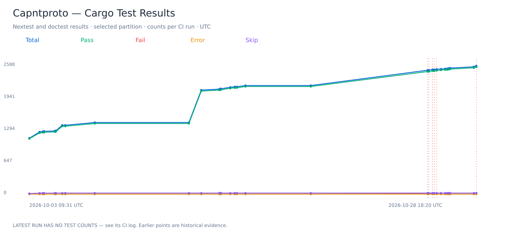
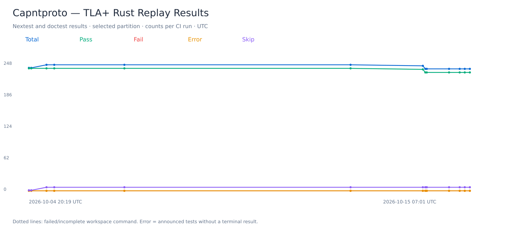
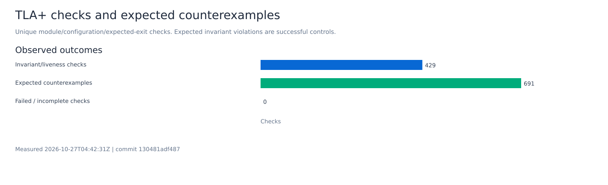
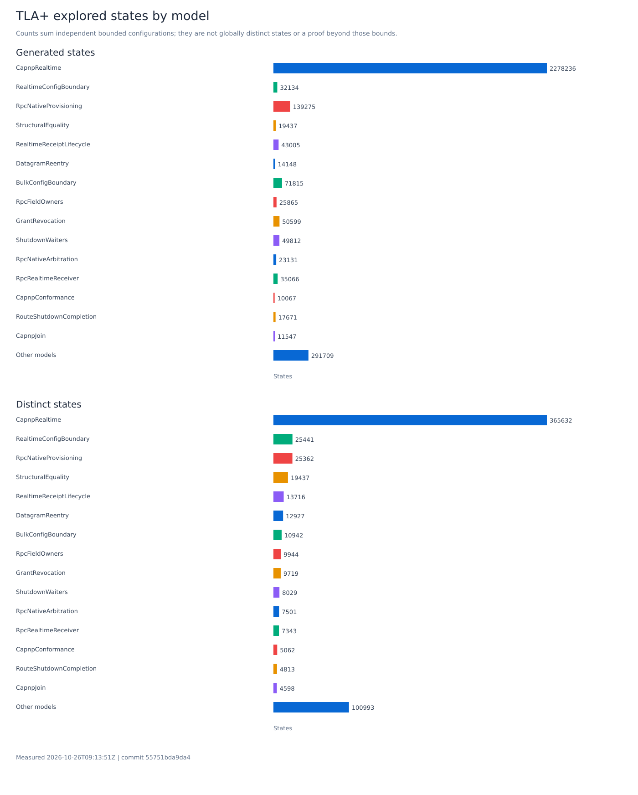
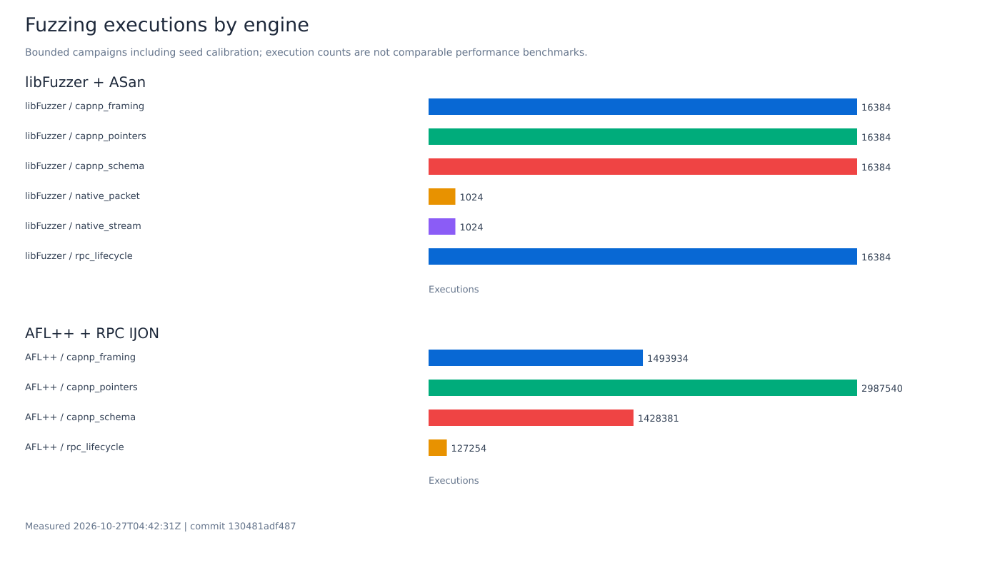
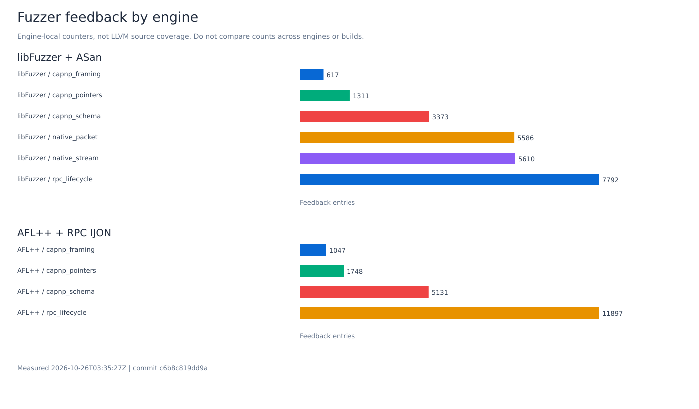
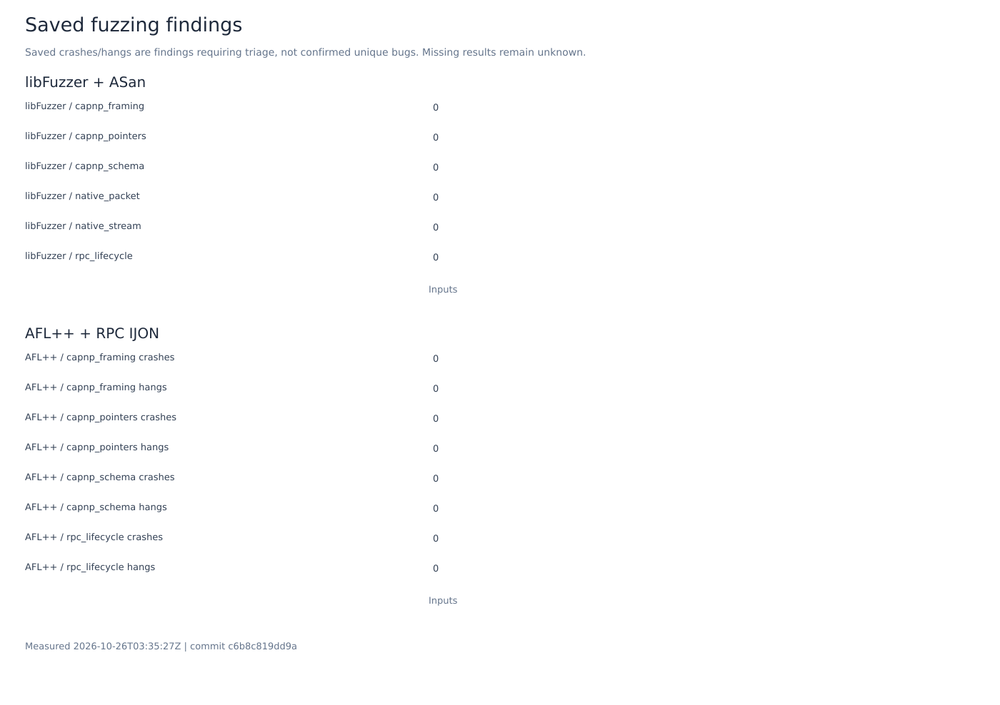

# Capntproto verification reports

[Project and supported APIs](https://github.com/DericHuynh/capntproto) · [Reporting contract](https://github.com/DericHuynh/capntproto/blob/main/docs/wiki/README-Reports.md)

This branch contains generated evidence only. See each result's measured commit
and workflow link before comparing it with a source checkout.

## Tests, coverage and benchmarks

Generated automatically from CI evidence. Each lane keeps its own measured commit and date; measurements from different commits are not combined into a single qualification claim.

### Cargo tests

Latest Cargo run: [2026-10-28T15:00:10Z · run 40711514741 / attempt 1](https://github.com/DericHuynh/capntproto/actions/runs/40711514741) · commit `d45a9285b0db` · **failure**

| Total | Passed | Failed | Errors | Skipped |
| ---: | ---: | ---: | ---: | ---: |
| 2570 | 2550 | [0](docs/reports/failed-tests.md) | 0 | 20 |

[Show all failed tests and diagnostics](docs/reports/failed-tests.md). Cargo tests and doctests exclude the dedicated TLA+, fuzz, Miri and mutation campaigns. Filtered tests are not counted as passes or skips. [Reporting contract](https://github.com/DericHuynh/capntproto/blob/main/docs/wiki/README-Reports.md).

### TLA+ models and Rust trace replays

[2026-10-28T15:00:10Z · run 40711514741 / attempt 1](https://github.com/DericHuynh/capntproto/actions/runs/40711514741) · commit `d45a9285b0db` · **failure**

Unique module&#47;configuration&#47;expected&#45;exit checks&#46; Expected invariant violations are successful controls&#46;

Counts sum independent bounded configurations&#59; they are not globally distinct states or a proof beyond those bounds&#46;

[Failed model replay tests](docs/reports/failed-models.md). Expected mutation counterexamples are successful checks, not unexpected failures.

### Fuzzing: libFuzzer and AFL++

[2026-10-28T15:00:10Z · run 40711514741 / attempt 1](https://github.com/DericHuynh/capntproto/actions/runs/40711514741) · commit `d45a9285b0db` · **failure**

Bounded campaigns including seed calibration&#59; execution counts are not comparable performance benchmarks&#46;

Engine&#45;local counters&#44; not LLVM source coverage&#46; Do not compare counts across engines or builds&#46;

Saved crashes&#47;hangs are findings requiring triage&#44; not confirmed unique bugs&#46; Missing results remain unknown&#46;

AFL++ guides the RPC lifecycle oracle with IJON state and progress annotations. Corpus inputs, crashes, hangs, logs and engine statistics are retained in the linked run. Fuzzer counters are not source coverage percentages.

### LLVM coverage

Latest coverage run: [2026-10-28T15:00:10Z · run 40711514398 / attempt 1](https://github.com/DericHuynh/capntproto/actions/runs/40711514398) · commit `d45a9285b0db` · **failure**

No validated coverage/baseline comparison is available for the latest run. Missing or unmapped counters are never presented as 100% coverage.

### Linux loopback benchmark comparisons

Latest benchmark run: [2026-10-28T15:00:10Z · run 40711514741 / attempt 1](https://github.com/DericHuynh/capntproto/actions/runs/40711514741) · commit `d45a9285b0db` · **failure**

Measurement evidence: **passed**. Independently validated encrypted benchmark values&#46; Workflow status and diagnostic completion are separate&#59; unavailable values remain blank&#46; Operations include whole concurrent batches and every service hop&#46;

Separate client/server processes, one outstanding request, several payload sizes and five repetitions. Current TCP fixtures use TLS 1.3, including upstream Rust Cap’n Proto, C++, gRPC over HTTP/2 and WebSockets over WSS; native encrypted transports and standard QUIC are identified separately. Historical data retains its recorded fixture contract. The dedicated campaign also reports recursive data, concurrent calls and independent service chains for gRPC and binary Protobuf WebSockets in its encrypted comparison artifact. Bars compare the recorded workload, rather than universal protocol performance.

[Machine-readable history and exact plotted values](docs/reports/history.json). Full logs, raw samples and LLVM exports are retained in the linked workflow artifacts.

## Exhaustive benchmark tables

Measured run: [2026-10-28T15:00:10Z · run 40711514741 / attempt 1](https://github.com/DericHuynh/capntproto/actions/runs/40711514741) · commit `d45a9285b0db` · **failure**

All measured cases and implementations are listed. Minimum latency is the primary estimate; means and spread retain all repetitions. Run mean SD is not a confidence interval. Latency is per complete operation or concurrent batch. Profiler counters sum the client and every service hop. Dashes indicate unavailable values.

### All encrypted latency comparisons

| Transport | Case | Implementation | Samples | Minimum µs | Mean µs | Sample SD µs | Run mean SD µs | Run mean min µs | Run mean max µs | p50 µs | p95 µs | p99 µs |
| --- | --- | --- | --- | --- | --- | --- | --- | --- | --- | --- | --- | --- |
| tls | loopback&#45;0 | cpp | 5000 | 45.355 | 53.365 | 7.709 | 0.909 | 52.192 | 54.390 | 51.601 | 66.671 | 83.404 |
| tls | loopback&#45;0 | grpc | 5000 | 52.524 | 68.539 | 15.617 | 14.999 | 59.905 | 95.229 | 61.802 | 98.120 | 114.427 |
| tls | loopback&#45;0 | legacy | 5000 | 29.300 | 37.209 | 8.401 | 4.156 | 34.942 | 44.593 | 34.258 | 52.192 | 64.449 |
| tls | loopback&#45;0 | portable | 5000 | 30.522 | 43.624 | 11.553 | 10.719 | 35.382 | 55.754 | 37.307 | 61.701 | 74.092 |
| tls | loopback&#45;0 | websocket | 5000 | 23.803 | 33.589 | 8.208 | 5.049 | 31.049 | 42.614 | 30.822 | 48.250 | 58.989 |
| tls | loopback&#45;64 | cpp | 5000 | 72.749 | 80.431 | 7.897 | 0.792 | 79.071 | 80.992 | 78.018 | 96.200 | 109.212 |
| tls | loopback&#45;64 | grpc | 5000 | 53.844 | 87.129 | 16.236 | 15.039 | 60.243 | 94.606 | 88.132 | 108.745 | 122.450 |
| tls | loopback&#45;64 | legacy | 5000 | 29.345 | 47.337 | 9.044 | 7.414 | 34.120 | 51.617 | 47.105 | 61.039 | 73.348 |
| tls | loopback&#45;64 | portable | 5000 | 30.584 | 53.209 | 6.925 | 1.972 | 50.155 | 54.910 | 50.914 | 65.903 | 75.406 |
| tls | loopback&#45;64 | websocket | 5000 | 23.956 | 38.965 | 8.407 | 3.190 | 34.585 | 41.829 | 39.302 | 51.505 | 62.620 |
| tls | loopback&#45;1024 | cpp | 5000 | 47.614 | 71.789 | 16.485 | 14.996 | 55.543 | 84.810 | 77.936 | 95.134 | 108.755 |
| tls | loopback&#45;1024 | grpc | 5000 | 55.505 | 74.591 | 19.838 | 15.829 | 63.423 | 101.267 | 64.955 | 108.004 | 131.488 |
| tls | loopback&#45;1024 | legacy | 5000 | 31.415 | 46.682 | 11.081 | 9.201 | 35.956 | 55.524 | 49.766 | 63.502 | 74.135 |
| tls | loopback&#45;1024 | portable | 5000 | 32.632 | 53.135 | 36.328 | 9.643 | 38.408 | 61.458 | 53.865 | 69.433 | 81.624 |
| tls | loopback&#45;1024 | websocket | 5000 | 23.678 | 32.885 | 8.246 | 6.376 | 29.039 | 44.222 | 29.843 | 49.037 | 57.749 |
| tls | loopback&#45;65536 | cpp | 5000 | 201.833 | 230.795 | 18.121 | 2.213 | 227.240 | 232.750 | 229.078 | 263.781 | 286.143 |
| tls | loopback&#45;65536 | grpc | 5000 | 204.693 | 258.475 | 48.747 | 40.025 | 237.325 | 329.921 | 241.566 | 356.168 | 389.029 |
| tls | loopback&#45;65536 | legacy | 5000 | 145.058 | 166.320 | 20.071 | 5.072 | 161.372 | 174.109 | 162.702 | 198.284 | 254.548 |
| tls | loopback&#45;65536 | portable | 5000 | 151.414 | 182.175 | 31.475 | 22.747 | 169.688 | 222.777 | 171.364 | 261.053 | 280.035 |
| tls | loopback&#45;65536 | websocket | 5000 | 165.794 | 212.610 | 46.045 | 37.494 | 186.164 | 272.958 | 191.951 | 293.527 | 315.486 |
| tls | unary&#45;empty | cpp | 5000 | 44.823 | 57.752 | 13.760 | 13.042 | 49.609 | 80.743 | 51.854 | 83.639 | 98.991 |
| tls | unary&#45;empty | grpc | 5000 | 52.376 | 66.958 | 16.819 | 16.385 | 58.101 | 96.212 | 59.935 | 99.238 | 118.682 |
| tls | unary&#45;empty | legacy | 5000 | 29.126 | 35.008 | 7.399 | 3.574 | 32.674 | 41.243 | 32.452 | 51.250 | 61.094 |
| tls | unary&#45;empty | portable | 5000 | 30.022 | 34.450 | 5.199 | 1.057 | 33.237 | 35.710 | 32.883 | 45.720 | 53.619 |
| tls | unary&#45;empty | websocket | 5000 | 25.816 | 32.358 | 6.336 | 1.632 | 31.214 | 35.208 | 30.682 | 46.588 | 55.957 |
| tls | unary&#45;small | cpp | 5000 | 44.948 | 51.499 | 6.589 | 1.393 | 49.390 | 53.050 | 49.596 | 65.204 | 76.612 |
| tls | unary&#45;small | grpc | 5000 | 53.848 | 61.734 | 7.695 | 2.512 | 58.376 | 65.025 | 60.088 | 76.706 | 91.735 |
| tls | unary&#45;small | legacy | 5000 | 29.240 | 33.313 | 4.967 | 0.843 | 32.168 | 34.274 | 31.989 | 42.936 | 52.762 |
| tls | unary&#45;small | portable | 5000 | 28.593 | 34.603 | 5.277 | 0.730 | 33.904 | 35.509 | 32.892 | 45.757 | 55.490 |
| tls | unary&#45;small | websocket | 5000 | 24.206 | 29.537 | 4.464 | 0.247 | 29.303 | 29.843 | 28.559 | 37.807 | 47.514 |
| tls | unary&#45;1k | cpp | 5000 | 47.253 | 74.871 | 17.216 | 14.267 | 54.701 | 85.414 | 78.562 | 100.270 | 115.968 |
| tls | unary&#45;1k | grpc | 5000 | 56.992 | 91.687 | 20.716 | 16.717 | 65.220 | 103.721 | 93.740 | 123.042 | 143.180 |
| tls | unary&#45;1k | legacy | 5000 | 31.053 | 44.777 | 11.696 | 8.965 | 36.085 | 54.123 | 48.851 | 62.090 | 76.550 |
| tls | unary&#45;1k | portable | 5000 | 32.108 | 53.874 | 11.461 | 9.650 | 36.646 | 59.174 | 53.795 | 71.652 | 85.754 |
| tls | unary&#45;1k | websocket | 5000 | 24.868 | 42.016 | 9.361 | 6.282 | 30.832 | 45.483 | 41.472 | 57.203 | 70.248 |
| tls | fanout&#45;32 | cpp | 5000 | 401.695 | 474.732 | 50.153 | 4.482 | 470.297 | 480.508 | 468.841 | 577.308 | 616.826 |
| tls | fanout&#45;32 | grpc | 5000 | 673.319 | 771.255 | 82.791 | 37.690 | 745.749 | 837.265 | 759.519 | 949.080 | 1106.418 |
| tls | fanout&#45;32 | legacy | 5000 | 156.554 | 176.985 | 19.141 | 2.976 | 172.973 | 180.141 | 174.838 | 205.898 | 229.423 |
| tls | fanout&#45;32 | portable | 5000 | 184.435 | 206.290 | 16.596 | 1.751 | 203.552 | 207.907 | 204.505 | 236.176 | 253.540 |
| tls | fanout&#45;32 | websocket | 5000 | 186.736 | 242.632 | 47.284 | 28.356 | 217.998 | 286.055 | 225.928 | 345.213 | 381.684 |
| tls | dependent&#45;read | cpp | 5000 | 106.358 | 152.447 | 40.738 | 40.446 | 119.758 | 198.590 | 132.900 | 215.242 | 243.287 |
| tls | dependent&#45;read | grpc | 5000 | 110.696 | 169.308 | 40.254 | 41.037 | 124.086 | 200.539 | 184.157 | 224.009 | 246.441 |
| tls | dependent&#45;read | legacy | 5000 | 65.023 | 91.759 | 21.229 | 20.491 | 74.300 | 114.365 | 83.601 | 125.793 | 143.225 |
| tls | dependent&#45;read | portable | 5000 | 80.405 | 117.112 | 35.280 | 27.704 | 92.037 | 159.413 | 97.729 | 173.281 | 193.681 |
| tls | dependent&#45;read | websocket | 5000 | 46.463 | 66.645 | 15.861 | 11.802 | 57.058 | 86.756 | 61.446 | 98.896 | 111.597 |
| tls | pipelined&#45;read | cpp | 5000 | 77.592 | 96.474 | 22.239 | 9.833 | 88.152 | 110.732 | 88.701 | 148.147 | 166.607 |
| tls | pipelined&#45;read | legacy | 5000 | 40.202 | 55.192 | 14.122 | 11.322 | 46.501 | 72.229 | 47.556 | 78.598 | 94.783 |
| tls | pipelined&#45;read | portable | 5000 | 61.280 | 86.126 | 25.186 | 22.989 | 69.709 | 120.066 | 71.743 | 128.206 | 145.941 |
| tls | write&#45;read | cpp | 5000 | 91.711 | 130.664 | 31.400 | 26.665 | 105.745 | 164.728 | 116.271 | 182.082 | 198.699 |
| tls | write&#45;read | grpc | 5000 | 109.954 | 154.853 | 37.221 | 34.890 | 125.770 | 201.836 | 137.107 | 216.740 | 236.563 |
| tls | write&#45;read | legacy | 5000 | 59.751 | 78.334 | 16.399 | 14.710 | 69.628 | 104.396 | 71.310 | 109.258 | 126.549 |
| tls | write&#45;read | portable | 5000 | 62.685 | 90.044 | 21.576 | 20.678 | 73.583 | 113.138 | 81.941 | 124.450 | 142.280 |
| tls | write&#45;read | websocket | 5000 | 46.870 | 63.176 | 12.835 | 5.593 | 59.717 | 72.785 | 59.461 | 89.003 | 106.655 |
| tls | callback | cpp | 5000 | 97.564 | 140.853 | 34.700 | 28.128 | 112.101 | 176.566 | 126.244 | 194.951 | 212.576 |
| tls | callback | grpc | 5000 | 55.420 | 62.924 | 7.233 | 0.579 | 62.311 | 63.735 | 61.119 | 77.738 | 90.612 |
| tls | callback | legacy | 5000 | 64.131 | 89.146 | 21.473 | 21.743 | 71.155 | 114.258 | 78.748 | 124.153 | 138.547 |
| tls | callback | portable | 5000 | 78.238 | 103.581 | 25.498 | 25.536 | 90.344 | 149.199 | 92.302 | 153.685 | 174.354 |
| tls | callback | websocket | 5000 | 46.695 | 58.365 | 8.634 | 2.513 | 56.578 | 62.793 | 56.315 | 75.532 | 88.364 |
| tls | bulk&#45;64k | cpp | 5000 | 198.835 | 244.139 | 47.697 | 42.233 | 222.370 | 319.587 | 227.544 | 357.812 | 383.425 |
| tls | bulk&#45;64k | grpc | 5000 | 201.402 | 257.369 | 49.990 | 50.636 | 229.209 | 347.760 | 238.048 | 362.283 | 395.972 |
| tls | bulk&#45;64k | legacy | 5000 | 144.954 | 162.705 | 12.941 | 2.071 | 161.058 | 166.116 | 161.092 | 188.455 | 203.095 |
| tls | bulk&#45;64k | portable | 5000 | 151.114 | 169.278 | 16.616 | 1.583 | 167.980 | 171.867 | 167.324 | 197.265 | 217.407 |
| tls | bulk&#45;64k | websocket | 5000 | 164.961 | 193.926 | 31.237 | 21.294 | 183.517 | 231.985 | 184.679 | 272.881 | 297.268 |
| tls | bulk&#45;256k | cpp | 5000 | 771.466 | 891.814 | 99.395 | 49.657 | 862.445 | 980.261 | 873.362 | 1162.255 | 1257.417 |
| tls | bulk&#45;256k | grpc | 5000 | 494.252 | 917.632 | 243.202 | 171.384 | 658.767 | 1135.286 | 920.694 | 1378.243 | 1495.889 |
| tls | bulk&#45;256k | legacy | 5000 | 443.173 | 507.276 | 63.025 | 34.803 | 486.350 | 569.101 | 494.455 | 658.624 | 709.218 |
| tls | bulk&#45;256k | portable | 5000 | 441.080 | 508.708 | 56.936 | 30.952 | 488.976 | 563.364 | 496.505 | 660.018 | 717.635 |
| tls | bulk&#45;256k | websocket | 5000 | 936.656 | 1048.826 | 75.374 | 34.960 | 1023.112 | 1108.840 | 1042.340 | 1162.339 | 1218.117 |
| tls | bulk&#45;1m | cpp | 5000 | 2987.543 | 3399.576 | 388.578 | 206.184 | 3237.524 | 3715.697 | 3268.310 | 4419.342 | 4628.963 |
| tls | bulk&#45;1m | grpc | 5000 | 2697.618 | 4550.555 | 883.077 | 870.569 | 3026.433 | 5105.757 | 4684.478 | 5823.011 | 6233.487 |
| tls | bulk&#45;1m | legacy | 5000 | 1508.275 | 1802.009 | 218.008 | 135.795 | 1643.971 | 1981.108 | 1695.755 | 2162.485 | 2231.629 |
| tls | bulk&#45;1m | portable | 5000 | 1512.025 | 1741.313 | 189.300 | 86.639 | 1650.131 | 1850.650 | 1664.064 | 2105.232 | 2186.373 |
| tls | bulk&#45;1m | websocket | 5000 | 3761.686 | 4359.755 | 374.818 | 193.383 | 4173.116 | 4685.705 | 4238.025 | 5135.831 | 5408.669 |
| tls | bulk&#45;4m | cpp | 5000 | 13911.625 | 16379.304 | 1925.580 | 608.241 | 15672.442 | 17262.590 | 15631.430 | 20569.998 | 21157.189 |
| tls | bulk&#45;4m | grpc | 5000 | 17539.012 | 19946.206 | 1465.732 | 463.613 | 19525.024 | 20714.095 | 19488.316 | 22916.664 | 23440.354 |
| tls | bulk&#45;4m | legacy | 5000 | 7721.364 | 9392.281 | 1009.738 | 590.009 | 8830.391 | 10305.441 | 8938.067 | 10902.006 | 11198.534 |
| tls | bulk&#45;4m | portable | 5000 | 7686.808 | 9034.668 | 833.818 | 280.619 | 8640.089 | 9300.782 | 8727.355 | 10729.661 | 11061.916 |
| tls | bulk&#45;4m | websocket | 5000 | 25573.441 | 28524.832 | 2419.675 | 694.889 | 27930.915 | 29604.021 | 27336.255 | 33130.694 | 33632.166 |
| tls | deep&#45;8 | cpp | 5000 | 47.859 | 66.375 | 17.261 | 17.202 | 53.541 | 85.262 | 57.032 | 92.765 | 109.304 |
| tls | deep&#45;8 | grpc | 5000 | 63.318 | 86.127 | 22.680 | 20.991 | 70.015 | 115.506 | 73.199 | 123.152 | 140.402 |
| tls | deep&#45;8 | legacy | 5000 | 31.697 | 43.133 | 10.744 | 10.472 | 35.061 | 54.646 | 36.914 | 59.381 | 70.322 |
| tls | deep&#45;8 | portable | 5000 | 32.580 | 45.894 | 12.650 | 12.462 | 36.455 | 60.145 | 38.267 | 65.240 | 77.376 |
| tls | deep&#45;8 | websocket | 5000 | 27.762 | 44.918 | 11.254 | 9.016 | 38.104 | 55.259 | 43.989 | 66.040 | 76.270 |
| tls | deep&#45;32 | cpp | 5000 | 54.135 | 72.283 | 18.159 | 15.595 | 61.542 | 98.946 | 63.417 | 104.419 | 121.558 |
| tls | deep&#45;32 | grpc | 5000 | 80.979 | 103.410 | 25.749 | 25.953 | 90.173 | 149.802 | 92.414 | 155.312 | 176.646 |
| tls | deep&#45;32 | legacy | 5000 | 37.906 | 53.705 | 14.499 | 10.661 | 42.789 | 68.575 | 46.910 | 76.156 | 90.656 |
| tls | deep&#45;32 | portable | 5000 | 38.780 | 56.642 | 17.663 | 15.753 | 44.622 | 74.270 | 48.599 | 81.529 | 100.857 |
| tls | deep&#45;32 | websocket | 5000 | 46.480 | 65.373 | 16.945 | 15.143 | 56.564 | 92.107 | 58.967 | 100.830 | 115.930 |
| tls | concurrent&#45;32 | cpp | 5000 | 447.705 | 519.028 | 43.539 | 23.416 | 499.535 | 556.384 | 517.822 | 589.753 | 629.050 |
| tls | concurrent&#45;32 | grpc | 5000 | 547.555 | 625.550 | 57.106 | 48.418 | 601.016 | 712.097 | 617.380 | 742.538 | 772.342 |
| tls | concurrent&#45;32 | legacy | 5000 | 107.596 | 154.062 | 40.523 | 42.484 | 121.081 | 201.887 | 132.820 | 218.835 | 236.474 |
| tls | concurrent&#45;32 | portable | 5000 | 128.671 | 181.156 | 53.775 | 50.791 | 143.339 | 247.322 | 151.256 | 273.683 | 293.359 |
| tls | concurrent&#45;32 | websocket | 5000 | 94.342 | 149.601 | 23.056 | 3.144 | 146.783 | 154.356 | 146.229 | 192.484 | 219.260 |
| tls | deep&#45;32&#45;concurrent&#45;32 | cpp | 5000 | 594.456 | 690.877 | 87.012 | 30.468 | 655.547 | 723.102 | 673.106 | 900.560 | 979.143 |
| tls | deep&#45;32&#45;concurrent&#45;32 | grpc | 5000 | 1371.829 | 1535.830 | 96.498 | 29.905 | 1513.427 | 1587.794 | 1526.366 | 1717.534 | 1862.547 |
| tls | deep&#45;32&#45;concurrent&#45;32 | legacy | 5000 | 363.244 | 431.299 | 44.093 | 36.380 | 414.081 | 496.357 | 425.580 | 521.228 | 555.995 |
| tls | deep&#45;32&#45;concurrent&#45;32 | portable | 5000 | 395.885 | 461.313 | 40.312 | 20.953 | 437.757 | 492.917 | 463.180 | 533.773 | 556.155 |
| tls | deep&#45;32&#45;concurrent&#45;32 | websocket | 5000 | 655.449 | 783.781 | 105.957 | 54.696 | 737.086 | 859.265 | 758.333 | 1057.255 | 1117.691 |
| tls | services&#45;4&#45;deep&#45;16 | cpp | 5000 | 340.554 | 412.547 | 34.899 | 12.569 | 394.511 | 425.954 | 409.892 | 469.185 | 507.304 |
| tls | services&#45;4&#45;deep&#45;16 | grpc | 5000 | 492.410 | 570.510 | 36.915 | 7.971 | 556.471 | 575.486 | 570.221 | 628.648 | 661.939 |
| tls | services&#45;4&#45;deep&#45;16 | legacy | 5000 | 247.555 | 297.785 | 28.039 | 8.359 | 285.594 | 307.956 | 295.812 | 343.193 | 370.187 |
| tls | services&#45;4&#45;deep&#45;16 | portable | 5000 | 275.757 | 332.342 | 27.872 | 7.149 | 324.579 | 341.226 | 331.042 | 380.317 | 412.283 |
| tls | services&#45;4&#45;deep&#45;16 | websocket | 5000 | 207.042 | 294.396 | 43.217 | 8.712 | 283.853 | 305.668 | 289.396 | 369.877 | 405.698 |
| tls | services&#45;4&#45;deep&#45;16&#45;concurrent&#45;32 | cpp | 5000 | 2499.843 | 2854.153 | 154.171 | 60.169 | 2797.454 | 2947.556 | 2844.704 | 3062.627 | 3212.760 |
| tls | services&#45;4&#45;deep&#45;16&#45;concurrent&#45;32 | grpc | 5000 | 4253.012 | 4719.286 | 219.806 | 105.888 | 4608.264 | 4878.006 | 4689.943 | 5091.291 | 5313.557 |
| tls | services&#45;4&#45;deep&#45;16&#45;concurrent&#45;32 | legacy | 5000 | 1436.426 | 1572.004 | 68.376 | 10.459 | 1562.153 | 1587.757 | 1569.780 | 1682.042 | 1729.571 |
| tls | services&#45;4&#45;deep&#45;16&#45;concurrent&#45;32 | portable | 5000 | 1545.414 | 1693.367 | 70.320 | 19.587 | 1675.397 | 1719.239 | 1693.272 | 1803.672 | 1857.665 |
| tls | services&#45;4&#45;deep&#45;16&#45;concurrent&#45;32 | websocket | 5000 | 1277.028 | 1574.947 | 100.172 | 35.267 | 1530.637 | 1623.291 | 1568.003 | 1748.206 | 1828.797 |
| tls | services&#45;4&#45;deep&#45;16&#45;clients&#45;8 | cpp | 5000 | 2070.893 | 2640.126 | 156.330 | 49.932 | 2577.032 | 2712.610 | 2647.457 | 2867.408 | 2998.523 |
| tls | services&#45;4&#45;deep&#45;16&#45;clients&#45;8 | grpc | 5000 | 3592.415 | 4336.543 | 230.989 | 68.522 | 4265.803 | 4425.311 | 4305.849 | 4740.502 | 4900.636 |
| tls | services&#45;4&#45;deep&#45;16&#45;clients&#45;8 | legacy | 5000 | 1164.136 | 1601.266 | 85.509 | 34.698 | 1548.172 | 1634.841 | 1600.955 | 1733.795 | 1788.927 |
| tls | services&#45;4&#45;deep&#45;16&#45;clients&#45;8 | portable | 5000 | 1318.639 | 1718.514 | 107.202 | 27.246 | 1678.189 | 1744.477 | 1711.661 | 1909.608 | 1970.434 |
| tls | services&#45;4&#45;deep&#45;16&#45;clients&#45;8 | websocket | 5000 | 1170.962 | 1573.305 | 151.203 | 72.854 | 1484.353 | 1655.514 | 1563.176 | 1831.943 | 1929.602 |
| tls | services&#45;8&#45;deep&#45;16&#45;clients&#45;8 | cpp | 5000 | 4112.888 | 5565.159 | 355.990 | 193.576 | 5373.465 | 5849.121 | 5514.716 | 6211.668 | 6505.612 |
| tls | services&#45;8&#45;deep&#45;16&#45;clients&#45;8 | grpc | 5000 | 6905.785 | 8867.595 | 649.603 | 144.550 | 8709.806 | 9046.936 | 8897.216 | 9908.268 | 10383.092 |
| tls | services&#45;8&#45;deep&#45;16&#45;clients&#45;8 | legacy | 5000 | 2727.877 | 3419.235 | 201.872 | 134.602 | 3252.463 | 3586.963 | 3387.326 | 3784.503 | 3987.986 |
| tls | services&#45;8&#45;deep&#45;16&#45;clients&#45;8 | portable | 5000 | 2611.643 | 3600.936 | 253.594 | 163.284 | 3435.450 | 3870.182 | 3583.665 | 4024.403 | 4207.360 |
| tls | services&#45;8&#45;deep&#45;16&#45;clients&#45;8 | websocket | 5000 | 2299.505 | 2890.287 | 236.594 | 50.564 | 2811.642 | 2948.469 | 2850.077 | 3338.988 | 3599.649 |
| quic | loopback&#45;0 | legacy | 5000 | 40.113 | 55.597 | 15.359 | 12.900 | 44.524 | 73.215 | 47.316 | 79.883 | 97.235 |
| quic | loopback&#45;0 | portable | 5000 | 44.009 | 65.473 | 17.225 | 15.387 | 48.399 | 79.694 | 72.097 | 92.170 | 108.404 |
| quic | loopback&#45;64 | legacy | 5000 | 40.009 | 45.783 | 6.568 | 1.146 | 44.689 | 47.525 | 44.393 | 58.395 | 69.920 |
| quic | loopback&#45;64 | portable | 5000 | 43.695 | 55.484 | 13.344 | 12.583 | 49.127 | 77.977 | 49.847 | 81.180 | 96.021 |
| quic | loopback&#45;1024 | legacy | 5000 | 42.275 | 58.111 | 13.856 | 13.314 | 47.900 | 72.756 | 51.737 | 78.936 | 93.197 |
| quic | loopback&#45;1024 | portable | 5000 | 45.942 | 66.654 | 17.883 | 15.949 | 51.330 | 83.766 | 61.237 | 93.415 | 107.710 |
| quic | loopback&#45;65536 | legacy | 5000 | 186.064 | 219.385 | 37.570 | 23.623 | 207.185 | 261.595 | 207.785 | 314.110 | 346.148 |
| quic | loopback&#45;65536 | portable | 5000 | 191.296 | 223.468 | 33.904 | 18.152 | 211.629 | 255.311 | 214.114 | 309.962 | 352.080 |
| quic | unary&#45;empty | legacy | 5000 | 39.890 | 46.194 | 7.338 | 1.323 | 44.826 | 47.665 | 44.667 | 59.679 | 73.092 |
| quic | unary&#45;empty | portable | 5000 | 43.034 | 49.810 | 7.363 | 0.947 | 48.722 | 50.898 | 48.034 | 63.170 | 77.648 |
| quic | unary&#45;small | legacy | 5000 | 39.008 | 45.296 | 6.173 | 0.415 | 44.784 | 45.863 | 43.496 | 57.522 | 69.964 |
| quic | unary&#45;small | portable | 5000 | 43.267 | 49.023 | 6.586 | 1.545 | 47.673 | 51.263 | 47.112 | 62.091 | 73.951 |
| quic | unary&#45;1k | legacy | 5000 | 41.935 | 47.745 | 6.244 | 0.837 | 46.616 | 48.598 | 46.029 | 59.904 | 71.234 |
| quic | unary&#45;1k | portable | 5000 | 45.520 | 51.559 | 6.132 | 0.647 | 50.614 | 52.288 | 49.638 | 63.562 | 76.099 |
| quic | fanout&#45;32 | legacy | 5000 | 185.567 | 206.629 | 17.981 | 1.903 | 205.429 | 210.012 | 201.737 | 242.601 | 261.909 |
| quic | fanout&#45;32 | portable | 5000 | 214.587 | 239.956 | 20.388 | 2.725 | 237.548 | 243.540 | 235.705 | 282.128 | 302.709 |
| quic | dependent&#45;read | legacy | 5000 | 87.700 | 99.834 | 11.352 | 1.751 | 97.256 | 101.990 | 96.817 | 121.213 | 143.714 |
| quic | dependent&#45;read | portable | 5000 | 117.444 | 132.751 | 13.958 | 2.042 | 129.836 | 135.590 | 129.431 | 160.377 | 185.787 |
| quic | pipelined&#45;read | legacy | 5000 | 52.944 | 60.188 | 7.948 | 1.885 | 58.552 | 63.404 | 58.188 | 74.925 | 93.375 |
| quic | pipelined&#45;read | portable | 5000 | 82.177 | 92.829 | 10.673 | 1.065 | 92.152 | 94.716 | 90.191 | 113.731 | 135.241 |
| quic | write&#45;read | legacy | 5000 | 81.790 | 92.848 | 10.121 | 1.732 | 90.604 | 95.291 | 90.218 | 112.711 | 130.125 |
| quic | write&#45;read | portable | 5000 | 89.933 | 101.361 | 11.256 | 1.671 | 99.458 | 103.758 | 98.388 | 123.167 | 144.187 |
| quic | callback | legacy | 5000 | 86.308 | 99.419 | 11.692 | 2.358 | 96.669 | 102.918 | 97.052 | 122.132 | 144.704 |
| quic | callback | portable | 5000 | 110.315 | 126.731 | 14.290 | 2.840 | 121.762 | 128.989 | 124.027 | 154.496 | 179.910 |
| quic | bulk&#45;64k | legacy | 5000 | 185.427 | 205.590 | 17.641 | 1.679 | 203.895 | 207.433 | 201.474 | 241.644 | 262.667 |
| quic | bulk&#45;64k | portable | 5000 | 188.199 | 210.839 | 17.442 | 2.620 | 208.405 | 215.085 | 207.793 | 246.853 | 266.198 |
| quic | bulk&#45;256k | legacy | 5000 | 467.286 | 551.400 | 404.685 | 41.870 | 514.891 | 618.256 | 517.441 | 777.166 | 812.029 |
| quic | bulk&#45;256k | portable | 5000 | 486.655 | 563.341 | 80.351 | 55.082 | 530.400 | 661.470 | 541.133 | 785.390 | 839.987 |
| quic | bulk&#45;1m | legacy | 5000 | 1747.254 | 2031.020 | 274.951 | 106.864 | 1909.421 | 2184.123 | 1930.413 | 2666.562 | 2781.966 |
| quic | bulk&#45;1m | portable | 5000 | 1730.197 | 2068.078 | 749.081 | 191.625 | 1894.402 | 2329.790 | 1921.759 | 2657.805 | 2769.819 |
| quic | bulk&#45;4m | legacy | 5000 | 8995.817 | 10224.132 | 1116.760 | 529.167 | 9902.003 | 11161.881 | 9984.540 | 13289.173 | 13894.600 |
| quic | bulk&#45;4m | portable | 5000 | 9147.056 | 10420.115 | 1335.784 | 323.546 | 10167.390 | 10973.383 | 10273.852 | 11102.581 | 13990.246 |
| quic | deep&#45;8 | legacy | 5000 | 43.332 | 49.970 | 6.781 | 0.958 | 48.746 | 51.102 | 48.032 | 63.778 | 77.112 |
| quic | deep&#45;8 | portable | 5000 | 47.206 | 54.280 | 7.038 | 0.899 | 53.556 | 55.806 | 52.416 | 68.093 | 82.118 |
| quic | deep&#45;32 | legacy | 5000 | 49.400 | 56.937 | 6.929 | 0.467 | 56.197 | 57.496 | 54.994 | 70.894 | 84.738 |
| quic | deep&#45;32 | portable | 5000 | 53.966 | 62.188 | 7.400 | 0.496 | 61.624 | 62.714 | 60.388 | 77.020 | 90.982 |
| quic | concurrent&#45;32 | legacy | 5000 | 122.346 | 149.974 | 34.811 | 27.857 | 137.052 | 199.803 | 138.626 | 238.383 | 256.557 |
| quic | concurrent&#45;32 | portable | 5000 | 147.926 | 210.433 | 61.514 | 62.293 | 163.040 | 286.208 | 175.319 | 310.626 | 329.030 |
| quic | deep&#45;32&#45;concurrent&#45;32 | legacy | 5000 | 409.321 | 459.429 | 35.054 | 1.661 | 456.655 | 461.150 | 457.589 | 509.685 | 536.674 |
| quic | deep&#45;32&#45;concurrent&#45;32 | portable | 5000 | 437.793 | 490.489 | 35.907 | 7.702 | 485.239 | 503.973 | 487.100 | 540.642 | 593.996 |
| quic | services&#45;4&#45;deep&#45;16 | legacy | 5000 | 380.111 | 442.582 | 34.582 | 9.549 | 428.371 | 453.315 | 439.400 | 501.864 | 534.135 |
| quic | services&#45;4&#45;deep&#45;16 | portable | 5000 | 368.141 | 426.178 | 35.553 | 12.430 | 412.227 | 441.130 | 421.832 | 484.639 | 517.117 |
| quic | services&#45;4&#45;deep&#45;16&#45;concurrent&#45;32 | legacy | 5000 | 1684.852 | 1911.134 | 92.122 | 28.952 | 1877.841 | 1935.739 | 1911.236 | 2063.306 | 2107.374 |
| quic | services&#45;4&#45;deep&#45;16&#45;concurrent&#45;32 | portable | 5000 | 1725.805 | 1986.834 | 76.883 | 9.970 | 1971.593 | 1996.212 | 1987.460 | 2101.512 | 2172.749 |
| quic | services&#45;4&#45;deep&#45;16&#45;clients&#45;8 | legacy | 5000 | 1663.364 | 2046.232 | 117.860 | 38.988 | 2011.074 | 2111.045 | 2040.612 | 2246.125 | 2323.103 |
| quic | services&#45;4&#45;deep&#45;16&#45;clients&#45;8 | portable | 5000 | 1543.311 | 2023.797 | 163.094 | 30.336 | 1982.108 | 2061.784 | 2041.009 | 2255.848 | 2336.276 |
| quic | services&#45;8&#45;deep&#45;16&#45;clients&#45;8 | legacy | 5000 | 3290.444 | 4234.005 | 345.968 | 214.798 | 4102.877 | 4609.451 | 4182.354 | 4899.094 | 5347.950 |
| quic | services&#45;8&#45;deep&#45;16&#45;clients&#45;8 | portable | 5000 | 2995.507 | 4154.167 | 378.837 | 144.024 | 3993.625 | 4383.156 | 4159.925 | 4730.235 | 5013.155 |

### Unsupported comparison cells

| Transport | Case | Implementation | Status |
| --- | --- | --- | --- |
| tls | pipelined&#45;read | grpc | Unsupported by this fixture&#47;protocol |
| tls | pipelined&#45;read | websocket | Unsupported by this fixture&#47;protocol |
| quic | loopback&#45;0 | cpp | Unsupported by this fixture&#47;protocol |
| quic | loopback&#45;64 | cpp | Unsupported by this fixture&#47;protocol |
| quic | loopback&#45;1024 | cpp | Unsupported by this fixture&#47;protocol |
| quic | loopback&#45;65536 | cpp | Unsupported by this fixture&#47;protocol |
| quic | unary&#45;empty | cpp | Unsupported by this fixture&#47;protocol |
| quic | unary&#45;small | cpp | Unsupported by this fixture&#47;protocol |
| quic | unary&#45;1k | cpp | Unsupported by this fixture&#47;protocol |
| quic | fanout&#45;32 | cpp | Unsupported by this fixture&#47;protocol |
| quic | dependent&#45;read | cpp | Unsupported by this fixture&#47;protocol |
| quic | pipelined&#45;read | cpp | Unsupported by this fixture&#47;protocol |
| quic | write&#45;read | cpp | Unsupported by this fixture&#47;protocol |
| quic | callback | cpp | Unsupported by this fixture&#47;protocol |
| quic | bulk&#45;64k | cpp | Unsupported by this fixture&#47;protocol |
| quic | bulk&#45;256k | cpp | Unsupported by this fixture&#47;protocol |
| quic | bulk&#45;1m | cpp | Unsupported by this fixture&#47;protocol |
| quic | bulk&#45;4m | cpp | Unsupported by this fixture&#47;protocol |
| quic | deep&#45;8 | cpp | Unsupported by this fixture&#47;protocol |
| quic | deep&#45;32 | cpp | Unsupported by this fixture&#47;protocol |
| quic | concurrent&#45;32 | cpp | Unsupported by this fixture&#47;protocol |
| quic | deep&#45;32&#45;concurrent&#45;32 | cpp | Unsupported by this fixture&#47;protocol |
| quic | services&#45;4&#45;deep&#45;16 | cpp | Unsupported by this fixture&#47;protocol |
| quic | services&#45;4&#45;deep&#45;16&#45;concurrent&#45;32 | cpp | Unsupported by this fixture&#47;protocol |
| quic | services&#45;4&#45;deep&#45;16&#45;clients&#45;8 | cpp | Unsupported by this fixture&#47;protocol |
| quic | services&#45;8&#45;deep&#45;16&#45;clients&#45;8 | cpp | Unsupported by this fixture&#47;protocol |
| quic | loopback&#45;0 | grpc | Unsupported by this fixture&#47;protocol |
| quic | loopback&#45;64 | grpc | Unsupported by this fixture&#47;protocol |
| quic | loopback&#45;1024 | grpc | Unsupported by this fixture&#47;protocol |
| quic | loopback&#45;65536 | grpc | Unsupported by this fixture&#47;protocol |
| quic | unary&#45;empty | grpc | Unsupported by this fixture&#47;protocol |
| quic | unary&#45;small | grpc | Unsupported by this fixture&#47;protocol |
| quic | unary&#45;1k | grpc | Unsupported by this fixture&#47;protocol |
| quic | fanout&#45;32 | grpc | Unsupported by this fixture&#47;protocol |
| quic | dependent&#45;read | grpc | Unsupported by this fixture&#47;protocol |
| quic | pipelined&#45;read | grpc | Unsupported by this fixture&#47;protocol |
| quic | write&#45;read | grpc | Unsupported by this fixture&#47;protocol |
| quic | callback | grpc | Unsupported by this fixture&#47;protocol |
| quic | bulk&#45;64k | grpc | Unsupported by this fixture&#47;protocol |
| quic | bulk&#45;256k | grpc | Unsupported by this fixture&#47;protocol |
| quic | bulk&#45;1m | grpc | Unsupported by this fixture&#47;protocol |
| quic | bulk&#45;4m | grpc | Unsupported by this fixture&#47;protocol |
| quic | deep&#45;8 | grpc | Unsupported by this fixture&#47;protocol |
| quic | deep&#45;32 | grpc | Unsupported by this fixture&#47;protocol |
| quic | concurrent&#45;32 | grpc | Unsupported by this fixture&#47;protocol |
| quic | deep&#45;32&#45;concurrent&#45;32 | grpc | Unsupported by this fixture&#47;protocol |
| quic | services&#45;4&#45;deep&#45;16 | grpc | Unsupported by this fixture&#47;protocol |
| quic | services&#45;4&#45;deep&#45;16&#45;concurrent&#45;32 | grpc | Unsupported by this fixture&#47;protocol |
| quic | services&#45;4&#45;deep&#45;16&#45;clients&#45;8 | grpc | Unsupported by this fixture&#47;protocol |
| quic | services&#45;8&#45;deep&#45;16&#45;clients&#45;8 | grpc | Unsupported by this fixture&#47;protocol |
| quic | loopback&#45;0 | websocket | Unsupported by this fixture&#47;protocol |
| quic | loopback&#45;64 | websocket | Unsupported by this fixture&#47;protocol |
| quic | loopback&#45;1024 | websocket | Unsupported by this fixture&#47;protocol |
| quic | loopback&#45;65536 | websocket | Unsupported by this fixture&#47;protocol |
| quic | unary&#45;empty | websocket | Unsupported by this fixture&#47;protocol |
| quic | unary&#45;small | websocket | Unsupported by this fixture&#47;protocol |
| quic | unary&#45;1k | websocket | Unsupported by this fixture&#47;protocol |
| quic | fanout&#45;32 | websocket | Unsupported by this fixture&#47;protocol |
| quic | dependent&#45;read | websocket | Unsupported by this fixture&#47;protocol |
| quic | pipelined&#45;read | websocket | Unsupported by this fixture&#47;protocol |
| quic | write&#45;read | websocket | Unsupported by this fixture&#47;protocol |
| quic | callback | websocket | Unsupported by this fixture&#47;protocol |
| quic | bulk&#45;64k | websocket | Unsupported by this fixture&#47;protocol |
| quic | bulk&#45;256k | websocket | Unsupported by this fixture&#47;protocol |
| quic | bulk&#45;1m | websocket | Unsupported by this fixture&#47;protocol |
| quic | bulk&#45;4m | websocket | Unsupported by this fixture&#47;protocol |
| quic | deep&#45;8 | websocket | Unsupported by this fixture&#47;protocol |
| quic | deep&#45;32 | websocket | Unsupported by this fixture&#47;protocol |
| quic | concurrent&#45;32 | websocket | Unsupported by this fixture&#47;protocol |
| quic | deep&#45;32&#45;concurrent&#45;32 | websocket | Unsupported by this fixture&#47;protocol |
| quic | services&#45;4&#45;deep&#45;16 | websocket | Unsupported by this fixture&#47;protocol |
| quic | services&#45;4&#45;deep&#45;16&#45;concurrent&#45;32 | websocket | Unsupported by this fixture&#47;protocol |
| quic | services&#45;4&#45;deep&#45;16&#45;clients&#45;8 | websocket | Unsupported by this fixture&#47;protocol |
| quic | services&#45;8&#45;deep&#45;16&#45;clients&#45;8 | websocket | Unsupported by this fixture&#47;protocol |

