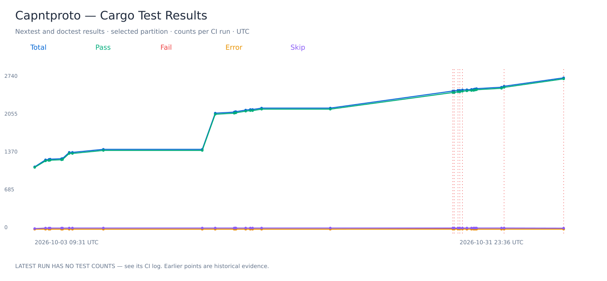
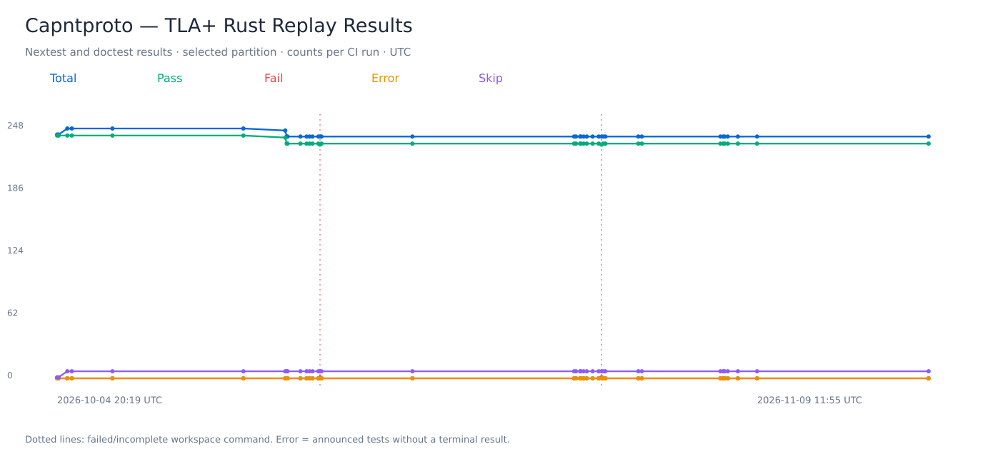
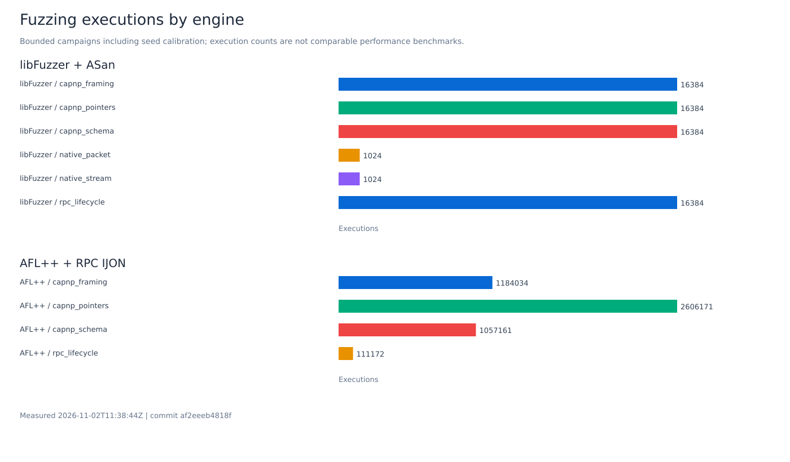
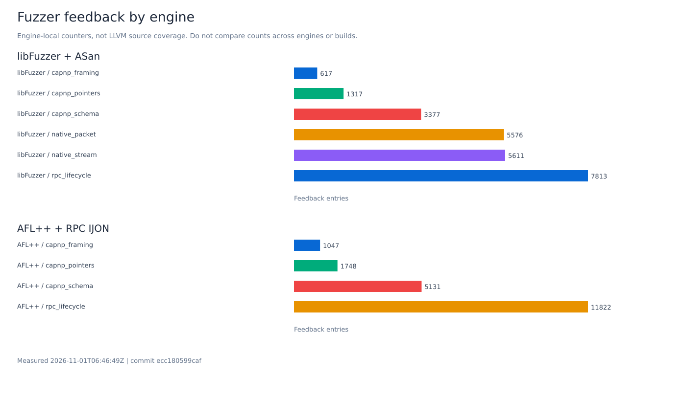
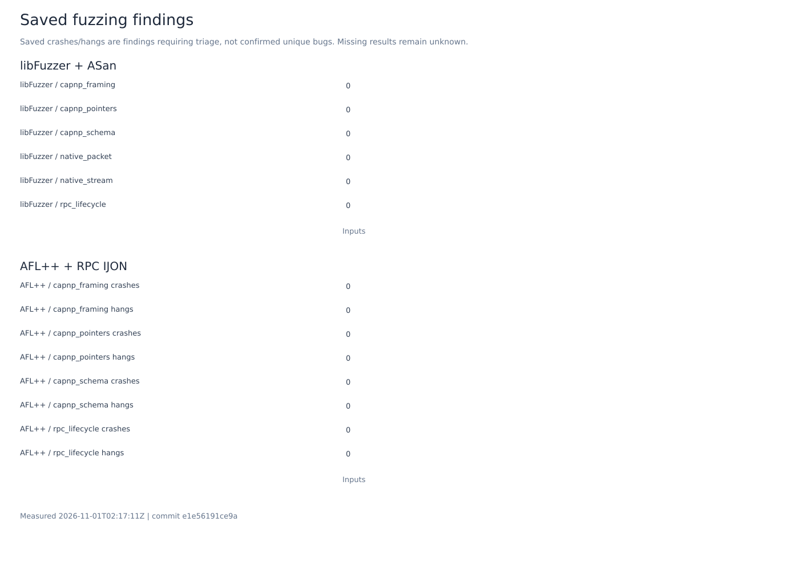

# Capntproto verification reports

[Project and supported APIs](https://github.com/DericHuynh/capntproto) · [Reporting contract](https://github.com/DericHuynh/capntproto/blob/main/docs/wiki/README-Reports.md)

This branch contains generated evidence only. See each result's measured commit
and workflow link before comparing it with a source checkout.

## Tests, coverage and benchmarks

Generated automatically from CI evidence. Each lane keeps its own measured commit and date; measurements from different commits are not combined into a single qualification claim.

### Cargo tests

Latest Cargo run: [2026-11-01T01:06:40Z · run 41259666622 / attempt 1](https://github.com/DericHuynh/capntproto/actions/runs/41259666622) · commit `68298e4cc0d5` · **cancelled**

| Total | Passed | Failed | Errors | Skipped |
| ---: | ---: | ---: | ---: | ---: |
| 2741 | 2724 | [0](docs/reports/failed-tests.md) | 0 | 17 |

[Show all failed tests and diagnostics](docs/reports/failed-tests.md). Cargo tests and doctests exclude the dedicated TLA+, fuzz, Miri and mutation campaigns. Filtered tests are not counted as passes or skips. [Reporting contract](https://github.com/DericHuynh/capntproto/blob/main/docs/wiki/README-Reports.md).

### TLA+ models and Rust trace replays

[2026-11-01T01:06:40Z · run 41259666622 / attempt 1](https://github.com/DericHuynh/capntproto/actions/runs/41259666622) · commit `68298e4cc0d5` · **cancelled**

[Failed model replay tests](docs/reports/failed-models.md). Expected mutation counterexamples are successful checks, not unexpected failures.

### Fuzzing: libFuzzer and AFL++

[2026-11-01T01:06:40Z · run 41259666622 / attempt 1](https://github.com/DericHuynh/capntproto/actions/runs/41259666622) · commit `68298e4cc0d5` · **cancelled**

Bounded campaigns including seed calibration&#59; execution counts are not comparable performance benchmarks&#46;

Engine&#45;local counters&#44; not LLVM source coverage&#46; Do not compare counts across engines or builds&#46;

Saved crashes&#47;hangs are findings requiring triage&#44; not confirmed unique bugs&#46; Missing results remain unknown&#46;

AFL++ guides the RPC lifecycle oracle with IJON state and progress annotations. Corpus inputs, crashes, hangs, logs and engine statistics are retained in the linked run. Fuzzer counters are not source coverage percentages.

### LLVM coverage

Latest coverage run: [2026-11-01T01:06:40Z · run 41259666626 / attempt 1](https://github.com/DericHuynh/capntproto/actions/runs/41259666626) · commit `68298e4cc0d5` · **failure**

No validated coverage/baseline comparison is available for the latest run. Missing or unmapped counters are never presented as 100% coverage.

### Linux loopback benchmark comparisons

Latest benchmark run: [2026-11-01T01:06:40Z · run 41259666622 / attempt 1](https://github.com/DericHuynh/capntproto/actions/runs/41259666622) · commit `68298e4cc0d5` · **cancelled**

Measurement evidence: **passed**. Independently validated encrypted benchmark values&#46; Workflow status and diagnostic completion are separate&#59; unavailable values remain blank&#46; Operations include whole concurrent batches and every service hop&#46;

Separate client/server processes, one outstanding request, several payload sizes and five repetitions. Current TCP fixtures use TLS 1.3, including upstream Rust Cap’n Proto, C++, gRPC over HTTP/2 and WebSockets over WSS; native encrypted transports and standard QUIC are identified separately. Historical data retains its recorded fixture contract. The dedicated campaign also reports recursive data, concurrent calls and independent service chains for gRPC and binary Protobuf WebSockets in its encrypted comparison artifact. Bars compare the recorded workload, rather than universal protocol performance.

[Machine-readable history and exact plotted values](docs/reports/history.json). Full logs, raw samples and LLVM exports are retained in the linked workflow artifacts.

## Exhaustive benchmark tables

Measured run: [2026-11-01T01:06:40Z · run 41259666622 / attempt 1](https://github.com/DericHuynh/capntproto/actions/runs/41259666622) · commit `68298e4cc0d5` · **cancelled**

All measured cases and implementations are listed. Minimum latency is the primary estimate; means and spread retain all repetitions. Run mean SD is not a confidence interval. Latency is per complete operation or concurrent batch. Profiler counters sum the client and every service hop. Dashes indicate unavailable values.

### All encrypted latency comparisons

| Transport | Case | Implementation | Samples | Minimum µs | Mean µs | Sample SD µs | Run mean SD µs | Run mean min µs | Run mean max µs | p50 µs | p95 µs | p99 µs |
| --- | --- | --- | --- | --- | --- | --- | --- | --- | --- | --- | --- | --- |
| tls | loopback&#45;0 | cpp | 5000 | 54.014 | 70.125 | 21.894 | 22.281 | 58.428 | 109.838 | 57.516 | 110.762 | 124.973 |
| tls | loopback&#45;0 | grpc | 5000 | 62.206 | 80.993 | 22.557 | 19.962 | 67.187 | 114.065 | 68.735 | 119.936 | 135.330 |
| tls | loopback&#45;0 | legacy | 5000 | 32.135 | 49.683 | 13.329 | 13.446 | 38.449 | 64.522 | 43.737 | 68.781 | 79.985 |
| tls | loopback&#45;0 | portable | 5000 | 37.384 | 52.747 | 15.662 | 15.558 | 41.193 | 69.953 | 43.798 | 75.937 | 87.246 |
| tls | loopback&#45;0 | websocket | 5000 | 31.815 | 44.132 | 9.722 | 9.718 | 36.853 | 55.422 | 38.254 | 56.824 | 66.871 |
| tls | loopback&#45;64 | cpp | 5000 | 53.724 | 78.696 | 25.725 | 27.737 | 57.560 | 109.916 | 62.201 | 117.485 | 128.311 |
| tls | loopback&#45;64 | grpc | 5000 | 62.217 | 87.098 | 24.887 | 26.153 | 66.905 | 116.333 | 72.540 | 125.025 | 140.417 |
| tls | loopback&#45;64 | legacy | 5000 | 36.254 | 44.471 | 11.463 | 11.089 | 38.966 | 64.296 | 38.396 | 62.941 | 77.053 |
| tls | loopback&#45;64 | portable | 5000 | 36.402 | 52.123 | 15.440 | 15.743 | 40.498 | 69.456 | 41.919 | 74.448 | 88.069 |
| tls | loopback&#45;64 | websocket | 5000 | 27.697 | 38.516 | 8.330 | 6.840 | 34.833 | 50.714 | 35.657 | 52.932 | 62.412 |
| tls | loopback&#45;1024 | cpp | 5000 | 56.688 | 73.200 | 21.179 | 22.013 | 61.507 | 112.338 | 61.090 | 112.354 | 126.357 |
| tls | loopback&#45;1024 | grpc | 5000 | 67.882 | 94.583 | 25.725 | 24.721 | 76.502 | 128.598 | 78.304 | 136.874 | 149.835 |
| tls | loopback&#45;1024 | legacy | 5000 | 38.425 | 47.103 | 11.420 | 11.429 | 41.468 | 67.540 | 41.021 | 67.068 | 79.271 |
| tls | loopback&#45;1024 | portable | 5000 | 39.267 | 55.223 | 16.025 | 16.785 | 42.760 | 73.701 | 44.861 | 78.760 | 93.327 |
| tls | loopback&#45;1024 | websocket | 5000 | 27.348 | 38.829 | 8.862 | 8.371 | 34.717 | 53.789 | 35.197 | 58.122 | 65.420 |
| tls | loopback&#45;65536 | cpp | 5000 | 234.861 | 266.761 | 36.625 | 11.380 | 259.693 | 287.012 | 254.955 | 322.363 | 428.864 |
| tls | loopback&#45;65536 | grpc | 5000 | 232.555 | 266.139 | 22.523 | 2.272 | 263.448 | 269.104 | 260.251 | 302.165 | 336.588 |
| tls | loopback&#45;65536 | legacy | 5000 | 159.853 | 182.425 | 34.044 | 26.065 | 169.930 | 229.038 | 169.014 | 269.007 | 286.238 |
| tls | loopback&#45;65536 | portable | 5000 | 167.704 | 182.232 | 15.057 | 0.805 | 181.406 | 183.332 | 178.080 | 205.493 | 237.628 |
| tls | loopback&#45;65536 | websocket | 5000 | 180.694 | 201.605 | 29.588 | 16.783 | 192.772 | 231.583 | 191.668 | 291.676 | 311.370 |
| tls | unary&#45;empty | cpp | 5000 | 54.053 | 61.538 | 8.456 | 1.380 | 60.098 | 63.745 | 56.975 | 77.618 | 89.359 |
| tls | unary&#45;empty | grpc | 5000 | 62.791 | 68.467 | 6.955 | 0.850 | 67.538 | 69.630 | 65.301 | 82.474 | 93.775 |
| tls | unary&#45;empty | legacy | 5000 | 33.001 | 40.058 | 5.124 | 0.603 | 39.381 | 41.014 | 38.171 | 49.024 | 59.078 |
| tls | unary&#45;empty | portable | 5000 | 36.061 | 41.337 | 5.724 | 0.403 | 40.656 | 41.673 | 39.335 | 51.143 | 61.032 |
| tls | unary&#45;empty | websocket | 5000 | 29.830 | 37.728 | 4.102 | 0.366 | 37.230 | 38.184 | 36.781 | 45.570 | 53.617 |
| tls | unary&#45;small | cpp | 5000 | 53.830 | 60.536 | 7.367 | 1.742 | 59.183 | 63.560 | 57.014 | 76.524 | 86.630 |
| tls | unary&#45;small | grpc | 5000 | 63.872 | 70.231 | 7.581 | 1.523 | 68.862 | 72.134 | 66.713 | 84.920 | 95.666 |
| tls | unary&#45;small | legacy | 5000 | 34.290 | 39.954 | 4.733 | 0.734 | 38.930 | 40.735 | 38.255 | 48.870 | 58.855 |
| tls | unary&#45;small | portable | 5000 | 35.805 | 41.616 | 4.946 | 0.629 | 40.858 | 42.256 | 39.857 | 51.599 | 61.980 |
| tls | unary&#45;small | websocket | 5000 | 27.856 | 35.978 | 4.245 | 0.266 | 35.707 | 36.303 | 35.046 | 43.367 | 52.511 |
| tls | unary&#45;1k | cpp | 5000 | 56.691 | 80.499 | 25.099 | 23.920 | 62.655 | 113.789 | 68.216 | 120.946 | 131.110 |
| tls | unary&#45;1k | grpc | 5000 | 66.084 | 91.996 | 24.455 | 20.267 | 78.107 | 123.463 | 78.417 | 135.331 | 147.137 |
| tls | unary&#45;1k | legacy | 5000 | 37.000 | 52.734 | 13.869 | 13.777 | 42.341 | 67.826 | 45.071 | 71.388 | 83.609 |
| tls | unary&#45;1k | portable | 5000 | 39.349 | 55.637 | 15.823 | 16.695 | 43.114 | 74.473 | 45.715 | 79.656 | 90.750 |
| tls | unary&#45;1k | websocket | 5000 | 30.148 | 47.069 | 11.021 | 10.419 | 35.215 | 55.220 | 49.077 | 63.317 | 72.356 |
| tls | fanout&#45;32 | cpp | 5000 | 438.787 | 586.763 | 204.780 | 91.201 | 494.410 | 682.801 | 477.850 | 1015.649 | 1049.112 |
| tls | fanout&#45;32 | grpc | 5000 | 809.346 | 1006.412 | 206.418 | 96.764 | 901.013 | 1141.762 | 884.751 | 1360.354 | 1391.797 |
| tls | fanout&#45;32 | legacy | 5000 | 175.424 | 213.160 | 57.667 | 46.475 | 191.717 | 296.286 | 188.360 | 363.849 | 380.084 |
| tls | fanout&#45;32 | portable | 5000 | 210.920 | 233.909 | 23.094 | 3.530 | 228.454 | 237.449 | 225.777 | 276.447 | 311.169 |
| tls | fanout&#45;32 | websocket | 5000 | 239.611 | 322.564 | 70.765 | 59.915 | 267.834 | 403.540 | 284.512 | 440.333 | 464.903 |
| tls | fanout&#45;128 | cpp | 5000 | 1534.312 | 2160.063 | 657.524 | 277.135 | 1840.967 | 2456.648 | 1768.772 | 3444.995 | 3519.956 |
| tls | fanout&#45;128 | grpc | 5000 | 3220.187 | 3956.894 | 710.873 | 82.714 | 3852.407 | 4042.215 | 3557.209 | 5108.341 | 5176.371 |
| tls | fanout&#45;128 | legacy | 5000 | 649.896 | 833.331 | 151.958 | 91.446 | 718.755 | 912.800 | 782.960 | 1037.413 | 1065.054 |
| tls | fanout&#45;128 | portable | 5000 | 811.843 | 1067.895 | 210.576 | 94.697 | 910.829 | 1166.527 | 970.148 | 1369.822 | 1397.919 |
| tls | fanout&#45;128 | websocket | 5000 | 907.156 | 1022.054 | 115.498 | 52.511 | 991.834 | 1115.243 | 991.751 | 1432.746 | 1521.531 |
| tls | dependent&#45;read | cpp | 5000 | 124.194 | 156.872 | 45.287 | 28.881 | 138.091 | 204.904 | 135.257 | 264.797 | 284.405 |
| tls | dependent&#45;read | grpc | 5000 | 133.619 | 183.962 | 50.667 | 49.348 | 147.764 | 247.208 | 152.936 | 261.938 | 282.652 |
| tls | dependent&#45;read | legacy | 5000 | 77.591 | 109.409 | 29.272 | 31.376 | 85.673 | 144.300 | 91.379 | 154.602 | 167.172 |
| tls | dependent&#45;read | portable | 5000 | 98.587 | 137.684 | 42.414 | 41.098 | 106.468 | 191.819 | 111.758 | 206.844 | 224.101 |
| tls | dependent&#45;read | websocket | 5000 | 58.595 | 76.061 | 16.669 | 16.404 | 67.625 | 105.363 | 69.899 | 112.390 | 125.151 |
| tls | pipelined&#45;read | cpp | 5000 | 88.091 | 119.162 | 45.025 | 28.909 | 96.713 | 154.474 | 94.126 | 211.642 | 224.853 |
| tls | pipelined&#45;read | legacy | 5000 | 47.791 | 67.375 | 20.064 | 21.165 | 51.572 | 90.898 | 54.091 | 98.723 | 111.747 |
| tls | pipelined&#45;read | portable | 5000 | 73.151 | 101.769 | 31.953 | 29.432 | 79.261 | 140.951 | 82.417 | 154.921 | 172.479 |
| tls | write&#45;read | cpp | 5000 | 109.063 | 132.818 | 34.195 | 23.396 | 120.780 | 174.578 | 116.955 | 216.458 | 234.187 |
| tls | write&#45;read | grpc | 5000 | 132.475 | 147.297 | 10.692 | 2.316 | 145.241 | 150.850 | 142.954 | 168.179 | 186.323 |
| tls | write&#45;read | legacy | 5000 | 71.378 | 79.703 | 6.492 | 0.477 | 79.229 | 80.406 | 76.923 | 92.782 | 103.565 |
| tls | write&#45;read | portable | 5000 | 75.305 | 82.931 | 6.528 | 0.955 | 81.638 | 84.282 | 80.135 | 96.639 | 105.983 |
| tls | write&#45;read | websocket | 5000 | 56.403 | 69.155 | 7.074 | 0.457 | 68.545 | 69.675 | 68.081 | 81.266 | 92.365 |
| tls | callback | cpp | 5000 | 115.380 | 141.346 | 38.513 | 29.214 | 125.972 | 193.474 | 123.171 | 235.149 | 256.078 |
| tls | callback | grpc | 5000 | 67.124 | 83.608 | 19.714 | 20.512 | 73.501 | 120.287 | 72.909 | 120.150 | 137.505 |
| tls | callback | legacy | 5000 | 77.817 | 91.612 | 19.375 | 14.621 | 84.446 | 117.753 | 82.530 | 137.460 | 154.541 |
| tls | callback | portable | 5000 | 94.308 | 118.614 | 34.097 | 36.491 | 101.545 | 183.882 | 100.902 | 188.125 | 209.373 |
| tls | callback | websocket | 5000 | 59.123 | 75.067 | 14.850 | 14.715 | 67.957 | 101.377 | 69.107 | 106.263 | 116.964 |
| tls | bulk&#45;64k | cpp | 5000 | 232.954 | 269.451 | 42.723 | 21.990 | 257.659 | 308.690 | 253.027 | 391.783 | 421.161 |
| tls | bulk&#45;64k | grpc | 5000 | 239.249 | 267.092 | 19.662 | 0.761 | 266.350 | 268.223 | 261.294 | 305.684 | 330.380 |
| tls | bulk&#45;64k | legacy | 5000 | 161.064 | 180.892 | 29.054 | 18.660 | 171.801 | 214.257 | 170.000 | 260.104 | 281.909 |
| tls | bulk&#45;64k | portable | 5000 | 167.822 | 181.748 | 12.638 | 0.473 | 181.073 | 182.265 | 177.777 | 206.840 | 225.107 |
| tls | bulk&#45;64k | websocket | 5000 | 182.452 | 194.943 | 12.454 | 0.811 | 193.588 | 195.750 | 190.976 | 217.589 | 238.966 |
| tls | bulk&#45;256k | cpp | 5000 | 955.210 | 1144.249 | 193.365 | 39.392 | 1098.397 | 1201.134 | 1041.845 | 1509.785 | 1548.223 |
| tls | bulk&#45;256k | grpc | 5000 | 602.505 | 1367.439 | 349.313 | 72.026 | 1281.185 | 1461.266 | 1387.870 | 1888.220 | 2011.034 |
| tls | bulk&#45;256k | legacy | 5000 | 475.880 | 526.850 | 50.088 | 16.020 | 511.220 | 547.631 | 512.533 | 685.290 | 719.433 |
| tls | bulk&#45;256k | portable | 5000 | 483.869 | 523.102 | 18.076 | 2.769 | 518.619 | 526.223 | 520.285 | 555.062 | 580.940 |
| tls | bulk&#45;256k | websocket | 5000 | 1145.612 | 1249.888 | 215.560 | 30.371 | 1218.240 | 1287.380 | 1256.487 | 1338.436 | 1374.576 |
| tls | bulk&#45;1m | cpp | 5000 | 3719.938 | 4230.264 | 2955.855 | 157.574 | 4070.790 | 4494.171 | 3984.671 | 5597.982 | 5756.892 |
| tls | bulk&#45;1m | grpc | 5000 | 2447.783 | 5294.913 | 1263.951 | 1286.753 | 3809.045 | 6383.402 | 5767.728 | 7174.259 | 7660.578 |
| tls | bulk&#45;1m | legacy | 5000 | 1624.951 | 1767.434 | 163.186 | 61.458 | 1705.307 | 1865.809 | 1700.091 | 2150.582 | 2210.747 |
| tls | bulk&#45;1m | portable | 5000 | 1641.593 | 1811.922 | 197.367 | 66.280 | 1706.965 | 1884.462 | 1713.333 | 2204.455 | 2251.483 |
| tls | bulk&#45;1m | websocket | 5000 | 4622.307 | 5032.055 | 345.682 | 100.140 | 4913.234 | 5171.606 | 4913.521 | 5781.839 | 5976.455 |
| tls | bulk&#45;4m | cpp | 5000 | 16587.772 | 17982.721 | 1688.342 | 69.793 | 17888.841 | 18084.885 | 17526.614 | 23979.447 | 24844.921 |
| tls | bulk&#45;4m | grpc | 5000 | 21774.590 | 25843.484 | 3343.192 | 3169.163 | 22936.803 | 29375.728 | 26276.948 | 32191.855 | 32679.929 |
| tls | bulk&#45;4m | legacy | 5000 | 8045.134 | 8872.153 | 827.756 | 317.709 | 8419.280 | 9252.541 | 8445.556 | 10446.521 | 10678.462 |
| tls | bulk&#45;4m | portable | 5000 | 8114.000 | 8733.788 | 699.420 | 204.550 | 8389.282 | 8891.406 | 8450.833 | 10388.623 | 10634.173 |
| tls | bulk&#45;4m | websocket | 5000 | 29074.299 | 30914.680 | 2304.374 | 394.180 | 30357.622 | 31453.756 | 29759.842 | 35813.688 | 36195.659 |
| tls | deep&#45;8 | cpp | 5000 | 56.684 | 63.214 | 7.214 | 1.454 | 61.896 | 64.920 | 60.169 | 78.009 | 90.470 |
| tls | deep&#45;8 | grpc | 5000 | 75.739 | 87.858 | 16.457 | 6.824 | 83.420 | 99.961 | 81.927 | 134.122 | 155.604 |
| tls | deep&#45;8 | legacy | 5000 | 35.769 | 51.696 | 14.439 | 13.228 | 42.226 | 71.247 | 42.565 | 73.268 | 86.810 |
| tls | deep&#45;8 | portable | 5000 | 38.237 | 50.581 | 14.125 | 14.298 | 43.381 | 76.111 | 43.221 | 75.362 | 91.548 |
| tls | deep&#45;8 | websocket | 5000 | 34.498 | 48.975 | 11.867 | 10.796 | 43.757 | 68.283 | 45.551 | 73.427 | 84.970 |
| tls | deep&#45;32 | cpp | 5000 | 63.302 | 70.095 | 7.910 | 1.239 | 68.730 | 71.604 | 66.616 | 87.200 | 98.546 |
| tls | deep&#45;32 | grpc | 5000 | 93.330 | 104.921 | 10.227 | 1.815 | 102.571 | 107.579 | 100.806 | 125.517 | 141.516 |
| tls | deep&#45;32 | legacy | 5000 | 45.413 | 50.187 | 5.821 | 0.319 | 49.873 | 50.573 | 47.563 | 61.576 | 72.637 |
| tls | deep&#45;32 | portable | 5000 | 46.170 | 50.885 | 5.533 | 0.387 | 50.326 | 51.284 | 48.652 | 61.844 | 72.091 |
| tls | deep&#45;32 | websocket | 5000 | 52.869 | 63.042 | 7.333 | 0.856 | 61.864 | 63.923 | 61.811 | 76.219 | 87.194 |
| tls | concurrent&#45;32 | cpp | 5000 | 478.064 | 755.009 | 293.425 | 129.443 | 664.024 | 972.460 | 536.318 | 1192.257 | 1220.409 |
| tls | concurrent&#45;32 | grpc | 5000 | 594.964 | 834.530 | 187.927 | 92.950 | 695.834 | 946.042 | 822.941 | 1064.132 | 1088.310 |
| tls | concurrent&#45;32 | legacy | 5000 | 122.702 | 171.363 | 62.921 | 55.426 | 134.054 | 265.915 | 135.480 | 291.894 | 306.051 |
| tls | concurrent&#45;32 | portable | 5000 | 150.738 | 171.807 | 21.613 | 8.448 | 163.311 | 184.999 | 162.492 | 213.230 | 248.013 |
| tls | concurrent&#45;32 | websocket | 5000 | 117.715 | 183.837 | 30.573 | 8.285 | 176.324 | 196.873 | 179.334 | 238.267 | 292.622 |
| tls | deep&#45;32&#45;concurrent&#45;32 | cpp | 5000 | 636.967 | 1035.098 | 315.907 | 122.963 | 855.609 | 1170.201 | 1089.741 | 1390.719 | 1437.069 |
| tls | deep&#45;32&#45;concurrent&#45;32 | grpc | 5000 | 1491.103 | 2102.562 | 500.593 | 246.063 | 1805.979 | 2376.056 | 1925.973 | 2808.425 | 2856.962 |
| tls | deep&#45;32&#45;concurrent&#45;32 | legacy | 5000 | 398.056 | 626.712 | 199.181 | 114.191 | 501.596 | 757.700 | 561.511 | 873.875 | 894.834 |
| tls | deep&#45;32&#45;concurrent&#45;32 | portable | 5000 | 437.264 | 659.844 | 176.999 | 84.248 | 579.021 | 798.597 | 665.935 | 861.216 | 886.203 |
| tls | deep&#45;32&#45;concurrent&#45;32 | websocket | 5000 | 685.017 | 909.652 | 215.762 | 78.820 | 787.834 | 991.304 | 778.685 | 1265.562 | 1305.749 |
| tls | services&#45;4&#45;deep&#45;16 | cpp | 5000 | 465.389 | 507.903 | 21.385 | 2.415 | 505.219 | 510.597 | 505.742 | 545.719 | 574.793 |
| tls | services&#45;4&#45;deep&#45;16 | grpc | 5000 | 588.792 | 648.080 | 29.359 | 3.480 | 644.076 | 653.480 | 644.939 | 694.874 | 740.122 |
| tls | services&#45;4&#45;deep&#45;16 | legacy | 5000 | 338.143 | 369.877 | 18.080 | 0.837 | 368.694 | 370.674 | 367.487 | 400.758 | 424.251 |
| tls | services&#45;4&#45;deep&#45;16 | portable | 5000 | 383.490 | 415.384 | 20.190 | 4.018 | 410.625 | 420.095 | 412.757 | 449.323 | 481.272 |
| tls | services&#45;4&#45;deep&#45;16 | websocket | 5000 | 266.424 | 343.334 | 38.885 | 4.868 | 338.929 | 349.832 | 341.646 | 405.663 | 434.285 |
| tls | services&#45;4&#45;deep&#45;16&#45;concurrent&#45;32 | cpp | 5000 | 3097.237 | 3986.271 | 248.758 | 7.030 | 3979.903 | 3997.686 | 3991.978 | 4400.628 | 4647.037 |
| tls | services&#45;4&#45;deep&#45;16&#45;concurrent&#45;32 | grpc | 5000 | 5043.872 | 6115.892 | 364.116 | 39.441 | 6058.688 | 6159.993 | 6079.438 | 6748.881 | 7057.028 |
| tls | services&#45;4&#45;deep&#45;16&#45;concurrent&#45;32 | legacy | 5000 | 1825.197 | 2280.958 | 156.717 | 29.688 | 2240.482 | 2318.331 | 2288.043 | 2529.080 | 2593.390 |
| tls | services&#45;4&#45;deep&#45;16&#45;concurrent&#45;32 | portable | 5000 | 1973.372 | 2397.716 | 145.794 | 18.171 | 2369.606 | 2416.188 | 2405.572 | 2627.785 | 2698.730 |
| tls | services&#45;4&#45;deep&#45;16&#45;concurrent&#45;32 | websocket | 5000 | 1704.511 | 1999.469 | 78.150 | 3.545 | 1996.170 | 2005.437 | 1996.843 | 2131.389 | 2196.130 |
| tls | services&#45;4&#45;deep&#45;16&#45;clients&#45;8 | cpp | 5000 | 2734.592 | 3680.948 | 437.016 | 39.540 | 3629.919 | 3724.571 | 3690.593 | 4334.985 | 4538.042 |
| tls | services&#45;4&#45;deep&#45;16&#45;clients&#45;8 | grpc | 5000 | 4540.019 | 5800.535 | 516.839 | 85.225 | 5683.687 | 5921.115 | 5832.154 | 6599.575 | 6833.080 |
| tls | services&#45;4&#45;deep&#45;16&#45;clients&#45;8 | legacy | 5000 | 1520.579 | 2301.539 | 159.578 | 27.211 | 2267.326 | 2338.333 | 2309.703 | 2540.458 | 2612.834 |
| tls | services&#45;4&#45;deep&#45;16&#45;clients&#45;8 | portable | 5000 | 1792.300 | 2427.000 | 129.583 | 23.883 | 2404.346 | 2466.950 | 2441.785 | 2592.878 | 2656.359 |
| tls | services&#45;4&#45;deep&#45;16&#45;clients&#45;8 | websocket | 5000 | 1500.888 | 1815.136 | 127.855 | 23.140 | 1789.383 | 1846.037 | 1808.312 | 2028.861 | 2123.139 |
| tls | services&#45;8&#45;deep&#45;16&#45;clients&#45;8 | cpp | 5000 | 5112.253 | 7325.997 | 886.459 | 124.987 | 7184.985 | 7511.794 | 7444.062 | 8565.389 | 8942.805 |
| tls | services&#45;8&#45;deep&#45;16&#45;clients&#45;8 | grpc | 5000 | 8354.446 | 10993.316 | 1290.370 | 75.716 | 10872.902 | 11071.576 | 11016.074 | 12971.478 | 13427.076 |
| tls | services&#45;8&#45;deep&#45;16&#45;clients&#45;8 | legacy | 5000 | 3008.498 | 4701.486 | 258.210 | 66.749 | 4643.568 | 4803.388 | 4707.774 | 5085.899 | 5277.488 |
| tls | services&#45;8&#45;deep&#45;16&#45;clients&#45;8 | portable | 5000 | 3374.527 | 4907.258 | 255.342 | 46.742 | 4852.564 | 4965.851 | 4914.333 | 5204.584 | 5375.783 |
| tls | services&#45;8&#45;deep&#45;16&#45;clients&#45;8 | websocket | 5000 | 2821.970 | 3366.698 | 248.459 | 16.012 | 3344.959 | 3386.191 | 3330.392 | 3823.770 | 4103.014 |
| quic | loopback&#45;0 | legacy | 5000 | 49.395 | 74.875 | 19.466 | 20.267 | 52.436 | 90.523 | 85.891 | 100.549 | 115.251 |
| quic | loopback&#45;0 | portable | 5000 | 52.437 | 81.811 | 23.282 | 19.200 | 56.922 | 101.376 | 96.928 | 113.376 | 127.376 |
| quic | loopback&#45;64 | legacy | 5000 | 49.221 | 53.566 | 6.438 | 1.392 | 52.367 | 55.864 | 51.229 | 65.593 | 81.287 |
| quic | loopback&#45;64 | portable | 5000 | 53.819 | 66.820 | 18.744 | 19.558 | 57.981 | 101.805 | 56.543 | 101.072 | 122.885 |
| quic | loopback&#45;1024 | legacy | 5000 | 49.124 | 63.827 | 16.538 | 16.520 | 54.590 | 93.211 | 54.879 | 92.597 | 111.505 |
| quic | loopback&#45;1024 | portable | 5000 | 54.773 | 70.375 | 19.872 | 20.562 | 60.296 | 107.137 | 59.683 | 106.539 | 127.465 |
| quic | loopback&#45;65536 | legacy | 5000 | 210.474 | 227.609 | 14.206 | 1.258 | 225.867 | 228.781 | 223.750 | 255.990 | 274.637 |
| quic | loopback&#45;65536 | portable | 5000 | 219.609 | 248.522 | 39.696 | 22.260 | 237.410 | 288.317 | 235.480 | 370.665 | 395.959 |
| quic | unary&#45;empty | legacy | 5000 | 46.791 | 52.219 | 5.706 | 0.370 | 51.888 | 52.824 | 50.198 | 62.341 | 76.631 |
| quic | unary&#45;empty | portable | 5000 | 53.222 | 57.903 | 7.019 | 1.908 | 56.613 | 61.151 | 55.231 | 71.529 | 85.487 |
| quic | unary&#45;small | legacy | 5000 | 46.809 | 68.755 | 19.440 | 19.236 | 52.463 | 90.193 | 56.874 | 96.698 | 111.838 |
| quic | unary&#45;small | portable | 5000 | 53.309 | 66.479 | 18.622 | 19.386 | 56.798 | 101.130 | 56.308 | 100.658 | 118.196 |
| quic | unary&#45;1k | legacy | 5000 | 50.992 | 62.787 | 16.376 | 16.745 | 55.049 | 92.738 | 53.623 | 92.201 | 108.255 |
| quic | unary&#45;1k | portable | 5000 | 55.631 | 69.615 | 20.104 | 20.996 | 59.306 | 107.152 | 58.599 | 106.794 | 126.278 |
| quic | fanout&#45;32 | legacy | 5000 | 210.213 | 230.861 | 18.767 | 2.595 | 226.518 | 233.176 | 224.166 | 268.057 | 294.116 |
| quic | fanout&#45;32 | portable | 5000 | 247.516 | 273.884 | 23.413 | 5.087 | 268.084 | 280.633 | 266.647 | 319.816 | 352.651 |
| quic | fanout&#45;128 | legacy | 5000 | 686.190 | 839.184 | 154.012 | 57.405 | 767.796 | 894.711 | 744.474 | 1099.702 | 1135.311 |
| quic | fanout&#45;128 | portable | 5000 | 802.777 | 1120.070 | 203.758 | 48.158 | 1066.867 | 1192.763 | 1025.452 | 1420.201 | 1453.137 |
| quic | dependent&#45;read | legacy | 5000 | 106.099 | 138.744 | 39.127 | 33.319 | 113.650 | 180.069 | 115.234 | 208.223 | 225.823 |
| quic | dependent&#45;read | portable | 5000 | 141.635 | 153.119 | 11.900 | 1.058 | 152.307 | 154.944 | 147.958 | 178.531 | 194.788 |
| quic | pipelined&#45;read | legacy | 5000 | 62.870 | 79.038 | 21.548 | 22.296 | 67.957 | 118.898 | 67.827 | 118.152 | 139.492 |
| quic | pipelined&#45;read | portable | 5000 | 97.963 | 139.901 | 42.134 | 40.616 | 105.810 | 187.884 | 113.749 | 203.022 | 220.021 |
| quic | write&#45;read | legacy | 5000 | 100.667 | 108.312 | 9.674 | 0.500 | 107.581 | 108.895 | 104.570 | 127.768 | 143.947 |
| quic | write&#45;read | portable | 5000 | 109.211 | 134.927 | 35.081 | 34.376 | 117.603 | 196.355 | 117.583 | 208.902 | 229.849 |
| quic | callback | legacy | 5000 | 105.694 | 130.232 | 31.522 | 33.451 | 114.013 | 190.012 | 114.229 | 191.883 | 211.263 |
| quic | callback | portable | 5000 | 132.804 | 185.215 | 52.436 | 45.260 | 142.552 | 235.148 | 152.507 | 263.719 | 283.433 |
| quic | bulk&#45;64k | legacy | 5000 | 209.484 | 228.059 | 14.599 | 3.337 | 223.889 | 231.545 | 223.925 | 256.748 | 276.951 |
| quic | bulk&#45;64k | portable | 5000 | 216.035 | 233.133 | 14.364 | 1.530 | 231.238 | 235.124 | 229.100 | 261.718 | 280.977 |
| quic | bulk&#45;256k | legacy | 5000 | 527.906 | 603.731 | 398.555 | 50.487 | 564.563 | 690.315 | 566.370 | 837.993 | 874.310 |
| quic | bulk&#45;256k | portable | 5000 | 551.606 | 601.076 | 555.102 | 24.449 | 587.632 | 644.658 | 586.018 | 633.253 | 663.027 |
| quic | bulk&#45;1m | legacy | 5000 | 1915.206 | 2058.482 | 171.672 | 43.852 | 2002.794 | 2124.816 | 2020.881 | 2176.670 | 2891.149 |
| quic | bulk&#45;1m | portable | 5000 | 1898.601 | 2118.671 | 467.379 | 86.631 | 2010.359 | 2217.071 | 2022.576 | 2847.891 | 2922.481 |
| quic | bulk&#45;4m | legacy | 5000 | 9533.471 | 10512.447 | 1376.351 | 244.746 | 10150.575 | 10752.184 | 10058.526 | 13732.034 | 14053.400 |
| quic | bulk&#45;4m | portable | 5000 | 9746.856 | 11139.285 | 1765.982 | 553.449 | 10373.807 | 11896.784 | 10358.511 | 14050.266 | 14466.016 |
| quic | deep&#45;8 | legacy | 5000 | 52.077 | 56.697 | 5.660 | 0.991 | 55.274 | 58.010 | 54.309 | 68.246 | 77.455 |
| quic | deep&#45;8 | portable | 5000 | 56.499 | 61.862 | 6.268 | 0.694 | 61.021 | 62.629 | 59.297 | 74.727 | 85.613 |
| quic | deep&#45;32 | legacy | 5000 | 57.467 | 64.586 | 6.467 | 0.463 | 63.846 | 64.962 | 61.863 | 77.409 | 88.400 |
| quic | deep&#45;32 | portable | 5000 | 64.139 | 70.319 | 7.431 | 0.778 | 69.542 | 71.599 | 66.967 | 85.433 | 96.929 |
| quic | concurrent&#45;32 | legacy | 5000 | 138.806 | 190.077 | 70.486 | 47.595 | 153.252 | 242.818 | 151.359 | 328.419 | 345.957 |
| quic | concurrent&#45;32 | portable | 5000 | 171.990 | 194.400 | 28.877 | 4.746 | 189.213 | 201.650 | 183.346 | 241.769 | 285.966 |
| quic | deep&#45;32&#45;concurrent&#45;32 | legacy | 5000 | 447.964 | 632.194 | 192.411 | 83.728 | 543.222 | 749.417 | 496.462 | 921.358 | 946.570 |
| quic | deep&#45;32&#45;concurrent&#45;32 | portable | 5000 | 485.167 | 654.949 | 173.965 | 64.189 | 599.004 | 741.770 | 533.744 | 911.655 | 934.821 |
| quic | services&#45;4&#45;deep&#45;16 | legacy | 5000 | 508.756 | 551.421 | 24.223 | 10.802 | 544.693 | 570.324 | 547.537 | 594.424 | 629.147 |
| quic | services&#45;4&#45;deep&#45;16 | portable | 5000 | 495.001 | 532.069 | 22.154 | 4.525 | 526.976 | 539.390 | 528.770 | 571.390 | 606.704 |
| quic | services&#45;4&#45;deep&#45;16&#45;concurrent&#45;32 | legacy | 5000 | 2209.842 | 2678.084 | 124.032 | 12.225 | 2665.346 | 2697.304 | 2684.962 | 2866.508 | 2921.045 |
| quic | services&#45;4&#45;deep&#45;16&#45;concurrent&#45;32 | portable | 5000 | 2238.902 | 2731.705 | 120.978 | 16.419 | 2715.840 | 2750.173 | 2738.784 | 2911.913 | 2972.719 |
| quic | services&#45;4&#45;deep&#45;16&#45;clients&#45;8 | legacy | 5000 | 2187.808 | 2673.898 | 182.494 | 17.986 | 2655.470 | 2693.821 | 2624.757 | 3017.652 | 3124.997 |
| quic | services&#45;4&#45;deep&#45;16&#45;clients&#45;8 | portable | 5000 | 1997.701 | 2550.879 | 208.659 | 34.828 | 2492.598 | 2581.817 | 2630.743 | 2810.685 | 2935.150 |
| quic | services&#45;8&#45;deep&#45;16&#45;clients&#45;8 | legacy | 5000 | 4407.080 | 5402.211 | 377.553 | 41.108 | 5357.993 | 5464.088 | 5312.211 | 6066.168 | 6315.676 |
| quic | services&#45;8&#45;deep&#45;16&#45;clients&#45;8 | portable | 5000 | 3797.254 | 4912.296 | 570.255 | 142.145 | 4787.935 | 5146.282 | 5025.528 | 5793.996 | 6148.503 |

### Unsupported comparison cells

| Transport | Case | Implementation | Status |
| --- | --- | --- | --- |
| tls | pipelined&#45;read | grpc | Unsupported by this fixture&#47;protocol |
| tls | pipelined&#45;read | websocket | Unsupported by this fixture&#47;protocol |
| quic | loopback&#45;0 | cpp | Unsupported by this fixture&#47;protocol |
| quic | loopback&#45;64 | cpp | Unsupported by this fixture&#47;protocol |
| quic | loopback&#45;1024 | cpp | Unsupported by this fixture&#47;protocol |
| quic | loopback&#45;65536 | cpp | Unsupported by this fixture&#47;protocol |
| quic | unary&#45;empty | cpp | Unsupported by this fixture&#47;protocol |
| quic | unary&#45;small | cpp | Unsupported by this fixture&#47;protocol |
| quic | unary&#45;1k | cpp | Unsupported by this fixture&#47;protocol |
| quic | fanout&#45;32 | cpp | Unsupported by this fixture&#47;protocol |
| quic | fanout&#45;128 | cpp | Unsupported by this fixture&#47;protocol |
| quic | dependent&#45;read | cpp | Unsupported by this fixture&#47;protocol |
| quic | pipelined&#45;read | cpp | Unsupported by this fixture&#47;protocol |
| quic | write&#45;read | cpp | Unsupported by this fixture&#47;protocol |
| quic | callback | cpp | Unsupported by this fixture&#47;protocol |
| quic | bulk&#45;64k | cpp | Unsupported by this fixture&#47;protocol |
| quic | bulk&#45;256k | cpp | Unsupported by this fixture&#47;protocol |
| quic | bulk&#45;1m | cpp | Unsupported by this fixture&#47;protocol |
| quic | bulk&#45;4m | cpp | Unsupported by this fixture&#47;protocol |
| quic | deep&#45;8 | cpp | Unsupported by this fixture&#47;protocol |
| quic | deep&#45;32 | cpp | Unsupported by this fixture&#47;protocol |
| quic | concurrent&#45;32 | cpp | Unsupported by this fixture&#47;protocol |
| quic | deep&#45;32&#45;concurrent&#45;32 | cpp | Unsupported by this fixture&#47;protocol |
| quic | services&#45;4&#45;deep&#45;16 | cpp | Unsupported by this fixture&#47;protocol |
| quic | services&#45;4&#45;deep&#45;16&#45;concurrent&#45;32 | cpp | Unsupported by this fixture&#47;protocol |
| quic | services&#45;4&#45;deep&#45;16&#45;clients&#45;8 | cpp | Unsupported by this fixture&#47;protocol |
| quic | services&#45;8&#45;deep&#45;16&#45;clients&#45;8 | cpp | Unsupported by this fixture&#47;protocol |
| quic | loopback&#45;0 | grpc | Unsupported by this fixture&#47;protocol |
| quic | loopback&#45;64 | grpc | Unsupported by this fixture&#47;protocol |
| quic | loopback&#45;1024 | grpc | Unsupported by this fixture&#47;protocol |
| quic | loopback&#45;65536 | grpc | Unsupported by this fixture&#47;protocol |
| quic | unary&#45;empty | grpc | Unsupported by this fixture&#47;protocol |
| quic | unary&#45;small | grpc | Unsupported by this fixture&#47;protocol |
| quic | unary&#45;1k | grpc | Unsupported by this fixture&#47;protocol |
| quic | fanout&#45;32 | grpc | Unsupported by this fixture&#47;protocol |
| quic | fanout&#45;128 | grpc | Unsupported by this fixture&#47;protocol |
| quic | dependent&#45;read | grpc | Unsupported by this fixture&#47;protocol |
| quic | pipelined&#45;read | grpc | Unsupported by this fixture&#47;protocol |
| quic | write&#45;read | grpc | Unsupported by this fixture&#47;protocol |
| quic | callback | grpc | Unsupported by this fixture&#47;protocol |
| quic | bulk&#45;64k | grpc | Unsupported by this fixture&#47;protocol |
| quic | bulk&#45;256k | grpc | Unsupported by this fixture&#47;protocol |
| quic | bulk&#45;1m | grpc | Unsupported by this fixture&#47;protocol |
| quic | bulk&#45;4m | grpc | Unsupported by this fixture&#47;protocol |
| quic | deep&#45;8 | grpc | Unsupported by this fixture&#47;protocol |
| quic | deep&#45;32 | grpc | Unsupported by this fixture&#47;protocol |
| quic | concurrent&#45;32 | grpc | Unsupported by this fixture&#47;protocol |
| quic | deep&#45;32&#45;concurrent&#45;32 | grpc | Unsupported by this fixture&#47;protocol |
| quic | services&#45;4&#45;deep&#45;16 | grpc | Unsupported by this fixture&#47;protocol |
| quic | services&#45;4&#45;deep&#45;16&#45;concurrent&#45;32 | grpc | Unsupported by this fixture&#47;protocol |
| quic | services&#45;4&#45;deep&#45;16&#45;clients&#45;8 | grpc | Unsupported by this fixture&#47;protocol |
| quic | services&#45;8&#45;deep&#45;16&#45;clients&#45;8 | grpc | Unsupported by this fixture&#47;protocol |
| quic | loopback&#45;0 | websocket | Unsupported by this fixture&#47;protocol |
| quic | loopback&#45;64 | websocket | Unsupported by this fixture&#47;protocol |
| quic | loopback&#45;1024 | websocket | Unsupported by this fixture&#47;protocol |
| quic | loopback&#45;65536 | websocket | Unsupported by this fixture&#47;protocol |
| quic | unary&#45;empty | websocket | Unsupported by this fixture&#47;protocol |
| quic | unary&#45;small | websocket | Unsupported by this fixture&#47;protocol |
| quic | unary&#45;1k | websocket | Unsupported by this fixture&#47;protocol |
| quic | fanout&#45;32 | websocket | Unsupported by this fixture&#47;protocol |
| quic | fanout&#45;128 | websocket | Unsupported by this fixture&#47;protocol |
| quic | dependent&#45;read | websocket | Unsupported by this fixture&#47;protocol |
| quic | pipelined&#45;read | websocket | Unsupported by this fixture&#47;protocol |
| quic | write&#45;read | websocket | Unsupported by this fixture&#47;protocol |
| quic | callback | websocket | Unsupported by this fixture&#47;protocol |
| quic | bulk&#45;64k | websocket | Unsupported by this fixture&#47;protocol |
| quic | bulk&#45;256k | websocket | Unsupported by this fixture&#47;protocol |
| quic | bulk&#45;1m | websocket | Unsupported by this fixture&#47;protocol |
| quic | bulk&#45;4m | websocket | Unsupported by this fixture&#47;protocol |
| quic | deep&#45;8 | websocket | Unsupported by this fixture&#47;protocol |
| quic | deep&#45;32 | websocket | Unsupported by this fixture&#47;protocol |
| quic | concurrent&#45;32 | websocket | Unsupported by this fixture&#47;protocol |
| quic | deep&#45;32&#45;concurrent&#45;32 | websocket | Unsupported by this fixture&#47;protocol |
| quic | services&#45;4&#45;deep&#45;16 | websocket | Unsupported by this fixture&#47;protocol |
| quic | services&#45;4&#45;deep&#45;16&#45;concurrent&#45;32 | websocket | Unsupported by this fixture&#47;protocol |
| quic | services&#45;4&#45;deep&#45;16&#45;clients&#45;8 | websocket | Unsupported by this fixture&#47;protocol |
| quic | services&#45;8&#45;deep&#45;16&#45;clients&#45;8 | websocket | Unsupported by this fixture&#47;protocol |

### All TLS&#47;WebTransport runtime combinations &#40;32&#45;hop reads&#59; both peers&#59; whole operations&#47;batches&#41;

| Runtime | Transport | RPC driver | Case &#40;operation or batch&#41; | Runs | Wall ns&#58; min &#47; mean ± SD | CPU ns&#58; min &#47; mean ± SD | User cycles&#58; min &#47; mean ± SD | Allocations&#58; min &#47; mean ± SD | Bytes allocated&#58; min &#47; mean ± SD | Reads&#58; min &#47; mean ± SD | Writes&#58; min &#47; mean ± SD | Received bytes&#58; min &#47; mean ± SD | Transmitted bytes&#58; min &#47; mean ± SD | IO counter level |
| --- | --- | --- | --- | --- | --- | --- | --- | --- | --- | --- | --- | --- | --- | --- |
| monoio&#45;epoll | tls | legacy | callback | 5 | 70223&#46;891 &#47; 71736&#46;814 ± 1512&#46;452 | 70233&#46;273 &#47; 71700&#46;609 ± 1455&#46;430 | 117039&#46;742 &#47; 121454&#46;069 ± 4379&#46;444 | 39&#46;000 &#47; 39&#46;000 ± 0&#46;000 | 3644&#46;000 &#47; 3644&#46;000 ± 0&#46;000 | 4&#46;000 &#47; 4&#46;000 ± 0&#46;000 | 4&#46;000 &#47; 4&#46;000 ± 0&#46;000 | 568&#46;000 &#47; 568&#46;000 ± 0&#46;000 | 568&#46;000 &#47; 568&#46;000 ± 0&#46;000 | ciphertext&#45;completions |
| monoio&#45;epoll | tls | legacy | concurrent&#45;32 | 5 | 112422&#46;605 &#47; 113733&#46;991 ± 1004&#46;150 | 112269&#46;809 &#47; 113587&#46;246 ± 1013&#46;604 | 310479&#46;770 &#47; 314363&#46;150 ± 2815&#46;948 | 206&#46;000 &#47; 206&#46;000 ± 0&#46;000 | 36864&#46;000 &#47; 36864&#46;000 ± 0&#46;000 | 2&#46;000 &#47; 2&#46;000 ± 0&#46;000 | 2&#46;000 &#47; 2&#46;000 ± 0&#46;000 | 6956&#46;000 &#47; 6956&#46;000 ± 0&#46;000 | 6956&#46;000 &#47; 6956&#46;000 ± 0&#46;000 | ciphertext&#45;completions |
| monoio&#45;epoll | tls | legacy | deep&#45;32&#45;concurrent&#45;32 | 5 | 8834406&#46;000 &#47; 9100987&#46;900 ± 304475&#46;591 | 8809016&#46;000 &#47; 9079794&#46;700 ± 305227&#46;985 | 28241290&#46;000 &#47; 29105056&#46;850 ± 945313&#46;293 | 52208&#46;750 &#47; 52208&#46;750 ± 0&#46;000 | 9099728&#46;000 &#47; 9099728&#46;000 ± 0&#46;000 | 5&#46;000 &#47; 5&#46;000 ± 0&#46;000 | 11&#46;000 &#47; 11&#46;000 ± 0&#46;000 | 343510&#46;000 &#47; 343510&#46;000 ± 0&#46;000 | 343510&#46;000 &#47; 343510&#46;000 ± 0&#46;000 | ciphertext&#45;completions |
| monoio&#45;epoll | tls | legacy | dependent | 5 | 1177231&#46;953 &#47; 1220682&#46;352 ± 51154&#46;148 | 1175282&#46;742 &#47; 1218485&#46;141 ± 50908&#46;131 | 1993660&#46;469 &#47; 2111780&#46;323 ± 143059&#46;583 | 1189&#46;000 &#47; 1189&#46;000 ± 0&#46;000 | 93840&#46;000 &#47; 93840&#46;000 ± 0&#46;000 | 66&#46;000 &#47; 66&#46;000 ± 0&#46;000 | 66&#46;000 &#47; 66&#46;000 ± 0&#46;000 | 11140&#46;000 &#47; 11140&#46;000 ± 0&#46;000 | 11140&#46;000 &#47; 11140&#46;000 ± 0&#46;000 | ciphertext&#45;completions |
| monoio&#45;epoll | tls | legacy | fanout&#45;128 | 5 | 408745&#46;406 &#47; 419356&#46;459 ± 7820&#46;007 | 407796&#46;438 &#47; 418613&#46;322 ± 7893&#46;318 | 1265225&#46;203 &#47; 1301738&#46;444 ± 26622&#46;939 | 1042&#46;000 &#47; 1042&#46;000 ± 0&#46;000 | 436480&#46;000 &#47; 436480&#46;000 ± 0&#46;000 | 2&#46;000 &#47; 2&#46;000 ± 0&#46;000 | 2&#46;000 &#47; 2&#46;000 ± 0&#46;000 | 27692&#46;000 &#47; 27692&#46;000 ± 0&#46;000 | 27692&#46;000 &#47; 27692&#46;000 ± 0&#46;000 | ciphertext&#45;completions |
| monoio&#45;epoll | tls | legacy | large | 5 | 201145&#46;219 &#47; 205539&#46;856 ± 5959&#46;085 | 201204&#46;938 &#47; 204913&#46;594 ± 4462&#46;074 | 527629&#46;469 &#47; 538425&#46;575 ± 11413&#46;432 | 18&#46;000 &#47; 18&#46;000 ± 0&#46;000 | 201048&#46;000 &#47; 201048&#46;000 ± 0&#46;000 | 3&#46;000 &#47; 3&#46;000 ± 0&#46;000 | 2&#46;000 &#47; 2&#46;000 ± 0&#46;000 | 100408&#46;000 &#47; 100408&#46;000 ± 0&#46;000 | 100408&#46;000 &#47; 100408&#46;000 ± 0&#46;000 | ciphertext&#45;completions |
| monoio&#45;epoll | tls | legacy | pipelined | 5 | 254419&#46;055 &#47; 261969&#46;747 ± 6598&#46;394 | 254072&#46;477 &#47; 261642&#46;389 ± 6614&#46;515 | 756623&#46;789 &#47; 786152&#46;905 ± 24790&#46;147 | 1466&#46;008 &#47; 1466&#46;011 ± 0&#46;004 | 183145&#46;125 &#47; 183172&#46;775 ± 28&#46;635 | 2&#46;000 &#47; 2&#46;000 ± 0&#46;000 | 2&#46;000 &#47; 2&#46;000 ± 0&#46;000 | 10756&#46;000 &#47; 10756&#46;000 ± 0&#46;000 | 10756&#46;000 &#47; 10756&#46;000 ± 0&#46;000 | ciphertext&#45;completions |
| monoio&#45;epoll | tls | legacy | unary | 5 | 30835&#46;151 &#47; 31488&#46;270 ± 507&#46;974 | 30799&#46;391 &#47; 31449&#46;701 ± 504&#46;552 | 46257&#46;954 &#47; 47679&#46;688 ± 1353&#46;629 | 7&#46;000 &#47; 7&#46;000 ± 0&#46;000 | 744&#46;000 &#47; 744&#46;000 ± 0&#46;000 | 2&#46;000 &#47; 2&#46;000 ± 0&#46;000 | 2&#46;000 &#47; 2&#46;000 ± 0&#46;000 | 260&#46;000 &#47; 260&#46;000 ± 0&#46;000 | 260&#46;000 &#47; 260&#46;000 ± 0&#46;000 | ciphertext&#45;completions |
| monoio&#45;epoll | tls | portable | callback | 5 | 90988&#46;211 &#47; 93026&#46;683 ± 2430&#46;337 | 90996&#46;469 &#47; 93030&#46;994 ± 2434&#46;430 | 177383&#46;352 &#47; 183545&#46;689 ± 6525&#46;136 | 35&#46;000 &#47; 35&#46;000 ± 0&#46;000 | 3012&#46;000 &#47; 3012&#46;000 ± 0&#46;000 | 4&#46;000 &#47; 4&#46;000 ± 0&#46;000 | 4&#46;000 &#47; 4&#46;000 ± 0&#46;000 | 568&#46;000 &#47; 568&#46;000 ± 0&#46;000 | 568&#46;000 &#47; 568&#46;000 ± 0&#46;000 | ciphertext&#45;completions |
| monoio&#45;epoll | tls | portable | concurrent&#45;32 | 5 | 146165&#46;828 &#47; 153017&#46;930 ± 6119&#46;896 | 146011&#46;594 &#47; 152802&#46;823 ± 6112&#46;355 | 415773&#46;055 &#47; 438428&#46;262 ± 19295&#46;543 | 170&#46;000 &#47; 170&#46;000 ± 0&#46;000 | 23552&#46;000 &#47; 23552&#46;000 ± 0&#46;000 | 2&#46;000 &#47; 2&#46;000 ± 0&#46;000 | 2&#46;000 &#47; 2&#46;000 ± 0&#46;000 | 6956&#46;000 &#47; 6956&#46;000 ± 0&#46;000 | 6956&#46;000 &#47; 6956&#46;000 ± 0&#46;000 | ciphertext&#45;completions |
| monoio&#45;epoll | tls | portable | deep&#45;32&#45;concurrent&#45;32 | 5 | 39976868&#46;750 &#47; 41233701&#46;950 ± 992364&#46;027 | 39884648&#46;750 &#47; 41144500&#46;350 ± 992036&#46;173 | 130358989&#46;000 &#47; 134336341&#46;850 ± 3006892&#46;952 | 40472&#46;000 &#47; 40472&#46;000 ± 0&#46;000 | 6631975&#46;250 &#47; 6631975&#46;250 ± 0&#46;000 | 6&#46;000 &#47; 6&#46;000 ± 0&#46;000 | 21&#46;000 &#47; 21&#46;000 ± 0&#46;000 | 343444&#46;000 &#47; 343444&#46;000 ± 0&#46;000 | 343444&#46;000 &#47; 343444&#46;000 ± 0&#46;000 | ciphertext&#45;completions |
| monoio&#45;epoll | tls | portable | dependent | 5 | 2161749&#46;781 &#47; 2236699&#46;839 ± 113215&#46;812 | 2157187&#46;867 &#47; 2231805&#46;036 ± 112560&#46;082 | 4242772&#46;445 &#47; 4305376&#46;081 ± 87502&#46;434 | 1063&#46;000 &#47; 1063&#46;000 ± 0&#46;000 | 105808&#46;000 &#47; 105808&#46;000 ± 0&#46;000 | 66&#46;000 &#47; 66&#46;000 ± 0&#46;000 | 98&#46;000 &#47; 98&#46;000 ± 0&#46;000 | 11844&#46;000 &#47; 11844&#46;000 ± 0&#46;000 | 11844&#46;000 &#47; 11844&#46;000 ± 0&#46;000 | ciphertext&#45;completions |
| monoio&#45;epoll | tls | portable | fanout&#45;128 | 5 | 605447&#46;359 &#47; 623197&#46;262 ± 15205&#46;428 | 604665&#46;656 &#47; 622509&#46;731 ± 15295&#46;546 | 1903759&#46;625 &#47; 1956385&#46;716 ± 48321&#46;583 | 716&#46;000 &#47; 716&#46;000 ± 0&#46;000 | 224512&#46;000 &#47; 224512&#46;000 ± 0&#46;000 | 2&#46;000 &#47; 2&#46;000 ± 0&#46;000 | 2&#46;000 &#47; 2&#46;000 ± 0&#46;000 | 27692&#46;000 &#47; 27692&#46;000 ± 0&#46;000 | 27692&#46;000 &#47; 27692&#46;000 ± 0&#46;000 | ciphertext&#45;completions |
| monoio&#45;epoll | tls | portable | large | 5 | 211096&#46;562 &#47; 215782&#46;881 ± 6174&#46;717 | 211168&#46;594 &#47; 215831&#46;038 ± 6156&#46;654 | 554930&#46;344 &#47; 565805&#46;469 ± 15785&#46;520 | 19&#46;000 &#47; 19&#46;000 ± 0&#46;000 | 301255&#46;000 &#47; 301255&#46;000 ± 0&#46;000 | 3&#46;000 &#47; 3&#46;000 ± 0&#46;000 | 2&#46;000 &#47; 2&#46;000 ± 0&#46;000 | 100408&#46;000 &#47; 100408&#46;000 ± 0&#46;000 | 100408&#46;000 &#47; 100408&#46;000 ± 0&#46;000 | ciphertext&#45;completions |
| monoio&#45;epoll | tls | portable | pipelined | 5 | 565186&#46;820 &#47; 570033&#46;702 ± 4230&#46;931 | 563850&#46;359 &#47; 568827&#46;616 ± 4372&#46;543 | 1733950&#46;328 &#47; 1749422&#46;559 ± 14774&#46;485 | 1234&#46;148 &#47; 1234&#46;153 ± 0&#46;004 | 141942&#46;930 &#47; 141977&#46;205 ± 31&#46;289 | 2&#46;000 &#47; 2&#46;000 ± 0&#46;000 | 3&#46;000 &#47; 3&#46;000 ± 0&#46;000 | 10778&#46;000 &#47; 10778&#46;000 ± 0&#46;000 | 10778&#46;000 &#47; 10778&#46;000 ± 0&#46;000 | ciphertext&#45;completions |
| monoio&#45;epoll | tls | portable | unary | 5 | 34079&#46;628 &#47; 34769&#46;967 ± 503&#46;270 | 34024&#46;446 &#47; 34704&#46;283 ± 518&#46;691 | 54518&#46;237 &#47; 56899&#46;596 ± 1898&#46;776 | 6&#46;000 &#47; 6&#46;000 ± 0&#46;000 | 456&#46;000 &#47; 456&#46;000 ± 0&#46;000 | 2&#46;000 &#47; 2&#46;000 ± 0&#46;000 | 2&#46;000 &#47; 2&#46;000 ± 0&#46;000 | 260&#46;000 &#47; 260&#46;000 ± 0&#46;000 | 260&#46;000 &#47; 260&#46;000 ± 0&#46;000 | ciphertext&#45;completions |
| monoio&#45;epoll | webtransport | legacy | callback | 5 | 86129&#46;250 &#47; 88450&#46;948 ± 2749&#46;021 | 86115&#46;711 &#47; 88456&#46;006 ± 2756&#46;916 | 163844&#46;352 &#47; 170805&#46;719 ± 8111&#46;567 | 57&#46;000 &#47; 57&#46;050 ± 0&#46;068 | 5116&#46;000 &#47; 5128&#46;000 ± 16&#46;432 | 4&#46;000 &#47; 4&#46;000 ± 0&#46;000 | 10&#46;000 &#47; 10&#46;000 ± 0&#46;000 | 480&#46;000 &#47; 480&#46;000 ± 0&#46;000 | 480&#46;000 &#47; 480&#46;000 ± 0&#46;000 | rpc&#45;stream&#45;completions |
| monoio&#45;epoll | webtransport | legacy | concurrent&#45;32 | 5 | 210315&#46;516 &#47; 212335&#46;614 ± 2522&#46;777 | 209975&#46;414 &#47; 211952&#46;265 ± 2524&#46;521 | 509612&#46;125 &#47; 513394&#46;052 ± 5616&#46;616 | 350&#46;328 &#47; 350&#46;333 ± 0&#46;004 | 57726&#46;703 &#47; 58033&#46;997 ± 280&#46;520 | 2&#46;039 &#47; 2&#46;043 ± 0&#46;004 | 128&#46;000 &#47; 128&#46;000 ± 0&#46;000 | 6912&#46;000 &#47; 6912&#46;000 ± 0&#46;000 | 6912&#46;000 &#47; 6912&#46;000 ± 0&#46;000 | rpc&#45;stream&#45;completions |
| monoio&#45;epoll | webtransport | legacy | deep&#45;32&#45;concurrent&#45;32 | 5 | 32646936&#46;250 &#47; 34035569&#46;900 ± 930479&#46;467 | 32592622&#46;750 &#47; 33974203&#46;900 ± 921686&#46;896 | 102940254&#46;250 &#47; 107371748&#46;500 ± 3135184&#46;451 | 60413&#46;500 &#47; 60663&#46;700 ± 195&#46;417 | 9949065&#46;000 &#47; 10117690&#46;600 ± 119596&#46;485 | 8&#46;500 &#47; 9&#46;350 ± 0&#46;602 | 8384&#46;000 &#47; 8537&#46;600 ± 126&#46;794 | 342944&#46;000 &#47; 346912&#46;000 ± 2898&#46;607 | 344064&#46;000 &#47; 347136&#46;000 ± 2535&#46;886 | rpc&#45;stream&#45;completions |
| monoio&#45;epoll | webtransport | legacy | dependent | 5 | 1479525&#46;812 &#47; 1502755&#46;228 ± 27385&#46;715 | 1476310&#46;016 &#47; 1499885&#46;903 ± 27474&#46;606 | 2899523&#46;445 &#47; 2971305&#46;208 ± 79209&#46;243 | 1643&#46;500 &#47; 1643&#46;547 ± 0&#46;064 | 150661&#46;094 &#47; 151462&#46;544 ± 448&#46;212 | 66&#46;000 &#47; 66&#46;000 ± 0&#46;000 | 260&#46;000 &#47; 260&#46;000 ± 0&#46;000 | 9688&#46;000 &#47; 9688&#46;000 ± 0&#46;000 | 9688&#46;000 &#47; 9688&#46;000 ± 0&#46;000 | rpc&#45;stream&#45;completions |
| monoio&#45;epoll | webtransport | legacy | fanout&#45;128 | 5 | 837867&#46;766 &#47; 872428&#46;347 ± 32142&#46;494 | 836576&#46;812 &#47; 871102&#46;681 ± 31991&#46;173 | 2259429&#46;219 &#47; 2361354&#46;003 ± 97726&#46;146 | 1581&#46;438 &#47; 1581&#46;438 ± 0&#46;000 | 534905&#46;625 &#47; 534905&#46;625 ± 0&#46;000 | 2&#46;203 &#47; 2&#46;203 ± 0&#46;000 | 512&#46;000 &#47; 512&#46;000 ± 0&#46;000 | 27648&#46;000 &#47; 27648&#46;000 ± 0&#46;000 | 27648&#46;000 &#47; 27648&#46;000 ± 0&#46;000 | rpc&#45;stream&#45;completions |
| monoio&#45;epoll | webtransport | legacy | large | 5 | 816055&#46;938 &#47; 836041&#46;481 ± 16603&#46;817 | 814535&#46;438 &#47; 833924&#46;463 ± 15967&#46;894 | 1275930&#46;812 &#47; 1320604&#46;194 ± 34999&#46;460 | 37&#46;125 &#47; 37&#46;525 ± 0&#46;224 | 420800&#46;500 &#47; 420896&#46;500 ± 53&#46;666 | 3&#46;250 &#47; 3&#46;275 ± 0&#46;014 | 5&#46;000 &#47; 5&#46;000 ± 0&#46;000 | 100232&#46;000 &#47; 100232&#46;000 ± 0&#46;000 | 100232&#46;000 &#47; 100232&#46;000 ± 0&#46;000 | rpc&#45;stream&#45;completions |
| monoio&#45;epoll | webtransport | legacy | pipelined | 5 | 445599&#46;664 &#47; 450542&#46;458 ± 5060&#46;172 | 445012&#46;945 &#47; 449802&#46;580 ± 5051&#46;064 | 1212675&#46;289 &#47; 1234166&#46;281 ± 17201&#46;979 | 1747&#46;609 &#47; 1747&#46;616 ± 0&#46;003 | 233400&#46;875 &#47; 234179&#46;425 ± 435&#46;347 | 2&#46;062 &#47; 2&#46;075 ± 0&#46;012 | 260&#46;000 &#47; 260&#46;000 ± 0&#46;000 | 10712&#46;000 &#47; 10712&#46;000 ± 0&#46;000 | 10712&#46;000 &#47; 10712&#46;000 ± 0&#46;000 | rpc&#45;stream&#45;completions |
| monoio&#45;epoll | webtransport | legacy | unary | 5 | 37926&#46;201 &#47; 39059&#46;054 ± 950&#46;248 | 37855&#46;146 &#47; 38999&#46;227 ± 956&#46;193 | 66629&#46;438 &#47; 69698&#46;537 ± 2451&#46;901 | 15&#46;023 &#47; 15&#46;023 ± 0&#46;000 | 1995&#46;906 &#47; 1995&#46;906 ± 0&#46;000 | 2&#46;000 &#47; 2&#46;000 ± 0&#46;000 | 4&#46;000 &#47; 4&#46;000 ± 0&#46;000 | 216&#46;000 &#47; 216&#46;000 ± 0&#46;000 | 216&#46;000 &#47; 216&#46;000 ± 0&#46;000 | rpc&#45;stream&#45;completions |
| monoio&#45;epoll | webtransport | portable | callback | 5 | 112361&#46;414 &#47; 115575&#46;984 ± 2425&#46;237 | 112378&#46;484 &#47; 115581&#46;339 ± 2426&#46;286 | 243986&#46;023 &#47; 253293&#46;819 ± 6665&#46;672 | 48&#46;000 &#47; 48&#46;025 ± 0&#46;056 | 4484&#46;000 &#47; 4490&#46;000 ± 13&#46;416 | 4&#46;000 &#47; 4&#46;000 ± 0&#46;000 | 5&#46;000 &#47; 5&#46;000 ± 0&#46;000 | 480&#46;000 &#47; 480&#46;000 ± 0&#46;000 | 480&#46;000 &#47; 480&#46;000 ± 0&#46;000 | rpc&#45;stream&#45;completions |
| monoio&#45;epoll | webtransport | portable | concurrent&#45;32 | 5 | 230161&#46;562 &#47; 234470&#46;653 ± 4220&#46;726 | 229826&#46;824 &#47; 234095&#46;335 ± 4189&#46;730 | 570227&#46;648 &#47; 583509&#46;740 ± 12799&#46;265 | 248&#46;227 &#47; 248&#46;267 ± 0&#46;024 | 40235&#46;609 &#47; 40844&#46;122 ± 555&#46;360 | 2&#46;039 &#47; 2&#46;051 ± 0&#46;007 | 64&#46;000 &#47; 64&#46;000 ± 0&#46;000 | 6912&#46;000 &#47; 6912&#46;000 ± 0&#46;000 | 6912&#46;000 &#47; 6912&#46;000 ± 0&#46;000 | rpc&#45;stream&#45;completions |
| monoio&#45;epoll | webtransport | portable | deep&#45;32&#45;concurrent&#45;32 | 5 | 44832412&#46;750 &#47; 46467437&#46;700 ± 1514785&#46;829 | 44735257&#46;000 &#47; 46364548&#46;500 ± 1514245&#46;854 | 141766470&#46;500 &#47; 146911889&#46;700 ± 4652016&#46;688 | 44398&#46;250 &#47; 44701&#46;300 ± 235&#46;803 | 7764819&#46;750 &#47; 7813227&#46;650 ± 45054&#46;536 | 9&#46;250 &#47; 9&#46;800 ± 0&#46;570 | 4128&#46;000 &#47; 4180&#46;800 ± 32&#46;790 | 329277&#46;750 &#47; 339691&#46;050 ± 8110&#46;363 | 341504&#46;000 &#47; 343616&#46;000 ± 1311&#46;610 | rpc&#45;stream&#45;completions |
| monoio&#45;epoll | webtransport | portable | dependent | 5 | 2766248&#46;875 &#47; 2809568&#46;255 ± 31597&#46;283 | 2760593&#46;289 &#47; 2803631&#46;577 ± 31451&#46;556 | 6012172&#46;055 &#47; 6106355&#46;408 ± 67389&#46;144 | 1293&#46;469 &#47; 1293&#46;525 ± 0&#46;051 | 152646&#46;781 &#47; 154905&#46;894 ± 1334&#46;520 | 66&#46;133 &#47; 66&#46;153 ± 0&#46;018 | 130&#46;000 &#47; 130&#46;000 ± 0&#46;000 | 9688&#46;000 &#47; 9688&#46;000 ± 0&#46;000 | 9688&#46;000 &#47; 9688&#46;000 ± 0&#46;000 | rpc&#45;stream&#45;completions |
| monoio&#45;epoll | webtransport | portable | fanout&#45;128 | 5 | 889504&#46;578 &#47; 900170&#46;262 ± 18383&#46;650 | 887789&#46;609 &#47; 898541&#46;794 ± 18473&#46;034 | 2440958&#46;094 &#47; 2473327&#46;250 ± 53744&#46;618 | 997&#46;125 &#47; 997&#46;325 ± 0&#46;112 | 303651&#46;875 &#47; 303699&#46;875 ± 26&#46;833 | 2&#46;203 &#47; 2&#46;203 ± 0&#46;000 | 256&#46;000 &#47; 256&#46;000 ± 0&#46;000 | 27648&#46;000 &#47; 27648&#46;000 ± 0&#46;000 | 27648&#46;000 &#47; 27648&#46;000 ± 0&#46;000 | rpc&#45;stream&#45;completions |
| monoio&#45;epoll | webtransport | portable | large | 5 | 874869&#46;562 &#47; 901424&#46;469 ± 17826&#46;708 | 873762&#46;344 &#47; 900215&#46;956 ± 17749&#46;955 | 1363125&#46;750 &#47; 1398780&#46;038 ± 31158&#46;466 | 37&#46;125 &#47; 37&#46;325 ± 0&#46;274 | 521007&#46;500 &#47; 521055&#46;500 ± 65&#46;727 | 2&#46;688 &#47; 2&#46;688 ± 0&#46;000 | 4&#46;000 &#47; 4&#46;000 ± 0&#46;000 | 100232&#46;000 &#47; 100232&#46;000 ± 0&#46;000 | 100232&#46;000 &#47; 100232&#46;000 ± 0&#46;000 | rpc&#45;stream&#45;completions |
| monoio&#45;epoll | webtransport | portable | pipelined | 5 | 707285&#46;062 &#47; 718052&#46;605 ± 13409&#46;602 | 706133&#46;898 &#47; 716764&#46;842 ± 13305&#46;251 | 2024720&#46;828 &#47; 2065932&#46;512 ± 46370&#46;129 | 1381&#46;797 &#47; 1381&#46;808 ± 0&#46;007 | 177898&#46;031 &#47; 178705&#46;581 ± 452&#46;070 | 2&#46;062 &#47; 2&#46;062 ± 0&#46;000 | 130&#46;000 &#47; 130&#46;000 ± 0&#46;000 | 10712&#46;000 &#47; 10712&#46;000 ± 0&#46;000 | 10712&#46;000 &#47; 10712&#46;000 ± 0&#46;000 | rpc&#45;stream&#45;completions |
| monoio&#45;epoll | webtransport | portable | unary | 5 | 42810&#46;106 &#47; 43871&#46;719 ± 1061&#46;379 | 42769&#46;404 &#47; 43829&#46;421 ± 1064&#46;068 | 80835&#46;342 &#47; 83774&#46;890 ± 2617&#46;421 | 12&#46;023 &#47; 12&#46;023 ± 0&#46;000 | 1707&#46;906 &#47; 1707&#46;906 ± 0&#46;000 | 2&#46;000 &#47; 2&#46;000 ± 0&#46;000 | 2&#46;000 &#47; 2&#46;000 ± 0&#46;000 | 216&#46;000 &#47; 216&#46;000 ± 0&#46;000 | 216&#46;000 &#47; 216&#46;000 ± 0&#46;000 | rpc&#45;stream&#45;completions |
| monoio&#45;uring | tls | legacy | callback | 5 | 63700&#46;367 &#47; 65666&#46;142 ± 1360&#46;100 | 63350&#46;812 &#47; 65563&#46;972 ± 1448&#46;988 | 113835&#46;703 &#47; 119736&#46;923 ± 4768&#46;660 | 39&#46;000 &#47; 39&#46;000 ± 0&#46;000 | 3644&#46;000 &#47; 3644&#46;000 ± 0&#46;000 | 4&#46;000 &#47; 4&#46;000 ± 0&#46;000 | 4&#46;000 &#47; 4&#46;000 ± 0&#46;000 | 568&#46;000 &#47; 568&#46;000 ± 0&#46;000 | 568&#46;000 &#47; 568&#46;000 ± 0&#46;000 | ciphertext&#45;completions |
| monoio&#45;uring | tls | legacy | concurrent&#45;32 | 5 | 113408&#46;727 &#47; 117498&#46;403 ± 4433&#46;872 | 113240&#46;332 &#47; 117341&#46;959 ± 4443&#46;755 | 320714&#46;059 &#47; 334750&#46;187 ± 14286&#46;598 | 206&#46;000 &#47; 206&#46;000 ± 0&#46;000 | 36864&#46;000 &#47; 36864&#46;000 ± 0&#46;000 | 2&#46;000 &#47; 2&#46;000 ± 0&#46;000 | 2&#46;000 &#47; 2&#46;000 ± 0&#46;000 | 6956&#46;000 &#47; 6956&#46;000 ± 0&#46;000 | 6956&#46;000 &#47; 6956&#46;000 ± 0&#46;000 | ciphertext&#45;completions |
| monoio&#45;uring | tls | legacy | deep&#45;32&#45;concurrent&#45;32 | 5 | 10256067&#46;250 &#47; 10661431&#46;600 ± 405923&#46;804 | 10236487&#46;000 &#47; 10643634&#46;500 ± 402935&#46;521 | 31237317&#46;500 &#47; 32306381&#46;250 ± 1244690&#46;204 | 52384&#46;000 &#47; 52384&#46;000 ± 0&#46;000 | 8662848&#46;000 &#47; 8662848&#46;000 ± 0&#46;000 | 7&#46;000 &#47; 7&#46;000 ± 0&#46;000 | 7&#46;000 &#47; 7&#46;000 ± 0&#46;000 | 343422&#46;000 &#47; 343422&#46;000 ± 0&#46;000 | 343422&#46;000 &#47; 343422&#46;000 ± 0&#46;000 | ciphertext&#45;completions |
| monoio&#45;uring | tls | legacy | dependent | 5 | 1081239&#46;547 &#47; 1098351&#46;889 ± 22153&#46;545 | 1079481&#46;953 &#47; 1096392&#46;811 ± 21835&#46;247 | 1975699&#46;070 &#47; 2030535&#46;206 ± 59438&#46;649 | 1189&#46;000 &#47; 1189&#46;000 ± 0&#46;000 | 93840&#46;000 &#47; 93840&#46;000 ± 0&#46;000 | 66&#46;000 &#47; 66&#46;000 ± 0&#46;000 | 66&#46;000 &#47; 66&#46;000 ± 0&#46;000 | 11140&#46;000 &#47; 11140&#46;000 ± 0&#46;000 | 11140&#46;000 &#47; 11140&#46;000 ± 0&#46;000 | ciphertext&#45;completions |
| monoio&#45;uring | tls | legacy | fanout&#45;128 | 5 | 408592&#46;359 &#47; 419501&#46;675 ± 14896&#46;599 | 407658&#46;312 &#47; 418805&#46;188 ± 14889&#46;926 | 1268993&#46;719 &#47; 1306193&#46;016 ± 45140&#46;479 | 1042&#46;000 &#47; 1042&#46;000 ± 0&#46;000 | 436480&#46;000 &#47; 436480&#46;000 ± 0&#46;000 | 2&#46;000 &#47; 2&#46;000 ± 0&#46;000 | 2&#46;000 &#47; 2&#46;000 ± 0&#46;000 | 27692&#46;000 &#47; 27692&#46;000 ± 0&#46;000 | 27692&#46;000 &#47; 27692&#46;000 ± 0&#46;000 | ciphertext&#45;completions |
| monoio&#45;uring | tls | legacy | large | 5 | 198656&#46;000 &#47; 202744&#46;144 ± 5867&#46;719 | 198674&#46;000 &#47; 202711&#46;125 ± 5867&#46;580 | 526566&#46;812 &#47; 534851&#46;994 ± 11220&#46;600 | 18&#46;000 &#47; 18&#46;000 ± 0&#46;000 | 201048&#46;000 &#47; 201048&#46;000 ± 0&#46;000 | 3&#46;000 &#47; 3&#46;000 ± 0&#46;000 | 2&#46;000 &#47; 2&#46;000 ± 0&#46;000 | 100408&#46;000 &#47; 100408&#46;000 ± 0&#46;000 | 100408&#46;000 &#47; 100408&#46;000 ± 0&#46;000 | ciphertext&#45;completions |
| monoio&#45;uring | tls | legacy | pipelined | 5 | 271429&#46;281 &#47; 279846&#46;852 ± 12570&#46;528 | 271143&#46;383 &#47; 279285&#46;823 ± 12031&#46;543 | 825755&#46;797 &#47; 852059&#46;706 ± 38363&#46;345 | 1466&#46;016 &#47; 1466&#46;019 ± 0&#46;004 | 183202&#46;250 &#47; 183209&#46;100 ± 9&#46;380 | 2&#46;000 &#47; 2&#46;000 ± 0&#46;000 | 2&#46;000 &#47; 2&#46;000 ± 0&#46;000 | 10756&#46;000 &#47; 10756&#46;000 ± 0&#46;000 | 10756&#46;000 &#47; 10756&#46;000 ± 0&#46;000 | ciphertext&#45;completions |
| monoio&#45;uring | tls | legacy | unary | 5 | 27544&#46;481 &#47; 28109&#46;696 ± 494&#46;804 | 27509&#46;636 &#47; 28068&#46;640 ± 494&#46;595 | 44849&#46;842 &#47; 46502&#46;416 ± 1231&#46;649 | 7&#46;000 &#47; 7&#46;000 ± 0&#46;000 | 744&#46;000 &#47; 744&#46;000 ± 0&#46;000 | 2&#46;000 &#47; 2&#46;000 ± 0&#46;000 | 2&#46;000 &#47; 2&#46;000 ± 0&#46;000 | 260&#46;000 &#47; 260&#46;000 ± 0&#46;000 | 260&#46;000 &#47; 260&#46;000 ± 0&#46;000 | ciphertext&#45;completions |
| monoio&#45;uring | tls | portable | callback | 5 | 88584&#46;609 &#47; 90622&#46;898 ± 2176&#46;416 | 88602&#46;430 &#47; 90632&#46;120 ± 2166&#46;756 | 186843&#46;562 &#47; 192493&#46;378 ± 6625&#46;066 | 35&#46;000 &#47; 35&#46;000 ± 0&#46;000 | 3012&#46;000 &#47; 3012&#46;000 ± 0&#46;000 | 4&#46;000 &#47; 4&#46;000 ± 0&#46;000 | 4&#46;000 &#47; 4&#46;000 ± 0&#46;000 | 568&#46;000 &#47; 568&#46;000 ± 0&#46;000 | 568&#46;000 &#47; 568&#46;000 ± 0&#46;000 | ciphertext&#45;completions |
| monoio&#45;uring | tls | portable | concurrent&#45;32 | 5 | 143546&#46;559 &#47; 150237&#46;666 ± 6283&#46;601 | 143380&#46;539 &#47; 150032&#46;008 ± 6248&#46;339 | 420037&#46;547 &#47; 438567&#46;274 ± 19053&#46;166 | 170&#46;000 &#47; 170&#46;000 ± 0&#46;000 | 23552&#46;000 &#47; 23552&#46;000 ± 0&#46;000 | 2&#46;000 &#47; 2&#46;000 ± 0&#46;000 | 2&#46;000 &#47; 2&#46;000 ± 0&#46;000 | 6956&#46;000 &#47; 6956&#46;000 ± 0&#46;000 | 6956&#46;000 &#47; 6956&#46;000 ± 0&#46;000 | ciphertext&#45;completions |
| monoio&#45;uring | tls | portable | deep&#45;32&#45;concurrent&#45;32 | 5 | 42892712&#46;750 &#47; 43181647&#46;000 ± 253325&#46;074 | 42778853&#46;500 &#47; 43082988&#46;850 ± 258903&#46;136 | 140445617&#46;750 &#47; 141607586&#46;650 ± 919301&#46;178 | 40705&#46;750 &#47; 40705&#46;750 ± 0&#46;000 | 7002822&#46;000 &#47; 7002822&#46;000 ± 0&#46;000 | 7&#46;500 &#47; 7&#46;500 ± 0&#46;000 | 6&#46;500 &#47; 6&#46;500 ± 0&#46;000 | 343243&#46;000 &#47; 343243&#46;000 ± 0&#46;000 | 342693&#46;000 &#47; 342693&#46;000 ± 0&#46;000 | ciphertext&#45;completions |
| monoio&#45;uring | tls | portable | dependent | 5 | 2267853&#46;336 &#47; 2287431&#46;045 ± 16850&#46;491 | 2263995&#46;898 &#47; 2282526&#46;386 ± 16444&#46;047 | 4667617&#46;125 &#47; 4714706&#46;412 ± 56875&#46;693 | 1063&#46;000 &#47; 1063&#46;000 ± 0&#46;000 | 105808&#46;000 &#47; 105808&#46;000 ± 0&#46;000 | 98&#46;000 &#47; 98&#46;000 ± 0&#46;000 | 98&#46;000 &#47; 98&#46;000 ± 0&#46;000 | 11844&#46;000 &#47; 11844&#46;000 ± 0&#46;000 | 11844&#46;000 &#47; 11844&#46;000 ± 0&#46;000 | ciphertext&#45;completions |
| monoio&#45;uring | tls | portable | fanout&#45;128 | 5 | 607034&#46;891 &#47; 629211&#46;350 ± 16524&#46;613 | 606489&#46;688 &#47; 628363&#46;609 ± 16319&#46;145 | 1911403&#46;125 &#47; 1981624&#46;366 ± 52055&#46;843 | 716&#46;000 &#47; 716&#46;000 ± 0&#46;000 | 224512&#46;000 &#47; 224512&#46;000 ± 0&#46;000 | 2&#46;000 &#47; 2&#46;000 ± 0&#46;000 | 2&#46;000 &#47; 2&#46;000 ± 0&#46;000 | 27692&#46;000 &#47; 27692&#46;000 ± 0&#46;000 | 27692&#46;000 &#47; 27692&#46;000 ± 0&#46;000 | ciphertext&#45;completions |
| monoio&#45;uring | tls | portable | large | 5 | 211009&#46;094 &#47; 215983&#46;925 ± 3517&#46;908 | 211087&#46;219 &#47; 216043&#46;144 ± 3507&#46;397 | 556540&#46;156 &#47; 572018&#46;662 ± 11307&#46;043 | 19&#46;000 &#47; 19&#46;000 ± 0&#46;000 | 301255&#46;000 &#47; 301255&#46;000 ± 0&#46;000 | 3&#46;000 &#47; 3&#46;000 ± 0&#46;000 | 2&#46;000 &#47; 2&#46;000 ± 0&#46;000 | 100408&#46;000 &#47; 100408&#46;000 ± 0&#46;000 | 100408&#46;000 &#47; 100408&#46;000 ± 0&#46;000 | ciphertext&#45;completions |
| monoio&#45;uring | tls | portable | pipelined | 5 | 573800&#46;375 &#47; 581615&#46;875 ± 5771&#46;319 | 572794&#46;656 &#47; 580414&#46;186 ± 5687&#46;482 | 1762144&#46;609 &#47; 1779445&#46;741 ± 15541&#46;982 | 1235&#46;195 &#47; 1235&#46;202 ± 0&#46;003 | 142051&#46;406 &#47; 142097&#46;106 ± 25&#46;547 | 3&#46;000 &#47; 3&#46;000 ± 0&#46;000 | 3&#46;000 &#47; 3&#46;000 ± 0&#46;000 | 10778&#46;000 &#47; 10778&#46;000 ± 0&#46;000 | 10778&#46;000 &#47; 10778&#46;000 ± 0&#46;000 | ciphertext&#45;completions |
| monoio&#45;uring | tls | portable | unary | 5 | 31604&#46;159 &#47; 31930&#46;395 ± 215&#46;744 | 31561&#46;430 &#47; 31886&#46;081 ± 210&#46;236 | 56153&#46;028 &#47; 57086&#46;869 ± 737&#46;936 | 6&#46;000 &#47; 6&#46;000 ± 0&#46;000 | 456&#46;000 &#47; 456&#46;000 ± 0&#46;000 | 2&#46;000 &#47; 2&#46;000 ± 0&#46;000 | 2&#46;000 &#47; 2&#46;000 ± 0&#46;000 | 260&#46;000 &#47; 260&#46;000 ± 0&#46;000 | 260&#46;000 &#47; 260&#46;000 ± 0&#46;000 | ciphertext&#45;completions |
| monoio&#45;uring | webtransport | legacy | callback | 5 | 79241&#46;953 &#47; 82828&#46;659 ± 3781&#46;461 | 79248&#46;344 &#47; 82838&#46;452 ± 3787&#46;482 | 173240&#46;359 &#47; 182231&#46;041 ± 10696&#46;838 | 65&#46;172 &#47; 65&#46;234 ± 0&#46;061 | 6161&#46;250 &#47; 6174&#46;850 ± 15&#46;238 | 4&#46;000 &#47; 4&#46;000 ± 0&#46;000 | 10&#46;000 &#47; 10&#46;000 ± 0&#46;000 | 480&#46;000 &#47; 480&#46;000 ± 0&#46;000 | 480&#46;000 &#47; 480&#46;000 ± 0&#46;000 | rpc&#45;stream&#45;completions |
| monoio&#45;uring | webtransport | legacy | concurrent&#45;32 | 5 | 232393&#46;926 &#47; 237235&#46;482 ± 4497&#46;705 | 232044&#46;973 &#47; 236850&#46;958 ± 4542&#46;933 | 592794&#46;242 &#47; 608264&#46;499 ± 13497&#46;561 | 391&#46;281 &#47; 391&#46;301 ± 0&#46;025 | 64754&#46;391 &#47; 64762&#46;941 ± 6&#46;234 | 8&#46;000 &#47; 8&#46;000 ± 0&#46;000 | 128&#46;000 &#47; 128&#46;000 ± 0&#46;000 | 6912&#46;000 &#47; 6912&#46;000 ± 0&#46;000 | 6912&#46;000 &#47; 6912&#46;000 ± 0&#46;000 | rpc&#45;stream&#45;completions |
| monoio&#45;uring | webtransport | legacy | deep&#45;32&#45;concurrent&#45;32 | 5 | 16972808&#46;250 &#47; 17448990&#46;800 ± 676534&#46;116 | 16936129&#46;500 &#47; 17410945&#46;750 ± 679436&#46;660 | 48411639&#46;500 &#47; 49751694&#46;450 ± 2142105&#46;250 | 59447&#46;000 &#47; 59451&#46;050 ± 2&#46;280 | 9315659&#46;000 &#47; 9317175&#46;800 ± 896&#46;337 | 331&#46;250 &#47; 331&#46;250 ± 0&#46;000 | 8320&#46;000 &#47; 8320&#46;000 ± 0&#46;000 | 342784&#46;500 &#47; 342786&#46;300 ± 1&#46;255 | 342784&#46;000 &#47; 342784&#46;000 ± 0&#46;000 | rpc&#45;stream&#45;completions |
| monoio&#45;uring | webtransport | legacy | dependent | 5 | 1351217&#46;352 &#47; 1367110&#46;600 ± 10499&#46;705 | 1348511&#46;797 &#47; 1364480&#46;255 ± 10565&#46;167 | 3004728&#46;148 &#47; 3043410&#46;652 ± 28253&#46;339 | 1776&#46;188 &#47; 1776&#46;284 ± 0&#46;055 | 167642&#46;344 &#47; 168455&#46;794 ± 454&#46;918 | 66&#46;000 &#47; 66&#46;000 ± 0&#46;000 | 260&#46;000 &#47; 260&#46;000 ± 0&#46;000 | 9688&#46;000 &#47; 9688&#46;000 ± 0&#46;000 | 9688&#46;000 &#47; 9688&#46;000 ± 0&#46;000 | rpc&#45;stream&#45;completions |
| monoio&#45;uring | webtransport | legacy | fanout&#45;128 | 5 | 877928&#46;047 &#47; 897336&#46;562 ± 21465&#46;328 | 876723&#46;641 &#47; 895455&#46;366 ± 21133&#46;355 | 2337964&#46;375 &#47; 2387473&#46;281 ± 60875&#46;703 | 1605&#46;672 &#47; 1605&#46;916 ± 0&#46;216 | 389199&#46;562 &#47; 389660&#46;412 ± 422&#46;406 | 30&#46;000 &#47; 30&#46;000 ± 0&#46;000 | 512&#46;000 &#47; 512&#46;000 ± 0&#46;000 | 27648&#46;000 &#47; 27648&#46;000 ± 0&#46;000 | 27648&#46;000 &#47; 27648&#46;000 ± 0&#46;000 | rpc&#45;stream&#45;completions |
| monoio&#45;uring | webtransport | legacy | large | 5 | 1311607&#46;375 &#47; 1348292&#46;637 ± 28560&#46;197 | 1310424&#46;500 &#47; 1346179&#46;744 ± 27921&#46;567 | 2404862&#46;312 &#47; 2478083&#46;231 ± 62818&#46;788 | 544&#46;562 &#47; 544&#46;763 ± 0&#46;204 | 470173&#46;750 &#47; 472661&#46;900 ± 2191&#46;183 | 87&#46;000 &#47; 87&#46;000 ± 0&#46;000 | 5&#46;000 &#47; 5&#46;000 ± 0&#46;000 | 100232&#46;000 &#47; 100232&#46;000 ± 0&#46;000 | 100232&#46;000 &#47; 100232&#46;000 ± 0&#46;000 | rpc&#45;stream&#45;completions |
| monoio&#45;uring | webtransport | legacy | pipelined | 5 | 509322&#46;703 &#47; 513683&#46;228 ± 5496&#46;506 | 508631&#46;344 &#47; 512942&#46;525 ± 5458&#46;255 | 1398630&#46;000 &#47; 1408585&#46;297 ± 11509&#46;321 | 1805&#46;539 &#47; 1805&#46;603 ± 0&#46;055 | 235764&#46;688 &#47; 235799&#46;612 ± 25&#46;850 | 12&#46;000 &#47; 12&#46;000 ± 0&#46;000 | 260&#46;000 &#47; 260&#46;000 ± 0&#46;000 | 10712&#46;000 &#47; 10712&#46;000 ± 0&#46;000 | 10712&#46;000 &#47; 10712&#46;000 ± 0&#46;000 | rpc&#45;stream&#45;completions |
| monoio&#45;uring | webtransport | legacy | unary | 5 | 33763&#46;722 &#47; 34302&#46;973 ± 421&#46;836 | 33722&#46;947 &#47; 34255&#46;362 ± 418&#46;201 | 69354&#46;663 &#47; 70366&#46;880 ± 834&#46;055 | 19&#46;055 &#47; 19&#46;059 ± 0&#46;003 | 2511&#46;781 &#47; 2512&#46;266 ± 0&#46;343 | 2&#46;000 &#47; 2&#46;000 ± 0&#46;000 | 4&#46;000 &#47; 4&#46;000 ± 0&#46;000 | 216&#46;000 &#47; 216&#46;000 ± 0&#46;000 | 216&#46;000 &#47; 216&#46;000 ± 0&#46;000 | rpc&#45;stream&#45;completions |
| monoio&#45;uring | webtransport | portable | callback | 5 | 109321&#46;719 &#47; 110372&#46;916 ± 1542&#46;852 | 109327&#46;055 &#47; 110380&#46;884 ± 1544&#46;901 | 262333&#46;414 &#47; 264961&#46;645 ± 2124&#46;333 | 56&#46;188 &#47; 56&#46;237 ± 0&#46;057 | 5531&#46;250 &#47; 5543&#46;250 ± 14&#46;812 | 4&#46;000 &#47; 4&#46;000 ± 0&#46;000 | 5&#46;000 &#47; 5&#46;000 ± 0&#46;000 | 480&#46;000 &#47; 480&#46;000 ± 0&#46;000 | 480&#46;000 &#47; 480&#46;000 ± 0&#46;000 | rpc&#45;stream&#45;completions |
| monoio&#45;uring | webtransport | portable | concurrent&#45;32 | 5 | 254003&#46;387 &#47; 260849&#46;227 ± 4420&#46;999 | 253449&#46;641 &#47; 260401&#46;865 ± 4485&#46;314 | 661317&#46;664 &#47; 680198&#46;290 ± 13326&#46;890 | 279&#46;281 &#47; 279&#46;363 ± 0&#46;046 | 46209&#46;828 &#47; 46226&#46;841 ± 9&#46;644 | 8&#46;000 &#47; 8&#46;000 ± 0&#46;000 | 64&#46;000 &#47; 64&#46;000 ± 0&#46;000 | 6912&#46;000 &#47; 6912&#46;000 ± 0&#46;000 | 6912&#46;000 &#47; 6912&#46;000 ± 0&#46;000 | rpc&#45;stream&#45;completions |
| monoio&#45;uring | webtransport | portable | deep&#45;32&#45;concurrent&#45;32 | 5 | 53395232&#46;500 &#47; 54077674&#46;150 ± 662833&#46;480 | 53280702&#46;250 &#47; 53957793&#46;150 ± 666043&#46;823 | 163868290&#46;750 &#47; 165837453&#46;050 ± 1959695&#46;864 | 46087&#46;250 &#47; 46095&#46;250 ± 7&#46;087 | 7408514&#46;000 &#47; 7424337&#46;650 ± 16811&#46;465 | 332&#46;250 &#47; 332&#46;400 ± 0&#46;137 | 4160&#46;000 &#47; 4160&#46;000 ± 0&#46;000 | 342491&#46;000 &#47; 342666&#46;600 ± 159&#46;616 | 342784&#46;000 &#47; 342784&#46;000 ± 0&#46;000 | rpc&#45;stream&#45;completions |
| monoio&#45;uring | webtransport | portable | dependent | 5 | 2810245&#46;883 &#47; 2899251&#46;008 ± 68507&#46;115 | 2803531&#46;141 &#47; 2892938&#46;684 ± 68923&#46;863 | 6560477&#46;602 &#47; 6792915&#46;798 ± 187124&#46;827 | 1678&#46;734 &#47; 1679&#46;034 ± 0&#46;298 | 201984&#46;594 &#47; 204060&#46;744 ± 1262&#46;336 | 97&#46;742 &#47; 97&#46;766 ± 0&#46;023 | 130&#46;000 &#47; 130&#46;000 ± 0&#46;000 | 9688&#46;000 &#47; 9688&#46;000 ± 0&#46;000 | 9688&#46;000 &#47; 9688&#46;000 ± 0&#46;000 | rpc&#45;stream&#45;completions |
| monoio&#45;uring | webtransport | portable | fanout&#45;128 | 5 | 976880&#46;922 &#47; 988395&#46;816 ± 8242&#46;216 | 974716&#46;719 &#47; 986358&#46;550 ± 8328&#46;243 | 2612067&#46;719 &#47; 2647285&#46;844 ± 27991&#46;742 | 1110&#46;062 &#47; 1110&#46;250 ± 0&#46;185 | 307332&#46;062 &#47; 307418&#46;213 ± 95&#46;149 | 30&#46;000 &#47; 30&#46;000 ± 0&#46;000 | 256&#46;000 &#47; 256&#46;000 ± 0&#46;000 | 27648&#46;000 &#47; 27648&#46;000 ± 0&#46;000 | 27648&#46;000 &#47; 27648&#46;000 ± 0&#46;000 | rpc&#45;stream&#45;completions |
| monoio&#45;uring | webtransport | portable | large | 5 | 1391537&#46;562 &#47; 1443432&#46;469 ± 33844&#46;610 | 1388455&#46;000 &#47; 1439880&#46;962 ± 33791&#46;171 | 2557266&#46;219 &#47; 2669734&#46;369 ± 91395&#46;841 | 544&#46;625 &#47; 544&#46;987 ± 0&#46;236 | 570591&#46;750 &#47; 573836&#46;550 ± 1815&#46;973 | 87&#46;000 &#47; 87&#46;000 ± 0&#46;000 | 4&#46;000 &#47; 4&#46;000 ± 0&#46;000 | 100232&#46;000 &#47; 100232&#46;000 ± 0&#46;000 | 100232&#46;000 &#47; 100232&#46;000 ± 0&#46;000 | rpc&#45;stream&#45;completions |
| monoio&#45;uring | webtransport | portable | pipelined | 5 | 899387&#46;578 &#47; 909529&#46;308 ± 8694&#46;575 | 897800&#46;688 &#47; 907809&#46;269 ± 8660&#46;279 | 2574484&#46;164 &#47; 2605632&#46;670 ± 26060&#46;300 | 1433&#46;930 &#47; 1434&#46;034 ± 0&#46;079 | 181534&#46;555 &#47; 182161&#46;105 ± 551&#46;685 | 14&#46;016 &#47; 14&#46;025 ± 0&#46;007 | 130&#46;000 &#47; 130&#46;000 ± 0&#46;000 | 10709&#46;812 &#47; 10711&#46;562 ± 0&#46;978 | 10712&#46;000 &#47; 10712&#46;000 ± 0&#46;000 | rpc&#45;stream&#45;completions |
| monoio&#45;uring | webtransport | portable | unary | 5 | 39073&#46;602 &#47; 39958&#46;515 ± 736&#46;438 | 39025&#46;200 &#47; 39878&#46;776 ± 741&#46;339 | 84704&#46;700 &#47; 86378&#46;039 ± 1532&#46;315 | 16&#46;043 &#47; 16&#46;056 ± 0&#46;008 | 2220&#46;516 &#47; 2223&#46;562 ± 1&#46;724 | 2&#46;000 &#47; 2&#46;000 ± 0&#46;000 | 2&#46;000 &#47; 2&#46;000 ± 0&#46;000 | 216&#46;000 &#47; 216&#46;000 ± 0&#46;000 | 216&#46;000 &#47; 216&#46;000 ± 0&#46;000 | rpc&#45;stream&#45;completions |
| tokio | tls | legacy | callback | 5 | 71301&#46;836 &#47; 73655&#46;170 ± 1890&#46;883 | 71315&#46;664 &#47; 73659&#46;530 ± 1894&#46;290 | 114591&#46;086 &#47; 119575&#46;908 ± 5454&#46;473 | 39&#46;000 &#47; 39&#46;000 ± 0&#46;000 | 3644&#46;000 &#47; 3644&#46;000 ± 0&#46;000 | 4&#46;000 &#47; 4&#46;000 ± 0&#46;000 | 4&#46;000 &#47; 4&#46;000 ± 0&#46;000 | 568&#46;000 &#47; 568&#46;000 ± 0&#46;000 | 568&#46;000 &#47; 568&#46;000 ± 0&#46;000 | ciphertext&#45;completions |
| tokio | tls | legacy | concurrent&#45;32 | 5 | 114677&#46;066 &#47; 115909&#46;675 ± 1543&#46;508 | 114546&#46;469 &#47; 115723&#46;091 ± 1515&#46;366 | 313007&#46;547 &#47; 317001&#46;049 ± 5215&#46;276 | 206&#46;000 &#47; 206&#46;000 ± 0&#46;000 | 36864&#46;000 &#47; 36864&#46;000 ± 0&#46;000 | 2&#46;000 &#47; 2&#46;000 ± 0&#46;000 | 2&#46;000 &#47; 2&#46;000 ± 0&#46;000 | 6956&#46;000 &#47; 6956&#46;000 ± 0&#46;000 | 6956&#46;000 &#47; 6956&#46;000 ± 0&#46;000 | ciphertext&#45;completions |
| tokio | tls | legacy | deep&#45;32&#45;concurrent&#45;32 | 5 | 9048704&#46;000 &#47; 9634741&#46;450 ± 586528&#46;275 | 9027523&#46;750 &#47; 9605785&#46;650 ± 586251&#46;393 | 28540017&#46;250 &#47; 30284906&#46;750 ± 1840309&#46;015 | 52211&#46;750 &#47; 52211&#46;750 ± 0&#46;000 | 9468360&#46;000 &#47; 9468360&#46;000 ± 0&#46;000 | 5&#46;000 &#47; 5&#46;000 ± 0&#46;000 | 15&#46;000 &#47; 15&#46;000 ± 0&#46;000 | 343510&#46;000 &#47; 343510&#46;000 ± 0&#46;000 | 343510&#46;000 &#47; 343510&#46;000 ± 0&#46;000 | ciphertext&#45;completions |
| tokio | tls | legacy | dependent | 5 | 1140960&#46;727 &#47; 1178292&#46;413 ± 35126&#46;047 | 1138881&#46;164 &#47; 1175681&#46;584 ± 34946&#46;104 | 1830330&#46;828 &#47; 1925062&#46;830 ± 87959&#46;058 | 1189&#46;000 &#47; 1189&#46;000 ± 0&#46;000 | 93840&#46;000 &#47; 93840&#46;000 ± 0&#46;000 | 66&#46;000 &#47; 66&#46;000 ± 0&#46;000 | 66&#46;000 &#47; 66&#46;000 ± 0&#46;000 | 11140&#46;000 &#47; 11140&#46;000 ± 0&#46;000 | 11140&#46;000 &#47; 11140&#46;000 ± 0&#46;000 | ciphertext&#45;completions |
| tokio | tls | legacy | fanout&#45;128 | 5 | 415361&#46;484 &#47; 435009&#46;016 ± 22937&#46;235 | 414806&#46;594 &#47; 434344&#46;322 ± 22781&#46;822 | 1271488&#46;719 &#47; 1332325&#46;081 ± 69205&#46;621 | 1042&#46;000 &#47; 1042&#46;000 ± 0&#46;000 | 436480&#46;000 &#47; 436480&#46;000 ± 0&#46;000 | 2&#46;000 &#47; 2&#46;000 ± 0&#46;000 | 2&#46;000 &#47; 2&#46;000 ± 0&#46;000 | 27692&#46;000 &#47; 27692&#46;000 ± 0&#46;000 | 27692&#46;000 &#47; 27692&#46;000 ± 0&#46;000 | ciphertext&#45;completions |
| tokio | tls | legacy | large | 5 | 193089&#46;625 &#47; 196469&#46;919 ± 3004&#46;226 | 193065&#46;188 &#47; 196516&#46;700 ± 3019&#46;680 | 511102&#46;656 &#47; 518102&#46;800 ± 5090&#46;584 | 18&#46;000 &#47; 18&#46;000 ± 0&#46;000 | 201048&#46;000 &#47; 201048&#46;000 ± 0&#46;000 | 3&#46;000 &#47; 3&#46;000 ± 0&#46;000 | 2&#46;000 &#47; 2&#46;000 ± 0&#46;000 | 100408&#46;000 &#47; 100408&#46;000 ± 0&#46;000 | 100408&#46;000 &#47; 100408&#46;000 ± 0&#46;000 | ciphertext&#45;completions |
| tokio | tls | legacy | pipelined | 5 | 256437&#46;633 &#47; 263469&#46;892 ± 7695&#46;938 | 256094&#46;906 &#47; 263116&#46;086 ± 7649&#46;675 | 763472&#46;148 &#47; 783080&#46;003 ± 22160&#46;825 | 1466&#46;008 &#47; 1466&#46;013 ± 0&#46;004 | 183145&#46;125 &#47; 183184&#46;200 ± 26&#46;132 | 2&#46;000 &#47; 2&#46;000 ± 0&#46;000 | 2&#46;000 &#47; 2&#46;000 ± 0&#46;000 | 10756&#46;000 &#47; 10756&#46;000 ± 0&#46;000 | 10756&#46;000 &#47; 10756&#46;000 ± 0&#46;000 | ciphertext&#45;completions |
| tokio | tls | legacy | unary | 5 | 30321&#46;982 &#47; 30663&#46;135 ± 216&#46;588 | 30235&#46;194 &#47; 30585&#46;006 ± 220&#46;959 | 42598&#46;796 &#47; 43934&#46;863 ± 795&#46;232 | 7&#46;000 &#47; 7&#46;000 ± 0&#46;000 | 744&#46;000 &#47; 744&#46;000 ± 0&#46;000 | 2&#46;000 &#47; 2&#46;000 ± 0&#46;000 | 2&#46;000 &#47; 2&#46;000 ± 0&#46;000 | 260&#46;000 &#47; 260&#46;000 ± 0&#46;000 | 260&#46;000 &#47; 260&#46;000 ± 0&#46;000 | ciphertext&#45;completions |
| tokio | tls | portable | callback | 5 | 85239&#46;328 &#47; 87748&#46;878 ± 2034&#46;592 | 85255&#46;336 &#47; 87755&#46;511 ± 2029&#46;065 | 164773&#46;648 &#47; 173084&#46;523 ± 6072&#46;765 | 35&#46;000 &#47; 35&#46;000 ± 0&#46;000 | 3012&#46;000 &#47; 3012&#46;000 ± 0&#46;000 | 4&#46;000 &#47; 4&#46;000 ± 0&#46;000 | 4&#46;000 &#47; 4&#46;000 ± 0&#46;000 | 568&#46;000 &#47; 568&#46;000 ± 0&#46;000 | 568&#46;000 &#47; 568&#46;000 ± 0&#46;000 | ciphertext&#45;completions |
| tokio | tls | portable | concurrent&#45;32 | 5 | 143326&#46;137 &#47; 148323&#46;968 ± 3681&#46;145 | 143152&#46;492 &#47; 148133&#46;325 ± 3679&#46;188 | 411968&#46;637 &#47; 427697&#46;485 ± 11626&#46;534 | 170&#46;000 &#47; 170&#46;000 ± 0&#46;000 | 23552&#46;000 &#47; 23552&#46;000 ± 0&#46;000 | 2&#46;000 &#47; 2&#46;000 ± 0&#46;000 | 2&#46;000 &#47; 2&#46;000 ± 0&#46;000 | 6956&#46;000 &#47; 6956&#46;000 ± 0&#46;000 | 6956&#46;000 &#47; 6956&#46;000 ± 0&#46;000 | ciphertext&#45;completions |
| tokio | tls | portable | deep&#45;32&#45;concurrent&#45;32 | 5 | 25150093&#46;750 &#47; 25958761&#46;100 ± 491771&#46;714 | 25094000&#46;000 &#47; 25898371&#46;950 ± 492470&#46;240 | 80632575&#46;750 &#47; 83142642&#46;350 ± 1600039&#46;910 | 40166&#46;500 &#47; 40166&#46;500 ± 0&#46;000 | 5752668&#46;500 &#47; 5752668&#46;500 ± 0&#46;000 | 25&#46;000 &#47; 25&#46;000 ± 0&#46;000 | 33&#46;000 &#47; 33&#46;000 ± 0&#46;000 | 343554&#46;000 &#47; 343554&#46;000 ± 0&#46;000 | 343554&#46;000 &#47; 343554&#46;000 ± 0&#46;000 | ciphertext&#45;completions |
| tokio | tls | portable | dependent | 5 | 2199566&#46;688 &#47; 2237263&#46;914 ± 27795&#46;973 | 2194309&#46;188 &#47; 2232795&#46;170 ± 28039&#46;162 | 4255446&#46;688 &#47; 4348956&#46;611 ± 76972&#46;027 | 1063&#46;000 &#47; 1063&#46;000 ± 0&#46;000 | 105808&#46;000 &#47; 105808&#46;000 ± 0&#46;000 | 98&#46;000 &#47; 98&#46;000 ± 0&#46;000 | 98&#46;000 &#47; 98&#46;000 ± 0&#46;000 | 11844&#46;000 &#47; 11844&#46;000 ± 0&#46;000 | 11844&#46;000 &#47; 11844&#46;000 ± 0&#46;000 | ciphertext&#45;completions |
| tokio | tls | portable | fanout&#45;128 | 5 | 602926&#46;359 &#47; 616885&#46;822 ± 15980&#46;539 | 602273&#46;578 &#47; 616092&#46;106 ± 15862&#46;228 | 1889126&#46;062 &#47; 1941013&#46;875 ± 52029&#46;692 | 716&#46;000 &#47; 716&#46;000 ± 0&#46;000 | 224512&#46;000 &#47; 224512&#46;000 ± 0&#46;000 | 2&#46;000 &#47; 2&#46;000 ± 0&#46;000 | 2&#46;000 &#47; 2&#46;000 ± 0&#46;000 | 27692&#46;000 &#47; 27692&#46;000 ± 0&#46;000 | 27692&#46;000 &#47; 27692&#46;000 ± 0&#46;000 | ciphertext&#45;completions |
| tokio | tls | portable | large | 5 | 205005&#46;000 &#47; 211278&#46;081 ± 6334&#46;727 | 205062&#46;594 &#47; 211325&#46;450 ± 6357&#46;473 | 543092&#46;781 &#47; 553558&#46;787 ± 12500&#46;068 | 19&#46;000 &#47; 19&#46;000 ± 0&#46;000 | 301255&#46;000 &#47; 301255&#46;000 ± 0&#46;000 | 3&#46;000 &#47; 3&#46;000 ± 0&#46;000 | 2&#46;000 &#47; 2&#46;000 ± 0&#46;000 | 100408&#46;000 &#47; 100408&#46;000 ± 0&#46;000 | 100408&#46;000 &#47; 100408&#46;000 ± 0&#46;000 | ciphertext&#45;completions |
| tokio | tls | portable | pipelined | 5 | 568834&#46;188 &#47; 602273&#46;800 ± 41837&#46;309 | 567711&#46;711 &#47; 601093&#46;836 ± 41712&#46;902 | 1742897&#46;297 &#47; 1845129&#46;886 ± 126038&#46;118 | 1234&#46;203 &#47; 1234&#46;203 ± 0&#46;000 | 142005&#46;656 &#47; 142005&#46;656 ± 0&#46;000 | 3&#46;000 &#47; 3&#46;000 ± 0&#46;000 | 3&#46;000 &#47; 3&#46;000 ± 0&#46;000 | 10778&#46;000 &#47; 10778&#46;000 ± 0&#46;000 | 10778&#46;000 &#47; 10778&#46;000 ± 0&#46;000 | ciphertext&#45;completions |
| tokio | tls | portable | unary | 5 | 31616&#46;848 &#47; 32840&#46;818 ± 1336&#46;324 | 31561&#46;642 &#47; 32796&#46;646 ± 1343&#46;012 | 49916&#46;723 &#47; 52793&#46;603 ± 3782&#46;952 | 6&#46;000 &#47; 6&#46;000 ± 0&#46;000 | 456&#46;000 &#47; 456&#46;000 ± 0&#46;000 | 2&#46;000 &#47; 2&#46;000 ± 0&#46;000 | 2&#46;000 &#47; 2&#46;000 ± 0&#46;000 | 260&#46;000 &#47; 260&#46;000 ± 0&#46;000 | 260&#46;000 &#47; 260&#46;000 ± 0&#46;000 | ciphertext&#45;completions |
| tokio | webtransport | legacy | callback | 5 | 96767&#46;742 &#47; 103012&#46;506 ± 5747&#46;211 | 96777&#46;477 &#47; 103011&#46;630 ± 5744&#46;853 | 176368&#46;562 &#47; 196054&#46;939 ± 17679&#46;132 | 51&#46;094 &#47; 51&#46;150 ± 0&#46;070 | 5074&#46;203 &#47; 5086&#46;425 ± 16&#46;481 | 4&#46;000 &#47; 4&#46;000 ± 0&#46;000 | 4&#46;000 &#47; 4&#46;000 ± 0&#46;000 | 480&#46;000 &#47; 480&#46;000 ± 0&#46;000 | 480&#46;000 &#47; 480&#46;000 ± 0&#46;000 | rpc&#45;stream&#45;completions |
| tokio | webtransport | legacy | concurrent&#45;32 | 5 | 158742&#46;980 &#47; 162138&#46;340 ± 3965&#46;711 | 158529&#46;863 &#47; 161945&#46;143 ± 3977&#46;669 | 402444&#46;703 &#47; 411960&#46;696 ± 10924&#46;749 | 216&#46;242 &#47; 216&#46;242 ± 0&#46;000 | 44458&#46;375 &#47; 44458&#46;384 ± 0&#46;010 | 2&#46;000 &#47; 2&#46;000 ± 0&#46;000 | 2&#46;000 &#47; 2&#46;000 ± 0&#46;000 | 6912&#46;000 &#47; 6912&#46;000 ± 0&#46;000 | 6912&#46;000 &#47; 6912&#46;000 ± 0&#46;000 | rpc&#45;stream&#45;completions |
| tokio | webtransport | legacy | deep&#45;32&#45;concurrent&#45;32 | 5 | 10216120&#46;000 &#47; 10465097&#46;800 ± 255566&#46;952 | 10195515&#46;500 &#47; 10444819&#46;250 ± 255996&#46;007 | 31957260&#46;250 &#47; 32690077&#46;300 ± 809804&#46;610 | 52321&#46;250 &#47; 52324&#46;550 ± 1&#46;849 | 9871919&#46;750 &#47; 9873362&#46;100 ± 1813&#46;775 | 6&#46;000 &#47; 6&#46;000 ± 0&#46;000 | 15&#46;000 &#47; 15&#46;000 ± 0&#46;000 | 342784&#46;000 &#47; 342784&#46;000 ± 0&#46;000 | 342784&#46;000 &#47; 342784&#46;000 ± 0&#46;000 | rpc&#45;stream&#45;completions |
| tokio | webtransport | legacy | dependent | 5 | 1576719&#46;227 &#47; 1606814&#46;789 ± 19525&#46;506 | 1573877&#46;438 &#47; 1603805&#46;231 ± 19550&#46;403 | 2903363&#46;688 &#47; 3005177&#46;239 ± 64897&#46;751 | 1387&#46;469 &#47; 1387&#46;541 ± 0&#46;066 | 117547&#46;578 &#47; 117565&#46;475 ± 16&#46;339 | 66&#46;000 &#47; 66&#46;000 ± 0&#46;000 | 66&#46;000 &#47; 66&#46;000 ± 0&#46;000 | 9688&#46;000 &#47; 9688&#46;000 ± 0&#46;000 | 9688&#46;000 &#47; 9688&#46;000 ± 0&#46;000 | rpc&#45;stream&#45;completions |
| tokio | webtransport | legacy | fanout&#45;128 | 5 | 506169&#46;141 &#47; 530506&#46;219 ± 21393&#46;666 | 505637&#46;922 &#47; 529818&#46;537 ± 21350&#46;554 | 1496771&#46;625 &#47; 1578362&#46;091 ± 70224&#46;872 | 1056&#46;656 &#47; 1056&#46;756 ± 0&#46;137 | 467772&#46;156 &#47; 467796&#46;181 ± 32&#46;855 | 2&#46;000 &#47; 2&#46;000 ± 0&#46;000 | 2&#46;000 &#47; 2&#46;000 ± 0&#46;000 | 27648&#46;000 &#47; 27648&#46;000 ± 0&#46;000 | 27648&#46;000 &#47; 27648&#46;000 ± 0&#46;000 | rpc&#45;stream&#45;completions |
| tokio | webtransport | legacy | large | 5 | 383110&#46;406 &#47; 404518&#46;838 ± 15269&#46;895 | 383166&#46;344 &#47; 404274&#46;844 ± 14985&#46;225 | 986562&#46;125 &#47; 1044559&#46;000 ± 46631&#46;885 | 49&#46;031 &#47; 49&#46;269 ± 0&#46;326 | 316400&#46;156 &#47; 316449&#46;537 ± 67&#46;323 | 3&#46;000 &#47; 3&#46;000 ± 0&#46;000 | 4&#46;000 &#47; 4&#46;000 ± 0&#46;000 | 100232&#46;000 &#47; 100232&#46;000 ± 0&#46;000 | 100232&#46;000 &#47; 100232&#46;000 ± 0&#46;000 | rpc&#45;stream&#45;completions |
| tokio | webtransport | legacy | pipelined | 5 | 334143&#46;148 &#47; 345203&#46;173 ± 12779&#46;725 | 333740&#46;070 &#47; 344602&#46;427 ± 12269&#46;186 | 954170&#46;453 &#47; 989017&#46;098 ± 41010&#46;600 | 1476&#46;398 &#47; 1476&#46;405 ± 0&#46;003 | 194689&#46;703 &#47; 194727&#46;409 ± 27&#46;273 | 2&#46;000 &#47; 2&#46;000 ± 0&#46;000 | 2&#46;000 &#47; 2&#46;000 ± 0&#46;000 | 10712&#46;000 &#47; 10712&#46;000 ± 0&#46;000 | 10712&#46;000 &#47; 10712&#46;000 ± 0&#46;000 | rpc&#45;stream&#45;completions |
| tokio | webtransport | legacy | unary | 5 | 42824&#46;034 &#47; 43244&#46;118 ± 278&#46;841 | 42769&#46;942 &#47; 43195&#46;150 ± 286&#46;635 | 73797&#46;037 &#47; 74911&#46;098 ± 813&#46;319 | 13&#46;031 &#47; 13&#46;032 ± 0&#46;002 | 1387&#46;701 &#47; 1387&#46;741 ± 0&#46;058 | 2&#46;000 &#47; 2&#46;000 ± 0&#46;000 | 2&#46;000 &#47; 2&#46;000 ± 0&#46;000 | 216&#46;000 &#47; 216&#46;000 ± 0&#46;000 | 216&#46;000 &#47; 216&#46;000 ± 0&#46;000 | rpc&#45;stream&#45;completions |
| tokio | webtransport | portable | callback | 5 | 120822&#46;344 &#47; 125754&#46;194 ± 6281&#46;521 | 120839&#46;820 &#47; 125755&#46;636 ± 6286&#46;625 | 265161&#46;672 &#47; 278071&#46;744 ± 20718&#46;665 | 47&#46;086 &#47; 47&#46;202 ± 0&#46;065 | 4390&#46;000 &#47; 4456&#46;103 ± 36&#46;953 | 4&#46;000 &#47; 4&#46;000 ± 0&#46;000 | 4&#46;000 &#47; 4&#46;000 ± 0&#46;000 | 480&#46;000 &#47; 480&#46;000 ± 0&#46;000 | 480&#46;000 &#47; 480&#46;000 ± 0&#46;000 | rpc&#45;stream&#45;completions |
| tokio | webtransport | portable | concurrent&#45;32 | 5 | 190172&#46;895 &#47; 194041&#46;277 ± 4821&#46;543 | 189801&#46;102 &#47; 193656&#46;072 ± 4775&#46;797 | 508601&#46;020 &#47; 521428&#46;298 ± 15584&#46;441 | 180&#46;188 &#47; 180&#46;188 ± 0&#46;000 | 31144&#46;570 &#47; 31144&#46;586 ± 0&#46;015 | 2&#46;000 &#47; 2&#46;000 ± 0&#46;000 | 2&#46;000 &#47; 2&#46;000 ± 0&#46;000 | 6912&#46;000 &#47; 6912&#46;000 ± 0&#46;000 | 6912&#46;000 &#47; 6912&#46;000 ± 0&#46;000 | rpc&#45;stream&#45;completions |
| tokio | webtransport | portable | deep&#45;32&#45;concurrent&#45;32 | 5 | 27146339&#46;000 &#47; 29091168&#46;000 ± 1216355&#46;404 | 27077589&#46;000 &#47; 29029826&#46;250 ± 1221038&#46;702 | 87318405&#46;000 &#47; 93654415&#46;000 ± 4087217&#46;450 | 39936&#46;000 &#47; 40004&#46;800 ± 153&#46;841 | 5599819&#46;000 &#47; 5726942&#46;350 ± 284253&#46;937 | 19&#46;000 &#47; 31&#46;800 ± 7&#46;155 | 29&#46;000 &#47; 34&#46;600 ± 3&#46;130 | 342784&#46;000 &#47; 342784&#46;000 ± 0&#46;000 | 342784&#46;000 &#47; 342784&#46;000 ± 0&#46;000 | rpc&#45;stream&#45;completions |
| tokio | webtransport | portable | dependent | 5 | 3176980&#46;047 &#47; 3229267&#46;991 ± 63544&#46;762 | 3171169&#46;734 &#47; 3221815&#46;555 ± 61307&#46;366 | 6730436&#46;117 &#47; 6842822&#46;411 ± 146276&#46;089 | 1389&#46;219 &#47; 1389&#46;247 ± 0&#46;055 | 133955&#46;484 &#47; 133961&#46;673 ± 13&#46;364 | 98&#46;000 &#47; 98&#46;000 ± 0&#46;000 | 98&#46;000 &#47; 98&#46;000 ± 0&#46;000 | 9688&#46;000 &#47; 9688&#46;000 ± 0&#46;000 | 9688&#46;000 &#47; 9688&#46;000 ± 0&#46;000 | rpc&#45;stream&#45;completions |
| tokio | webtransport | portable | fanout&#45;128 | 5 | 679938&#46;906 &#47; 700191&#46;594 ± 17987&#46;279 | 677114&#46;594 &#47; 698656&#46;241 ± 18327&#46;482 | 2080891&#46;094 &#47; 2144554&#46;472 ± 52234&#46;090 | 730&#46;719 &#47; 730&#46;719 ± 0&#46;000 | 255857&#46;938 &#47; 255857&#46;969 ± 0&#46;022 | 2&#46;000 &#47; 2&#46;000 ± 0&#46;000 | 2&#46;000 &#47; 2&#46;000 ± 0&#46;000 | 27648&#46;000 &#47; 27648&#46;000 ± 0&#46;000 | 27648&#46;000 &#47; 27648&#46;000 ± 0&#46;000 | rpc&#45;stream&#45;completions |
| tokio | webtransport | portable | large | 5 | 402921&#46;625 &#47; 416626&#46;619 ± 23932&#46;894 | 402986&#46;594 &#47; 416635&#46;806 ± 23864&#46;352 | 1026006&#46;969 &#47; 1084976&#46;850 ± 77208&#46;016 | 50&#46;031 &#47; 50&#46;281 ± 0&#46;286 | 416607&#46;125 &#47; 416656&#46;900 ± 66&#46;039 | 2&#46;000 &#47; 2&#46;000 ± 0&#46;000 | 4&#46;000 &#47; 4&#46;000 ± 0&#46;000 | 100232&#46;000 &#47; 100232&#46;000 ± 0&#46;000 | 100232&#46;000 &#47; 100232&#46;000 ± 0&#46;000 | rpc&#45;stream&#45;completions |
| tokio | webtransport | portable | pipelined | 5 | 641122&#46;609 &#47; 657457&#46;370 ± 20284&#46;608 | 639992&#46;984 &#47; 656321&#46;758 ± 20249&#46;732 | 1927955&#46;727 &#47; 1973629&#46;800 ± 64965&#46;992 | 1247&#46;055 &#47; 1247&#46;139 ± 0&#46;067 | 153574&#46;352 &#47; 153638&#46;183 ± 37&#46;887 | 3&#46;000 &#47; 3&#46;000 ± 0&#46;000 | 3&#46;000 &#47; 3&#46;000 ± 0&#46;000 | 10712&#46;000 &#47; 10712&#46;000 ± 0&#46;000 | 10712&#46;000 &#47; 10712&#46;000 ± 0&#46;000 | rpc&#45;stream&#45;completions |
| tokio | webtransport | portable | unary | 5 | 46160&#46;792 &#47; 47602&#46;697 ± 1120&#46;054 | 46092&#46;327 &#47; 46985&#46;505 ± 726&#46;889 | 87746&#46;479 &#47; 90368&#46;947 ± 2377&#46;861 | 12&#46;031 &#47; 12&#46;032 ± 0&#46;002 | 1099&#46;705 &#47; 1099&#46;746 ± 0&#46;059 | 2&#46;000 &#47; 2&#46;000 ± 0&#46;000 | 2&#46;000 &#47; 2&#46;000 ± 0&#46;000 | 216&#46;000 &#47; 216&#46;000 ± 0&#46;000 | 216&#46;000 &#47; 216&#46;000 ± 0&#46;000 | rpc&#45;stream&#45;completions |
| tokio&#45;driven | tls | legacy | callback | 5 | 80257&#46;227 &#47; 85126&#46;528 ± 4879&#46;642 | 80263&#46;078 &#47; 85130&#46;144 ± 4884&#46;254 | 132114&#46;055 &#47; 146612&#46;669 ± 14331&#46;113 | 39&#46;000 &#47; 39&#46;000 ± 0&#46;000 | 3644&#46;000 &#47; 3644&#46;000 ± 0&#46;000 | 4&#46;000 &#47; 4&#46;000 ± 0&#46;000 | 4&#46;000 &#47; 4&#46;000 ± 0&#46;000 | 568&#46;000 &#47; 568&#46;000 ± 0&#46;000 | 568&#46;000 &#47; 568&#46;000 ± 0&#46;000 | ciphertext&#45;completions |
| tokio&#45;driven | tls | legacy | concurrent&#45;32 | 5 | 118096&#46;496 &#47; 119995&#46;684 ± 1556&#46;978 | 117829&#46;000 &#47; 119814&#46;177 ± 1593&#46;776 | 318813&#46;012 &#47; 325835&#46;344 ± 4755&#46;768 | 206&#46;000 &#47; 206&#46;000 ± 0&#46;000 | 36864&#46;000 &#47; 36864&#46;000 ± 0&#46;000 | 2&#46;000 &#47; 2&#46;000 ± 0&#46;000 | 2&#46;000 &#47; 2&#46;000 ± 0&#46;000 | 6956&#46;000 &#47; 6956&#46;000 ± 0&#46;000 | 6956&#46;000 &#47; 6956&#46;000 ± 0&#46;000 | ciphertext&#45;completions |
| tokio&#45;driven | tls | legacy | deep&#45;32&#45;concurrent&#45;32 | 5 | 9390687&#46;750 &#47; 9649512&#46;000 ± 240811&#46;233 | 9371507&#46;000 &#47; 9626153&#46;850 ± 241562&#46;275 | 29400207&#46;500 &#47; 30258339&#46;750 ± 782356&#46;060 | 52208&#46;750 &#47; 52208&#46;800 ± 0&#46;112 | 9099728&#46;000 &#47; 9100458&#46;400 ± 1633&#46;224 | 5&#46;000 &#47; 5&#46;000 ± 0&#46;000 | 11&#46;000 &#47; 11&#46;000 ± 0&#46;000 | 343510&#46;000 &#47; 343510&#46;000 ± 0&#46;000 | 343510&#46;000 &#47; 343510&#46;000 ± 0&#46;000 | ciphertext&#45;completions |
| tokio&#45;driven | tls | legacy | dependent | 5 | 1293335&#46;000 &#47; 1305124&#46;556 ± 10409&#46;642 | 1290831&#46;359 &#47; 1302723&#46;716 ± 10272&#46;488 | 2159979&#46;586 &#47; 2203296&#46;045 ± 29226&#46;798 | 1189&#46;000 &#47; 1189&#46;000 ± 0&#46;000 | 93840&#46;000 &#47; 93840&#46;000 ± 0&#46;000 | 66&#46;000 &#47; 66&#46;000 ± 0&#46;000 | 66&#46;000 &#47; 66&#46;000 ± 0&#46;000 | 11140&#46;000 &#47; 11140&#46;000 ± 0&#46;000 | 11140&#46;000 &#47; 11140&#46;000 ± 0&#46;000 | ciphertext&#45;completions |
| tokio&#45;driven | tls | legacy | fanout&#45;128 | 5 | 424502&#46;297 &#47; 437064&#46;281 ± 10461&#46;351 | 423969&#46;797 &#47; 435891&#46;503 ± 10596&#46;322 | 1287634&#46;797 &#47; 1326916&#46;359 ± 37181&#46;942 | 1042&#46;000 &#47; 1042&#46;000 ± 0&#46;000 | 436480&#46;000 &#47; 436480&#46;000 ± 0&#46;000 | 2&#46;000 &#47; 2&#46;000 ± 0&#46;000 | 2&#46;000 &#47; 2&#46;000 ± 0&#46;000 | 27692&#46;000 &#47; 27692&#46;000 ± 0&#46;000 | 27692&#46;000 &#47; 27692&#46;000 ± 0&#46;000 | ciphertext&#45;completions |
| tokio&#45;driven | tls | legacy | large | 5 | 199264&#46;625 &#47; 207503&#46;587 ± 5569&#46;398 | 199324&#46;500 &#47; 207545&#46;125 ± 5558&#46;737 | 524098&#46;656 &#47; 541951&#46;688 ± 14053&#46;064 | 18&#46;000 &#47; 18&#46;000 ± 0&#46;000 | 201048&#46;000 &#47; 201048&#46;000 ± 0&#46;000 | 3&#46;000 &#47; 3&#46;000 ± 0&#46;000 | 2&#46;000 &#47; 2&#46;000 ± 0&#46;000 | 100408&#46;000 &#47; 100408&#46;000 ± 0&#46;000 | 100408&#46;000 &#47; 100408&#46;000 ± 0&#46;000 | ciphertext&#45;completions |
| tokio&#45;driven | tls | legacy | pipelined | 5 | 267326&#46;594 &#47; 282634&#46;317 ± 14127&#46;488 | 267025&#46;727 &#47; 282245&#46;478 ± 14124&#46;473 | 796027&#46;930 &#47; 839649&#46;692 ± 43631&#46;168 | 1466&#46;000 &#47; 1466&#46;011 ± 0&#46;009 | 183112&#46;000 &#47; 183164&#46;775 ± 44&#46;562 | 2&#46;000 &#47; 2&#46;000 ± 0&#46;000 | 2&#46;000 &#47; 2&#46;000 ± 0&#46;000 | 10756&#46;000 &#47; 10756&#46;000 ± 0&#46;000 | 10756&#46;000 &#47; 10756&#46;000 ± 0&#46;000 | ciphertext&#45;completions |
| tokio&#45;driven | tls | legacy | unary | 5 | 34405&#46;450 &#47; 35209&#46;320 ± 1032&#46;730 | 34369&#46;857 &#47; 35163&#46;813 ± 1034&#46;568 | 52137&#46;300 &#47; 54180&#46;806 ± 3664&#46;017 | 7&#46;000 &#47; 7&#46;000 ± 0&#46;000 | 744&#46;000 &#47; 744&#46;000 ± 0&#46;000 | 2&#46;000 &#47; 2&#46;000 ± 0&#46;000 | 2&#46;000 &#47; 2&#46;000 ± 0&#46;000 | 260&#46;000 &#47; 260&#46;000 ± 0&#46;000 | 260&#46;000 &#47; 260&#46;000 ± 0&#46;000 | ciphertext&#45;completions |
| tokio&#45;driven | tls | portable | callback | 5 | 98294&#46;273 &#47; 99988&#46;005 ± 2825&#46;841 | 98312&#46;188 &#47; 99993&#46;398 ± 2833&#46;613 | 197844&#46;852 &#47; 203954&#46;958 ± 8239&#46;062 | 35&#46;000 &#47; 35&#46;000 ± 0&#46;000 | 3012&#46;000 &#47; 3012&#46;000 ± 0&#46;000 | 4&#46;000 &#47; 4&#46;000 ± 0&#46;000 | 4&#46;000 &#47; 4&#46;000 ± 0&#46;000 | 568&#46;000 &#47; 568&#46;000 ± 0&#46;000 | 568&#46;000 &#47; 568&#46;000 ± 0&#46;000 | ciphertext&#45;completions |
| tokio&#45;driven | tls | portable | concurrent&#45;32 | 5 | 148179&#46;258 &#47; 155772&#46;956 ± 9503&#46;040 | 148023&#46;117 &#47; 155594&#46;922 ± 9503&#46;139 | 422633&#46;863 &#47; 444822&#46;051 ± 28488&#46;976 | 170&#46;000 &#47; 170&#46;000 ± 0&#46;000 | 23552&#46;000 &#47; 23552&#46;000 ± 0&#46;000 | 2&#46;000 &#47; 2&#46;000 ± 0&#46;000 | 2&#46;000 &#47; 2&#46;000 ± 0&#46;000 | 6956&#46;000 &#47; 6956&#46;000 ± 0&#46;000 | 6956&#46;000 &#47; 6956&#46;000 ± 0&#46;000 | ciphertext&#45;completions |
| tokio&#45;driven | tls | portable | deep&#45;32&#45;concurrent&#45;32 | 5 | 28925492&#46;750 &#47; 29527955&#46;000 ± 586441&#46;591 | 28850572&#46;250 &#47; 29460531&#46;600 ± 588731&#46;179 | 92711848&#46;000 &#47; 94604981&#46;950 ± 1922371&#46;945 | 40562&#46;250 &#47; 40562&#46;250 ± 0&#46;000 | 5942599&#46;000 &#47; 5942599&#46;000 ± 0&#46;000 | 27&#46;500 &#47; 27&#46;500 ± 0&#46;000 | 35&#46;500 &#47; 35&#46;500 ± 0&#46;000 | 344900&#46;000 &#47; 344900&#46;000 ± 0&#46;000 | 344900&#46;000 &#47; 344900&#46;000 ± 0&#46;000 | ciphertext&#45;completions |
| tokio&#45;driven | tls | portable | dependent | 5 | 2370778&#46;914 &#47; 2413314&#46;827 ± 39705&#46;474 | 2365346&#46;219 &#47; 2408274&#46;594 ± 39698&#46;649 | 4670247&#46;383 &#47; 4757376&#46;064 ± 91825&#46;737 | 1063&#46;000 &#47; 1063&#46;000 ± 0&#46;000 | 105808&#46;000 &#47; 105808&#46;000 ± 0&#46;000 | 98&#46;000 &#47; 98&#46;000 ± 0&#46;000 | 98&#46;000 &#47; 98&#46;000 ± 0&#46;000 | 11844&#46;000 &#47; 11844&#46;000 ± 0&#46;000 | 11844&#46;000 &#47; 11844&#46;000 ± 0&#46;000 | ciphertext&#45;completions |
| tokio&#45;driven | tls | portable | fanout&#45;128 | 5 | 613396&#46;672 &#47; 622393&#46;003 ± 5715&#46;673 | 612802&#46;094 &#47; 621621&#46;059 ± 5623&#46;022 | 1922928&#46;953 &#47; 1954904&#46;906 ± 21903&#46;944 | 716&#46;000 &#47; 716&#46;000 ± 0&#46;000 | 224512&#46;000 &#47; 224512&#46;000 ± 0&#46;000 | 2&#46;000 &#47; 2&#46;000 ± 0&#46;000 | 2&#46;000 &#47; 2&#46;000 ± 0&#46;000 | 27692&#46;000 &#47; 27692&#46;000 ± 0&#46;000 | 27692&#46;000 &#47; 27692&#46;000 ± 0&#46;000 | ciphertext&#45;completions |
| tokio&#45;driven | tls | portable | large | 5 | 223447&#46;906 &#47; 229821&#46;294 ± 7872&#46;804 | 223465&#46;188 &#47; 229868&#46;800 ± 7897&#46;201 | 587203&#46;906 &#47; 602533&#46;644 ± 21225&#46;032 | 19&#46;000 &#47; 19&#46;000 ± 0&#46;000 | 301255&#46;000 &#47; 301255&#46;000 ± 0&#46;000 | 3&#46;000 &#47; 3&#46;000 ± 0&#46;000 | 2&#46;000 &#47; 2&#46;000 ± 0&#46;000 | 100408&#46;000 &#47; 100408&#46;000 ± 0&#46;000 | 100408&#46;000 &#47; 100408&#46;000 ± 0&#46;000 | ciphertext&#45;completions |
| tokio&#45;driven | tls | portable | pipelined | 5 | 566807&#46;945 &#47; 587137&#46;414 ± 20450&#46;414 | 565618&#46;711 &#47; 585931&#46;447 ± 20494&#46;116 | 1738662&#46;883 &#47; 1795261&#46;797 ± 64251&#46;203 | 1234&#46;148 &#47; 1234&#46;155 ± 0&#46;003 | 141942&#46;930 &#47; 141988&#46;630 ± 25&#46;547 | 3&#46;000 &#47; 3&#46;000 ± 0&#46;000 | 3&#46;000 &#47; 3&#46;000 ± 0&#46;000 | 10778&#46;000 &#47; 10778&#46;000 ± 0&#46;000 | 10778&#46;000 &#47; 10778&#46;000 ± 0&#46;000 | ciphertext&#45;completions |
| tokio&#45;driven | tls | portable | unary | 5 | 35858&#46;717 &#47; 36787&#46;889 ± 818&#46;627 | 35822&#46;908 &#47; 36738&#46;737 ± 822&#46;804 | 59228&#46;370 &#47; 61939&#46;110 ± 2193&#46;520 | 6&#46;000 &#47; 6&#46;000 ± 0&#46;000 | 456&#46;000 &#47; 456&#46;000 ± 0&#46;000 | 2&#46;000 &#47; 2&#46;000 ± 0&#46;000 | 2&#46;000 &#47; 2&#46;000 ± 0&#46;000 | 260&#46;000 &#47; 260&#46;000 ± 0&#46;000 | 260&#46;000 &#47; 260&#46;000 ± 0&#46;000 | ciphertext&#45;completions |
| tokio&#45;driven | webtransport | legacy | callback | 5 | 98007&#46;539 &#47; 100679&#46;772 ± 2351&#46;308 | 98030&#46;305 &#47; 100685&#46;712 ± 2342&#46;421 | 191342&#46;867 &#47; 198585&#46;531 ± 6462&#46;575 | 49&#46;000 &#47; 49&#46;050 ± 0&#46;068 | 4156&#46;000 &#47; 4168&#46;000 ± 16&#46;432 | 4&#46;000 &#47; 4&#46;000 ± 0&#46;000 | 10&#46;000 &#47; 10&#46;000 ± 0&#46;000 | 480&#46;000 &#47; 480&#46;000 ± 0&#46;000 | 480&#46;000 &#47; 480&#46;000 ± 0&#46;000 | rpc&#45;stream&#45;completions |
| tokio&#45;driven | webtransport | legacy | concurrent&#45;32 | 5 | 223616&#46;047 &#47; 232207&#46;335 ± 9014&#46;676 | 223266&#46;844 &#47; 231859&#46;449 ± 9038&#46;228 | 533982&#46;176 &#47; 562036&#46;120 ± 27898&#46;480 | 346&#46;273 &#47; 346&#46;333 ± 0&#46;034 | 57743&#46;859 &#47; 58165&#46;884 ± 563&#46;881 | 2&#46;055 &#47; 2&#46;068 ± 0&#46;013 | 128&#46;000 &#47; 128&#46;000 ± 0&#46;000 | 6912&#46;000 &#47; 6912&#46;000 ± 0&#46;000 | 6912&#46;000 &#47; 6912&#46;000 ± 0&#46;000 | rpc&#45;stream&#45;completions |
| tokio&#45;driven | webtransport | legacy | deep&#45;32&#45;concurrent&#45;32 | 5 | 38543407&#46;750 &#47; 39036772&#46;050 ± 370977&#46;583 | 35176700&#46;000 &#47; 35677900&#46;650 ± 365479&#46;849 | 110485807&#46;000 &#47; 112043548&#46;350 ± 1102292&#46;758 | 60539&#46;250 &#47; 60542&#46;500 ± 1&#46;846 | 10862721&#46;000 &#47; 10868158&#46;600 ± 10077&#46;076 | 7&#46;750 &#47; 7&#46;750 ± 0&#46;000 | 8320&#46;000 &#47; 8320&#46;000 ± 0&#46;000 | 342784&#46;000 &#47; 342784&#46;000 ± 0&#46;000 | 342784&#46;000 &#47; 342784&#46;000 ± 0&#46;000 | rpc&#45;stream&#45;completions |
| tokio&#45;driven | webtransport | legacy | dependent | 5 | 1613571&#46;930 &#47; 1634737&#46;286 ± 28501&#46;869 | 1610431&#46;195 &#47; 1631433&#46;994 ± 28329&#46;514 | 3220823&#46;406 &#47; 3276092&#46;811 ± 80901&#46;276 | 1511&#46;500 &#47; 1511&#46;547 ± 0&#46;064 | 134821&#46;094 &#47; 135622&#46;544 ± 448&#46;212 | 66&#46;000 &#47; 66&#46;000 ± 0&#46;000 | 260&#46;000 &#47; 260&#46;000 ± 0&#46;000 | 9688&#46;000 &#47; 9688&#46;000 ± 0&#46;000 | 9688&#46;000 &#47; 9688&#46;000 ± 0&#46;000 | rpc&#45;stream&#45;completions |
| tokio&#45;driven | webtransport | legacy | fanout&#45;128 | 5 | 850132&#46;938 &#47; 885764&#46;391 ± 34775&#46;097 | 848460&#46;312 &#47; 884307&#46;650 ± 34907&#46;029 | 2277894&#46;828 &#47; 2397113&#46;872 ± 117003&#46;048 | 1577&#46;406 &#47; 1577&#46;431 ± 0&#46;014 | 534387&#46;875 &#47; 534418&#46;075 ± 16&#46;882 | 2&#46;219 &#47; 2&#46;219 ± 0&#46;000 | 512&#46;000 &#47; 512&#46;000 ± 0&#46;000 | 27648&#46;000 &#47; 27648&#46;000 ± 0&#46;000 | 27648&#46;000 &#47; 27648&#46;000 ± 0&#46;000 | rpc&#45;stream&#45;completions |
| tokio&#45;driven | webtransport | legacy | large | 5 | 827002&#46;469 &#47; 844371&#46;356 ± 10724&#46;880 | 825084&#46;531 &#47; 842755&#46;069 ± 10990&#46;972 | 1314314&#46;000 &#47; 1361524&#46;475 ± 28783&#46;052 | 33&#46;094 &#47; 33&#46;325 ± 0&#46;275 | 420284&#46;250 &#47; 420341&#46;100 ± 61&#46;391 | 3&#46;219 &#47; 3&#46;237 ± 0&#46;028 | 5&#46;000 &#47; 5&#46;000 ± 0&#46;000 | 100232&#46;000 &#47; 100232&#46;000 ± 0&#46;000 | 100232&#46;000 &#47; 100232&#46;000 ± 0&#46;000 | rpc&#45;stream&#45;completions |
| tokio&#45;driven | webtransport | legacy | pipelined | 5 | 476643&#46;906 &#47; 491613&#46;042 ± 15848&#46;994 | 475986&#46;461 &#47; 490777&#46;498 ± 15686&#46;676 | 1292160&#46;273 &#47; 1341634&#46;041 ± 46953&#46;690 | 1743&#46;492 &#47; 1743&#46;598 ± 0&#46;060 | 232938&#46;000 &#47; 233729&#46;750 ± 444&#46;478 | 2&#46;094 &#47; 2&#46;100 ± 0&#46;007 | 260&#46;000 &#47; 260&#46;000 ± 0&#46;000 | 10712&#46;000 &#47; 10712&#46;000 ± 0&#46;000 | 10712&#46;000 &#47; 10712&#46;000 ± 0&#46;000 | rpc&#45;stream&#45;completions |
| tokio&#45;driven | webtransport | legacy | unary | 5 | 42211&#46;889 &#47; 43439&#46;915 ± 817&#46;604 | 42178&#46;345 &#47; 43388&#46;774 ± 808&#46;465 | 76764&#46;088 &#47; 80386&#46;589 ± 2521&#46;114 | 11&#46;023 &#47; 11&#46;023 ± 0&#46;000 | 1515&#46;906 &#47; 1515&#46;906 ± 0&#46;000 | 2&#46;000 &#47; 2&#46;000 ± 0&#46;000 | 4&#46;000 &#47; 4&#46;000 ± 0&#46;000 | 216&#46;000 &#47; 216&#46;000 ± 0&#46;000 | 216&#46;000 &#47; 216&#46;000 ± 0&#46;000 | rpc&#45;stream&#45;completions |
| tokio&#45;driven | webtransport | portable | callback | 5 | 117065&#46;203 &#47; 120467&#46;016 ± 3022&#46;675 | 117083&#46;109 &#47; 120461&#46;208 ± 3109&#46;415 | 263903&#46;852 &#47; 271832&#46;125 ± 7444&#46;486 | 40&#46;000 &#47; 40&#46;050 ± 0&#46;068 | 3524&#46;000 &#47; 3536&#46;000 ± 16&#46;432 | 4&#46;000 &#47; 4&#46;000 ± 0&#46;000 | 5&#46;000 &#47; 5&#46;000 ± 0&#46;000 | 480&#46;000 &#47; 480&#46;000 ± 0&#46;000 | 480&#46;000 &#47; 480&#46;000 ± 0&#46;000 | rpc&#45;stream&#45;completions |
| tokio&#45;driven | webtransport | portable | concurrent&#45;32 | 5 | 235294&#46;660 &#47; 239642&#46;177 ± 4193&#46;383 | 234856&#46;379 &#47; 239276&#46;535 ± 4244&#46;334 | 584211&#46;605 &#47; 600458&#46;682 ± 14805&#46;825 | 244&#46;180 &#47; 244&#46;235 ± 0&#46;033 | 40273&#46;828 &#47; 40694&#46;366 ± 428&#46;468 | 2&#46;105 &#47; 2&#46;115 ± 0&#46;008 | 64&#46;000 &#47; 64&#46;000 ± 0&#46;000 | 6912&#46;000 &#47; 6912&#46;000 ± 0&#46;000 | 6912&#46;000 &#47; 6912&#46;000 ± 0&#46;000 | rpc&#45;stream&#45;completions |
| tokio&#45;driven | webtransport | portable | deep&#45;32&#45;concurrent&#45;32 | 5 | 33568088&#46;250 &#47; 33919549&#46;000 ± 274581&#46;261 | 33494658&#46;000 &#47; 33843535&#46;500 ± 268991&#46;839 | 103691791&#46;500 &#47; 105002561&#46;750 ± 909643&#46;125 | 44308&#46;000 &#47; 44335&#46;900 ± 25&#46;693 | 6859081&#46;000 &#47; 6880730&#46;450 ± 18374&#46;924 | 28&#46;750 &#47; 29&#46;200 ± 0&#46;447 | 4144&#46;000 &#47; 4147&#46;200 ± 4&#46;382 | 340434&#46;000 &#47; 341134&#46;000 ± 679&#46;080 | 342144&#46;000 &#47; 342272&#46;000 ± 175&#46;271 | rpc&#45;stream&#45;completions |
| tokio&#45;driven | webtransport | portable | dependent | 5 | 2962204&#46;984 &#47; 3006905&#46;997 ± 32774&#46;730 | 2956562&#46;031 &#47; 3000730&#46;237 ± 32585&#46;746 | 6532338&#46;945 &#47; 6640786&#46;273 ± 82394&#46;841 | 1161&#46;516 &#47; 1161&#46;550 ± 0&#46;060 | 139879&#46;719 &#47; 140500&#46;306 ± 566&#46;649 | 97&#46;719 &#47; 97&#46;750 ± 0&#46;044 | 130&#46;000 &#47; 130&#46;000 ± 0&#46;000 | 9688&#46;000 &#47; 9688&#46;000 ± 0&#46;000 | 9688&#46;000 &#47; 9688&#46;000 ± 0&#46;000 | rpc&#45;stream&#45;completions |
| tokio&#45;driven | webtransport | portable | fanout&#45;128 | 5 | 904860&#46;953 &#47; 911149&#46;887 ± 6795&#46;494 | 903370&#46;984 &#47; 909761&#46;537 ± 6790&#46;638 | 2485914&#46;844 &#47; 2500619&#46;869 ± 14685&#46;802 | 992&#46;844 &#47; 993&#46;072 ± 0&#46;131 | 302700&#46;625 &#47; 304360&#46;475 ± 931&#46;649 | 2&#46;578 &#47; 2&#46;606 ± 0&#46;026 | 256&#46;000 &#47; 256&#46;000 ± 0&#46;000 | 27648&#46;000 &#47; 27648&#46;000 ± 0&#46;000 | 27648&#46;000 &#47; 27648&#46;000 ± 0&#46;000 | rpc&#45;stream&#45;completions |
| tokio&#45;driven | webtransport | portable | large | 5 | 869318&#46;062 &#47; 912273&#46;750 ± 29572&#46;512 | 867141&#46;594 &#47; 910772&#46;769 ± 29830&#46;780 | 1383597&#46;562 &#47; 1477087&#46;919 ± 66167&#46;707 | 33&#46;188 &#47; 33&#46;569 ± 0&#46;214 | 520571&#46;750 &#47; 520647&#46;200 ± 45&#46;975 | 3&#46;031 &#47; 3&#46;062 ± 0&#46;022 | 4&#46;000 &#47; 4&#46;000 ± 0&#46;000 | 100232&#46;000 &#47; 100232&#46;000 ± 0&#46;000 | 100232&#46;000 &#47; 100232&#46;000 ± 0&#46;000 | rpc&#45;stream&#45;completions |
| tokio&#45;driven | webtransport | portable | pipelined | 5 | 736598&#46;984 &#47; 753068&#46;169 ± 12895&#46;824 | 735128&#46;922 &#47; 751502&#46;403 ± 12831&#46;135 | 2106984&#46;375 &#47; 2154849&#46;097 ± 38701&#46;264 | 1377&#46;656 &#47; 1377&#46;662 ± 0&#46;010 | 178452&#46;219 &#47; 178485&#46;544 ± 27&#46;962 | 3&#46;070 &#47; 3&#46;116 ± 0&#46;035 | 130&#46;000 &#47; 130&#46;000 ± 0&#46;000 | 10706&#46;375 &#47; 10706&#46;750 ± 0&#46;839 | 10712&#46;000 &#47; 10712&#46;000 ± 0&#46;000 | rpc&#45;stream&#45;completions |
| tokio&#45;driven | webtransport | portable | unary | 5 | 44505&#46;999 &#47; 45884&#46;719 ± 1825&#46;241 | 44468&#46;243 &#47; 45831&#46;393 ± 1804&#46;971 | 87681&#46;858 &#47; 91636&#46;688 ± 5563&#46;024 | 8&#46;023 &#47; 8&#46;023 ± 0&#46;000 | 1227&#46;906 &#47; 1227&#46;906 ± 0&#46;000 | 2&#46;000 &#47; 2&#46;000 ± 0&#46;000 | 2&#46;000 &#47; 2&#46;000 ± 0&#46;000 | 216&#46;000 &#47; 216&#46;000 ± 0&#46;000 | 216&#46;000 &#47; 216&#46;000 ± 0&#46;000 | rpc&#45;stream&#45;completions |

