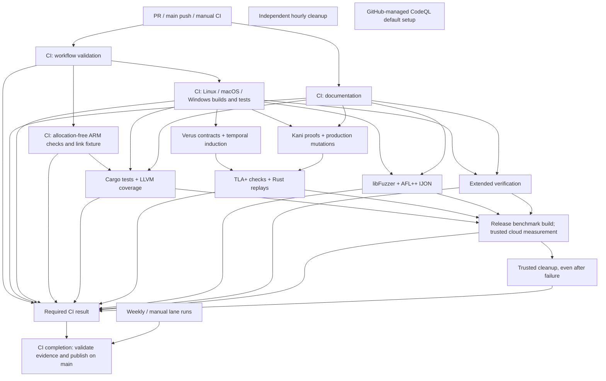

# Quality checks and benchmark reports

Pull requests compile default features on **Linux, macOS and Windows** and run
smoke checks plus selected minimal storage, TLS and QUIC feature profiles.
There is no feature powerset matrix. Full correctness
checks use nextest and a separate doctest command on the supported Linux verification host:

```sh
cargo nextest run --locked --workspace
cargo test --locked --workspace --doc
```

These commands cover unit/integration tests, doctests, bounded models, Miri,
mutation controls, fuzz/sanitizer controls, owned workspace crates, upstream quiche adapters,
C++ interoperability and downstream checks. Native tools and pinned verification
prerequisites are still required; see [Testing](Testing.md) and the
[full setup action](../../.github/actions/quality-setup/action.yml). Tests launch
specialized subprocesses where needed. Benchmarks do not run as tests.
Documented ignored diagnostic/unbounded/release-publication controls remain
outside the default bounded test run; [ignored-tests.json](../../quality/ignored-tests.json)
records their rationale.

| Workflow | Trigger | Scope and report artifact |
| --- | --- | --- |
| [CI](../../.github/workflows/ci.yml) | PR; push to `main`; manual | Library/binary builds and RPC/pipelining, transport and selected feature checks on all three OSes. Linux/macOS also test storage reopen; Linux enforces allocation budgets and QUIC v1 interoperability. `platform-report` |
| [CI / Workflow validation](../../.github/workflows/ci-workflows.yml) | Called once by CI; manual | Workflow, auditable-build, trigger-test and README-reporting changes: actionlint with ShellCheck/Pyflakes, trigger regression tests, reporting tests and Zizmor |
| [CI / Documentation](../../.github/workflows/ci-docs.yml) | Called once by CI; Tuesday 05:43 UTC; manual | Documentation/workflow/wiki-tool changes: wiki validation/export and local links. External checks are advisory and run only weekly/manually. `github-wiki`, `documentation-links` |
| [Verification / Extended](../../.github/workflows/verification-extended.yml) | Called by CI; Wednesday 04:37 UTC; manual | Bounded Miri endian/seed sweep, native cargo-careful checks, LLVM IR size reports, and guard mutation/coverage controls in independent jobs |
| [Verification / Cargo tests](../../.github/workflows/verification-tests.yml) | Called by CI; Monday 03:19 UTC; manual | One LLVM-instrumented Cargo partition, un-instrumented C++ reference suites, advisory checks, coverage regression report. `cargo-test-report` |
| [Verification / Formal checks](../../.github/workflows/verification-models.yml) | Called by CI; Monday 03:29 UTC; manual | Verus source/temporal proofs (`verus-report`) and four required Kani proof/control shards (`kani-report-1` through `kani-report-4`), then distributed TLC checks and Rust replays (`models-report`). Separate proof-duration and model-state graphs. |
| [Verification / Fuzzing](../../.github/workflows/verification-fuzz.yml) | Called by CI; Monday 03:39 UTC; manual | Six libFuzzer/ASan targets and four AFL++ targets with RPC IJON guidance. Engine-specific execution, feedback and finding graphs. `fuzz-report` |
| [Performance / Dedicated benchmarks](../../.github/workflows/performance.yml) | Called by CI; manual | Build and smoke-test release artifacts on every PR; trusted runs measure application workflows across two dedicated VPC peers, followed by separate loopback controls. `benchmark-bundle`, `benchmark-build-provenance`, `dedicated-benchmark-report` |
| [Benchmark droplet cleanup](../../.github/workflows/maintenance-benchmarks.yml) | After CI benchmarks, even on failure; every hour at :17 UTC; manual | Destroy this repository's abandoned benchmark resources older than two hours; requires trusted credentials |
| [Reports / Publish](../../.github/workflows/reports.yml) | CI or standalone Cargo, formal-check, fuzzing or benchmark completion; manual run ID | Validate trusted default-branch producer artifacts and publish to `reports`; it does not rerun their tests |

## Trigger and concurrency policy

CI is the only automatic push/PR entry point. It calls workflow validation and
documentation as reusable workflows, then starts platform builds after workflow
validation succeeds. Allocation-free core/engine checks and a bare-metal link
fixture run alongside platform builds; Cargo/coverage also waits for this lane.
Cargo/coverage, models, fuzzing and extended verification
then run in parallel after platform and documentation checks. Release benchmarks
follow all four verification lanes. Branch work runs through `pull_request`; only `main` has an
automatic `push` trigger. Feature branches without a PR can dispatch CI manually.
The unconditional final CI job checks every required dependency, including failed
or skipped jobs, so workflow validation and documentation failures cannot produce
a green result. Tag pushes do not start CI.

New commits to the same PR cancel its stale checks. Main runs are serialized
without cancelling an active paid measurement. Workflow, event and PR/ref
identity keep unrelated checks separate, including scheduled external-link
checks versus ordinary documentation pushes. Full and extended verification
retain their own cancellation groups. Dedicated benchmarks, cleanup and report
publication each serialize their own jobs without cancelling an active job;
cleanup remains independent of the benchmark job so it can recover abandoned
resources. Cancellation of an enclosing PR run can still interrupt a measurement;
its unconditional cleanup and the independent hourly janitor handle that case.
Manual dispatch is an explicit additional run.

Fork and Dependabot PRs compile the same optimized benchmark bundle without
secrets; cloud measurement and cloud cleanup are explicitly skipped. Same-repository
PRs and main use the `Benchmarking` environment and its configured protections.
Missing credentials fail trusted measurement instead of recording a benchmark pass.
No PR publishes the default-branch dashboard. Four uniquely named `readme-data-*`
artifacts share a CI run; the publisher validates each lane, attempt and commit,
then merges all four into one atomic reports-branch update. Standalone scheduled
or manual lane runs remain publishable. Reusable calls do not trigger separate
publication runs.

The two GitHub-managed **Dependabot Updates** jobs come from the separate Cargo
and GitHub Actions ecosystems in [dependabot.yml](../../.github/dependabot.yml).
They update dependencies; they are not duplicate Quality runs. GitHub-managed
**Dependency Graph** analysis also has a distinct purpose: it does not run the
platform tests. The README
publisher pushes with `GITHUB_TOKEN`, which GitHub excludes from ordinary
[recursive workflow triggering](https://docs.github.com/en/actions/how-tos/write-workflows/choose-when-workflows-run/trigger-a-workflow).

Trigger changes apply when the branch contains the updated workflow files.
Branches created before this policy must incorporate it to stop their old
branch-push triggers. Already queued runs are not removed by a workflow edit.

The Rust development tool enforces this policy. Locally, run:

```sh
cargo run --locked -p capntproto-dev -- check-workflows
```

Require **Required CI result** in branch protection (replace the former
**Required platform report** check when adopting this workflow layout). This gate
now includes coverage, all verification lanes and benchmark compilation/measurement
according to the credential policy above. Windows also exercises
component storage and retained snapshots; CI does not establish power-loss
durability. Platform
qualification requires successful hosted checks; local Linux validation is not
macOS/Windows validation.

## Workflow dependencies



Solid edges are `needs`, reusable-workflow calls, or report-producer completion
triggers. CodeQL's default setup runs independently on PR/main and its weekly schedule;
there is no second repository CodeQL workflow. Benchmark cleanup also runs inside
its producing job; the hourly workflow recovers abandoned
resources. Report publication never launches another verification or benchmark run.

## Independent verification partitions

The local `cargo nextest run --workspace` entry point remains comprehensive. CI gives
expensive campaigns explicit owners:

- Cargo selects all ordinary tests/doctests, filtering `tlc`, `native_fuzz_smoke`,
  `serialization_and_ownership_miri`, and the two `authority_and_transition_*`
  controls. LLVM coverage combines the nextest run and the separate doctest run.
- [Verus and Kani](Formal-Verification.md) check inventoried production proofs
  and required fault controls before the TLC job. Verus also checks unbounded
  temporal induction through the verified verus-tla library. Each lane has
  separate artifacts and graphs; proof duration is not coverage. Proof counts
  are not added to Cargo test counts or the published TLC replay/state history.
- TLA+ selects tests containing `tlc`, including the bounded catalog, negative
  controls, and Rust trace replays. Helpers reject TLC calls from the Cargo
  partition, so an incorrectly named new test fails visibly. Each model job uses
  a fresh session identity; repeated readers reuse only checks from that session.
- Fuzzing owns both mutation engines. Extended verification owns Miri and guard
  mutation/coverage controls. The platform CI matrix retains its fast regression
  subsets; these are distinct platform qualifications, not full campaign reruns.

`quality/src/lanes.rs` is the shared partition policy. Expected mutation violations
are successful controls only when both TLC's exit status and the named invariant
match. TLA+ reports retain separate nextest replay counts and unique
module/configuration/expected-exit checks; state totals across configurations
are not a claim of globally distinct states. Fuzz feedback and source coverage
have different units and are never combined. The new Cargo coverage scope is
`first-party-owned-crates-v3`: older scopes need explicit review; the imported core, RPC, futures and codegen
crates are now included.

Every producer uploads a README, SVGs, measured counters and diagnostics and
publishes its own measured commit through the trusted report publisher. Cancelled
or missing measurements cannot reuse an earlier green report. No new histories
are invented when migrating the combined reports.

## Rust dependency caching

Every Cargo job uses [Swatinem/rust-cache](https://github.com/Swatinem/rust-cache),
pinned to a reviewed commit in the shared setup action. Restore occurs after
Rust toolchain setup and before cargo-auditable installation and project builds.
Keys separate platform, coverage, extended-check and benchmark configurations;
the action also hashes toolchains, manifests, lockfiles and compiler settings.
Only trusted `main` runs save caches; PRs can restore them. Cargo verifies its
fingerprints, and every requested test still runs after a cache hit.

The cache holds registries, dependency build artifacts and installed Cargo tools.
Coverage uses registry/tool caching only: its large source-bound instrumented
targets are rebuilt, and raw counters and reports are never restored as measurements.
The workspace-specific targets for downstream consumers and benchmarks are mapped
explicitly rather than sharing incompatible quiche build artifacts.

## Auditable Cargo builds

Every CI job that invokes Cargo first runs the shared
[auditable setup action](../../.github/actions/auditable-setup/action.yml). It pins
**cargo-auditable 0.7.6** and **rust-audit-info 0.5.4**, then puts a Cargo wrapper
on PATH. Builds, tests, examples, coverage, benchmark compilation, nested Cargo
commands and subsequent `cargo install` commands use `cargo auditable`. The
wrapper preserves `+toolchain` selection and explicit `cargo auditable` calls.
The initial installation of cargo-auditable itself is the bootstrap exception.

Use the same setup locally from the repository root in bash (Git Bash on Windows):

```sh
bash scripts/setup-auditable.sh
export PATH="$PWD/target/auditable-tools/wrapper:$PWD/target/auditable-tools/bin:$PATH"
cargo nextest run --locked --workspace
cargo test --locked --workspace --doc
```

Keep that PATH active for build, benchmark, verification and release commands.
No system Cargo installation is replaced. The ordinary workspace test command
is unchanged. All tools and the wrapper live under ignored `target/`.
Each platform smoke job checks wrapper argument forwarding, including the
macOS runner's Bash 3.2, before invoking Cargo. Schema fixtures come from the
pinned C++ submodule; Linux jobs install both the compiler and schema headers.

Platform jobs also package and compile the extracted `capntproto-core` crate with Rust
1.97.0, its declared minimum. Package contents include sources, tests,
license and documentation, while upstream archive metadata remains outside it.
Platform jobs extract dependency metadata from both application binaries and
fail if it is missing; their JSON inventories include binary SHA-256 hashes.
Benchmark bundling requires metadata in **all eight Rust executables**, including
the instruction harness and Gungraun runner, before producing a valid manifest.
Import extracts it again and checks it against the manifest. These inventories
travel with the existing source/compiler/lockfile provenance.

Cargo omits an explicit crate type for benchmark executables. A small
[compiler adapter](../../scripts/auditable-bench-rustc.sh) makes the default `bin`
type explicit so cargo-auditable embeds metadata while retaining individual
`cargo bench --no-run` builds. It rejects a conflicting `RUSTC_WRAPPER`. Existing
benchmark artifacts built without this adapter must be cleaned once before
reuse; the metadata gate rejects them. Benchmark dependencies stay in ordinary
`[dependencies]` because cargo-auditable excludes development-only dependencies.

The embedded inventory describes Cargo dependencies of supported linked binaries
and C-compatible dynamic libraries. It does not describe system libraries or the
separately compiled C++ reference, whose pinned provenance is recorded separately.
Rust libraries, ordinary test harnesses, doctests, Miri interpretation and IR-only
checks do not all produce eligible binaries. Their Cargo invocations still go
through the wrapper; Miri explicitly ignores compiler wrapping. Dependency
inventories complement the existing advisory scan; embedding metadata is not a
security audit.

## Focused checks and tool versions

All maintained Rust implementations live in owned workspace crates. Workspace
Clippy with warnings denied and ordinary Cargo tests cover them directly.
The `core_feature_profiles` test checks no-std and allocation-only builds;
`nightly_rpc_try_contracts` checks the optional feature on the pinned nightly.

The platform jobs cover default-feature compile/smoke checks and selected minimal
feature profiles; no feature powerset matrix is introduced. Allocation contracts in [allocations.rs](../../tests/allocations.rs)
use allocation-counter **0.8.1**, run with `cargo nextest run --workspace`, and also run on
Linux PRs. They require zero allocations for repeated borrowed generated field
reads and synchronous decoding into caller storage. Async scratch decoding
permits segment metadata allocation but must avoid allocating the 8 KiB payload
when caller storage fits; a fallback control must allocate that payload.
A positive control must observe a heap allocation. The allocator is linked into this test binary only; measurements are
thread-local and make no claim about other tasks or threads.

Workflow checks use actionlint **1.7.12** and Zizmor **1.30.1**. Actions are pinned
to commit IDs. Zizmor audits the repository's `.github` directory, including
composite actions and Dependabot configuration. Vendored upstream workflows
are not executed by this repository and are outside that input scope.
Zizmor uses `advanced-security: false`, so findings fail the job
without requiring code-scanning merge rules. Targeted suppressions keep
checked-out composite action syntax compatible with the pinned actionlint and
allow the intentional PATH additions for auditable Cargo. They do not exempt
the actions' other contents from analysis.

Lychee **0.24.2** checks first-party documentation. Its
[configuration](../../quality/lychee.toml) identifies historical evidence archived
outside the repository and generated/downloaded paths absent from a clean clone.
Ordinary source links and frozen measurements remain checked. External sites are
checked separately so transient failures do not block code PRs. The workflows
with path filters should not be unconditional required checks in branch protection.

Verification / Extended has three independent, bounded jobs:

- **Miri:** `CAPNTPROTO_MIRI_EXTENDED=1 cargo nextest run --locked --test memory_safety`
  retains the existing 96 interpreted ownership executions and adds six wire
  tests with seeds 2–5 on x86-64 and big-endian `s390x-unknown-linux-gnu`: 48 more
  executions. Compiler, source hashes, exact test inventories, targets, seeds,
  and logs are retained. This is interpretation, not native s390x qualification.
  It uses the pinned nightly **2026-08-29** and a 45-minute job limit.
- **cargo-careful 0.4.10:** pinned nightly **2026-08-29** with `rust-src`, a
  separately built standard library, and a 35-minute limit. Tests cover native
  storage fault recovery, descriptor passing, framing and allocation budgets.
  The TLC descriptor replay remains in the ordinary full suite; this job selects
  native checks. It does not instrument C++ internals or replace sanitizers/Miri.
- **cargo-llvm-lines 0.4.48:** reports optimized IR line and instantiation counts
  for the runtime and `native_store` consumer with Rust **1.97.0**. Generated generic
  code is instantiated by the consumer. Reports retain compiler identity and the
  commit; these counts are not build timings and have no regression threshold yet.

Refresh cargo-careful and its dated nightly together; its compatibility window is
shorter than the main compiler pin. Tool failures fail their respective jobs.

## Complete LLVM reporting and regression gates

```sh
cargo run --locked -p capntproto-quality -- coverage target/quality/coverage
cargo run --locked -p capntproto-quality -- security target/quality/security
cargo run --locked -p capntproto-quality -- report target/quality coverage,security
```

The collector uses pinned nightly Rust/LLVM 22. It runs the Cargo partition once
with default features and collects ordinary nested Rust crate profiles. Miri,
sanitizer and mutation subprocesses retain their own toolchains. The independent
C++ reference suites still execute, without coverage instrumentation or counters
in this report. Separate Cargo target directories prevent incompatible quiche
artifacts from being shared across workspaces. Every collection uses fresh raw
profiles even when Rust dependencies are restored from cache.

Only project-owned `.rs` sources enter `coverage/FILES.md`, totals and regression
checks: the runtime, core, RPC engine and wire driver, async framing, codegen, schema compiler,
compatibility crate, quality tools, test support,
tests, examples, fuzz harnesses, benchmarks and Miri checks. An explicit file
allowlist is passed to **all** LLVM JSON, LCOV and HTML exports. Vendored crates,
C++ reference sources, Cargo registry dependencies generated `OUT_DIR` files and checked-in `*_capnp.rs` bindings
are excluded. Instrumentation of linked Rust dependencies may still be present
in raw execution profiles; it does not enter the published coverage scope.
See [LLVM's source filtering](https://llvm.org/docs/CommandGuide/llvm-cov.html#export-command).
JSON and LCOV capture stdout separately from diagnostic stderr. LLVM warnings
remain in the export logs and cannot corrupt the machine-readable artifacts;
nonzero exit statuses, deadlines and cancellation still fail the collection.

Zero-hit owned code remains in the denominator. Owned files without executable
mappings are explicit N/A, never counted as covered. The scope is versioned as
`first-party-owned-crates-v4`; this adds the previously omitted RPC wire crate. A baseline from an older scope is
rejected and must be reviewed again. Linux coverage does not qualify other OSes.

Per-file and aggregate **line, region, function and branch ratios** have a maximum
0.5 percentage-point allowance against `quality/coverage-baseline.json` for
scheduler-dependent async paths. Larger drops fail. A drop to zero hits or zero
mapped counters fails even inside that allowance. Lost instrumentation, changed
compiler/options, stale source hashes and inconsistent raw counters fail checks.
The initial baseline is a complete `coverage/summary.json` from a successful
collection of this scope, committed as `quality/coverage-baseline.json` after
inspecting its files and counters. Changes to a baseline require review. Missing
baselines still fail the final report; CI never creates one automatically or
substitutes the current run for a missing comparison.

Owned build scripts declare `LLVM_PROFILE_FILE` with Cargo's
[`rerun-if-env-changed`](https://doc.rust-lang.org/cargo/reference/build-scripts.html#rerun-if-env-changed)
directive. Each collection uses a new profile directory, so a warm Cargo target
reruns schema generation and produces fresh counters. It must not reuse old
profile files or silently lose build-script coverage. A regression test checks
the real RPC package on a cold build, a warm build with a new destination, and a
warm build whose destination is unchanged.

The first `first-party-owned-crates-v3` baseline was measured on Linux x86-64 on
2026-10-03 from commit `ed95a35ac`, using the pinned coverage compiler and flags.
Its source fingerprint is
`fec878f884402877922bf93693050d11cf88fcc25d6ae8ecccb6efab3971e2fd`.
The instrumented workspace run passed 1,236 tests. The baseline inventories 558
owned source files: 515 have LLVM mappings; 43 are explicitly unmapped. The four
imported Rust crates each have measured coverage. Raw-counter hashes, source-file
hashes and per-group totals were checked before saving the initial summary as
the baseline. The initial measurement is a regression reference, not a claim that
all code paths are covered.

The October 2026 CI requalification reviews the baseline after the nextest
migration, separation of Cargo/TLA+/fuzz lanes, codegen file split, and RPC
optimizations. The original comparison and logs remain failed evidence; changing
the reference does not certify that run. A subsequent CI run must pass the
comparison against the reviewed snapshot before merge. Coverage policy errors
retain the measured counters in evidence, and the report includes the original
failure diagnostic rather than only a generic failed-evidence message.

The review distinguishes executable gaps from changed denominators. Added tests
exercise stream rejection and overflow without corrupting pending bytes, real
QUIC reset propagation, copying-output EOF, multi-segment batch fallbacks,
scratch segment inventories, high-ID lookup and owner destruction. Reporting
tests run real passing/failing nextest fixtures and reject stale or absent JUnit
reports. Coverage-parser tests preserve zero-hit sources, reject malformed or
duplicate exports, and verify workspace/profile isolation.

Remaining zero-hit mappings stay in the snapshot. Examples include clock
callbacks and queued futures which negative controls require never to execute,
32-bit framing overflow paths unreachable on the measured 64-bit target,
platform-specific errors, and model replays now exercised in the independent
TLA+ lane. Burst-buffer trimming and canceled borrowed-driver paths also remain
partly unmeasured. Assertions added to unsafe test fixtures contribute untaken
failure branches. Moving code out of `codegen.rs` and removing covered statements from
join handling can lower a file ratio without adding uncovered lines. Changed
LLVM mappings in generic/generated call sites also change region counts. These
are reviewed baseline differences, not exclusions or claims of coverage. Every
source-group metric must still be compared with the original baseline during
review, and CI continues enforcing per-file and per-group ratios thereafter.

The reviewed replacement was collected on Linux x86-64 on 2026-10-06 from
`8f3e05e23`, with the same pinned compiler, flags and ownership scope. All 1,349
instrumented Cargo-partition tests and workspace doctests passed. The snapshot
inventories 603 source files, with 558 mapped and 45 explicitly unmapped. All 36
group metrics meet or exceed the original baseline; 32 per-file metric changes
remain after the added tests. The complete measured summary is committed without
altering its counters. Source hashes and every mapped metric were checked against
the raw LLVM export. Its source fingerprint is
`adaac8a40b0581d2903533d0ae2556b38d94c54d54d2153a1616caa535dac6d7`;
the raw LLVM JSON SHA-256 is
`88143aa8049c8d3b2dfe1661bbb0027fbb6c15904b3f55b7ed2524e03b1e0761`.

The TCP/portability follow-up was reviewed on 2026-10-07 with the same scope,
compiler and flags. All 1,381 instrumented Cargo-partition tests and 64 runnable
workspace doctests passed. The complete replacement snapshot inventories 610
owned source files: 563 mapped and 47 explicitly unmapped. Every source hash,
mapped metric and group sum was checked against the source tree and raw export;
no mappings were lost. Its source fingerprint is
`ee551cefde15012b97ac7ce31ddf70b66469e4f14e5f14c92384f44a66c26f2c`, and the raw
LLVM JSON SHA-256 is
`ec5d221e492642bf181fda4ffc0eaf4f45a2f2469c098102d6867508dc39eed4`.

Added tests cover malformed/missing benchmark trials, the exact 1.15× boundary,
retention of slow samples, valid-but-slow reports and their diagnostic charts,
engine source ownership, and concurrent verification captures. All four tool
group ratios improved. Thirty-two of 36 group metrics meet or exceed the prior
reference. The four decreases retain their actual measured counters:

| Group / metric | Previous covered/total | Reviewed covered/total |
| --- | ---: | ---: |
| Capability RPC / functions | 883/986 | 909/1017 |
| Tests and verification / branches | 2240/4050 | 2241/4056 |
| Wire runtime / functions | 2020/2414 | 2028/2424 |
| Wire runtime / branches | 1537/1976 | 1541/1982 |

Eighteen per-file metric decreases were reviewed. The new framing overflow
closures are unreachable on the measured 64-bit host; separate 32-bit Miri
executions exercise rejection without claiming 64-bit coverage. Hosted Join and
Return handlers validate question state before the portable transition, leaving
its defensive error conversions unexecuted there. Removing two covered RPC lines
leaves the same 216 uncovered lines, and changing generic IO adapters removes
one covered region per transport without adding uncovered regions. Collector
registration, capture cancellation/OS errors, and untaken test-assertion failures
remain explicit gaps. None is removed from the denominator.

The snapshot is the complete measured summary, with no counter adjustments.
Original failed comparisons and the raw review remain in
`target/tcp-portability/coverage-isolated/` and `coverage-review.json` under its
parent directory. Updating the reference does not certify that failed run:
a subsequent collection must pass the unchanged per-file and per-group gates.

The v4 requalification uses fresh instrumented builds and profiles: all 2,014
Cargo-lane tests and 85 runnable doctests passed. The reviewed summary contains
956 source files, 828 mapped and 128 explicitly unmapped, with no lost mappings
among previously measured files. The newly included RPC wire crate contributes
99 mapped files and 18,128/22,518 covered lines. Overall capability-RPC line
coverage is 88.93% versus 91.05% in the last v3 snapshot; codegen is 90.73% versus
91.89%, and tooling is 66.67% versus 71.46%. Expanded and newly mapped code retains
its uncovered counters. An unchanged QUIC adapter also records one fewer covered
line (128/134 versus 129/134); the measurement is preserved without adjustment.
Source identity is `fe494ef61ee07c06fbaf86e6cfb5961ed577cbdc48c68f6b3fe41213cb3cfcff`;
raw LLVM JSON SHA-256 is
`481a66442a0c5cd962c25d2ecd545ff16906b4ce73ced2da07ca51fd673e5cd4`.
The report validator independently checks those raw counters and source hashes.
This local requalification does not certify the other CI lanes or a release.

The Fuzzing job packages its reports, logs, queues, crashes and hangs in
`fuzz-report.tar.gz` before artifact upload. This preserves AFL's colon-containing
filenames, which GitHub's artifact uploader rejects as individual files. Extract
the archive to inspect `target/quality/fuzz/README.md` and `FAILED-TESTS.md`, graphs,
`target/verification/native-fuzz/` logs, and `fuzz/artifacts/` reproducer inputs.
Packaging runs even when a campaign fails, and retains the failing run's evidence.

## Dedicated remote workflows and loopback controls

The CI runner provisions **two** dedicated droplets: one client and one server,
on the same plan, region and VPC. Workload traffic is direct plaintext TCP over
the server's private IPv4 address. SSH uploads binaries and retrieves artifacts;
it does not tunnel measured traffic. The server binds only its private address
and restricts the six benchmark ports to the client droplet. The provider's
[`vpc_uuid` placement field](https://docs.digitalocean.com/products/droplets/reference/api/droplets/)
pins the second peer to the first peer's VPC. A second-peer capacity failure
cleans up both peers instead of changing region or hardware silently.

The shared [workflow catalog](../../benchmarks/rpc/workflows.json) exercises
legacy Rust RPC, portable Rust RPC, published upstream Rust RPC (`capnp-rust`),
pinned upstream C++, gRPC and WebSockets.
The Cap'n Proto implementations use the same schema. gRPC uses protobuf unary
methods over HTTP/2; WebSockets use binary protobuf application messages:

| Case | Work per measured iteration |
|---|---|
| `unary-empty`, `unary-small`, `unary-1k` | One validated echo at 0, 64 or 1,024 bytes |
| `fanout-32` | Issue 32 independent 1 KiB calls concurrently and validate every response |
| `dependent-read` | Open a state capability, await it, then read 1 KiB |
| `pipelined-read` | Open the same capability and send its read before awaiting the open response |
| `write-read` | Update a retained state capability with an expected version, then validate the new version and 1 KiB data |
| `callback` | Pass a client capability, receive and validate its callback, then await the outer completion |
| `bulk-64k`, `bulk-256k`, `bulk-1m`, `bulk-4m` | One validated request/response at 64 KiB, 256 KiB, 1 MiB or 4 MiB |

There are **70 supported workflow/implementation cells**. Promise-pipelined
reads are explicitly unsupported for gRPC and WebSockets and excluded from
ratios, rather than replaced with sequential reads. Their state references use
application IDs without capability security. A dependent read consumes its
temporary cell; retained state is released outside timing, with bounded leases
for abandoned clients. Callbacks use four duplex messages: request,
notification, acknowledgement, completion. gRPC uses a bidirectional stream
opened before timing; WebSockets use the existing connection. Fan-out sends
32 outstanding messages or unary calls before awaiting completion. No protocol
uses compression; all are plaintext, and WebSocket clients use standard masking.
The 4 MiB payload is echoed in both directions. Workflow gRPC and WebSocket
message limits are 8 MiB to include framing; portable RPC uses an 8 MiB frame
limit and a 32 MiB buffer budget. These limits apply only to workflow benchmarks;
the existing small-call microbenchmark configuration is unchanged. Workflow
format version 3 retains the same workload semantics. The required matrix now
includes upstream Rust at every payload and capability workflow; older partial
matrices fail validation.

The independent [upstream Rust benchmark](../../benchmarks/rpc-upstream/README.md)
pins crates.io `capnp` 0.27.2, `capnp-rpc`/`capnpc` 0.27.0 and its own lockfile.
It uses upstream’s buffered TCP adapter arrangement and the same application
workload and timing source as our two drivers. It links no capntproto runtime
crate. Bundle construction verifies this separation and records the upstream
versions, lockfile hash, executable hash and embedded dependency inventory.
Both loopback charts and remote workflow charts include it, with ratios
against the matching C++ cell. It is a descriptive reference, not subject to
the performance acceptance threshold for our own TCP driver.

Five repetitions rotate implementation order. Every cell has 250 warmups and
1,000 retained workflow samples, with setup excluded and validation, response
cleanup and a ten-second workflow deadline included. One CPU is selected on each
host and reused across implementations. The client alone measures elapsed time;
no clock synchronization or one-way latency inference is needed. Fan-out latency
is the latency of the whole 32-call batch. Workflow/s and RPC/s are reported
separately; these closed-loop workloads do not measure open-loop saturation or
an arrival-rate SLO. This initial remote suite compares plaintext TCP; native
QUIC, TLS/mTLS, failure recovery and three-party routing remain separate tests.

`target/quality/benchmark/remote/README.md` and `p50-ratios.svg` report each
workflow's p50/p95/p99, throughput and p50 ratio to C++. Adjacent JSON, per-trial
client CPU/RSS logs, both host environments and provisioning receipts preserve
the evidence. Client resource logs include process startup and warmup. Server
CPU counters cover the whole campaign, including idle and
setup time. A missing cell, duplicate repetition, mismatched bundle, same-host
run or local smoke record fails validation. Remote results are descriptive
baselines; the existing loopback acceptance gate does not apply to them.

```sh
# Credential-free smoke test: all 70 supported cells, not timing evidence.
cargo run --locked -p capntproto-dev -- digitalocean-bench smoke \
  --bundle target/benchmark-build/bundle --output target/workflow-smoke \
  --state target/workflow-smoke-state

# Requires DIGITALOCEAN_ACCESS_TOKEN and GITHUB_REPOSITORY; use fresh paths.
cargo run --locked -p capntproto-dev -- digitalocean-bench run-remote \
  --bundle target/benchmark-build/bundle --output target/quality/benchmark \
  --state target/remote-benchmark-state
```

Every PR builds and smoke-tests the workflows locally, including 72 cross-language
checks against C++ in both directions across all three Rust implementations. Trusted CI runs execute
the remote campaign, stop its servers, and then run the existing loopback and
instruction controls on the already-provisioned client. The workflow summary
and downloadable artifact keep remote results separate from those controls.
Local smoke success does not establish a remote performance ratio.

Add **`DIGITALOCEAN_ACCESS_TOKEN`** as a secret in the GitHub environment
**`Benchmarking`** (Settings → Environments → Benchmarking). Both the dedicated
benchmark job and scheduled cleanup job use this environment. It needs access
to read plans, create/read/delete Droplets and SSH keys, and create/read tags.
No local token or persistent SSH key is required. Run **Performance / Dedicated benchmarks**
from a trusted revision. The workflow generates temporary client and host keys,
pins the host key, and exposes the token only to the infrastructure steps.

Region and size default to `auto`, with `ubuntu-24-04-x64`. A read-only capacity
check runs before provisioning. Auto selection uses
an available four-vCPU CPU-Optimized `c-4` or `c-4-intel` plan, preferring `c-4`
and `nyc3` when available. Explicit region/size inputs are honored; unavailable
choices fail with available alternatives rather than silently changing the host.
Only dedicated `c-N` / `c-N-intel` sizes are accepted, with a **$0.50/hour rate ceiling
per host ($1.00/hour combined maximum)**.
Catalog availability does not reserve capacity. A recognized HTTP 422 capacity
rejection tries the next eligible pair (at most 24 attempts), changing only inputs
set to `auto`. Each pair is tried once. Quota, billing, invalid configuration and
ambiguous network failures stop without retrying creation. The provider's error
code and message are retained with credentials and cloud-init data redacted;
Each role's `provisioning.json` records every attempt and `droplet.json` identifies the host
actually created. A failed create still follows the receipt/tag cleanup path.
A failed measurement does not run sample-validation
steps or publish stale measurements. Ubuntu 24.04 builds
run on Ubuntu 24.04 to preserve shared-library compatibility. The C++ reference
uses Clang and its pinned upstream source. Nothing is compiled on the droplet.

The build job invokes each target independently:

```sh
cargo bench --locked --manifest-path benchmarks/rpc/Cargo.toml --bench tcp --no-run
cargo bench --locked --manifest-path benchmarks/rpc/Cargo.toml --bench native --no-run
cargo bench --locked --manifest-path benchmarks/rpc/Cargo.toml --bench capnp_cpp --no-run
cargo bench --locked --manifest-path benchmarks/rpc/Cargo.toml --bench grpc --no-run
cargo bench --locked --manifest-path benchmarks/rpc/Cargo.toml --bench websocket --no-run
cargo bench --locked --manifest-path benchmarks/instructions/Cargo.toml --bench hot_paths --no-run
```

`benchmark-build` also compiles the independent pinned C++ executable and the
comparison driver, copies Cargo-reported executable paths into a bundle, and
records compiler/source/lockfile/binary identities. The remote driver verifies
binary hashes before measuring. An individual `cargo bench --bench NAME` runs
that protocol's workload; the C++ wrapper additionally requires
`CAPNTPROTO_CPP_BENCH` pointing to the compiled `capnp-reference` binary. Full
comparison timing runs on the droplet with protocol order rotated between five
repetitions. The comparison driver uses `taskset` to pin the server and client
to two distinct cores reported by the host topology, respecting its allowed CPU
set and skipping sibling hardware threads. Every protocol uses the same pair.
The selected CPUs, allowed set and topology are retained in `environment.json`;
unavailable affinity or fewer than two allowed cores fails the comparison.
Individual `cargo bench --bench NAME` runs retain the caller's CPU affinity.

The standalone TCP benchmark measures the opt-in portable RpcSystem by default;
`CAPNTPROTO_BENCH_PORTABLE=0` selects the legacy control. This benchmark choice
does not change the library's default RpcSystem. The CI loopback control explicitly
selects legacy RPC; the remote suite measures both drivers. Comparisons record the selection as `tcp_driver` in
`environment.json`. Build the driver and TCP bench in release mode, then run
`CAPNTPROTO_BENCH_PORTABLE=1 driver compare-tcp TCP_EXECUTABLE CPP_EXECUTABLE NEW_OUTPUT_DIRECTORY`.
Use the actual Cargo-reported TCP executable and the compiled C++ reference.
The portable gate requires pooled p50 no greater than **1.5× C++ at each of 0,
64 and 1024 bytes**. Its 65536-byte results and p95/p99 remain visible as
diagnostics. The legacy control retains its 1.15× gate at all four sizes. Preserve source
and binary identities and avoid compiler/test load during timing. Passing the
legacy path does not qualify the replacement driver.

Actions streams the driver's workflow/protocol, payload size and repetition progress while
retaining it in `runner.log`. Setup stages identify cloud-init, runtime-tool
installation and bundle upload separately. The driver has a 20-minute overall
limit for loopback controls; remote workflows have a separate 25-minute limit.
A failed or timed-out run downloads available partial logs and samples
before cleanup and still fails the job. Partial samples are diagnostic evidence,
not published measurements. A low droplet-wide CPU reading alone cannot establish
whether this sequential latency benchmark is making progress; check the live
trial log and completed samples.

The bundle also contains Gungraun **0.20.0**, its matching precompiled runner, and
the instruction benchmark. The droplet installs Valgrind, but no Rust toolchain
or build dependencies. After the RPC timing runs, it profiles encode/decode at
64/1024/65536 bytes. Explicit workspace/output paths prevent Gungraun from invoking
Cargo remotely. The six summaries, runner/binary/lockfile hashes and Valgrind
version are retained; missing, duplicate, stale-baseline or invalid counters fail
import. Local verification uses the executable's `--test` mode without profiling.
Instruction counts measure the maintained serializer, including validation and
ownership cleanup, and do not compare the five RPC implementations. No historical
instruction-count regression baseline is claimed.

The separate loopback controls use IPv4 loopback, single-threaded server/client
processes, one outstanding call, 0/64/1024/65536-byte payloads, 10,000 warmups and
1,000 timed requests per repetition. Every response's sequence and payload are
validated. The longer warmup gives the host time to settle before collecting
short latency trials; the previous 100-request warmup lasted only a few
milliseconds for small messages. The same budget applies to all protocols,
and setup and warmup are excluded. All measured samples, including slow ones,
remain in the report. Reports include p50/p95/p99, sequential
request rate, comparison ratios, raw samples, CPU/OS details, Linux clock source
and droplet plan. Clock-read costs matter to user-space QUIC recovery and pacing;
compare implementations on the same host rather than extrapolating from a
development machine with a different clock source or power governor.
The default Capntproto TCP adapter and C++ Cap'n Proto both use plaintext TCP.
The separate native QUIC measurement uses QUIC v1 with TLS 1.3 and pinned peer
authentication; gRPC uses plaintext HTTP/2, and WebSockets plaintext binary echo. These security
and semantic differences are explicit; this is not peak concurrent throughput.

Portable acceptance requires plaintext TCP pooled p50 latency at or below
**1.5× C++ for every small-call payload (0, 64 and 1024 bytes)**; the legacy
control retains **1.15× at every size**. Both retain 64 KiB, p95 and p99 measurements.
The report preserves raw samples and graphs even when this gate fails. TLS/mTLS
and QUIC keep their security semantics and have separate measurements; their
ratios do not qualify the plaintext target. For a focused local comparison, build
the release `driver` and `tcp` bench, then run
`driver compare-tcp TCP_EXECUTABLE CPP_EXECUTABLE NEW_OUTPUT_DIRECTORY`.
It alternates the two implementations over five repetitions on the same pair
of physical cores and records executable hashes, topology, clock costs and all
samples. Do not run compilers or other test campaigns during latency measurement.

Measurement version 2 uses bulk payload comparison and includes response/promise
cleanup and a ten-second per-call deadline in each timed round trip. The old C++
harness asserted each byte separately and sampled before destroying its response.
That inflated its large-payload baseline: a five-repetition local control changed
the C++ 64-KiB median from 156.025 to 75.219 microseconds after bulk comparison and
cleanup were matched, before adding the matching deadline. This is a benchmark
correction, not a protocol speedup. Historical unversioned comparisons below are
retained as historical evidence and must not qualify the current target. The
driver and report validator reject legacy or mixed measurement versions. The
version-2 dedicated result below does not meet the 1.2× target.

The runner attempts deletion of both droplets and temporary SSH keys after
success, failure or cancellation, including partial provisioning. Both intended
names are recorded before any creation request; a lost response is not retried.
An Actions `always()` step verifies cleanup. A separate hourly janitor
recovers hosts/keys abandoned by runner loss, scoped by repository tag, unique
name and age. Cleanup failures fail the job. Scheduled Actions may be delayed:
this is not a guaranteed billing cutoff. DigitalOcean bills CPU Droplets by the
second at their hourly rate (minimum charges apply); **destroying** the droplet
ends billing, whereas powering it off does not. See [DigitalOcean pricing](https://docs.digitalocean.com/products/droplets/details/pricing/).

Do not treat old `target/quality` output as evidence for changed sources; reports
reject mismatched source fingerprints. Each workflow reports its own scope and
explicitly omits unmeasured coverage/performance rather than inventing results.

### Portable TCP qualification (October 11, 2026)

The portable driver passed the 1.5× small-call gate in two independent local
release/full-LTO comparisons on the Ryzen 7 5800H, using CPUs 0/2 and the matched
workload above. The confirmation run measured:

| Payload | Portable TCP p50 (µs) | C++ TCP p50 (µs) | p50 ratio | p95 ratio | p99 ratio |
| --- | ---: | ---: | ---: | ---: | ---: |
| 0 bytes | 56.781 | 38.133 | 1.489× | 1.462× | 1.448× |
| 64 bytes | 56.711 | 38.273 | 1.482× | 1.465× | 1.432× |
| 1 KiB | 57.480 | 39.460 | 1.457× | 1.444× | 1.406× |
| 64 KiB | 102.667 | 76.267 | 1.346× | 1.364× | 1.397× |

The initial run's small-call ratios were 1.494×, 1.484× and 1.492×. All samples
were retained; no compiler, tests or profiler ran during timing. Local raw trials,
summaries, executable hashes and CPU/clock metadata are in
`target/portable-optimization/batch54-comparison/` and `batch54-confirmation/`.
The reference is pinned C++ revision `0de72d8d8cec6b69edaa29de51d3bd490341f9c2`.
These are sequential plaintext loopback results, separate from the CI dashboard's
measured commit. They do not qualify encrypted transports or concurrent throughput.

Comparison with the legacy driver exposed avoidable builder allocation,
framing traversal and repeated scheduler work. The hosted adapter now reuses
released request/result segments in a bounded per-connection cache, grants ready
inbox calls a useful polling quantum, and keeps empty lanes out of output
reservation. Queue growth stays outside the common capacity check. The explicit
`cached_message_words` and `cached_message_segments` options bound released
application segments independently of live messages and the wire-buffer budget;
zero disables retention. Regression tests retain responses across reuse, check
zeroed segments, and exercise output exhaustion before call admission.

The allocation-free engine retains caller-owned storage and the same protocol
transitions. The library's default remains legacy while bilateral Join and
remaining tail/pipeline-only integration are completed. Performance qualification
alone does not establish that functional parity.

### Portable client instruction campaign (October 12, 2026)

The **21 million client instruction** target is met with the opt-in build settings
below: **20,981,715**, with repeat runs of **20,959,647** and **20,957,904**.
The ordinary full-LTO build measures **28,365,674** and does not meet that ceiling.
Local Callgrind measurements use the complete release/full-LTO plaintext
TCP client process, an empty payload, 100 warmups and 1,000 retained calls,
including process initialization, bootstrap and cleanup. The workload, timing
checks and measurement boundaries stay fixed across candidates.

| Candidate | Additional build settings | Client instructions |
| --- | --- | ---: |
| Portable campaign baseline | None | 66,401,123 |
| Portable checkpoint `batch108` | None | 30,149,143 |
| Legacy control `batch101` | None | 24,156,786 |
| Portable checkpoint `batch118` | Static C++ runtime | 27,481,967 |
| Portable checkpoint `batch120` | Static C++ runtime, LLVM PGO | 22,908,528 |
| Portable final `batch129` | Static C++ runtime, LLVM PGO, native CPU | **20,981,715** |
| Matched legacy control `batch130-legacy` | Static C++ runtime, independently trained LLVM PGO, native CPU | 16,723,238 |
| Portable final `batch131-ordinary` | None | 28,365,674 |

The final ordinary build reduces instructions by **57.3%** from the campaign
baseline; the tuned build reduces them by **68.4%**. Against the independently
trained legacy control with identical settings, the portable client uses
**1.255×** as many instructions. These are instruction ratios, not latency ratios.

Raw profiles, executable snapshots and measurement output are retained locally
under `target/portable-optimization/`. These instruction diagnostics do not
establish a latency ratio or qualify a release. The earlier latency qualification
above is historical evidence for its stated candidate.

Changes remove repeated envelope construction, retain validated serialized
frames, reuse request owners, defer general result-hook allocation, and coalesce
task notifications. Driver publication and maintenance now share one polling
budget across flushes. Network-control work invalidated during that scan must
still be polled or explicitly rescheduled; third-party transfer regressions
exercise this requirement at different budgets. More aggressive reply processing
and broad inlining trials regressed instruction counts and were reverted.

The final publication fast path lets a freshly sent, lone direct call sleep until
input or an application wake. Regression coverage checks cancellation and new
admission without unrelated IO. Compact receipt storage preserves fixed inline
arrays for allocation-free profiles, and data-only questions release their
request buffer after publication while retaining their exact method identity.
Selected-pointer validation retains traversal, nesting and capability checks;
tests compare its errors and limits against full-envelope decoding.

The shared benchmark harness now chooses the protocol before the timed loop.
This avoids moving a gRPC-sized future for each TCP call and benefits both Rust
drivers. Every call, timeout, clock read and response check remains present.
Historical checkpoints before `batch126` used the earlier harness layout; the
three final/control builds above all use the same updated harness.

The compiler experiments are opt-in, separate from the ordinary release build.
Static C++ runtime linkage reduces process initialization in this full-process
measurement; it does not remove BoringSSL or any transport. PGO trains both TCP
peers on payload sizes 0, 1, 7, 8, 31, 64, 256, 1,024, 4,096 and 65,536 bytes,
each with 100 warmups and 1,000 measured calls. Build scripts and proc macros do
not contribute training data. Bounds, overflow checks, validation, timeouts and
payload verification remain enabled. Training does not qualify all RPC features.

Reproduce with the pinned Rust toolchain, `llvm-tools-preview`, Valgrind and the
normal native build prerequisites:

```sh
cargo run --locked -p capntproto-dev -- rpc-instructions \
  --pgo --native-cpu --static-cpp --maximum 21000000 \
  --output target/quality/rpc-instructions
```

The command discovers the GNU/Linux C++ static runtime rather than hardcoding a
compiler version. It requires a new output directory, retains raw profiles and
executable snapshots, and writes `report.json` with the compiler, flags, training
outputs, workload, executable hash and instruction total. The maximum enforces
the ceiling after saving evidence. `--native-cpu` is a separate opt-in
for binaries restricted to a compatible CPU; neither PGO nor native CPU targeting
changes the project's default build. Omit all three optimization flags to measure
the ordinary full-LTO build (also omit the maximum for that comparison). Add
`--legacy` and use a new output directory to independently train and measure the
legacy control. Counts are host/toolchain-specific; this result does not change
the library's default driver or build settings.

Qualification for the final implementation: **2,174 workspace nextest tests
passed**, with seven existing skips, including native fuzzing, mutation checks,
Miri, C++ interoperability and optimized-runtime tests. The five portable feature
profiles passed **436 tests**; both allocation-free and allocating bare-metal
checks passed, and the allocation-free executable linked. Documentation tests
passed **85** with 13 existing ignores. The unsafe-documentation, repository and
workflow gates passed. Ten benchmark smoke cases checked 11,000 calls across
plaintext TCP, authenticated TCP, QUIC, gRPC and WebSocket. Kani was not available
locally. These checks cover the implementation before this prose-only report
update; the source checksums and tracked patch are retained beside `batch129`'s
binary and raw report.

### Latency check of the tuned candidate

Two separate, unprofiled comparisons of the same `batch129` executable against
the existing pinned C++ reference produced the following pooled median latencies.
Each comparison contains five alternating repetitions, 10,000 warmups and 1,000
retained calls per peer/payload pair, on separate fixed physical cores. No
compiler, test campaign or profiler ran during timing. All samples were retained.

| Payload | Portable p50 (µs), first run | C++ p50 (µs), first run | First ratio | Confirmation ratio |
| --- | ---: | ---: | ---: | ---: |
| 0 bytes | 38.483 | 37.785 | 1.018× | 1.011× |
| 64 bytes | 38.692 | 38.204 | 1.013× | 1.024× |
| 1 KiB | 39.461 | 38.971 | 1.013× | 1.013× |
| 64 KiB | 81.575 | 76.197 | 1.071× | 1.055× |

Both local comparisons are below 1.15× at all four payloads. This uses the tuned
Rust build above; the C++ reference was unchanged and was not retrained with PGO.
It is sequential plaintext loopback evidence, not qualification of ordinary-build
latency, encrypted transports, concurrent throughput or complete driver parity.
Raw samples, tail percentiles, executable hashes, CPU placement and clock-read
diagnostics are retained in `batch129-comparison/` and
`batch129-latency-confirmation/` under the same local campaign directory.

### Legacy driver instruction campaign (October 12, 2026)

The legacy driver now passes the **18 million client instruction** ceiling with
**17,788,526** instructions, down **23.9%** from the matched **23,366,812** baseline.
Both measurements use ordinary release/full LTO, one codegen unit and enabled
overflow checks, with a generic CPU target, dynamic C++ runtime and no PGO.
Both peers explicitly select the legacy driver. The complete Callgrind client
process includes startup, bootstrap, 100 warmups, 1,000 retained empty calls and
cleanup. Timeouts, timer reads, sequence checks and payload validation remain
unchanged. This is an instruction ceiling, not a latency or throughput ratio.

The changes reuse validated Call envelopes and the owned receive poller, drive
ready output during publication, cache the decoded result payload, simplify
response futures and avoid repeated builder/segment access. Bounds, nesting and
traversal budgets remain enforced. Question ownership is installed before calling
transport code, and protocol table borrows end before polling I/O. Regression
tests cover synchronous replies, reentrant writes, partial input, retained
responses, cancellation, flush ownership and independent template copies.

The raw report, binary hash, build log and Callgrind profiles are retained locally
in `target/legacy-optimization/final-ordinary/`. Reproduce using a fresh directory:

```sh
cargo run --locked -p capntproto-dev -- rpc-instructions \
  --legacy --maximum 18000000 \
  --output target/quality/legacy-rpc-instructions
```

An unprofiled comparison of this ordinary-build executable against the same
pinned C++ reference passed the 1.15× latency gate at every payload. Pooled p50
ratios were **1.004×** (empty), **1.000×** (64 bytes), **1.005×** (1 KiB) and
**0.914×** (64 KiB). Five alternating repetitions retained all 40,000 timed
samples after 10,000 warmups per peer/payload/repetition, on separate fixed
physical cores with compilers and tests stopped. Raw trials and environment
details are in `target/legacy-optimization/final-latency/`. Ten additional smoke
cases passed across plaintext TCP, authenticated TCP, QUIC, gRPC and WebSocket
at empty and 64 KiB payloads. These local sequential loopback results do not
qualify concurrent throughput or encrypted-transport latency.

The portable migration was paused with a source snapshot retained under
`target/portable-optimization/shelved-source.*`. Its later ordinary-build checkpoint
measured **26,053,204** instructions, improving on `batch131` above but still
missing the separate 25 million target. The opt-in tuned results above describe
their historical binaries; they do not qualify the current ordinary build or
establish complete portable-driver feature parity. Work has resumed alongside
the remote workflow comparisons above. The hosted bridge now relies on the
transport-owned frame to retain admission credit through physical flush,
removing a duplicate credit list. A regression test also prevents an earlier
empty-output result from marking newly published, unflushed output idle.

### Follow-up after adding remote workflow comparisons

Unobserved legacy replies now transfer exclusive ownership to the transport and
drive ready output immediately. A response still uses shared ownership when a
pipeline needs it. Completion is published before calling transport code, and
returned capabilities stay alive through enqueue. Regression tests cover both
paths and Return-before-Release ordering.

Three alternating before/after Callgrind runs of ordinary full-LTO binaries
(generic CPU, one codegen unit, overflow checks, no PGO) gave these median counts
for the complete processes, including 100 warmups and 1,000 retained empty calls:

| Driver / process | Before | After |
|---|---:|---:|
| Legacy client | 17,775,500 | 17,777,578 |
| Legacy server | 19,536,650 | 18,045,569 |
| Portable client | 26,082,490 | 26,020,661 |
| Portable server | 35,988,720 | 35,910,480 |

The server improvement is **7.6%** for legacy; its client cost is essentially
unchanged. Portable client instructions improve **0.24%**, still above the
separate 25 million target. With compilers, tests and profilers stopped, five
alternating TCP/C++ repetitions per payload used the existing 10,000-warmup,
1,000-sample budget and fixed physical CPU placement:

| Payload | Legacy before / C++ | Legacy after / C++ | Portable before / C++ | Portable after / C++ |
|---|---:|---:|---:|---:|
| Empty | 1.007× | 0.996× | 1.159× | 1.159× |
| 64 B | 1.004× | 0.989× | 1.168× | 1.161× |
| 1 KiB | 1.003× | 0.993× | 1.159× | 1.157× |
| 64 KiB | 0.889× | 0.843× | 1.166× | 1.135× |

These are descriptive local plaintext loopback results, not two-droplet results.
Small latency differences need further remote confirmation. The **0.90× small-call
target remains unmet**. Raw samples, all instruction repetitions, binary hashes
and validation logs are under `target/remote-workflows/`; the report is
`qualification/README.md`. The final runtime passed all 2,209 workspace nextest
tests (7 documented skips), including Miri, mutation, fuzz and release checks,
and all 43 supported workflow cells plus 36 C++ interoperability checks. The
allocation-free profile passed 86 tests and compiled for `thumbv7em-none-eabi`.

### Reply envelope reuse in both drivers

Portable hosted results now build inside a private Return envelope. Data-only
publication copies the framed segments, preserving far pointers and validating
the payload under the caller's reader limits. Capability-bearing results and
messages beyond the reader's segment-count limit use the general codec. Legacy
TCP reuses a Return template and a checked header selection, invalidated by
unrestricted message edits. Empty portable maintenance lanes advance in batches
while charging the same caller budget and preserving the rotating cursor.

Three alternating ordinary full-LTO Callgrind repetitions (generic CPU, one
codegen unit, overflow checks, no PGO) measured the complete processes, including
100 warmups and 1,000 empty calls:

| Driver / process | Before | After | Change |
|---|---:|---:|---:|
| Legacy client | 17,777,557 | 17,763,900 | −0.08% |
| Legacy server | 18,045,548 | 17,272,688 | −4.28% |
| Portable client | 26,020,829 | 26,048,884 | +0.11% |
| Portable server | 35,910,444 | 32,109,549 | −10.58% |

With compilers, profilers and tests stopped, five alternating Rust/C++ trials
per payload used 10,000 warmups and 1,000 retained samples on separate physical
cores. These are pooled p50 ratios against each paired C++ control:

| Payload | Legacy before / C++ | Legacy after / C++ | Portable before / C++ | Portable after / C++ |
|---|---:|---:|---:|---:|
| Empty | 0.989× | 0.977× | 1.156× | 1.127× |
| 64 B | 0.989× | 0.982× | 1.165× | 1.134× |
| 1 KiB | 0.984× | 0.979× | 1.155× | 1.127× |
| 64 KiB | 0.931× | 0.899× | 1.160× | 1.147× |

Portable's small-call medians are approximately **1.15× legacy**, comparing
their independently measured Rust trials. The **1.00× portable target remains
unmet**, and its client cost is essentially unchanged, still above 25 million
instructions. These local sequential plaintext TCP results do not qualify live
cross-host performance. Raw trials, profiles, source patch and binary identities
are retained in `target/remote-workflows/reply-final/`; its `README.md` records
the measurement conditions and all comparison rows.

The final runtime passed all 2,214 workspace nextest tests (7 documented skips),
85 doctests (13 ignored), 230 engine/wire tests without default features, and
bare-metal RPC checks with and without `alloc`. Release workflow validation
passed all 58 supported cells and 48 C++ interoperability checks. Each of the
256 KiB, 1 MiB and 4 MiB cases also completed 250 warmups and 1,000 retained
calls on all five implementations. These local checks establish correctness,
not remote latency qualification.

### Server admission and maintenance costs

Legacy TCP retains the Call payload view already checked during dispatch,
including third-party answer adoption. Parameter access still imbues the owned
capability table, and transports without a cache keep the decoding fallback.
The completion enum boxes only its locally redirected builder, reducing moves
through the ordinary reply channel at the cost of one allocation for local
redirection. Portable maintenance copies its capacity table only when storage
grows, preserving the cursor and checked total; its hosted worker wraps the
cursor with a comparison instead of division.

Three alternating full-LTO Callgrind repetitions use the same complete-process
100-warmup/1,000-empty-call setup as above (batch186 to batch190):

| Driver / process | Before | After | Change |
|---|---:|---:|---:|
| Legacy client | 17,763,885 | 17,772,656 | +0.05% |
| Legacy server | 17,272,679 | 16,726,896 | −3.16% |
| Portable client | 26,048,824 | 26,048,958 | <0.01% |
| Portable server | 32,109,519 | 31,839,274 | −0.84% |

Five alternating Rust/C++ trials per payload used separate physical cores,
10,000 warmups and 1,000 retained samples. Ratios use pooled p50 and each paired
C++ control; our compilers, profilers and tests were stopped for these trials.

| Payload | Legacy before / C++ | Legacy after / C++ | Portable before / C++ | Portable after / C++ |
|---|---:|---:|---:|---:|
| Empty | 0.955× | 0.996× | 1.136× | 1.136× |
| 64 B | 0.982× | 0.986× | 1.138× | 1.139× |
| 1 KiB | 0.984× | 0.982× | 1.124× | 1.098× |
| 64 KiB | 0.881× | 0.903× | 1.114× | 1.128× |

The repeatable instruction reduction does **not** establish a consistent latency
improvement. Portable small-call medians remain approximately **1.15–1.16×
legacy**; the **1.00× target remains unmet**. These local sequential plaintext
TCP measurements do not qualify remote performance. Raw trials, profiles,
source patch and binary identities are in `target/remote-workflows/server-final/`.

The measured runtime passed all 2,216 workspace nextest tests (7 documented
skips), 85 doctests (13 ignored), 231 engine/wire tests without default features,
Clippy, and bare-metal RPC checks with and without `alloc`. Workspace validation
includes Miri, fuzzing and the 98-case mutation campaign. Release validation
passed 58 workflow cells and 48 C++ interoperability checks; all 15 large-payload
cells also passed with 250 warmups and 1,000 retained calls each.

### Upstream Rust RPC comparison

The portable-driver review uses upstream `capnproto-rust` revision
[`81bc1b815d0f450c9114f9cc2e2274182d210df2`](https://github.com/capnproto/capnproto-rust/tree/81bc1b815d0f450c9114f9cc2e2274182d210df2)
as an implementation reference, without changing the imported dependency revision.

| Area | Upstream Rust implementation | Portable driver and optimization consequence |
|---|---|---|
| Service completion | [`rpc.rs`](https://github.com/capnproto/capnproto-rust/blob/81bc1b815d0f450c9114f9cc2e2274182d210df2/capnp-rpc/src/rpc.rs) polls the call promise before awaiting returned result ownership. | Poll execution before subscribing to completion. Ready methods avoid allocating a waiter and waking their own worker. |
| Message ownership | [`twoparty.rs`](https://github.com/capnproto/capnproto-rust/blob/81bc1b815d0f450c9114f9cc2e2274182d210df2/capnp-rpc/src/twoparty.rs) retains incoming segment storage and shares outgoing builders through the write queue. | Retained frames and reusable Return envelopes already follow this ownership principle. Preserve that storage through adapters instead of introducing another serialization pass. |
| Scheduling | [`task_set.rs`](https://github.com/capnproto/capnproto-rust/blob/81bc1b815d0f450c9114f9cc2e2274182d210df2/capnp-rpc/src/task_set.rs) uses `FuturesUnordered` and an unbounded task channel. | The portable hosted worker scans bounded slots and charges each stage against a polling budget. Reducing idle scans remains useful; replacing it wholesale would require preserving fairness, capacity failure and caller-supplied storage. |

The completion change applies to ordinary execution and transferred answers.
Pending work still registers a completion observer. If a method publishes an
early pipeline during its poll and returns `Pending` without waking, the worker
explicitly preserves that notification. An already-published pipeline does not
cause repeated self-wakes. Ready execution with a retained result builder still
waits for the builder to be returned before collection. Regression tests exercise
these cases alongside the existing cancellation, fairness and handoff tests.
Transferred pipelines also stop polling their shared execution future once it
completes: polling that handle again while waiting for result ownership could
panic. Their unresolved observer retains a waiter for the eventual builder
return. A regression consumes outstanding notifications before testing that
the later return wakes and resolves the client.

This optimization is in the hosted adapter. The allocation-free engine, its
bounded storage and the `no_std` feature boundary remain intact. Upstream's
serialization portability does not make its `std`/heap-based RPC scheduler a
drop-in replacement for the portable engine.

Three alternating complete-process Callgrind trials, with ordinary full LTO,
100 warmups and 1,000 empty calls, compare batch190 (`e50088794`) with batch194:

| Driver / process | Before | After | Change |
|---|---:|---:|---:|
| Legacy client | 17,772,563 | 17,770,509 | −0.01% |
| Legacy server | 16,726,818 | 16,724,750 | −0.01% |
| Portable client | 26,048,852 | 26,046,647 | <0.01% |
| Portable server | 31,839,178 | 29,543,349 | −7.21% |

Five alternating Rust/C++ trials per payload, with 10,000 warmups and 1,000
retained samples on separate physical cores, give these pooled p50 ratios:

| Payload | Legacy before / C++ | Legacy after / C++ | Portable before / C++ | Portable after / C++ |
|---|---:|---:|---:|---:|
| Empty | 0.998× | 0.989× | 1.145× | 1.146× |
| 64 B | 0.993× | 0.975× | 1.142× | 1.149× |
| 1 KiB | 0.986× | 0.975× | 1.139× | 1.132× |
| 64 KiB | 0.908× | 0.920× | 1.171× | 1.151× |

Our compilers, tests and profilers were stopped during latency measurement;
this remains a shared workstation. The instruction reduction does not establish
a consistent latency improvement. Portable small-call medians remain about
**1.15–1.16× legacy**, so the **1.00× target remains unmet**. These measurements
compare our drivers, with C++ as a control; they do not benchmark upstream Rust
itself or qualify remote performance.

The final source passes 294 selected RPC unit/integration tests, including
pipeline, cancellation, multiparty, TLS/mTLS and TLC replay checks; 3 RPC
doctests pass (4 ignored). Clippy, formatting and ARM RPC checks with and without
`alloc` pass. Release validation passes 58 workflow cells, 48 C++ interoperability
cases and all 15 large-payload cells at 250 warmups and 1,000 measured calls.
The full workspace and GitHub CI were not rerun for this change. Raw profiles,
latency trials, source patch and binary identities are retained under
`target/remote-workflows/upstream-qualified/`.

### Bounded portable maintenance fast path

The portable server now skips maintenance scans when small tables contain only
live exports, answers awaiting Finish or retained pipeline leases, and vacant
pipeline observers. A settled initial pipeline used to leave allocated observer
storage that forced every subsequent ordinary call through all 18 maintenance
stages. The fast path checks at most eight slots per relevant table. Larger
tables and active observers keep the budgeted scanner. Reclamation checks use
the same predicates as actual cleanup; forgotten export batches cannot qualify
as idle. No cached ownership flags, heap allocations or `std` dependencies are
added to the engine or wire driver.

Against `7cb732065`, three complete-process Callgrind trials with ordinary full
LTO, 100 warmups and 1,000 empty calls produced these median instruction counts:

| Portable process | Before | After | Change |
|---|---:|---:|---:|
| Client | 26,046,762 | 26,064,458 | +0.07% |
| Server | 29,543,081 | 27,888,953 | −5.60% |

Five rotated, alternating repetitions measured all five peers on the same two
physical cores, with 10,000 warmups and 1,000 retained calls per trial. The
upstream peer uses the independent published-crate benchmark described above.
These are pooled p50 ratios; lower is better:

| Payload | Portable before / C++ | Portable after / C++ | Legacy / C++ | Upstream Rust / C++ | Portable after / legacy |
|---|---:|---:|---:|---:|---:|
| Empty | 1.124× | 1.113× | 0.979× | 0.995× | 1.137× |
| 64 B | 1.129× | 1.127× | 0.980× | 0.998× | 1.150× |
| 1 KiB | 1.134× | 1.127× | 0.977× | 1.012× | 1.154× |
| 64 KiB | 1.120× | 1.142× | 0.874× | 1.052× | 1.306× |

Small-call p50 improved by 0.2–1.0% locally. The initial 64 KiB run was 2.0%
slower after the change; an independent repeat was 1.7% faster. Neither a bulk
latency improvement nor a consistent regression is established on this shared
workstation. Compilers, tests and profilers were stopped during latency runs.
The **1.00× legacy target remains unmet**; these runs do not qualify remote
performance. Raw trials, profiles, source patch and executable identities are
retained under `target/portable-optimization/maintenance-20261012/`.

Validation passed 512 RPC engine/wire/runtime tests, 233 engine/wire tests with
allocation disabled, and 50 selected transport/multiparty integration tests.
Regressions cover deferred final lease release, answer ID reuse, forgotten
export batches and cleanup after an observer table becomes vacant. Clippy,
formatting and ARM RPC checks with and without `alloc` passed. The release
workflow smoke run passed all 70 supported cells and 72 cross-language checks,
including the 256 KiB, 1 MiB and 4 MiB payload workflows. The full workspace and
GitHub CI were not rerun for this change.

### Portable dispatch adapter overhead

The hosted portable adapter reuses the validated shared-parameter allocation as
its `ParamsHook`, avoiding a second wrapper for those data-only calls.
Capability-bearing payloads retain their existing ownership path. The
worker's stage transition is inlined into its bounded scan, and the coordinator
registers the parent waker once before consuming application notifications.
The allocation-free engine and wire driver's interfaces are unchanged.

Against `3265164b2`, three complete-process Callgrind trials with ordinary full
LTO, 100 warmups and 1,000 empty plaintext TCP calls produced these medians:

| Portable process | Before | After | Change |
|---|---:|---:|---:|
| Client | 26,064,614 | 25,979,565 | −0.33% |
| Server | 27,889,334 | 27,632,788 | −0.92% |

Five rotated, alternating repetitions on two physical cores, each with 10,000
warmups and 1,000 retained calls, gave these pooled p50 ratios:

| Payload | Portable after / before | Portable after / C++ | Portable after / legacy | Portable after / upstream Rust |
|---|---:|---:|---:|---:|
| Empty | 0.998× | 1.127× | 1.154× | 1.123× |
| 64 B | 1.005× | 1.131× | 1.151× | 1.127× |
| 1 KiB | 1.005× | 1.134× | 1.159× | 1.115× |
| 64 KiB | 1.014× | 1.149× | 1.281× | 1.078× |

Small-call latency is effectively unchanged. The 64 KiB median difference
ranged from 1.5% faster to 1.4% slower across four runs, including longer paired
trials and intermediate-build comparisons with 10,000 retained calls. Tail
latency also changed direction. These shared-workstation measurements establish
neither a bulk latency improvement nor a consistent regression. Compilers, tests
and profilers were stopped during latency runs. The **1.00× legacy target
remains unmet**; no remote performance qualification is claimed.

Validation passed 512 RPC engine/wire/runtime tests, 233 engine/wire tests with
allocation disabled, 50 selected transport/multiparty integration tests, Clippy,
formatting and ARM RPC checks with and without `alloc`. Regression checks verify
the shared parameter allocation and its lifetime, notifications before initial
parent-waker registration, and replacement of the parent waker during idle polls.
The release smoke run passed all 70 supported workflow cells and 72
cross-language checks, including the large payload workflows. The full workspace
and GitHub CI were not rerun. Raw measurements, intermediate binaries, source
patch and executable identities are retained under
`target/portable-optimization/worker-20261012/`.

### Retained portable request readers (October 13, 2026)

Upstream Rust RPC's Params owns the incoming message and capability table directly
(see the upstream implementation linked above). The portable hosted adapter now
retains the admitted parameter struct and its immutable segment owner. It uses
the frame's validated segment layout and cached method metadata, avoiding another
envelope decode. Prepared server calls own their ParamsHook directly, so dispatch
passes that owner to the service without an intermediate payload representation.
Segment identity checks remain in CheckedStructReader::retain. Requests with
capability descriptors still use their exact receipts; fixed caller buffers still
copy into the hosted Params owner. The allocation-free engine and wire profile
have no new allocation or dependency.

Three complete-process Callgrind trials against a0b5b3926 used ordinary
release/full LTO, one codegen unit, overflow checks, 100 warmups and 1,000 empty
plaintext TCP calls:

| Portable process | Before | After | Change |
|---|---:|---:|---:|
| Client | 25,983,035 | 25,997,058 | +0.05% |
| Server | 27,634,357 | 27,145,018 | −1.77% |

Five rotated repetitions on two physical cores, with 10,000 warmups and 10,000
retained calls per peer and payload, produced these pooled p50 ratios:

| Payload | After / before | After / C++ | After / legacy | After / upstream Rust |
|---|---:|---:|---:|---:|
| Empty | 1.000× | 1.117× | 1.144× | 1.127× |
| 64 B | 0.997× | 1.146× | 1.155× | 1.133× |
| 1 KiB | 0.998× | 1.135× | 1.158× | 1.122× |
| 64 KiB | 1.006× | 1.209× | 1.268× | 1.087× |

P50 stayed within 0.7% of the baseline. P99 was mixed: empty calls changed from
123.5 to 147.9 µs, 64 B from 124.0 to 111.5 µs, 1 KiB from 157.7 to 130.4 µs, and
64 KiB from 223.8 to 242.8 µs. Local builds, tests and profilers were stopped during
latency measurement, but this remains a shared workstation. These measurements
establish lower server instruction cost, not a p99 improvement or remote
qualification. The **1.00× legacy target remains unmet**.

Validation passed 516 engine/wire/runtime tests (the changed hosted adapter was
retested with all 232 RPC unit tests), 233 tests with allocation disabled, and
30 transport/interoperability/handoff tests. Regressions check retained parameter
identity and lifetime for single/multiple segments, fixed-buffer fallback and
capability-bearing requests. The cross-runtime test passes all 132 required
scenarios plus the bounded upstream check and two expected upstream-only controls.
Clippy, formatting and the bare-metal wire build passed. Verus verifies 34 source
functions and lemmas, the 139-function temporal library and nine fault controls;
Kani retains the constructor wrapper check. The full workspace/coverage campaign
is delegated to hosted CI for this batch. Raw profiles, both rejected and retained
candidates, long latency trials and executable identities are retained under
`target/portable-optimization/verus-20261013/`.

### Portable receipt representation (October 14, 2026)

Release compilation already uses fat LTO and one codegen unit. Inspection of the
baseline binary found a 62,424-byte `Coordinator::poll_work_budget` with a
3,384-byte stack frame. Its generic adapters are extensively inlined, but the
state machines still move owned values, validate ledger identities and poll
separate stages. Inlining alone cannot remove these operations or shrink a
retained value's representation. Large machine code is a diagnostic observation,
not evidence that further inlining would improve performance.

One concrete cost was hidden in admission: the hosted driver has zero inline
receipt slots, and even a Call with no descriptors reserved one slot for its
target. That allocated three vectors and their boxed container. The target is
already moved into its own affine owner at acceptance; it now uses temporary
stack slots in the same transactional admission path. The target still consumes
the configured capacity budget. Calls with descriptors retain their existing
storage and validation. Capacity policies are also passed only while reserving
receipts, rather than carried in every accepted Call, Return and Resolve owner.
Neither change introduces an allocation or dependency into the no-alloc profile.

Three alternating whole-process Callgrind trials against `651c7ec81`, with
100 warmups and 1,000 retained empty plaintext TCP calls, produced these medians:

| Process | Before | After | Change | Matched legacy |
|---|---:|---:|---:|---:|
| Client | 25,997,720 | 25,963,270 | −0.13% | 17,744,945 |
| Server | 27,145,087 | 26,168,694 | −3.60% | 16,352,505 |

Both portable binaries use ordinary release/full LTO with overflow checks,
without PGO, CPU-specific flags or static C++ linkage. Legacy uses the candidate
executable with only the driver selector changed. Counts include startup,
bootstrap and cleanup; they are not latency ratios. Portable remains **1.46×**
legacy client instructions and **1.60×** legacy server instructions. The
development `rpc-instructions` report now includes `server_instructions` as well
as `client_instructions`; its optional ceiling still applies to the client.

A separate experiment boxed immediate promise errors to shrink successful and
pending promises. It saved only about 0.4% client and 0.8% server instructions
beyond the receipt changes while adding an allocation to immediate failures.
That experiment was reverted; the existing promise representation is retained.

Five rotated local latency repetitions used two physical cores, 10,000 warmups
and 10,000 retained calls per payload and implementation:

| Payload | After / before p50 | After / legacy p50 | After / upstream Rust p50 | After / C++ p50 |
|---|---:|---:|---:|---:|
| Empty | 0.992× | 1.156× | 1.116× | 1.112× |
| 64 B | 0.995× | 1.154× | 1.114× | 1.114× |
| 1 KiB | 1.013× | 1.151× | 1.123× | 1.149× |
| 64 KiB | 0.990× | 1.205× | 1.109× | 1.094× |

P50 changes are small and mixed. P99 changed from 212 to 277 µs for empty calls,
262 to 500 µs for 64 B, 455 to 996 µs for 1 KiB, and 1,092 to 765 µs for 64 KiB.
There was substantial variation between repetitions on this shared workstation;
builds, tests and profilers were stopped during latency measurement. These data
establish a repeatable instruction reduction, **not a latency or p99 improvement**.
Dedicated-host latency qualification and the 1.00× legacy target remain open.
Raw profiles, candidate binaries, rejected experiments and latency samples are
retained under `target/portable-optimization/abstractions-20261014/`.

Validation passed 517 engine/wire/hosted-runtime tests, 233 tests with allocation
disabled, 61 transport/ownership/interoperability tests and the instruction
parser test. The new allocation-counter regression covers imported and promised
targets, zero-capacity rejection, retained target lifetime and full cleanup.
The interoperability matrix passes all 132 required scenarios and the bounded
upstream check, with the existing two upstream-only failure controls reported
separately. The four distributed trace replays pass with the pinned Java/TLC
tools. Bare-metal RPC checks pass both without allocation and with `alloc`;
Clippy, formatting and validation of 102 documents pass. Full workspace and
dedicated-host qualification remain with hosted CI.

### Legacy call completion overhead

The legacy driver now polls method execution and result completion in one
future, reducing the state moves performed by nested completion adapters. It
still drops a completed method future before awaiting its released `Results`:
custom futures can retain that owner even after returning `Ready`. A regression
test covers immediate and pending completion, success and failure, and calls
with and without promise pipelining. Wire behavior and public interfaces are
unchanged.

Against `2f013b9cb`, three complete-process Callgrind trials with ordinary full
LTO, one codegen unit, overflow checks, 100 warmups and 1,000 empty plaintext TCP
calls produced these median instruction counts, including startup and warmups:

| Legacy process | Before | After | Change |
|---|---:|---:|---:|
| Client | 17,770,878 | 17,770,706 | Effectively unchanged |
| Server | 16,724,954 | 16,389,388 | −2.01% |

Five rotated, alternating repetitions on two physical cores, each with 10,000
warmups and 1,000 retained calls, gave these pooled p50 ratios:

| Payload | Legacy before / C++ | Legacy after / C++ | Portable / C++ | Upstream Rust / C++ |
|---|---:|---:|---:|---:|
| Empty | 0.970× | 0.984× | 1.113× | 0.993× |
| 64 B | 0.975× | 0.972× | 1.110× | 1.002× |
| 1 KiB | 0.979× | 0.977× | 1.126× | 1.014× |
| 64 KiB | 0.913× | 0.852× | 1.163× | 1.002× |

A separate five-repetition confirmation with 10,000 retained calls per trial
measured legacy/C++ ratios of **0.984× for empty calls** and **0.896× for 64 KiB**.
Against the previous legacy binary, those medians were 0.7% slower and 2.7%
faster respectively; the shorter run measured 1.5% slower and 6.6% faster.
Small-call latency is effectively unchanged, and the size of the bulk gain
varies. Compilers, tests and profilers were stopped during latency runs. These
are shared-workstation diagnostics, not dedicated-host or remote qualification;
the **0.90× small-call target remains unmet**.

The workspace nextest run exercised 2,238 tests: 2,234 passed initially, four
failed, and seven were skipped. All four failures passed subsequent targeted
rechecks after repairing a stale Kani mutation anchor and the report fixture,
and using CI's Java 17 and auditable Cargo wrapper. The isolated ignored-test
inventory also passed; its cold-build deadline is now 30 minutes and it shares
the bounded tooling test group. No entirely clean full-workspace rerun is claimed.
The updated export-lease Kani proof passed, and its negative control failed at
the intended assertion. RPC rechecks, Clippy, and the release smoke run passed,
including all 70 supported workflow cells and 72 cross-language checks. Raw
trials, profiles, logs, source patch and executable identities are retained under
`target/legacy-optimization/dispatch-20261012/`.

### Tail-latency optimization

Use the longer comparison when evaluating p99. A 1,000-call trial contributes
only about ten observations to its slowest 1%; the existing short CI comparison
is primarily a p50 gate. The tail command keeps 50,000 measured calls after
10,000 warmups in each of five repetitions, rotating and alternating before,
after, upstream Rust and C++ on the same two physical cores:

```sh
CAPNTPROTO_BENCH_PORTABLE=0 cargo run --locked --release \
  --manifest-path benchmarks/rpc/Cargo.toml --bin capntproto-rpc-bench -- \
  compare-tail /path/to/before-tcp /path/to/after-tcp \
  /path/to/capnp-rust /path/to/capnp-reference target/tail-comparison
```

Build all peers with the same ordinary full-LTO release configuration first;
the comparison itself only launches prebuilt peers. The output directory must
be new. Set `CAPNTPROTO_BENCH_PORTABLE=1` to compare portable revisions instead.
Retained evidence includes executable hashes, CPU placement, raw samples,
pooled p50/p95/p99, p99/p50, each trial's p99 and its range, and request rate.
Before/after ratios report both median and tail latency as well as throughput.
No slow samples are trimmed and no p99 acceptance threshold is inferred from a
single run. An unchanged-binary comparison helps expose host variation before
attributing a tail improvement to code.
These are sequential round trips; they do not establish a p99 service-level
objective under concurrent load or a fixed incoming request rate.

The legacy receive loop now resets its work budget on each poll, so waiting for
network input or flow control does not accumulate an unnecessary periodic
yield. Continuously ready input still yields every 32 messages. The regression
checks both transport input interfaces with continuous traffic and intermittent
arrivals. This retains bounded uninterrupted work, consistent with the
[executor's fairness requirements](https://docs.rs/tokio/latest/tokio/runtime/index.html#detailed-runtime-behavior).

Against `e9ff1cc5e`, three full-process Callgrind trials (ordinary full LTO,
100 warmups and 1,000 empty calls) reduced median client instructions from
17,770,777 to 17,744,050 (−0.15%) and server instructions from 16,389,436 to
16,351,858 (−0.23%). The receive-budget regression fails against the original
driver and passes with the fix. Validation passed 551 selected RPC, transport,
flow-control and benchmark tests, plus all 70 release workflow cells and 72
cross-language smoke checks. The six model-trace checks initially lacked their
TLC path; all passed with the pinned Java 17 and TLC configuration. Clippy,
formatting and wiki validation passed.

The unchanged-binary control measured empty-call p99 of 68.7–83.5 µs across its
two labels while p50 stayed at 38.2–38.3 µs. A subsequent full comparison
overlapped another project's multi-core tests and produced millisecond-scale
tails in multiple peers; that run is retained but does not qualify an
improvement or regression. After that competing test process finished, a fresh
five-repetition comparison retained 250,000 calls per payload and peer:

| Payload | Before p50 | After p50 | Before p99 | After p99 | After p99 / p50 |
|---|---:|---:|---:|---:|---:|
| Empty | 38.20 µs | 38.20 µs | 66.28 µs | 73.61 µs | 1.927× |
| 64 B | 38.13 µs | 38.13 µs | 55.73 µs | 62.72 µs | 1.645× |
| 1 KiB | 38.83 µs | 38.69 µs | 57.27 µs | 62.30 µs | 1.610× |
| 64 KiB | 69.70 µs | 69.63 µs | 157.63 µs | 105.32 µs | 1.513× |

Pooled small-call p99 was 8.8–12.5% worse, while 64 KiB p99 was 33.2% better.
Request-rate changes ranged from −2.8% to +1.5%. Per-trial tails still varied
widely: empty-call p99 ranged from 53.9–100.1 µs before and 54.0–177.5 µs after.
The deterministic scheduling correction and instruction reduction are verified;
**a repeatable end-to-end p99 improvement is not established**, and p99 is not
yet close to p50 across the matrix. Dedicated-host measurements are still needed
to distinguish smaller runtime effects from host variation. Evidence is under
`target/legacy-optimization/tail-20261013/`, including the control, untrimmed
comparison and confirmation trials, profiles and validation logs.

## Comparison bar charts

The final **Comparison bar charts** section of each generated report README
embeds standalone SVG figures from validated report data. CI uploads the README,
`charts/*.svg` and `charts/data.json` together; download and extract the report
artifact to preserve its relative image links. The Actions job summary links to
that artifact. Rendering uses pinned Plotters with its SVG backend; no browser,
Python plotting environment, external chart service or extra benchmark run is
needed.

The dedicated benchmark report includes six RPC figures, each with a panel for every
payload size:

- Median (p50), p95 and p99 round-trip latency, in microseconds.
- Sequential requests per second.
- Median-latency and request-rate ratios relative to C++ Cap'n Proto, with
  the measured Capntproto TCP driver identified in the captions.

A seventh figure shows Gungraun instruction counts by encode/decode operation
and payload size. Its table also records data reads and writes. Charts are drawn
only after the raw Gungraun schema, complete case inventory and stored hashes
validate; missing measurements do not become zeroes.

Latency improves downward; request rate improves upward. Each payload panel has
its own linear axis including zero, so compare protocols within a panel and
read the axis when comparing payloads. Native's authenticated encryption and the
other baselines' plaintext transports remain explicit in the figures.

The full coverage report includes four figures comparing current versus reviewed
baseline line, region, function and branch coverage by source group. Axes span
0–100%; N/A has no bar and never substitutes for zero or full coverage. Figures
are produced only after source identities, raw samples/counters and baseline
consistency pass validation. A failed rerun removes previous generated figures
rather than reusing stale charts. Exact plotted values and source identity are
retained in `charts/data.json`.

## QUIC performance investigation (October 2026)

The initial latency target was Native at **no more than 3× the C++ Cap'n Proto median**
for each payload in the fixed workload above. This compares authenticated QUIC
with plaintext TCP; encryption, peer authentication, congestion control and
pacing remain enabled. Tail latency is reported separately, and loopback results
do not establish WAN latency or concurrent throughput.

The major avoidable costs were in the packet adapter:

1. An unconditional `sleep_until(SendInfo.at)` registered a millisecond-resolution
   Tokio timer even when a packet was already due. Repeating this per packet
   turned small RPCs into millisecond operations. The adapter now waits only for
   future deadlines. A paused-clock regression test checks both cases. This
   follows [Quiche's packet pacing contract](https://docs.quic.tech/quiche/struct.SendInfo.html)
   while accounting for [Tokio timer granularity](https://docs.rs/tokio/latest/tokio/time/fn.sleep_until.html).
2. Flushing after every received datagram emitted ACKs before RPC tasks could
   generate their responses. Bounded receive bursts and a bounded opportunity
   to produce the RPC reply let ACKs share data packets. Tiny-request packet
   sends fell from about two to one per endpoint and request in the local probe.
3. Native stayed at a 1,200-byte send limit despite having a 1,350-byte packet
   buffer. Both adapters now probe that bounded limit with Quiche's PMTUD.
   They retain the smaller working MTU when probes fail.
4. Every outgoing datagram required a separate send syscall and the mobility
   path repeated a local-address query. The established path now uses its known
   address. Linux sends bounded UDP segmentation aggregates; other systems and
   unsupported kernels use individual datagrams. Aggregates preserve packet
   boundaries, source/destination, Quiche's send quantum and the latest pacing
   deadline. Migration probes retain their separate cancellation behavior.
5. Waiting for a response while more request bytes were already buffered added
   four scheduler turns to each partial stream delivery. The adapter now drains
   that input before offering the bounded reply opportunity. Inline delivery
   must also advance FIN and shutdown receipts without waiting for another UDP
   packet; large queued shutdowns and crossed receipts cover that requirement.

The [dedicated confirmation run on `66ece9a51`](https://github.com/DericHuynh/capntproto/actions/runs/37179996233)
contains 80,000 validated timed requests across four protocols, four payloads
and five repetitions, after 10,000 warmup requests per trial. It uses the same
fixed server/client CPU pair for every protocol. Its median ratios meet the
3× target for every payload, confirming the [preceding longer-warmup run](https://github.com/DericHuynh/capntproto/actions/runs/37179451459)
(2.43–2.69× medians). Some tail ratios remain above 3×:

| Payload | Native p50 (µs) | C++ p50 (µs) | p50 ratio | p95 ratio | p99 ratio |
| --- | ---: | ---: | ---: | ---: | ---: |
| 0 B | 70.994 | 28.645 | 2.48× | 2.82× | 2.61× |
| 64 B | 71.058 | 28.715 | 2.47× | 1.90× | 1.84× |
| 1 KiB | 75.189 | 30.775 | 2.44× | 3.61× | 3.17× |
| 64 KiB | 439.405 | 159.986 | 2.75× | 3.04× | 3.18× |

Mean elapsed time per request also stays below 3× in both longer-warmup runs:
2.27–2.85× in the confirmation run and 2.40–2.82× in the preceding run. These
include loop overhead and determine the reported sequential request rate.

Before the timer and packet-loop fixes, [the 100-warmup workload](https://github.com/DericHuynh/capntproto/actions/runs/37167747551)
measured roughly 4.65 ms for an empty Native RPC and 142.69 ms for 64 KiB.
Those are separate dedicated-host runs, not paired samples. Ratios in the table
compare protocols measured on the same host.

Benchmark methodology also needed attention. The original 100-request warmup
lasted only a few milliseconds for small messages, and CPU placement was not
controlled. Individual repetitions showed two latency bands in both Native and
C++, making pooled medians sensitive to how often each protocol landed in each
band. [One early optimized run](https://github.com/DericHuynh/capntproto/actions/runs/37177323633)
met all median targets, but [a follow-up](https://github.com/DericHuynh/capntproto/actions/runs/37177863847)
measured 3.93× at 1 KiB. Affinity alone was insufficient: an
[affinity-controlled repeat](https://github.com/DericHuynh/capntproto/actions/runs/37178808621)
measured 3.48× for empty requests. Longer warmup made C++ repetition medians
more consistent; Native still has occasional slower repetitions. Their remaining
cause is not isolated, and the results do not promise a 3× bound on every request
or host. No slow samples are removed.

Memory copying through the bounded application bridge and per-packet QUIC
cryptography remain visible in CPU profiles. Increasing the stream buffers from
16 to 64 KiB did not materially improve the local large-message median and was
reverted. A receive-offload prototype offered a smaller additional gain than
removing unnecessary scheduler turns; it was not merged. The shipped changes
use the unmodified Quiche crate and keep bounded buffering and backpressure.

### Follow-up target: 1.5×

The next target is at most **1.5× C++ median latency for every payload** with the
same authentication and validated workload. The [first follow-up run](https://github.com/DericHuynh/capntproto/actions/runs/37223461974)
reached 1.81–1.86× for small-call medians and 1.60× at 64 KiB; it does not yet
establish the 1.5× target.

The candidate caches the active socket address until validated migration,
enables ThinLTO and one codegen unit for checkout release builds, and runs all
Rust benchmark application futures as local tasks. Linux sockets now prohibit
IP fragmentation and allow Quiche to probe up to 16 KiB. Larger stream staging
and bounded segmentation batches become useful with that larger packet size.
Real encrypted relay tests cover initial MTU fallback and a silently shrinking
path, including exact transferred bytes and shutdown receipts. Shared-listener
queues have a separate 128 KiB byte budget.

Local ablations rejected custom queue-turn yielding, a local RPC task queue,
and lazy pipeline resolution because they did not improve latency. Local HPET
timing has substantially higher clock-read costs than the dedicated host's
clock; local ratios are diagnostics, not evidence that the target is met.

The [second follow-up run](https://github.com/DericHuynh/capntproto/actions/runs/37225071824)
uses full LTO, eight bounded local reply turns, and Linux
read-only UDP registration with temporary write interest on backpressure. A
syscall trace identified an EPOLLOUT event after each successful UDP send;
removing continuous write interest approximately halved client epoll calls in
the small-call diagnostic. Its median ratios were 1.82×, 1.82×, 1.73×, and
1.56× for 0, 64, 1,024, and 65,536 bytes respectively, still above the target.
A stack-framing experiment and a smaller request arena showed no clear latency
gain and were not retained.

The [third follow-up run](https://github.com/DericHuynh/capntproto/actions/runs/37226839751)
increases QUIC staging and application bridges to 128 KiB:
a 64 KiB payload plus framing otherwise spills over the previous 64 KiB bound.
Local measurements reduced large-message latency by about 21%. Calls that explicitly disable
promise pipelining also avoid allocating a queued answer pipeline and shared
completion future. Early publication, errors, capability ownership, cancellation,
and normal pipelining retain their existing semantics.

| Payload | Native median (µs) | C++ median (µs) | Median ratio |
| --- | ---: | ---: | ---: |
| 0 bytes | 60.012 | 36.991 | 1.62× |
| 64 bytes | 59.645 | 37.002 | 1.61× |
| 1,024 bytes | 62.991 | 39.726 | 1.59× |
| 64 KiB | 264.326 | 182.701 | 1.45× |

Only the large payload meets 1.5× in this run. All 5,000 samples per cell were
retained; the empty-call p95 was 101.390 µs versus C++'s 43.676 µs. This droplet
used a Xeon Platinum 8168, while the preceding run used an 8280. Ratios compare
protocols within one run; changes between those runs cannot isolate the effect
of a code change from host variation. CI passed on Ubuntu, macOS, and Windows.
A later experiment removing two boxed completion futures showed no consistent
local latency improvement and was reverted.

### Current optimization target

The current optimization target is at most 1.2× the pinned C++ median for each
of the four payload sizes, with unchanged authentication, encryption, validation,
warmups, repetitions, and sample retention. This target has not yet been met.
The [first 1.2× campaign](https://github.com/DericHuynh/capntproto/actions/runs/37252316131)
measured commit `311e7d8d5b6955bc61905a2de068bfa212dafbdf` on dedicated Xeon
Platinum 8168 cores with fast `kvm-clock` reads. All five repetitions and 5,000
measured samples per cell were retained; droplet cleanup succeeded.

| Payload | Native p50 (µs) | C++ p50 (µs) | Native / C++ |
| --- | ---: | ---: | ---: |
| Empty | 63.200 | 38.090 | 1.66× |
| 64 B | 65.710 | 47.530 | 1.38× |
| 1 KiB | 64.390 | 64.610 | 1.00× |
| 64 KiB | 266.770 | 194.840 | 1.37× |

Several repetitions were bimodal for both implementations; the apparent 1 KiB
parity is not a stable cross-run guarantee. Native retains TLS encryption and
mutual authentication, while the pinned C++ reference uses plaintext TCP.

That candidate reuses write-queue buffers (discarding exceptional capacities
above 1,024 entries), borrows batches without temporary message/receipt vectors,
and uses stack framing for up to two messages with up to two segments each.
A non-pipelined call receives one initial poll before a background completion
task is allocated; pending calls are always queued for another poll. Native
reliable traffic avoids reading application clocks for absent datagrams and
migrations. Upstream QUIC recovery and transport pacing continue to use their
normal clocks and deadlines.

The [second 1.2× campaign](https://github.com/DericHuynh/capntproto/actions/runs/37254318347)
measured commit `fb9ee230d37d66d99fa41793bc57a06db574d8c0`, which stores single-segment receive ranges inline, keeps one
input cancellation registration per connection with a bounded cooperative read
loop, and generates QUIC packets directly into their final batch buffer. Packet
boundaries, pacing, path changes and congestion quantum still determine flushes.
Disabled pipelines allocate their diagnostic only on use, and dropped pipeline
recipients do not allocate unused result wrappers. A local allocation diagnostic
counted approximately 41 client allocations per empty RPC versus 56 in the prior
main baseline, including setup amortized over 11,000 calls. Server Callgrind
counts fell from 623 million to 574 million instructions for that workload.
These diagnostics are not latency acceptance evidence. Its dedicated results
retained all samples and again missed the target:

| Payload | Native p50 (µs) | C++ p50 (µs) | Native / C++ |
| --- | ---: | ---: | ---: |
| Empty | 57.996 | 37.736 | 1.54× |
| 64 B | 59.102 | 38.312 | 1.54× |
| 1 KiB | 77.517 | 40.695 | 1.90× |
| 64 KiB | 255.865 | 187.048 | 1.37× |

Native per-repetition medians were 57.6–59.0 µs for empty calls, but 60.9–101.3 µs
for 1 KiB. The slower repetitions remain in the result. Cleanup succeeded.

The third candidate transfers outgoing-call permits to the queued write, retaining
admission through partial writes, flush, cancellation, and failure without a
per-call background completion task. Transports without this facility retain
the completion-promise fallback. Sends whose completion is unobserved avoid a
receipt channel; warmed detached batches allocate nothing. The client allocation
diagnostic fell from about 41 to 34 allocations per empty call. The
[third dedicated run](https://github.com/DericHuynh/capntproto/actions/runs/37255751713)
measured commit `bc4acf904581d64a3f3591119cb60f632c7f7581` and confirmed cleanup:

| Payload | Native p50 (µs) | C++ p50 (µs) | Native / C++ |
| --- | ---: | ---: | ---: |
| Empty | 56.87 | 36.67 | 1.55× |
| 64 B | 57.35 | 37.94 | 1.51× |
| 1 KiB | 60.24 | 39.65 | 1.52× |
| 64 KiB | 248.69 | 179.77 | 1.38× |

These results still miss the target. Correctness tests subsequently caught an
early output-closure fence on write failures in that candidate. The fix separates
write-queue completion from transport closure: RPC errors propagate even if
close blocks, while the closure fence waits for close and the network driver
waits for connection handles to disappear. That corrected source requires its
own qualification; the table measures the earlier success path only.

The next candidate removes an allocated task-completion wrapper and replaces
the RPC task set's thread-safe admission channel with a reusable local queue.
The task set already owns non-Send futures. Queue wakeups and canceled-task
destructors run outside mutable borrows, including reentrant callbacks. It also
corrects two-party message allocation: a zero size hint means a bounded 2 KiB
initial segment instead of growing from a zero-word segment. Unhinted calls
use the same initial size, while explicit request hints reserve payload and RPC
envelope space. Small responses consequently avoid unnecessary segmentation.
Local diagnostics count about 29 client allocations per empty RPC, down from
34 before these changes, over 11,000 calls including setup. The
[fourth dedicated run](https://github.com/DericHuynh/capntproto/actions/runs/37258956487)
measured `0ea8e0fc071d40c95d52c4ad5b8445c15f9e0626`, including the corrected
output fence, and confirmed cleanup:

| Payload | Native p50 (µs) | C++ p50 (µs) | Native / C++ |
| --- | ---: | ---: | ---: |
| Empty | 55.27 | 37.34 | 1.48× |
| 64 B | 55.98 | 37.46 | 1.49× |
| 1 KiB | 57.61 | 40.52 | 1.42× |
| 64 KiB | 254.41 | 182.98 | 1.39× |

The target remains unmet. Tail latency was also variable: native p95 values were
92.65, 94.82, 67.95, and 393.69 µs respectively. Every repetition remains in the
report; these results do not establish a consistent improvement at every size.

Further candidates use a bounded local byte stream between native RPC and its
TCP/QUIC drivers, retaining Tokio's cooperative budget and remote receipt fences.
Ordinary server replies construct local result wrappers only for live pipelines;
redirected calls retain their explicit results, and each connection reuses its
call executor. Local server instruction diagnostics fell from approximately
549 million to 540 million instructions over 11,000 empty calls including setup.
These are CPU-work diagnostics, not evidence that the latency target is met.

The [fifth dedicated run](https://github.com/DericHuynh/capntproto/actions/runs/37261038782)
measured the local byte stream at `b7c0b4ea8`, before the result-wrapper changes,
on a Xeon Platinum 8280. All samples were retained and cleanup succeeded:

| Payload | Native p50 (µs) | C++ p50 (µs) | Native / C++ |
| --- | ---: | ---: | ---: |
| Empty | 47.70 | 30.75 | 1.55× |
| 64 B | 69.61 | 31.48 | 2.21× |
| 1 KiB | 50.37 | 35.62 | 1.41× |
| 64 KiB | 225.25 | 187.41 | 1.202× |

This also misses the target, including narrowly at 64 KiB. Native 64-byte
repetition medians split between 47–48 and 70–71 µs; C++ also showed variation
between repetitions. The slower repetitions remain included. A different host
and these distributions prevent attributing all cross-run changes to the patch.

The [sixth dedicated run](https://github.com/DericHuynh/capntproto/actions/runs/37262860181)
at `7b91e576e` includes the result-wrapper, retained-frame, first-segment, and
idle-check changes. Its Xeon Platinum 8280 used `kvm-clock` (23–25 ns clock-read
diagnostics). All five repetitions and all samples were retained; sample
validation and droplet cleanup succeeded:

| Payload | Native p50 (µs) | C++ p50 (µs) | Native / C++ |
| --- | ---: | ---: | ---: |
| Empty | 42.53 | 27.68 | 1.54× |
| 64 B | 42.44 | 27.99 | 1.52× |
| 1 KiB | 45.19 | 30.09 | 1.50× |
| 64 KiB | 213.91 | 156.76 | 1.36× |

The 1.2× target remains unmet at every size. Both implementations were faster
than in the fifth run, so lower absolute native latency alone cannot establish
the patch's benefit across hosts. One native 1-KiB repetition had a 70.21-µs
median; it remains included. These results precede the separate TCP/TLS
vectored-write change, which does not alter the canonical native QUIC workload.

### Lessons from the pinned C++ implementation

The comparison uses upstream commit
[`0de72d8d8cec6b69edaa29de51d3bd490341f9c2`](https://github.com/capnproto/capnproto/tree/0de72d8d8cec6b69edaa29de51d3bd490341f9c2).
The relevant optimizations are specific ownership and scheduling decisions:

| C++ mechanism | Application to the maintained Rust implementation |
| --- | --- |
| `arena.h` / `arena.c++`: inline `segment0`, lazily allocated metadata for other segments | Buffered framing keeps the first range directly. Builders now also keep the first segment's metadata inline, with a separate vector only for additional segments. Bounds and alignment checks remain. An earlier enum-based inline builder experiment increased measured instructions and was rejected; the current representation keeps segment zero directly addressable. |
| `serialize-async.c++`: separately owned retained frames; direct reads for large incomplete frames | Retained Rust frames now own a boxed word slice instead of allocating another `Arc` control block. Short-lived views still share the receive buffer and remain valid after the stream is dropped. Large-frame direct reads already exist. |
| `rpc-twoparty.c++`: `evalLast()` batches related messages into one vectored write and propagates write failures to reads | Rust already batches queued messages, uses stack framing for small batches, and propagates output failure separately from transport-close completion. Native TCP/TLS now also submits its kind, length, and payload together with a vectored write. KJ's end-of-event-queue scheduling is stronger than a fixed number of Tokio yields; this is a remaining scheduling opportunity. |
| `kj/async-inl.h`: `PromiseDisposer::appendPromise()` stores continuation nodes in an existing promise arena | Prefer fusing Rust async continuations and reusing task storage before type erasure. A C++-style raw arena cannot be copied blindly: Rust futures must retain pinning, cancellation and destructor guarantees. |
| `rpc.c++`: `checkIfBecameIdle()` first checks whether protocol tables are empty | Skip allocating and scheduling an idle-check task while an import or export proves the connection is active. Fallible borrows preserve reentrant capability destruction; the last release still requests a deferred check. |
| `rpc.c++`: capability-free successful returns set `noFinishNeeded` and release answer state | Already supported, with explicit exceptions for joins and callee-allocated answer IDs. Errors and redirected responses retain their required pipeline/Finish semantics. |
| `message.c++`: reusable scratch segments clear only their used portion | Existing Rust scratch allocators already provide this. General RPC arena pooling needs bounded retention and ownership through partial writes and retained pipelines; the benchmark must not receive special scratch-only behavior. |

C++ also caches segment pointers in a non-movable reader arena. Rust readers
can move and accept user-provided segment storage, so caching a pointer across
moves would require an additional stable-storage guarantee. The framing change
caches offsets instead and adds no unsafe code.

Another C++ allocator optimization remembers the last segment with available
space instead of scanning every prior segment. Rust's `allocate_anywhere()`
currently uses first-fit scanning. A cached allocation candidate could help
messages with many segments, but it needs fragmented-message and memory-retention
measurements: skipping usable holes can trade CPU savings for larger messages.
This is not a leading cost in the measured small-RPC profile and remains deferred.

Local diagnostics used 10,000 warmups and 1,000 empty calls, including amortized
setup. Client allocation counts were 299,838 for the pinned C++ executable and
308,784 for the Rust candidate (about 27.3 and 28.1 per call). C++ still allocated
more cumulative bytes because its default message arenas are larger. Removing
the retained-frame `Arc` alone increased Rust server instructions from 539.76
million to 541.03 million; the simpler first-segment lookup brought that down
to 537.35 million. This is why an allocation count alone is insufficient to
accept an optimization. The C++ server used 293.17 million instructions in the
same diagnostic, but its plaintext TCP transport omits QUIC recovery and TLS
cryptography. These are instruction/allocation diagnostics, not latency results
or an attribution of the entire performance gap to one layer.

The C++-inspired idle precheck further reduced the Rust client diagnostic to
264,786 allocations (about 24.1 per call) and server instructions to 524.67
million. Idle model replay, both capability/question release orders, reentrant
disconnect cleanup, joins, redirected calls, and output closure checks retain
their original behavior. Dedicated latency qualification is still required.

Following the vectored-write path exposed three separate TLS writes for each
native TCP frame: its kind byte, length, and payload. The TCP bridge now presents
the five-byte stack header and borrowed payload together. Partial writes resume
at the exact byte boundary, and the caller still publishes acknowledgement only
after flush succeeds. In the same 11,000-call local diagnostic, server instructions
fell from 469.66 million to 393.53 million (16.2%) and client allocations fell from
275,492 to 242,491 (about three fewer per call). This diagnostic uses native
TCP/TLS with the same authentication and workload; it does not change the
canonical QUIC/C++ benchmark or establish the QUIC latency target. Targeted tests
cover partial and pending writes, write-zero and flush errors, authenticated RPC,
large byte transfers, crossed receipts, and shutdown.

The 2026-10-05 builder-metadata diagnostic compares optimized binaries before
and after replacing the metadata vector's first entry with an inline field.
Across 10,000 warmups and 1,000 empty native QUIC calls, client allocations fell
from 264,790 to 253,787 (about one fewer per call, 4.2% overall); cumulative
allocated bytes fell from 48,584,039 to 47,703,806. In separate Callgrind runs,
client instructions changed from 531.24 to 529.85 million and server instructions
from 529.06 to 529.86 million. This is an allocation improvement, not a demonstrated
latency or material instruction-count improvement. Unlike the earlier three-way
enum experiment, segment zero stays separate when later segments are allocated.
The tradeoff is larger inline builder metadata. Allocation contracts now require
one allocation for a single-segment heap builder and zero for fitting scratch
storage; moved multi-segment builders, external segments and allocator cleanup
retain their ownership checks. Dedicated latency qualification is still required.

The next local diagnostic adds bounded per-connection segment reuse and avoids
background protection tasks for non-streaming, non-pipelined methods that finish
on their first poll. Pending methods retain their executor ownership; ordinary
local calls remain deferred. A connection retains at most 128 KiB in 16 released
segments, with exact-size reuse and clearing of the used prefix. Against the
inline-builder baseline above, empty-call server instructions fell from 529.86
to 475.29 million (10.3%). Client allocations fell from 253,787 to 242,787 and
cumulative allocated bytes from 47,703,806 to 25,353,757. These are local
instruction/allocation diagnostics; they do not establish the 1.2× latency target.
The memory suite includes pooled multi-segment reuse with simultaneous live
messages under both Miri aliasing models, and cancellation tests exercise an
initially pending protected method and immediate success/error completion.

Combining near-struct offset and complete-target validation into one segment
lookup reduced the same local server profile further, from 475.29 to 466.29
million instructions. It retains alignment, nesting, traversal and complete
bounds validation without caching addresses into movable readers. The malformed
offset cases passed the extended memory suite's 144 interpreted executions,
including both aliasing models and big-endian wire decoding.

The [next dedicated run](https://github.com/DericHuynh/capntproto/actions/runs/37273929820)
measured `9d87134b2` before that pointer change. Measurement and droplet cleanup
succeeded, but its report job lacked the schema compiler and failed before
sample validation. Raw pooled medians were Native/C++ 44.04/39.54, 44.65/31.23,
44.63/33.85 and 163.08/126.57 microseconds at 0/64/1024/65536 bytes, respectively.
Those are diagnostic samples, not a passed quality report or a demonstrated
1.2× result. All five repetitions remain included. The report job now installs
its schema compiler before provisioning a measurement host.

The subsequent QUIC candidate uses upstream `BufFactory` and `stream_send_zc`
with immutable `Bytes` views. Reads are capped at the existing 128-KiB bridge
budget. An acknowledged slab can be reclaimed; a retained retransmission view
prevents mutation, and later small writes consume the unused tail before another
slab is allocated. At most 4 KiB of unused tail is retired per slab. A regression
holds 1,024 outstanding one-byte views and checks that this does not allocate a
128-KiB slab per write. Partial writes, cancellation and EOF preserve their
existing state transitions. The production quiche crate remains unmodified.

Local empty-call diagnostics for this candidate used 471.93 million server
instructions versus 466.29 million before it, while client allocations fell
from 242,787 to 231,787. A three-repetition local comparison showed lower 64-KiB
latency, but the small-message instruction increase is a tradeoff and local
timings do not qualify the 1.2× target.

The [validated dedicated run on `5ec4a320a`](https://github.com/DericHuynh/capntproto/actions/runs/37277836998)
included the pooled arenas, combined struct validation and owned QUIC buffers.
All 80 trials passed report validation, and resource cleanup succeeded. On its
Xeon Platinum 8168 host, the pooled results still miss the target:

| Payload | Native p50 (µs) | C++ p50 (µs) | Native / C++ |
| --- | ---: | ---: | ---: |
| Empty | 53.069 | 37.366 | 1.42× |
| 64 B | 54.513 | 37.527 | 1.45× |
| 1 KiB | 54.864 | 40.502 | 1.35× |
| 64 KiB | 239.210 | 185.883 | 1.29× |

Every repetition remains included, including native empty-call medians ranging
from 50.97 to 87.36 µs. This host differs from earlier runs, so absolute times
across runs are not a paired comparison. The complete workspace nextest run at
this revision passed 1,558 tests with seven documented skips.

The next candidate transfers immutable bytes from the local RPC bridge into
QUIC without copying them into a second staging buffer. Copied adapters retain
the bounded fallback, while partial writes and unacknowledged retransmissions
keep their own immutable views. One-byte retention tests guard against an
allocation per message. It also shares incoming answer flags, returns arena
allocations without a second segment lookup, and follows C++ in leaving empty
capability tables null instead of allocating a list tag.

For 10,000 warmups plus 1,000 empty calls, local server instruction counts fell
from 471.93 to 460.00 million. Five paired local repetitions of the buffer and
arena changes showed only modest latency differences. Direct polling of the
transport on each write regressed latency and was discarded; polling at flush
and replacing RPC oneshots showed insufficient benefit to retain. These are
diagnostics, not a demonstrated 1.2× result. The new candidate passed 291 focused
tests and the unsafe documentation gate before full qualification.

The [validated run on `2ef360212`](https://github.com/DericHuynh/capntproto/actions/runs/37284232525)
retained all 80 trials and confirmed droplet deletion. It used a dedicated Xeon
Platinum 8168 with `kvm-clock`; source identity was
`d63ba30ce055df40f40f208fbf23e0e5b1c454f51373027d19c389f3e429bfd6`.

| Payload | Native p50 (µs) | C++ p50 (µs) | Native / C++ |
| --- | ---: | ---: | ---: |
| Empty | 56.762 | 39.703 | 1.43× |
| 64 B | 58.082 | 39.437 | 1.47× |
| 1 KiB | 59.001 | 42.851 | 1.38× |
| 64 KiB | 234.549 | 191.508 | 1.225× |

The 1.2× target remains unmet at every payload. The full workspace run at this
revision passed 1,559 tests, including extended memory-safety checks, with seven
documented skips and one failure: an allocation-hint assertion still counted
the omitted empty capability-table tag. That expectation needs updating; this
is not a claim that the complete suite passed at this revision.

The following candidate keeps 16 peer IDs inline with a sparse fallback,
retains one framing-state allocation per connection, skips inactive shutdown
reads, and defers unused application clock reads. At `c11475e00`, the full
workspace suite passed all 1,565 tests with seven documented skips; the stale
allocation-hint expectation was corrected. Local empty-call instructions fell
from 460.00 to 446.53 million and five paired runs showed about 3% lower small-call
latency. A larger MTU showed no convincing gain and was discarded.

The subsequent receive-buffer handoff preserves partial admission through the
copying path and transfers whole buffers only into an empty bridge. Reserving
for quiche's readable fragments first prevents buffer growth from reintroducing
the removed copy. For 1,000 warmups and 1,000 64-KiB calls, local server
instructions fell from 2.127 to 1.995 billion; five paired local repetitions had
pooled medians of 176.07 versus 171.60 µs. Small-call latency was essentially
unchanged. The candidate passed 297 focused transport/RPC/model checks, ten
bridge ownership/property checks and the unsafe-documentation gate. These
diagnostics still require a new dedicated acceptance run.

Keeping one native timer/notification registration and reducing two-party RPC
read-ahead to 8 KiB further reduced local server instructions: 447.98 to 437.64
million for 10,000 warmups plus 1,000 empty calls, and 1.995 to 1.861 billion for
1,000 warmups plus 1,000 64-KiB calls. Smaller staging reduces the copied prefix;
message limits and framing validation stay unchanged. A separate large receive
allocation pool showed no meaningful instruction improvement and was rejected.
The combined runtime at `ae8285127` passed all 1,568 workspace nextest checks,
with seven documented skips, including memory-safety and mutation controls.

Version-2 local controls used the same CPU pair, release flags, five repetitions
and full sample retention. Authenticated TCP/TLS measured 45.75/45.96/47.42/161.06
µs at 0/64/1024/65536 bytes; native QUIC in that comparison measured
64.88/64.95/66.77/170.83 µs, and C++ plaintext TCP
38.06/37.99/39.04/76.27 µs. In a separate plaintext two-party Rust RPC control,
Rust/C++ measured 49.52/37.85, 49.03/37.72, 42.88/38.55 and 84.37/76.20 µs.
These diagnostics distinguish the authenticated transport path from serialization
and RPC machinery. The plaintext control omits native session/transport features
and cannot qualify the native QUIC target; these local results are not dedicated
acceptance measurements.

The [first validated version-2 run on `80a470fd6`](https://github.com/DericHuynh/capntproto/actions/runs/37293782939)
used four dedicated `c-4` vCPUs in `nyc3`, an Intel Xeon Platinum 8358 and
`kvm-clock`, at $0.125/hour. Its source fingerprint is
`58ad234aceb9b11239d6ddfdbb918daa6691c9dd0653852991631522892a1b90`.
All 80 trials passed validation, and cleanup confirmed deletion of droplet
`606256499`. Five repetitions contribute every sample to these pooled medians:

| Payload | Native QUIC p50 (µs) | C++ TCP p50 (µs) | Native / C++ |
| --- | ---: | ---: | ---: |
| Empty | 41.803 | 30.895 | 1.353× |
| 64 B | 42.137 | 31.607 | 1.333× |
| 1 KiB | 44.621 | 32.898 | 1.356× |
| 64 KiB | 144.610 | 68.046 | 2.125× |

The target remains unmet for every payload. Compared with this run's baseline,
native medians would need roughly 10–12% further reduction for small calls and
44% at 64 KiB. This host differs from earlier Xeon 8168 runs, and the C++
measurement contract changed; absolute times across those runs are not an
isolated optimization comparison. Native remains authenticated QUIC, while C++
uses plaintext TCP. The narrower local plaintext Rust control does not substitute
for this acceptance result.

The preceding attempt failed before host creation because DigitalOcean rejected
its newly registered SSH key. The development tool now bounds retries for that
exact rejection, checks key ownership and absence of a matching host, and still
refuses retries for ambiguous creation responses. Ten cloud-tool regression
tests passed. The successful follow-up created its host on the first attempt,
so it verifies the ordinary provider path; delayed-key recovery is covered by
the simulated tests.

Allocation checks cover the warmed single-segment queue, and partial-write
tests cover every byte boundary of small frames plus large multi-segment batches.
RPC regression tests cover self-wakes, independent subsequent wakes, late errors,
pipeline publication, cancellation, and shutdown. An absolute-deadline experiment
was rejected because system time and paused Tokio time are distinct clock domains.
Local paired timings varied with other machine activity and cannot establish
the target; dedicated measurements remain the acceptance evidence.

### Investigating the 64-KiB transport cost

The 2026-10-05 version-2 size sweep covered twelve payloads from 8 to 128 KiB,
with three repetitions and every sample retained. Native QUIC's local median
rose from 149.04 µs at 48,000 bytes to 169.85 at 64,000, 170.34 at 65,536 and
175.86 at 66,000. There was no isolated cliff at exactly 65,536 bytes. Larger
steps appeared at packet boundaries near 16 and 32 KiB. Upstream quiche 0.30.0
caps established packets at 16,383 bytes to retain a two-byte packet-length
varint; requesting a larger loopback MTU does not remove this cap.

The pinned C++ implementation provided two useful controls:

- [`rpc-twoparty.c++`](https://github.com/capnproto/capnproto/blob/0de72d8d8cec6b69edaa29de51d3bd490341f9c2/c%2B%2B/src/capnp/rpc-twoparty.c%2B%2B#L176)
  batches queued messages into `MessageStream::writeMessages`, retaining their
  owners until completion and propagating write failures. Native TCP/TLS now
  similarly drains up to eight queued frames into one vectored batch and one
  flush. Its local bridge also admits 128 KiB: a 64-KiB body plus its RPC envelope
  no longer spills across a 64-KiB capacity boundary. Frame bytes and the receipt
  flush fence retain their original semantics. The sender holds at most eight
  active frames beside its eight queued frames; each data frame remains limited
  to 16 KiB.
- [`serialize-async.c++`](https://github.com/capnproto/capnproto/blob/0de72d8d8cec6b69edaa29de51d3bd490341f9c2/c%2B%2B/src/capnp/serialize-async.c%2B%2B#L724)
  reads large incomplete frames directly into their final allocation. Rust
  already has that framing path. Instrumenting native receive delivery showed
  over 99.9% of 64-KiB calls arriving at the RPC bridge as one complete chunk.
  An additional owned-chunk API and a receive-allocation pool did not produce
  a repeatable latency gain and were discarded.

Linux UDP receive aggregation now complements the existing segmented sender.
`recvmsg` exposes the original packet boundaries without another payload copy;
the driver splits the aggregate before quiche processing, and the shared
listener splits it before connection-ID routing and per-route admission.
Unsupported kernels and other platforms retain ordinary datagrams. Truncated
data or control metadata is discarded as packet loss, and a burst always
finishes the bounded aggregate already received. Migration enables aggregation
on the newly committed socket. Authentication, encryption, congestion control,
pacing, packet limits and the crates.io quiche source are unchanged.

A 20,000-call, 64-KiB client syscall diagnostic fell from 100,010 successful UDP
reads to 40,023 (about five to two per call). The new run observed 100,002
datagrams in GRO aggregates and no send errors. Clock reads stayed near 461,000;
these are mechanism counts, not timing samples. The first five-repetition local
release comparison measured:

| Transport | Previous p50 (µs) | Batched p50 (µs) | Reduction |
| --- | ---: | ---: | ---: |
| Native TCP/TLS, 64 KiB | 160.076 | 145.060 | 9.4% |
| Native QUIC, 64 KiB | 167.410 | 161.334 | 3.6% |

Each comparison alternated executable order, used the same CPU pair, 10,000
warmups and 1,000 measured calls per repetition, and pooled all 5,000 samples
per row. Every QUIC 64-KiB repetition improved; QUIC small-message pooled medians
varied by less than 1%. These Ryzen 5800H/HPET results are local diagnostics,
not dedicated acceptance evidence. They reduce the large-message cost but do
not establish the 1.2× native/C++ target.

Regression checks cover scalar/vectored partial writes, pending writes and
flush errors, IPv4/IPv6, canceled receives, truncated aggregates, mixed
connection IDs, unknown routes and oversized packets. The initial focused
transport/listener run passed all 99 tests, including the socket and listener
TLA+ replays.

After adding shared-listener support and aligned ancillary storage, a final
five-repetition local release comparison repeated the same experiment and
included the C++ executable. All 60 trials and their samples were retained.
Native QUIC's 64-KiB p50 fell from 168.249 to 158.821 µs (5.6%), p95 from
182.707 to 173.557 and p99 from 194.301 to 184.522. Every paired large-payload
median improved. Empty/64-byte/1-KiB pooled medians changed by +0.4%/+1.0%/+2.1%,
respectively: the small-message cost of the new receive path is a tradeoff.
C++'s 64-KiB median in this experiment was 76.966 µs, so the final local native
ratio was still 2.064×. These measurements ran after builds and tests exited.

The [dedicated run on `eb2d04927`](https://github.com/DericHuynh/capntproto/actions/runs/37318535864)
validated all 80 trials and confirmed deletion of droplet `606308934`. It used
four dedicated `c-4` vCPUs in `nyc1` at $0.125/hour, a Xeon Platinum 8280 and
`kvm-clock`. Source fingerprint:
`6ebfc3515cb5c4ad6d8b9347f515d5c6e4607ecfddf517e9d682281e30c0a8d0`.

| Payload | Native QUIC p50 (µs) | C++ TCP p50 (µs) | Native / C++ |
| --- | ---: | ---: | ---: |
| Empty | 54.064 | 36.011 | 1.501× |
| 64 B | 52.615 | 35.660 | 1.475× |
| 1 KiB | 55.742 | 40.214 | 1.386× |
| 64 KiB | 207.927 | 85.553 | 2.430× |

The target remains unmet. This host differs from the preceding Xeon 8358, so
those two runs are not a controlled before/after measurement of batching.
All five repetitions remain included, including native 64-KiB medians from
202.744 to 224.804 µs. The paired local comparisons isolate the change; this
dedicated comparison measures the remaining gap against C++ on the new host.

The full workspace nextest run completed 1,574 tests: 1,572 passed, seven
documented tests were skipped, and two checks required correction or rerun.
A compiler CLI test reused a fixture path from another worktree while inheriting
the current directory as its source prefix; it now explicitly uses the fixture
root. The mutation guard correctly invalidated its run after that test edit.
With the tree held unchanged, all nine compiler tests and both qualification
checks passed. Clippy and the unsafe-documentation gate passed; the workspace
run also passed Miri, native fuzz smoke, C++ interop and optimized runtime checks.

### Profiling and owned TCP frame buffers

A 2026-10-05 follow-up profiled the release client and counted copies at their
call sites. About 24% of sampled user cycles were in AES-GCM encryption and
decryption; memory copies were another substantial cost. Profiling itself
increased elapsed time, so these samples identify work rather than establish
latency. The C++ control remains plaintext TCP. No encryption, authentication,
congestion control, pacing or deadline checks were removed.

For 2,000 native QUIC calls at 64 KiB, the copy counter identified approximately
131 MB at each of the application payload setter, local send bridge, quiche
send emission, quiche receive-frame ownership, quiche receive emission and
local RPC reader. It also observed two full-payload clearing paths, the smaller
framing-prefix copy, and about 32.8 MB of UDP batch-boundary copies. The earlier
owned-reader experiment did remove its intended copy and clearing work, but
that did not translate into a repeatable latency improvement. This confirms
that removing a copy alone is insufficient evidence to keep a change.

A new QUIC experiment retained the packet at a batch boundary instead of
moving it, at the cost of another packet of buffer capacity. The counter
confirmed removal of that roughly 16-KiB copy per call. However, seven alternating
release repetitions measured 173.765 µs before and 177.118 µs after at 64 KiB.
Background compilation made those timings provisional; they did not justify
the added complexity, and the experiment was discarded. All 84 trials and
their samples were retained locally, including slow repetitions.

The retained change applies C++'s message-ownership pattern to native TCP/TLS.
The bridge splits bounded owned chunks into views of at most 16 KiB, retaining
them until the vectored batch finishes. It no longer copies outgoing data
through a stack buffer and a fresh vector for each frame. The queue and active
batch still each hold at most eight frames, and the producer retains at most
one additional 128-KiB chunk. Views can retain their backing allocations until
the batch completes. Receive framing reuses initialized storage, limits each
read to the validated frame length, and transfers complete buffers into an
empty local pipe. A full pipe still uses bounded partial admission. Receipt
acknowledgements still require actual delivery and successful output flush.

Two local release comparisons each used five alternating repetitions, CPUs 0
and 2, 10,000 warmups and 1,000 measured calls at every canonical payload size:

| Native TCP/TLS, 64 KiB | Previous p50 (µs) | Owned-frame p50 (µs) | Reduction |
| --- | ---: | ---: | ---: |
| First comparison | 156.445 | 149.181 | 4.6% |
| Repeat comparison | 160.286 | 154.838 | 3.4% |

Pooling all 10,000 samples per payload gives 157.981 → 151.906 µs at 64 KiB
(3.8%); pooled small-message medians change by +0.6% / +0.3% / −0.7% at
0 / 64 / 1024 bytes. Tail latency varied substantially with background load;
these are local diagnostics, not dedicated acceptance results. The copy counter
separately confirms removal of both outgoing staging copies. This TCP improvement
does not change the canonical native QUIC/C++ acceptance ratio. The last dedicated
64-KiB result remains 2.430×, and the 1.2× target is still unmet.

The retained change passed 138 selected nextest checks covering transport
framing, local buffer ownership, blocked-receiver receipt delivery, native vats,
TLS/mTLS, capability pipelining, shutdown and transport TLA+ trace replay.
Workspace Clippy with warnings denied, the unsafe-documentation gate and all
98 project-document checks also passed. This was a focused regression run,
not a new complete-workspace qualification.

### Queue clock and executor tracing

Further release tracing on 2026-10-05 found that the bounded executor drive
already stops after two turns on ordinary server deliveries and three on client
deliveries. Of 10,000 observed 64-KiB receive deliveries, 48 server and ten client
deliveries reached the eight-turn limit without producing output. Reducing that
limit would change scheduling for the exceptional cases, rather than remove
eight turns from every call; no scheduling change was retained. A separate
8-KiB → 2-KiB initial reader-buffer experiment did not improve large-message
latency (163.917 → 164.896 µs over five alternating repetitions) and was discarded.

The retained queue change avoids sampling the diagnostic clock for every message
when only the oldest timestamp in a pending batch is needed. A relaxed atomic
hint allows producers to skip that read; the existing locks remain authoritative.
If the receiver has drained the queue, the producer releases both locks, samples
the clock and retries. User clocks can still reenter the queue. Concurrent
producers may take redundant samples, but cannot leave an accepted batch without
its timestamp. FIFO order, active-batch metrics, admission and flush receipts are
unchanged. Pinned C++ queue-age and batch-boundary comparisons still pass.

A separate native QUIC diagnostic enqueued 32 independent echo RPCs before
awaiting all responses. Every sequence and payload was validated, using the
same authenticated transport and ten-second batch deadline. Each latency sample
measured completion of the entire batch. Its measurement version was `20032`,
so the canonical version-2 acceptance validator rejects these samples.

| Payload per call / experiment | Previous batch p50 (µs) | New batch p50 (µs) | Change |
| --- | ---: | ---: | ---: |
| 64 B / initial comparison | 270.985 | 171.740 | −36.6% |
| 64 B / independent repeat | 268.753 | 166.504 | −38.0% |
| 64 KiB / initial comparison | 3086.078 | 3102.701 | +0.5% |

Each comparison used five alternating release repetitions, 1,000 warmup batches
and 1,000 measured batches per repetition, on CPUs 0 and 2 of the local Ryzen
5800H with HPET. All samples were retained, and builds and tests were stopped
during latency runs. The 64-byte repeat improved in every paired repetition.
A separate client counter over 2,000 batches recorded 90,161 → 28,121 clock reads:
about 31 fewer per batch, confirming the intended mechanism. The slow local HPET
clock magnifies the benefit; this result must not be projected onto the dedicated
host's much faster `kvm-clock` without measuring it.

Sequential RPCs do not amortize queue timestamps: the 20,000-call 64-KiB counter
remained near 461,000 clock reads before and after. Initial five- and
seven-repetition sequential comparisons showed approximately 1.6% and 2.0%
higher 64-KiB medians, respectively. These results are retained along with the
batch gains, rather than treated as progress toward the sequential target.
A rebuilt control was byte-for-byte identical to the original executable.
Nine further alternating repetitions increased measured calls to 10,000 after
10,000 warmups, retaining all 90,000 samples per executable. Pooled medians
were 165.525 → 164.617 µs (−0.5%), while p95 rose 205.544 → 214.065 µs and
p99 rose 265.608 → 290.472 µs. The varying results establish neither a reliable
sequential gain nor uniformly improved tails. This change is retained for the
repeatable small-batch benefit; dedicated qualification is still needed.

The change passed 69 selected nextest checks, including concurrent producer
FIFO, partial writes, cancellation, reentrant clocks, allocations, admission,
TCP/TLS and QUIC native vats, C++ comparisons and TLA+ trace replay. Workspace
Clippy with warnings denied, the unsafe-documentation gate, formatting and all
98 project-document checks also passed. This is a focused regression run. The
last dedicated canonical 64-KiB ratio remains 2.430×; the 1.2× native QUIC/C++
target is still unmet.

### Packet ceilings and inline framing metadata

A follow-up raised the configured Linux packet ceiling from 16 KiB to 65,507
bytes as an experiment. The 20,000-call client counter still observed about
100,000 QUIC datagrams in 40,000 successful UDP reads. Upstream quiche 0.30.0
[caps established data packets at 16,383 bytes](https://docs.rs/quiche/0.30.0/src/quiche/lib.rs.html#6751-6755)
regardless of a larger configured ceiling. Five alternating repetitions changed
64-KiB p50 from 165.664 to 164.546 µs without changing the packet-count mechanism;
the experiment was discarded. The production packet bounds and upstream quiche
implementation remain unchanged.

The retained framing change stores the second segment's end offset inline.
Frames with three or more segments build their validated ranges directly into
an immutable allocation. The metadata structure remains 48 bytes on the tested
x86-64 build. An allocation regression demonstrated the old two-segment path's
one 32-byte metadata allocation and now requires zero metadata allocations for
both shared and retained messages. Retained messages still allocate their own
payload storage; short-lived views retain their existing lifetime checks.

The initial representation reduced local 64-KiB p50 from 167.899 to 166.153 µs
but enlarged the frame metadata. The final immutable representation preserves
its original size. Seven alternating release repetitions on the same Ryzen
5800H/HPET host used CPUs 0 and 2, 10,000 warmups and 1,000 measured calls:

| Payload | Previous p50 (µs) | Inline framing p50 (µs) |
| --- | ---: | ---: |
| Empty | 67.397 | 67.188 |
| 64 B | 67.676 | 68.096 |
| 1 KiB | 69.423 | 69.771 |
| 64 KiB | 166.502 | 165.594 |

All 56 trials and all samples were retained. Small-message medians changed by
less than 0.7%; the 64-KiB reduction was 0.5%, with p95/p99 increasing from
204.496/248.007 to 206.312/264.210 µs. The allocation reduction is established;
these timing differences are too small and variable to establish a reliable
end-to-end speedup.

A longer nine-repetition comparison used 10,000 warmups and 10,000 measured
64-KiB calls per repetition, retaining all 90,000 samples per executable.
Pooled p50 changed from 166.991 to 166.781 µs (−0.1%); p95/p99 changed from
232.781/434.205 to 223.353/378.052 µs. Tail results vary between experiments.
No builds or tests ran during these timing comparisons, but this remains a
shared local host rather than dedicated acceptance evidence.

All 68 focused nextest checks passed, including allocation budgets, maximum
segment tables, fragmented/truncated inputs, traversal limits, cancellation,
retained capabilities, native TCP/TLS and QUIC vats, C++ comparisons and TLA+
replays. A property test compares the buffered parser against the independent
synchronous decoder across randomized segment contents, read chunks, frame
truncations and traversal budgets. Workspace Clippy also passed with warnings
denied, along with formatting, the unsafe-documentation gate and all 98 project
document checks. This was a focused regression run. The last dedicated native
QUIC/C++ 64-KiB ratio remains 2.430×, and the 1.2× target remains unmet.

### C++ call-context comparison and rejected allocation experiment

The pinned C++ implementation keeps cancellation and response ownership in one
[RpcCallContext](https://github.com/capnproto/capnproto/blob/0de72d8d8cec6b69edaa29de51d3bd490341f9c2/c%2B%2B/src/capnp/rpc.c%2B%2B#L3159)
and allocates its response through `getResults()` when needed. The October 5
comparison also checked its batched outgoing writes, short-lived receive-buffer
views, direct reads for large messages and capability-free `noFinishNeeded`
returns. Those optimizations already have counterparts in this runtime.

An experimental Rust call context combined the separate return guard and
retained-results allocation. It kept protected application owners separate from
pipeline owners, preserved cancellation Return-before-capability-release
ordering, and released capabilities outside internal borrows. Its first form
removed one allocation and about 32 requested heap bytes per server call. A
refinement boxed retained results only when a protected method outlived its
Results owner, increasing the saving to about 152 bytes per ordinary call.
The allocator counter measured 253,753 allocations before and 242,753 after
11,000 calls, including connection setup in both totals. These are allocation
traffic measurements, not peak-memory or latency savings.

The refined candidate passed 94 focused nextest checks, including cancellation,
early result release, third-party answer adoption, admission, allocations,
native vats, TLA+ trace replays and installed C++ interoperability. Workspace
Clippy with warnings denied, formatting and the unsafe-documentation gate also
passed. A new lifetime test covered multiple protected owners, surviving
pipeline owners and reentrant result destruction. Correctness checks did not
establish a performance improvement.

Seven alternating release repetitions on the Ryzen 5800H/HPET host used CPUs 0
and 2, 10,000 warmups and 1,000 measured calls for each payload and executable.
All 112 trials and their samples were retained. The diagnostic harness checked
each executable's protocol identity and measurement version 2, including bulk
payload validation, response cleanup and per-call deadlines. Pooled p50 values:

| Payload | C++ plaintext TCP (µs) | Rust plaintext TCP, candidate (µs) | Previous native QUIC (µs) | Candidate native QUIC (µs) |
| --- | ---: | ---: | ---: | ---: |
| Empty | 38.902 | 49.936 | 67.886 | 68.165 |
| 64 B | 38.971 | 49.658 | 68.235 | 68.236 |
| 1 KiB | 39.600 | 41.416 | 69.981 | 70.330 |
| 64 KiB | 81.994 | 89.258 | 166.014 | 168.388 |

A separate nine-repetition check retained 90,000 measured 64-KiB samples per
native executable after 10,000 warmups per trial. The refined candidate changed
p50 from 165.664 to 167.899 µs, a 1.35% regression, consistent with the shorter
comparison's 1.43% regression. Its p95/p99 were lower, 212.318/348.509 versus
229.429/438.534 µs, but tails varied across experiments. The earlier inline
form was essentially neutral in its longer check: 168.457 versus 168.807 µs.
Neither form established a latency win, so neither ownership change was
retained in the shipped runtime. No builds or tests ran during the final timing
comparisons; this remains a shared local host, not dedicated acceptance evidence.

The matched plaintext transport narrows the Rust/C++ gap to 1.046× at 1 KiB and
1.089× at 64 KiB, while small calls remain about 1.28×. Native QUIC in the same
experiment is 1.75–2.05× C++ plaintext TCP. This supports looking beyond RPC
ownership for the larger native gap: authenticated transport, packet protection,
packet processing, session bridges and executor work are absent or different
in the plaintext control. The comparison does not isolate encryption alone.
Copying a C++ allocation strategy is therefore a hypothesis to measure, not an
assurance of equal end-to-end performance. The 1.2× native target remains unmet;
the last dedicated canonical 64-KiB ratio remains 2.430×.

### Matched TCP/TLS and QUIC architecture comparison

The `native_tcp` benchmark now uses the same native `Network`, echo service,
pinned mutual authentication, payload validation, response cleanup and version-2
timing contract as `native`. It selects `transport::tcp` rather than the QUIC
adapter. Build and run the standalone diagnostic with:

```sh
cargo bench --locked --manifest-path benchmarks/rpc/Cargo.toml --bench native_tcp
```

Its protocol identity is `native-tcp`. It is deliberately outside the canonical
four-protocol bundle and QUIC/C++ acceptance gate; TCP results cannot establish
the QUIC target. As with other individual targets, this command retains the
caller's CPU affinity. The comparison below instead pins server/client to
physical cores 0/2 and alternates executable order.

On October 5, seven release/full-LTO repetitions per payload, each with 10,000
warmups and 1,000 retained samples, compared the published QUIC runtime, the
final idle-bulk-path changes and the authenticated TCP control. Setup and handshakes are excluded. The local
Ryzen 7 5800H uses HPET; these are local diagnostics, not dedicated-host results.

| Payload | TCP/TLS p50 (µs) | QUIC before (µs) | QUIC after (µs) | After / TCP |
| --- | ---: | ---: | ---: | ---: |
| 0 bytes | 47.283 | 67.886 | 66.908 | 1.415× |
| 64 bytes | 47.423 | 68.165 | 66.908 | 1.411× |
| 1 KiB | 49.238 | 69.702 | 69.003 | 1.401× |
| 64 KiB | 146.667 | 163.918 | 163.010 | 1.111× |

The small-call median reduction is about 1.0–1.8%. The 0.6% large-call difference
is small relative to local run variation. Every sample is retained; no best-run
selection or outlier removal is used.
A separate nine-repetition 64-KiB confirmation, with 10,000 warmups and 10,000
measurements per repetition, retained 90,000 samples per executable. Its median
was 164.476 µs before and 164.058 µs after (0.25% lower), supporting a neutral
large-call result rather than a material speedup. p95/p99 were
201.144/297.455 µs before and 190.109/218.674 µs after; tail variation remains
too large to treat those tail differences as an established gain.

Both paths use the local RPC byte bridge. QUIC additionally drives packet
protection, recovery, pacing, stream state and UDP readiness in user space.
A separate syscall counter over 20,000 64-KiB calls counted 461,840 clock reads
for QUIC versus 218,937 for TCP/TLS, including setup. This is a count of work,
not a division of wall time into costs. The earlier CPU profile also identified
packet encryption/decryption and payload copies as substantial user CPU costs.

Three proposed adapter changes were evaluated and rejected: using the live task
waker for every bridge probe, caching the absolute recovery deadline (including
a variant with a single application-deadline timer), and replacing Linux's
temporary receive-readiness future with its single-reader waker slot. The
recovery deadline changed too frequently in sequential RPC to reduce clock
reads. The reader-slot variant improved small-call medians by 0.8–1.2%, but a
separate nine-repetition 64-KiB run with 90,000 samples per executable regressed
164.058 → 166.292 µs (1.36%). None of those three prototypes is retained.

The bulk driver now keeps a small idle check separate from its full handler.
After initialization, if there are no queued grants, active transfers, partial
prefaces or readable streams, it avoids constructing a readable-stream snapshot
or entering the stream-processing/initialization stack frame. Pending grants
still run before the peer sends data, and existing transfers retain deadline,
cancellation, flow-credit and receipt processing. The allocation-only prototype
had regressed the 64-KiB median by 2.6%; separating the idle path removed that
regression in the final comparison above.

The allocation optimization targets active split-plane traffic: Quiche already
returns an owned snapshot from `readable()`, so the bulk driver now iterates that
snapshot without collecting a second `Vec`. Draining pending grants also keeps
the bounded admission queue's capacity. A full engine regression holds an
authorized bulk stream unread, confirms data remains readable in Quiche, then
drives 100 further engine passes. The former code allocated 100 times / 3,200
bytes; the new code allocates zero times. Resuming the reader delivers the exact
payload, demonstrating that the optimization does not consume or lose readiness.
This counter measures allocation traffic under bulk backpressure, not bulk
throughput. The sequential timings above measure the combined changes.

The timer investigation also found a correctness issue: the adapter's combined
timer can wake for migration polling or an advanced Tokio clock before Quiche's
system-clock recovery deadline. Such a wake previously updated the no-ACK
observation and could spuriously revalidate the MTU. A separate, retained guard
checks that Quiche's timer has actually expired before recording recovery or
requesting a reprobe. The regression fails on the former implementation before
even sending a packet; genuine loss and silent path-MTU reduction still exercise
the encrypted recovery tests. This guard adds no work to ordinary packet events.

The final source passed 158 focused nextest checks covering transport engines,
real and simulated packet faults, bulk services and grants, TCP/QUIC native vats,
TLS/mTLS, migration, MTU fallback and TLA+ trace replay. The benchmark harness's
three checks, workspace and benchmark Clippy with warnings denied, formatting,
unsafe documentation checks and validation of all 98 project documents passed.

Ordinary RPC remains ordered on stream 0. QUIC's cross-stream loss isolation
benefits independent streams, as described by [RFC 9000 §13](https://www.rfc-editor.org/rfc/rfc9000.html#section-13).
The [split-plane API](Split-Plane.md) exercises that architecture for explicitly
granted bulk traffic while retaining control credit. A loss-free, single-call
echo does not exercise it. Existing encrypted packet tests cover control
progress across a bulk packet gap, independent stream credits, packet loss,
reordering, duplicates and stalled consumers. Those correctness tests do not
establish a throughput advantage. The 1.2× QUIC/C++ target remains unmet.

### Clock diagnostics

The report records current and available Linux clocksources and five batches of
100,000 `std::time::Instant` reads on each assigned benchmark CPU. The reported
nanoseconds per read include loop overhead and are diagnostics only; they are
never subtracted from latency samples. The `clock-reads` driver command also runs
this probe independently.

Use the OS monotonic clock for benchmarks, QUIC timers, pacing, and deadlines.
On supported systems it uses a fast TSC-backed path without application assembly.
The dedicated host currently selects `kvm-clock`, which applies virtualization
offsets and multipliers to TSC. An invariant TSC rate alone does not establish
cross-CPU synchronization or migration safety; see the
[Linux timekeeping documentation](https://cdn.kernel.org/doc/html/latest/virt/kvm/x86/timekeeping.html).
Do not force a TSC source excluded by the kernel or disable its reliability
checks just to improve a measurement. Local HPET clock reads measured roughly
1.4–1.6 microseconds in October 2026, so local timing can magnify clock-heavy
transport paths relative to the dedicated host.

The third QUIC follow-up run measured 26–31 ns per `Instant` read on both assigned
droplet cores using `kvm-clock` (TSC was also listed as available). Its clock is
already fast; raw TSC cannot account for the remaining several-microsecond gap
to the small-payload target. No clocksource settings were changed.

### Congestion control and submillisecond pacing

The pinned [quiche 0.30.0 congestion-control API](https://docs.rs/quiche/0.30.0/quiche/enum.CongestionControlAlgorithm.html)
provides Reno, CUBIC and `Bbr2Gcongestion`. CUBIC remains the production default.
Algorithm experiments change the selected upstream controller on both peers;
they do not modify quiche, disable encryption, increase the congestion window,
or bypass pacing. The pinned backend exposes no separate BBRv3 controller or
public custom-controller hook. Its `Bbr2Gcongestion` implementation includes
[some BBRv3 parameter updates](https://github.com/cloudflare/quiche/blob/0.30.0/quiche/src/recovery/gcongestion/bbr2.rs),
but these trials retain the upstream BBRv2 label. BBRv3 trials will wait for
official upstream support; the project keeps the unmodified quiche dependency.

The experiments exposed a pacing problem in the adapter:
[Tokio's sleep timer has millisecond granularity](https://docs.rs/tokio/latest/tokio/time/fn.sleep_until.html).
Waiting for a short future `SendInfo.at` could therefore add a millisecond-scale
pause. The BBRv2 comparison was particularly sensitive to this delay. Expired deadlines already
had a fast path; the missing piece was waiting accurately for future deadlines.

Real Linux sockets now lazily create one nonblocking, close-on-exec timerfd per
connection, use the OS monotonic clock, and reuse the descriptor. The fallback
runtime timer is also retained outside the packet driver's future. Already-due
packets allocate no timer resources. Creation, arming or reactor failures select
the portable timer. Simulated sockets use their virtual-clock timer, including
simulations with no OS I/O reactor. A kernel wakeup cannot advance a paused
runtime clock, and stale readiness from a canceled wait cannot release the next
packet early. Other platforms retain the portable timer.

The pinned C++ KJ event port also lazily creates and reuses a monotonic timerfd
in [`updateNextTimerEvent()`](https://github.com/capnproto/capnproto/blob/0de72d8d8cec6b69edaa29de51d3bd490341f9c2/c%2B%2B/src/kj/async-unix.c%2B%2B#L785).
That is a useful implementation reference, not evidence that the plaintext
C++ benchmark measures QUIC pacing. The adapter preserves each batch's latest
upstream pacing deadline and congestion quantum. It adds no busy-wait loop,
clock-source override, kernel configuration requirement or unsafe Rust.

Seven release/full-LTO repetitions per payload on the local Ryzen 7 5800H
(HPET clock) compared the old adapter, the timer-reuse implementation, upstream
BBRv2 with timer reuse, and authenticated TCP/TLS. Server/client used physical
cores 0/2, executable order alternated, and each trial kept 1,000 samples after
10,000 warmups. The 112 trials retained all 112,000 measurements. These are
sequential loopback diagnostics, not a controlled wide-area congestion test or
the dedicated QUIC/C++ acceptance run.

| Payload | Old CUBIC p50 (µs) | Timer-reuse CUBIC p50 (µs) | Timer-reuse BBRv2 p50 (µs) | TCP/TLS p50 (µs) |
| --- | ---: | ---: | ---: | ---: |
| 0 bytes | 68.305 | 67.676 | 156.444 | 47.283 |
| 64 bytes | 69.073 | 67.816 | 172.648 | 47.213 |
| 1 KiB | 70.469 | 70.051 | 207.568 | 49.378 |
| 64 KiB | 170.552 | 167.969 | 459.486 | 151.137 |

The CUBIC median differences are small (0.6–1.8%). The 64-KiB p95/p99 changed
from 265.187/564.737 µs to 230.407/432.806 µs, but tail variation is substantial.
BBRv2 remains slower than CUBIC here even with the more accurate timer. An earlier
prototype recreated a combined waiting future on every paced send and regressed
the CUBIC 64-KiB median by 2.3%; retaining the fallback timer outside the packet
loop's future removed that regression in this comparison.
Raw trials, executable hashes, CPU topology and clock source are retained in
`target/quic-ci-algorithms/pacing-reuse-comparison/` during local development.

A longer 64-KiB confirmation used nine repetitions with 10,000 retained samples
after 10,000 warmups per executable and repetition (180,000 samples total).
The old/new CUBIC medians were 173.695/172.927 µs, a 0.4% difference; p95 was
324.622/321.479 µs and p99 was 721.950/783.968 µs. This supports treating CUBIC
performance as effectively unchanged, without claiming a tail-latency benefit.
The complete confirmation is in `target/quic-ci-algorithms/pacing-reuse-long/`.

A separate paired BBRv2 confirmation compared the old and retained adapters,
with three repetitions, the same 10,000 warmups and 1,000 retained samples per
payload and executable (24,000 samples total). Both peers used upstream
`Bbr2Gcongestion` in both builds. Median latency changed as follows:

| Payload | Old BBRv2 p50 (µs) | Timer-reuse BBRv2 p50 (µs) |
| --- | ---: | ---: |
| 0 bytes | 2,314.471 | 144.572 |
| 64 bytes | 2,313.911 | 168.247 |
| 1 KiB | 2,326.483 | 205.263 |
| 64 KiB | 6,778.166 | 454.946 |

The 11–16× improvement isolates the adapter's coarse timer as a major obstacle
to these BBRv2 trials. It does not establish an advantage over CUBIC or predict
behavior under network congestion. Complete measurements and executable hashes
are in `target/quic-ci-algorithms/bbr2-reuse-confirmation/`.

The research points to the following evaluation order:

| Candidate | Decision and next evidence needed |
| --- | --- |
| CUBIC | Keep as default; measure packet-loop changes against it. [RFC 9438](https://www.rfc-editor.org/rfc/rfc9438.html) describes its window growth and behavior over high-bandwidth, long-delay paths. |
| Reno | Useful as a simpler loss-based comparison. A loopback latency result alone cannot establish its suitability for large bandwidth-delay products. |
| Upstream BBRv2 | Evaluate with accurate pacing, then controlled RTT, bottleneck rate, loss, competing flows and application-limited traffic. Sequential loopback results do not justify changing the default. [RFC 9743](https://www.rfc-editor.org/rfc/rfc9743.html) describes the broader congestion-control assessment needed. |
| Deficit round robin for bulk producers | Consider only after measuring contention between independent transfers. [DRR](https://repository.library.washu.edu/cse_research/339/) accounts for service in bytes, but it does not itself solve ownership of unconsumed flow credit. Retain the per-transfer caps: lending a stalled transfer every unused slot's credit could block later transfers indefinitely. |
| Kernel timestamp pacing with FQ/ETF | A separate, optional experiment for hosts with suitable queue configuration. [QUIC Steps](https://arxiv.org/html/2505.09222v1) evaluates interactions between pacing, GSO and queue disciplines. Timerfd improves wakeup precision without requiring those host changes; it is not hardware transmit-time scheduling. |

Every controller must retain congestion response, authenticated transport,
bounded buffering and [QUIC's pacing requirements](https://www.rfc-editor.org/rfc/rfc9002.html#section-7.7).
The 1.2× QUIC/C++ target remains unmet.

## TCP default and vectored IO

The legacy acceptance baseline was matched plaintext TCP at no more than 1.15×
the pinned C++ implementation. The opt-in portable migration now uses a 1.5×
small-call gate, described above. `rpc::connect` selects TCP, and native
directory routes select authenticated TCP/TLS. QUIC remains an explicit option;
the historical QUIC comparisons above do not qualify this plaintext baseline.

The main TCP regression was at the Tokio-to-futures IO boundary. The write queue
already batches framing headers and message segments, but `tokio_util::compat`
does not forward vectored writes. Its scalar fallback split the batch into
separate sends and introduced additional readiness wakeups. The shared adapter
now forwards `poll_write_vectored`, including partial progress and `Pending`, to
TCP, TLS and QUIC writers. It preserves flush, shutdown and error propagation.
Fault-injection tests exercise short writes across segment boundaries,
backpressure and shutdown failure without relying on real-socket timing.

A local release/full-LTO comparison on the Ryzen 7 5800H used server/client
CPUs 0/2 on different physical cores, five alternating repetitions, 10,000 warmups and 1,000
retained calls per executable, repetition and payload. All 40,000 timed samples
were retained, with matched payload validation, response cleanup and per-call
deadlines. Compilers and test campaigns were stopped during measurement. This
host uses HPET; `Instant` reads cost about 1.4 µs, making redundant runtime
wakeups particularly expensive.

| Payload | Legacy Capntproto TCP p50 (µs) | C++ TCP p50 (µs) | p50 ratio | p95 ratio | p99 ratio |
| --- | ---: | ---: | ---: | ---: | ---: |
| 0 bytes | 39.740 | 37.784 | 1.052× | 1.017× | 1.014× |
| 64 bytes | 39.671 | 37.645 | 1.054× | 1.085× | 1.052× |
| 1 KiB | 40.438 | 38.692 | 1.045× | 1.003× | 1.018× |
| 64 KiB | 69.981 | 75.220 | 0.930× | 0.934× | 0.945× |

Every pooled median and every individual repetition's median passed the 1.15×
gate. Tails also passed in this run, though the gate uses pooled p50. Raw trials,
the pass/fail summary, executable hashes and CPU/clock measurements are retained
locally in `target/tcp-portability/acceptance-confirmation/`. The earlier
`vectored-comparison/` run also passed every payload. The C++ peer was built
in release mode from pinned revision
`0de72d8d8cec6b69edaa29de51d3bd490341f9c2` with the same benchmark schema.
These results qualify this local sequential loopback workload, not encrypted
transport performance, concurrent throughput, other hosts or the incomplete
allocation-free RPC profile.
