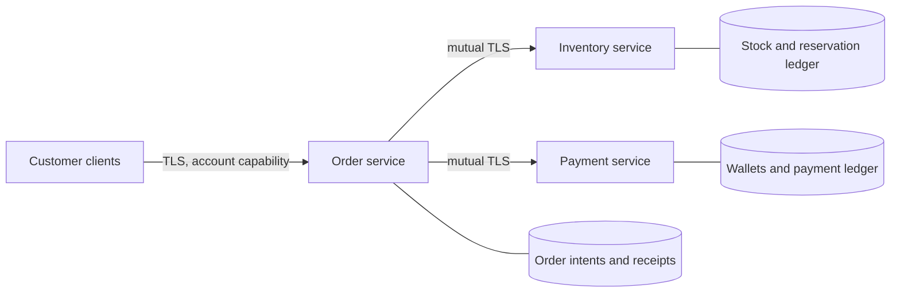

# Distributed ticket checkout

A small commerce application based on the reservation/payment saga used by online
shops and ticket sellers. It has three independently restartable processes with
separate SQLite databases and real Cap'n Proto RPC connections:



Each RPC endpoint can use legacy or portable independently. Tests also run mixed
drivers. There is no shared memory or database between the three services.
The example uses local development TLS names; the tests run the actual server
executables, not in-memory service substitutes.

## Customer behavior

- `login` returns a `Customer` capability bound to one account. Request parameters
  cannot select a different account afterward. Internal ledgers require a client
  certificate that public customers do not receive.
- A purchase takes an idempotency key and 1–8 tickets. Tickets cost 1,000 cents
  each, or 900 cents each for quantities of at least three. The server computes
  the price. Repeating a key with the same quantity returns the same order;
  changing the quantity returns a conflict.
- An order starts `Processing`, then becomes `Confirmed` or `Declined`.
  The `cents` field is its quoted price. A confirmed receipt means exactly one
  stock allocation and charge. Declined/cancelled orders have no net charge.
- Cancellation returns `Cancelling` while release/refund is still outstanding.
  It becomes `Cancelled` only after both services acknowledge compensation.
  A cancellation that wins before confirmation prevents confirmation, even if
  money was already captured. Once confirmed, this example refuses cancellation
  and returns the unchanged confirmed receipt.
- Cancelling an unknown key creates a permanent cancelled tombstone. A delayed
  purchase with that key cannot restart the purchase. Use a fresh key for a new
  purchase, including after a terminal decline.
- A transport error means the outcome is unknown. Retry with the **same** key;
  do not create a second purchase with a new key merely because a reply was lost.
- `buy` pipelines `Order.settled()` through the promised capability returned by
  `Customer.place()`, exercising dependent capabilities over a live connection.

## Recovery and concurrency

Each service uses SQLite WAL transactions with `synchronous=FULL`. No database
transaction or mutable borrow spans an RPC await. The order service commits
acceptance/cancellation intent before replying, scans unfinished orders on
startup, and retries resource operations with the same immutable identity.

Inventory and payments record `Held`, `Committed`, `Released` or `Rejected` for
each order. Retries cannot debit twice. Releases create tombstones even when a
reserve has not arrived yet; late reserves and commits cannot undo them. A final
conditional order update resolves the confirmation/cancellation race. Pending
cancellation remains visible while a ledger is unavailable.

Accepted resource work may continue after its caller disconnects, as can a real
remote payment request. Server-owned jobs are bounded. The process tests exploit
this behavior to release a delayed reservation **after cancellation has already
completed**. This tests the tombstone fence rather than relying on cancelling an
RPC future to roll back a remote operation.

## Run the application

From the repository root, generate short-lived development credentials and an
empty state directory once:

```sh
cargo run --locked --manifest-path examples/configurations/Cargo.toml \
  --bin example-credentials -- /tmp/checkout-pki
mkdir -p /tmp/checkout-state
```

The checked-in `config.dev.json` contains **public development tokens**, not
production credentials. Use a private configuration and provisioned certificates
for your own deployment. The credential tool refuses to overwrite an existing
PKI directory.

Terminal 1:

```sh
cargo run --locked --manifest-path examples/checkout/Cargo.toml --bin checkout-node -- \
  inventory --listen 127.0.0.1:4701 --db /tmp/checkout-state/inventory.sqlite \
  --config examples/checkout/config.dev.json --cert /tmp/checkout-pki/server.pem \
  --key /tmp/checkout-pki/server-key.pem --ca /tmp/checkout-pki/ca.pem
```

Terminal 2:

```sh
cargo run --locked --manifest-path examples/checkout/Cargo.toml --bin checkout-node -- \
  payments --listen 127.0.0.1:4702 --db /tmp/checkout-state/payments.sqlite \
  --config examples/checkout/config.dev.json --cert /tmp/checkout-pki/server.pem \
  --key /tmp/checkout-pki/server-key.pem --ca /tmp/checkout-pki/ca.pem
```

Terminal 3:

```sh
cargo run --locked --manifest-path examples/checkout/Cargo.toml --bin checkout-node -- \
  shop --listen 127.0.0.1:4700 --db /tmp/checkout-state/orders.sqlite \
  --config examples/checkout/config.dev.json --cert /tmp/checkout-pki/server.pem \
  --key /tmp/checkout-pki/server-key.pem --ca /tmp/checkout-pki/ca.pem \
  --client-cert /tmp/checkout-pki/client.pem --client-key /tmp/checkout-pki/client-key.pem \
  --inventory 127.0.0.1:4701 --payments 127.0.0.1:4702
```

Terminal 4:

```sh
export CHECKOUT_TOKEN=alice-development-token
cargo run --locked --manifest-path examples/checkout/Cargo.toml --bin checkout-client -- \
  --address 127.0.0.1:4700 --ca /tmp/checkout-pki/ca.pem --account alice buy purchase-1 3
# Repeat exactly: the same receipt, without buying three more tickets.
cargo run --locked --manifest-path examples/checkout/Cargo.toml --bin checkout-client -- \
  --address 127.0.0.1:4700 --ca /tmp/checkout-pki/ca.pem --account alice buy purchase-1 3
cargo run --locked --manifest-path examples/checkout/Cargo.toml --bin checkout-client -- \
  --address 127.0.0.1:4700 --ca /tmp/checkout-pki/ca.pem --account alice list
```

Restart processes with the same database paths to recover their state. Select
`--driver legacy` on any node/client to mix implementations. `--help` lists
configuration flags. A confirmed purchase is not cancellable in this model;
`cancel purchase-1` returns its confirmed receipt.

## Check correctness

```sh
cargo test --locked --manifest-path examples/checkout/Cargo.toml -- --test-threads=1
# The shared local/required-CI integration entry point includes this application:
cargo run --locked -p capntproto-dev -- examples --native-only
# Longer reproducible history campaign:
CHECKOUT_HISTORY_SEEDS=512 cargo test --locked --manifest-path examples/checkout/Cargo.toml \
  --test distributed concurrent_user_histories -- --nocapture
```

The default campaign records 64 histories per topology, with seven concurrent
purchase/cancel/view operations through three independent customer connections.
Four topologies cover both homogeneous implementations and both mixed directions.
Topology vectors name the client, order, inventory and payment drivers in that order.
The independent checker exhausts legal operation orderings consistent with
observed real-time intervals. It permits asynchronous settlement, while rejecting
lost updates, payload changes, non-monotonic receipts and confirmation after an
acknowledged cancellation. Failures include the seed and complete history.

A second independent oracle compares public terminal receipts and accepted keys
to both ledgers and the provisioned stock/money supply. It checks no overselling,
o overdraft, no duplicate charge, correct bulk prices, no missing accepted order,
no leaked hold, and complete compensation. Mutation controls feed both checkers
known-bad histories/ledgers to verify that they reject those failures.

Process tests also force these specific schedules with durable one-shot
failpoints and file barriers, not probabilistic sleeps at commit boundaries:

| Failure or race | Required customer outcome |
| --- | --- |
| 24 buyers contend for scarce stock and funds; receipts replay | No overselling, overdraft or duplicate effects |
| Reservation waits until after cancellation finishes | Remains cancelled; no stock/fund resurrection |
| Cancel after capture, before order confirmation | Refund and stock restoration before `Cancelled` |
| Cancel while payment rejection is in flight | Cancellation wins; no refund of money never debited |
| Payment process exits after capture, before reply | Retry recovers one confirmed purchase and one charge |
| Order process exits after durable acceptance, before reply | Same-key retry recovers the original order |
| Payment outage, then order crash during compensation | Cancellation remains pending, then recovers fully |
| Restart all three processes | Confirmed receipts, balances and cancel tombstones survive |
| Wrong credentials or public access to a ledger | Access rejected; account namespaces remain isolated |
| Order process crashes during a CLI purchase | Nonzero exit with clean stdout; same-key retry recovers |

Test-only `--faults` plans are outside the business schema. Their one-shot markers
are stored durably so restarting a crashed process does not reinject the same
crash. `.hit`, `.resume` and `.done` barriers live only in temporary test
folders. Child processes are reaped on success and killed on test failure.

This is a bounded correctness campaign, not a proof over every possible
execution. It assumes functioning local durable storage and trusted service
operators. It demonstrates a recoverable single order authority; it does not
implement replicated consensus, multi-region availability or a real payment
provider. Timeouts preserve pending/unknown outcomes rather than claiming an
operation failed without side effects.
